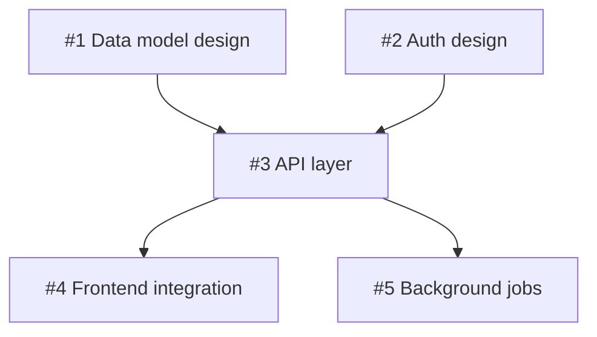

# Fabrik User Guide

Fabrik is an automated Claude Code SDLC driver powered by GitHub Issues and Projects.
This guide covers everything you need to set up, configure, and use Fabrik effectively.

For a quick overview see the [README](../README.md).
For details on the internal stage lifecycle, see [Stage Lifecycle](stage-lifecycle.md).
For the authoritative engine state-machine spec (label semantics, review gate transitions, marker handling), see [State Machine](state-machine.md).

---

## Table of Contents

1. [Getting Started](#1-getting-started)
2. [Configuration Reference](#2-configuration-reference)
3. [Workflow Patterns](#3-workflow-patterns)
4. [Stage Reference](#4-stage-reference)
5. [Plugin & Skills](#5-plugin--skills)
6. [Labels Reference](#6-labels-reference)
7. [Permissions](#7-permissions)
8. [TUI Dashboard](#8-tui-dashboard)
9. [Observability](#9-observability)
10. [Webhook Mode](#10-webhook-mode)
11. [Troubleshooting](#11-troubleshooting)

---

## 1. Getting Started

### Prerequisites

- Go 1.26.1+
- [Claude Code CLI](https://docs.anthropic.com/en/docs/claude-code) installed and authenticated
- A GitHub token with `repo`, `project`, and `workflow` scopes
  - Fine-grained tokens (`github_pat_...`) are **not supported** — GitHub Projects v2 GraphQL doesn't work with them
  - A classic personal access token (`ghp_...`) and a `gh` CLI OAuth token (`gho_...`, via `gh auth token`) both work. The shortest path, given `gh auth login` is already required below, is `FABRIK_TOKEN=$(gh auth token)` — note this rotates on re-auth. Create a classic PAT instead at: https://github.com/settings/tokens (select "Tokens (classic)")
  - If a fine-grained token is detected at startup, Fabrik prints a `[warn]` message and subsequent API calls include an actionable hint; see [GitHub API Returns 401 or Fine-Grained Token Warning](#github-api-returns-401-or-fine-grained-token-warning)
- A GitHub Project (v2) with board columns matching your stage names


### Initial Setup

**Option A: Install binary (requires `gh`)**

```bash
# Requires: gh auth login (with access to handarbeit/fabrik)
cd ~/bin  # or any directory on your PATH
gh release download --repo handarbeit/fabrik \
  --pattern "fabrik_*_$(uname -s | tr A-Z a-z)_$(uname -m | sed 's/x86_64/amd64/' | sed 's/aarch64/arm64/').tar.gz" \
  -O - | tar xz
# Platform-specific alternatives:
#   darwin/arm64:  --pattern "fabrik_*_darwin_arm64.tar.gz"
#   darwin/amd64:  --pattern "fabrik_*_darwin_amd64.tar.gz"
#   linux/amd64:   --pattern "fabrik_*_linux_amd64.tar.gz"
#   linux/arm64:   --pattern "fabrik_*_linux_arm64.tar.gz"
```

**Option B: Build from source (requires Go)**

```bash
# Build
go build -o fabrik .
```

Then initialize:

```bash
# Initialize stage configs, plugin, and config template
./fabrik init
# Creates:
#   .fabrik/stages/       — stage YAML configs
#   .fabrik/plugin/       — Claude Code plugin
#   .fabrik/config.yaml   — project config template (edit this)
# Updates:
#   .git/info/exclude     — adds .fabrik/repos/, .fabrik/worktrees/, .fabrik/debug/,
#                           .fabrik/history.json, and .fabrik/warnings.json so they
#                           don't appear as untracked in git status (local excludes,
#                           not committed to the repo)
```

Pass your GitHub Project URL to auto-populate `owner`, `project`, and `owner_type` in
`config.yaml`. The `--user` flag enables fully non-interactive setup:

```bash
./fabrik init --user you https://github.com/orgs/your-org/projects/5
# or for a personal project:
./fabrik init --user you https://github.com/users/you/projects/3
```

Without a URL, `fabrik init` behaves as before: if your terminal is interactive it
prompts for owner, repo, project number, and username; otherwise it writes a
fully-commented template for you to fill in.

**GitHub Enterprise Server project URLs are also accepted.** Pass `--ghes-host` (or
set `FABRIK_GHES_HOST`) alongside a project URL on your GHES instance:

```bash
./fabrik init --user you --ghes-host github.example.com \
    https://github.example.com/orgs/your-org/projects/5
```

`init` runs before `.fabrik/config.yaml` exists, so the host can only come from the
flag or environment variable at this point — never from `config.yaml`. The resolved
host is written into the generated config (`ghes_host: github.example.com`), so you
only need to supply it to `init` once; every subsequent `fabrik` invocation picks it
up from `config.yaml`. See [GitHub Enterprise Server
Support](#github-enterprise-server-support) below for the full effect of `ghes_host`.

To refresh plugin skills without touching stages or config (e.g., after upgrading Fabrik):

```bash
./fabrik upgrade
```

> **Note:** `fabrik upgrade` also migrates your workflow configuration: it qualifies the
> skill references in `.fabrik/stages/*.yaml` and, if you have edited files under
> `.fabrik/plugin/`, moves those edits into `.fabrik/plugins/local-workflows/`. It never
> commits; review and commit the result. See
> [Workflow migration](#workflow-migration-fabrik-upgrade). `--force` overwrites local
> edits unconditionally and `--reconcile` prints a guided merge prompt; see
> [Upgrade protection for customized skills](#upgrade-protection-for-customized-skills).

Edit `.fabrik/config.yaml` with your project settings and commit it to git. Add your
GitHub token to a gitignored `.env` file:

```
# .env (gitignored — keep secrets here)
# Required scopes: repo, project, workflow
# A classic PAT (ghp_...) or a `gh` CLI OAuth token (gho_..., via `gh auth token`) both
# work — fine-grained tokens (github_pat_...) do not. Shortest path if `gh auth login`
# is already done: FABRIK_TOKEN=$(gh auth token) — rotates on re-auth. Otherwise create
# a classic PAT at: https://github.com/settings/tokens (select "Tokens (classic)")
FABRIK_TOKEN=ghp_...

# Optional: run this instance's Claude invocations against a different Claude
# account/subscription. See "Alternate Claude Profile (CLAUDE_CONFIG_DIR)" below.
# CLAUDE_CONFIG_DIR=/home/user/.claude-alt-profile

# Optional: explicit opt-in to API billing instead of subscription billing.
# An ambient ANTHROPIC_API_KEY here is scrubbed by default and never reaches
# Claude invocations on its own — see "Anthropic Auth Namespace Scrub &
# apiKeyHelper Refusal" below.
# FABRIK_ANTHROPIC_API_KEY=sk-ant-...
```

> **Note:** When a `.git/` directory is present, Fabrik refuses to start if `.env` exists but is not listed in `.gitignore` (prevents accidental token leaks). In directories **without** `.git/` — containers, CI workspaces, or bare directories — this check is skipped and `.env` is loaded normally without requiring a `.gitignore` entry.

### Create a Project Board

**Recommended (organization-owned repos): let Fabrik create it.** Fabrik's most common
onboarding failure has always been a hand-built board whose column names don't exactly
match the stage names in `.fabrik/stages/*.yaml` — a human retyping nine names into
GitHub's UI. `fabrik init --create-board` removes that step entirely: it creates a fully
configured Project (v2) board directly from the stage configs it just extracted, in
stage order, so the board and your stage configs can never disagree.

```bash
./fabrik init --create-board --owner your-org
```

`--repo` is optional. Fabrik discovers repositories from the items on the board, so a
board needs no repository link to work. Pass `--repo your-repo` only if you want the
board linked to that repository (it then shows on the repo's Projects tab) and
`.fabrik/config.yaml` scoped to it (`repo:`, single-repo mode). Without it, the board is
created unlinked and the config is multi-repo.

This requires a GitHub token (`--token`, `FABRIK_TOKEN`, or `GITHUB_TOKEN`) with `repo`
and `project` scopes, same as the daemon itself. On success it writes the new project's
number, owner, and owner type into `.fabrik/config.yaml` for you. It also creates the
display-only project fields — `Fabrik` (Text, the [status line](#project-board-status-line)),
`Last activity` (Date) and `Last run` (Text) — under the names `project_fields.*` resolves
to, skipping any set to `off`. If creating a field fails, the board is kept and recorded in
the config, the failed field is named, and the command exits non-zero: run `fabrik
repair-board --apply` to finish. `--title` sets the
board's title (default: `"<repo> Fabrik Pipeline"`, or `"<owner> Fabrik Pipeline"` without `--repo`).

If `.fabrik/config.yaml` already has an `owner`/`project` configured — this repo has
already been onboarded — `--create-board` refuses rather than creating a second board
your config wouldn't end up pointing at; pass `--force` if you really do want a fresh
board and are prepared to overwrite the existing config with its details.

This works with an ordinary personal access token as well as a GitHub App token, so it
is available to every user today — it does **not** depend on GitHub App support (#770).
It is **organization-owned repos only**: Fabrik refuses explicitly, naming the reason,
if `--owner` resolves to a user account rather than an organization (see [Repairing an
Existing Board](#repairing-an-existing-board) below for the same restriction on repair).

**Manual setup (user-owned repos, or if you prefer to build it by hand):** create a
GitHub Project (v2) for your repository yourself. Add board columns that correspond to
your stage names -- the column name must match the `name` field in each stage YAML file
exactly (case-sensitive). The default pipeline uses:

`Backlog` -> `Specify` -> `Research` -> `Plan` -> `Implement` -> `Review` -> `Validate` -> `Queued` -> `Done`

`Queued` is a holding column, not a pipeline stage — it's used only when [merge-train](#merge-train--queued) is enabled, but `fabrik init` extracts its stage YAML unconditionally, so it's still part of the required column set from the start.

Then edit `.fabrik/config.yaml`'s `owner`, `repo`, `project`, and `owner_type` to point at
it (see [First Run](#first-run) below).

### Repairing an Existing Board

If you add a stage after your board was already created — or your board predates a
`fabrik init` that would have created it with every stage's column — `fabrik
repair-board` adds the missing columns without disturbing anything already on the
board:

```bash
./fabrik repair-board          # dry run: prints which columns and display fields are missing, changes nothing
./fabrik repair-board --apply   # adds the missing columns and display fields
```

`repair-board` also checks the three display-only fields (`Fabrik`, `Last activity`,
`Last run`, or the names set in `project_fields.*`; a field set to `off` is skipped), so a
board that predates them gains them without a trip to Project settings. Field handling is
create-only: a field that already exists with the right type is reported as present, and
one that exists with the **wrong** type (say, a single-select named `Fabrik`) is reported
as a type mismatch and left untouched — Fabrik never deletes, renames, retypes or
recreates a field. A failure creating one field does not stop the others or the Status
repair; the command exits non-zero and names the field that failed. A second `--apply`
is a no-op that reports everything present.

If an enabled display field is missing from the board, Fabrik also records a **Display fields
missing** entry in the TUI warnings panel at startup, naming the fields and offering
`fabrik repair-board --apply` as the fix (on a user-owned board, which `repair-board` cannot
change, it asks you to create them by hand). A field whose name is taken by a field of another
type gets its own entry with no fix. The entry clears the next time Fabrik starts after the fields
exist, or once you set the missing ones to `off`.

Repair never removes a column and never reorders existing ones. Most importantly, it
never regenerates an existing column's underlying id — doing so would silently clear
every item's Status, since GitHub's `updateProjectV2Field` mutation replaces the entire
option list in one call. Repair always echoes back every existing option's id
unchanged and only appends the columns your stage configs are missing, so no item ever
loses its place in the pipeline. Like board creation, repair is organization-owned
repos only, and refuses explicitly on a user-owned board.

### Compatibility Notes

> **Warning:** Global Claude Code plugins can interfere with Fabrik's headless sessions. Do not install global plugins on machines running Fabrik as a service. The `superpowers` plugin is a known offender — if installed globally, it injects unexpected behaviour into Fabrik's Claude sessions and causes duplicate comments on issues.
>
> To check for the problematic plugin:
> ```bash
> ls ~/.claude/plugins/cache/claude-plugins-official/
> ```
> If `superpowers` appears, remove it:
> ```bash
> rm -rf ~/.claude/plugins/cache/claude-plugins-official/superpowers
> ```
> See [§11 Troubleshooting → Duplicate Comments on Issues](#11-troubleshooting) for full details.

### First Run

With settings in `.fabrik/config.yaml`:

```bash
./fabrik
```

Or pass settings as flags:

```bash
./fabrik \
  --owner your-org \
  --repo your-repo \
  --project 1 \
  --user your-github-username
```

Fabrik polls the project board every 30 seconds by default (configurable with `--poll`
or `poll:` in `config.yaml`).

**Idle backoff**: When nothing needs work, Fabrik progressively slows down polling to conserve API rate limit budget. The backoff is time-based — after 5 minutes of idle polls, the interval doubles; after 10 minutes it quadruples; after 20 minutes it caps at 5 minutes. Any activity (items dispatched or deep-fetched) immediately resets the interval to the configured value. Press `w` in the TUI to wake polling instantly if you've just made changes on the board.

| Idle duration | Effective interval | At 30s base |
|---|---|---|
| 0–5 min | 1× (configured) | 30s |
| 5–10 min | 2× | 60s |
| 10–20 min | 4× | 120s |
| 20+ min | max (5 minutes) | 300s |

**Rate-limit backoff**: When Fabrik detects GraphQL API quota pressure, the same interval infrastructure adds a separate rate-limit component that escalates as quota depletes. There is no separate 5-minute ceiling for the rate-limit contributor — it can exceed 5 minutes when the configured base interval is large. The effective poll interval is `max(idle interval, rate-limit interval)`, so whichever is larger governs at any given moment.

| Remaining GraphQL quota | Multiplier | At 30s base | At 60s base |
|---|---|---|---|
| >=10% (incl. sticky zone 20%–50%) | 2× | 60s | 120s |
| >=5% and <10% | 4× | 120s | 240s |
| >=1% and <5% | 6× | 180s | 360s |
| <1% | 10× (cap) | 300s | 600s |

Rate-limit backoff uses two-threshold hysteresis to prevent thrashing: it **activates** when GraphQL remaining quota drops below **20%** of the hourly limit, and **clears only when quota rises above 50%** of the limit. While quota is recovering (20%–50%, sticky zone), the 2× tier applies. Activity detection (items deep-fetched or dispatched) resets idle backoff but does NOT reset rate-limit backoff — the two concerns are independent. When rate-limit backoff is active, Fabrik logs the effective poll interval each cycle so operators can observe the actual cadence.

**Board fetch resilience**: `FetchProjectBoard` automatically retries up to 3 times (with 1s/2s backoff) when GitHub returns an empty response (zero items), which occurs during transient Projects v2 indexer degradation that intermittently returns empty boards for non-empty projects (both returned node count and `totalCount` are zero in degraded responses). The log line:

```
[warn] project board fetch returned N items, totalCount=M (attempt X/3) — retrying in case of indexer hiccup
```

indicates the retry is occurring. It is transient and requires no user action unless it persists across all three attempts (in which case Fabrik accepts the last response and continues, which may appear as a temporarily idle engine).

Move an issue to `Specify` on the board to start processing it.

### Git Repositories and Worktrees

Fabrik always bare-clones each managed repository on first access. Run Fabrik from any directory (no need to be inside a git checkout of a managed repo):

```bash
mkdir ~/my-fabrik-dir && cd ~/my-fabrik-dir
fabrik init
./fabrik --owner myorg --project 5 --user me
# No --repo needed — Fabrik processes all repos on the board
```

Fabrik **always bare-clones** each managed repository on first access:
- Bare clones are stored at `.fabrik/repos/<owner>-<repo>.git`
- Worktrees are created at `.fabrik/worktrees/<owner>-<repo>/issue-N/` on branch `fabrik/issue-N`
- One worktree manager runs per discovered repository, all sharing the same poll loop

**`.fabrik/repos/` is excluded from git tracking by default** (gitignored). Bare clone directories can be very large and should not be committed to your repository. When you run `fabrik init` inside a git repo, these paths are also added to `.git/info/exclude` automatically.

To restrict processing to a single repository, pass `--repo owner/repo`.

The `.fabrik/` directory (config, stages, plugin) always lives in the directory where you run `fabrik`.

**An already-landed issue branch is not reused.** When the local `fabrik/issue-N` branch is missing, Fabrik normally recreates it from `origin/fabrik/issue-N`. After a `fabrik:revalidate`, a reopen or a landing-verification failure, that remote branch can be merged history, and adopting it would give phantom diffs and conflicts. Fabrik instead forks a fresh branch from the base, with one log line saying why, when the origin tip is already on the base branch, or equals the head of a merged PR for the item (its linked PR, or the PR named by its `fabrik:credited-pr:<N>` label, which covers squash and rebase merges). A branch with unmerged commits is still adopted, and so is one whose ancestry check fails. Adopting a branch whose open PR targets a different base logs `warn: base mismatch`, naming both bases.

### Multi-Repo Support

Fabrik can manage issues across every repository on the board in a single run. To enable multi-repo mode, omit (or comment out) the `repo:` field in `.fabrik/config.yaml` — Fabrik then discovers repositories lazily from the project board and processes issues from all of them. Each repository gets its own bare clone at `.fabrik/repos/<owner>-<repo>.git` and its own set of worktrees, all driven by the same poll loop.

#### Write-access gating for board-derived repos

Because repos are discovered from board items rather than configured explicitly, tracking an upstream issue on your own board (a normal GitHub Projects workflow) can surface a repo you don't administer. Fabrik checks the configured token's write access to each newly discovered repo (piggybacked on the same API call already used for the `allow_auto_merge` check — no extra request) before seeding any labels or evaluating `allow_auto_merge` on it:

- A repo the token **can** write to is managed exactly as before: labels are seeded, `allow_auto_merge` is checked, and its board items are dispatched into the pipeline normally.
- A repo the token **cannot** write to is skipped entirely: no label-mutation requests are made against it, no `allow_auto_merge` warning is printed (its only fix requires admin rights the operator doesn't have), and its board items are **not processed at all** — not even read-only. Nearly every stage past Specify/Research needs to push commits and open PRs, which requires exactly the access already found absent, so partial processing would only fail later and less clearly. Fabrik logs a one-time notice naming the repo and reason instead.

The access determination is cached per repo for the life of the process — it costs one API call the first time a repo is seen, never repeated on later polls.

### Git Clone Protocol (HTTPS vs SSH)

By default, Fabrik uses HTTPS to bare-clone managed repos (`https://github.com/<owner>/<repo>.git`). Users who authenticate via SSH keys can switch to SSH clone URLs instead.

#### Using SSH

Pass `--ssh` on the command line or add `git_ssh: true` to `.fabrik/config.yaml`:

```bash
# One-time: use SSH for this run
fabrik --ssh --owner myorg --project 5 --user me

# Persistent: add to .fabrik/config.yaml
git_ssh: true
```

The environment variable `FABRIK_GIT_SSH=true` is also supported (useful in CI).

When SSH mode is active, Fabrik uses `git@github.com:<owner>/<repo>.git` as the clone URL. This requires your SSH key to be registered with GitHub and accessible via `ssh-agent`.

> **Startup behavior with SSH mode:** When `--ssh` / `git_ssh: true` is set, Fabrik suppresses the HTTPS credential helper startup check (described below) — it is not applicable. No equivalent SSH agent availability check runs at startup. If your SSH key is absent or unloaded when a clone or fetch runs, git will fail at that point rather than at startup. To verify your agent before running Fabrik: `ssh -T git@github.com`.

#### HTTPS Credential Helper Warning

When using HTTPS (the default), Fabrik checks at startup whether a git credential helper is configured. If none is found, you'll see an advisory warning:

```
[startup] warn: no git credential helper configured; HTTPS cloning may prompt for credentials.
[startup] warn: configure one (e.g. git-credential-osxkeychain) or use --ssh / git_ssh: true in .fabrik/config.yaml.
```

This warning is non-fatal. If you use a GitHub token in your environment (`FABRIK_TOKEN` or `GITHUB_TOKEN`) and your git is configured to use it (e.g., via a credential helper or token-in-URL), cloning will work without further configuration.

To resolve the warning, either:
- Configure a credential helper: `git config --global credential.helper osxkeychain` (macOS), or `git config --global credential.helper store`
- Or switch to SSH mode with `--ssh` / `git_ssh: true`

#### Existing Bare Clones

**Switching between HTTPS and SSH does not re-clone existing bare repos.** Once Fabrik has cloned a repo, it reuses the existing bare clone with its original remote URL. The SSH/HTTPS setting only affects new clones.

If you switch to SSH mode after existing bare clones were created, those clones will continue to fetch via HTTPS. To switch an existing bare clone to SSH, update its remote URL directly:

```bash
git -C .fabrik/repos/owner-repo.git remote set-url origin git@github.com:owner/repo.git
```

#### URL Rewriting

If you have `url.<base>.insteadOf` configured in your global `~/.gitconfig` (a common way to redirect HTTPS to SSH globally), Fabrik will notice at startup and print an informational message. Git applies URL rewriting transparently, so Fabrik's HTTPS clone URLs will automatically use your SSH configuration — no additional Fabrik setting is needed.

> **GitHub Enterprise Server:** clone URLs (both HTTPS and SSH) are built against the configured `ghes_host` when set, instead of `github.com`. See [GitHub Enterprise Server Support](#github-enterprise-server-support) below.

### GitHub Enterprise Server Support

Fabrik can run against a GitHub Enterprise Server (GHES) instance instead of github.com. This was verified against a live GHES 3.19.8 instance with full API parity for everything Fabrik uses — no adapter layer, schema introspection, or capability negotiation is involved. It's pure endpoint/host configuration.

#### Configuring a GHES host

Set the hostname of your GHES instance (no scheme, no trailing slash) via any of the usual precedence layers:

```bash
# Flag
fabrik --ghes-host github.example.com --owner myorg --project 5 --user me

# Environment variable
export FABRIK_GHES_HOST=github.example.com

# .fabrik/config.yaml
ghes_host: github.example.com
```

Precedence is flag > `FABRIK_GHES_HOST` > `config.yaml`'s `ghes_host`, matching every other setting. A value with a `https://`/`http://` scheme or a trailing `/` is normalized automatically, so `https://github.example.com/` and `github.example.com` are equivalent.

**Absent any GHES configuration, behavior is exactly today's github.com behavior** — this is the default path and does not regress.

Once configured, the GHES host governs:
- **REST and GraphQL API endpoints** — REST resolves to `https://<host>/api/v3/...`, GraphQL to `https://<host>/api/graphql`. These are independently derived, not one path-suffixed from the other — GHES puts them at different paths (`/api/v3/graphql` is a 404 on GHES; `/api/graphql` is the correct endpoint).
- **Bare-clone URLs** — both the HTTPS and SSH forms (`--ssh` / `git_ssh: true` still selects which protocol is used; see [Git Clone Protocol](#git-clone-protocol-https-vs-ssh) above).
- **Commit author noreply email** — Fabrik-authored commits use `<user>@users.noreply.<host>` instead of `<user>@users.noreply.github.com`. **Note:** this mirrors github.com's own noreply-email convention with the configured host substituted, but has not been verified against a live GHES instance's actual private-commit-email behavior — GitHub's published GHES admin documentation does not explicitly confirm this format. If your GHES instance uses a different convention, please file an issue.
- **`GH_HOST` in stage-worker subprocess environments** — every Claude-invoked stage worker's `gh` CLI calls (e.g. the `validate` skill's Pre-Completion Gate, which runs `gh pr view` on every invocation) are pointed at the same GHES instance as the engine, via the `gh` CLI's own `GH_HOST` convention. See [Subprocess Environment](#subprocess-environment).
- **`fabrik init`'s project-URL parsing** — a GHES project URL is accepted alongside github.com URLs when `--ghes-host`/`FABRIK_GHES_HOST` is supplied to `init`. See the `fabrik init` walkthrough near the top of this guide.

**Self-upgrade (`--auto-upgrade`) stays on github.com, unauthenticated, when a GHES host is configured.** Fabrik's own releases always live at `github.com/handarbeit/fabrik`, never on your GHES instance. Your configured token authenticates your GHES host, not github.com, so it is never sent with the release-check/download request — sending it would fail outright with "Bad credentials" rather than falling back to unauthenticated. Since `handarbeit/fabrik`'s releases are public, self-upgrade still works unauthenticated; it's just subject to github.com's lower unauthenticated rate limit. See [Auto-upgrade](#auto-upgrade) below.

#### Minimum supported version

Fabrik requires **GHES 3.19 or later**. At startup, when a GHES host is configured, Fabrik queries the instance's unauthenticated `/meta` endpoint for `installed_version` and refuses to start if it's below the floor:

```
GHES instance github.example.com reports version 3.18.5, below Fabrik's minimum supported version 3.19 —
upgrade the GHES instance or remove the ghes_host configuration. See docs/USER_GUIDE.md
```

If the `/meta` fetch itself fails (network error, auth problem), Fabrik logs a non-fatal warning and continues — connectivity issues surface more clearly moments later when the project board fetch runs. This preflight only applies when a GHES host is configured; github.com deployments never see it.

#### Known limitations

A few advisory-only, non-gating features still hardcode `github.com` and have not been updated for GHES:
- The startup board-validation check's human-facing project board URL link.
- The URL-rewrite and HTTPS-credential-helper startup checks' SSH-rewrite detection heuristics.

None of these affect correctness — they may just show a `github.com`-shaped link or an inapplicable advisory message on a GHES deployment. Webhook support and `projects_v2_item` availability on GHES are also unverified; Fabrik always falls back to polling when webhooks aren't available, so this is not a blocker.

### GitHub App Authentication

Fabrik can authenticate to GitHub as a **GitHub App installation** instead of a personal access token. This is a second, **co-equal** authentication path — not a replacement, not a recommended upgrade, and not a deprecation of PAT mode. A user-owned project board can never use App auth at all (see "Organization boards only" below), so a personal access token remains the only option in that case, permanently.

App auth gives the engine its own rate-limit bucket (separate from any human's PAT, and larger — GitHub scales installation limits with the organization's repo and user count) and a stable `fabrik[bot]` identity on every issue/PR/comment it creates, instead of appearing as whichever human's token happens to be configured.

**The engine itself is compat mode only.** It consumes an App ID, private key, and installation ID for a GitHub App you have already created and installed — manually via GitHub's own App-creation UI, or via `fabrik init --github-app` below. The engine never runs the manifest/browser bootstrap flow itself; that's `fabrik init --github-app`'s job.

#### No user, no PAT — the App is the identity

An App-authenticated deployment is self-contained: it needs **no `user:`** and **no `FABRIK_TOKEN`/`GITHUB_TOKEN`**. `fabrik init --github-app` does not ask for a GitHub username, and startup accepts an App config with `user` unset (PAT mode still requires `user`). Everything that a PAT-mode deployment attributes to a person is derived from the App instead:

| Where | PAT mode | App mode |
|---|---|---|
| Commit author/committer | `<user>` / `<user>@users.noreply.github.com` | `<slug>[bot]` / `<bot-user-id>+<slug>[bot]@users.noreply.github.com` — GitHub's documented form, so commits link to the App's avatar. The bot user ID is looked up once at startup (`GET /users/<slug>[bot]`); if that lookup fails, startup logs a warning and uses the ID-less `<slug>[bot]@users.noreply.github.com` (still authored by the App, but not avatar-linked), upgrading it on a later start once the lookup succeeds |
| Lock label | `fabrik:locked:<user>` | `fabrik:locked:<slug>-<hash>` — see "Lock identity" below |
| "Awaiting input" `@mention` | the configured `user` | the issue's assignees, or its author when unassigned; nobody when neither resolves. A bot login (including this App itself) is never mentioned |
| Spawned-child assignees | the configured `user` | the parent's human assignees, or none. If GitHub rejects an inherited assignee (HTTP 422 — e.g. not assignable in the child's repo) the child is created unassigned and a warning is logged |
| TUI stop comment | "stopped from TUI by `<user>`" | "stopped from TUI" |
| Release-upgrade check | authenticates with the PAT | unauthenticated — Fabrik's release repo is public on github.com, and an installation token is scoped to your organization, not to it |

**A leftover `user:` is tolerated and ignored.** An existing App deployment that still has `user:` configured keeps starting; the value is not used for the commit identity, lock label, mentions, or spawn assignees (App auth wins over it just as it wins over a coexisting PAT), and startup logs one line saying so. Likewise a leftover `FABRIK_TOKEN` is never used under App auth. The one thing the leftover `user:` is still read for is a **one-time cleanup**: at startup, Fabrik removes a `fabrik:locked:<user>` label left on an item by a pre-App run of this instance (a crash while locked) when no worker in this process holds it, so a switch from PAT to App mode does not strand items. Only a label applied more than two hours ago is removed (a PAT-mode instance still running as that user may legitimately hold a younger one), and one whose age cannot be read is left; either case is logged, and you remove the label by hand once you are sure no other instance holds it.

**Lock identity.** The `<hash>` in `fabrik:locked:<slug>-<hash>` is six hex characters of a hash of this machine's hostname and Fabrik's working directory, so two local instances that share one App installation hold *different* lock labels and the usual lock-then-verify tie-break between instances keeps working (a single shared label would make each instance read the other's lock as its own). The label never contains `[bot]` and is kept within GitHub's 50-character label limit — an App slug longer than 29 characters is truncated deterministically. Two consequences: the label is stable across restarts on the same host and directory, but **changing the hostname or moving the Fabrik directory changes it**, so a lock left by a crashed instance under the old name has to be removed by hand (`fabrik:locked:<slug>-<old-hash>`). Where the hostname is not stable — a container or Kubernetes pod (the hostname is the container/pod ID and changes on every restart or reschedule) or a laptop whose hostname follows the network — set `FABRIK_INSTANCE_ID` to a stable per-instance string (for example the StatefulSet pod name); it replaces the hostname in the hash, so the label survives restarts. Give each concurrent instance of one App a *different* value (or a different Fabrik directory). Startup logs the derived lock label so you can see what to look for.

**Operator-side CLIs.** `fabrik repair-board` builds an installation client from the `github_app_*` config when no `--token` is given, so it works on an App-only deployment (`fabrik init --github-app --create-board` already did). `fabrik upgrade` and `fabrik watch` are run by an operator at a terminal, not by the daemon: they need no token (`watch` just omits PR/CI status without one), and non-App `fabrik init --create-board` still needs a PAT. Git over SSH (`git_ssh: true`) is an explicit operator choice and out of scope here.

#### Setting up App auth

`fabrik init --github-app` drives setup end to end: register a new App via GitHub's manifest flow (or adopt an existing one), resolve its installation on your organization, verify the installation's granted permissions, and populate `.fabrik/config.yaml` — no manual credential copying or board editing required.

**Creating a new App:**

```bash
fabrik init --github-app --owner myorg
```

This opens (or, headless, prints) GitHub's App-creation page pre-filled with the exact permission set the engine requires. Confirm creation on GitHub, and the flow resumes automatically: it exchanges the resulting code for the App's credentials, writes the private key to `.fabrik/github-app-key.pem` (see "Key storage" below), discovers the installation on `myorg`, verifies granted permissions, and writes `github_app_id`/`github_app_private_key_path`/`github_app_installation_id` into `.fabrik/config.yaml`.

The App is created under `myorg` itself, not your personal account. It is private, and a private App can only be installed on the account that owns it. On a first run it isn't installed yet, so the flow opens its install page. In an interactive terminal it then waits (up to 10 minutes) and carries on by itself as soon as you've installed the App on `myorg`; Ctrl-C stops it. Run non-interactively, it prints the install URL and exits non-zero instead, and is safe to re-run once the App is installed: it reuses the App it created.

**Adopting an existing App** — one you already created by hand or via another tool — using the same `--github-app-id`/`--github-app-private-key-path` flag names the engine's own runtime config uses:

```bash
fabrik init --github-app --owner myorg \
  --github-app-id 123456 \
  --github-app-private-key-path /path/to/private-key.pem
```

Both flags must be given together, or neither — giving only one is refused, since a bare `--github-app-private-key-path` on the create path would risk a fresh manifest bootstrap silently overwriting whatever file already sits there. Add `--github-app-installation-id` to pin a specific installation and skip discovery entirely (useful when the App is installed on more than one account and you want a specific one, or to avoid an extra discovery round trip). All three flags also accept `FABRIK_GITHUB_APP_ID`/`FABRIK_GITHUB_APP_PRIVATE_KEY_PATH`/`FABRIK_GITHUB_APP_INSTALLATION_ID` as a fallback (flag takes precedence) — the same env vars the running engine reads.

`fabrik init --github-app` refuses to run against an already-populated `.fabrik/config.yaml` without `--force` — otherwise a real App would be registered/adopted and credentials minted, only for the write to `.fabrik/config.yaml` to silently no-op (the same reasoning as [Create a Project Board](#create-a-project-board)'s `--force` requirement). It also refuses combination with `--ghes-host`/`FABRIK_GHES_HOST`: App auth doesn't yet support GHES endpoints (see the engine's own equivalent refusal below), so this is caught at setup time rather than surfacing as a confusing startup failure the first time the engine runs.

**Creating the board in the same run:** combine with `--create-board` (see [Create a Project Board](#create-a-project-board)) to also create a fully-configured project board, using the App's own freshly-minted client — no separate `--token` needed, since App auth already carries `organization_projects:write`:

```bash
fabrik init --github-app --create-board --owner myorg
```

If you pass `--repo`, it must be one of the repositories the App's installation can access. With "Only select repositories", init checks this before creating anything and names the repositories the installation does cover, and where to add more.

**Organization-only, at setup time too.** The same restriction [Organization boards only](#organization-boards-only) describes for the running engine applies during setup: `fabrik init --github-app` refuses a user-owned `--owner` outright, before attempting anything else, with the identical wording.

**Permission verification at setup time.** Immediately after minting the installation's first token, setup runs the exact same granted-permission check the engine's own startup performs (see [Startup permission verification](#startup-permission-verification)) — so a shortfall is caught here, not on the engine's first run. If you're **adopting** an App whose installation predates a permission the engine now requires, GitHub never applies a permission increase to an existing installation automatically — an org admin must approve it explicitly:

```
GitHub App installation 789012 is missing required permissions: organization_projects
(required "write", granted "none")
Fabrik cannot change App permissions itself — ask an App owner and an org admin:
  1. App owner: set the permission at https://github.com/organizations/myorg/settings/apps/fabrik/permissions
  2. Org admin: accept the permission request at https://github.com/organizations/myorg/settings/installations/789012
then re-run `fabrik init --github-app`
```

The same refusal — with the same two steps — applies to `actions: write` (see [Startup permission verification](#startup-permission-verification)); an App adopted without it is refused here rather than at the engine's first start.

**Contents permission.** A newly created App always requests `contents: write`, because by default git runs over HTTPS as the installation (see [Git under App auth](#git-under-app-auth)). Verification follows the engine's own rule: `contents: write` is required unless git runs over SSH — `git_ssh: true` in an existing `.fabrik/config.yaml`, `FABRIK_GIT_SSH`, or a global `url.git@github.com:.insteadOf` rewrite. An App created before this change requested only `contents: read`; there is nothing for the installation to approve until the App itself asks for more, so the error names the App's permissions page as the first step:

```
GitHub App installation 789012 is missing required permissions: contents (required "write",
granted "read") (contents:write is needed because git runs over HTTPS as the installation — if
the App does not request it yet, set Contents to "Read and write" at
https://github.com/organizations/myorg/settings/apps/my-app/permissions first; or set
git_ssh: true in .fabrik/config.yaml to keep using your SSH key) — approve the permission
change at https://github.com/settings/installations/789012 ...
```

**`--webhooks`.** GitHub App auth and `--webhooks` cannot currently be combined — see "Not combinable with `--webhooks`" under Known limitations below. `fabrik init --github-app --webhooks` is refused outright at setup time, before any network call, with the same explanation the engine's own startup gives; there's no need to discover the incompatibility later by watching the engine refuse to start. Run the engine with polling (`--reconcile-interval`) instead.

**Key storage.** A freshly created App's private key is written to `.fabrik/github-app-key.pem` (0600, parent directory 0700, written atomically) unless `--github-app-private-key-path` names a different location (adopt path only — see above). Non-key App metadata (App ID, slug, webhook secret, client ID/secret) is written to the fixed, non-configurable `.fabrik/github-app-state.json` — the same file the engine's own compat-mode client construction reads diagnostics-only state from. **Re-keying:** rotate the key on the App's GitHub settings page, then replace the file at your configured `github_app_private_key_path`; the engine's own startup detects a key that doesn't match its recorded fingerprint and fails loudly with a repair-needed error rather than silently misauthenticating. Both default paths are added to `.git/info/exclude` by `fabrik init` (alongside the other Fabrik working directories it already excludes) so a routine `git add .` in your project can't accidentally commit the private key — unlike `.fabrik/config.yaml`, which is meant to be committed, these are per-operator secrets. A custom `--github-app-private-key-path` outside `.fabrik/` is not auto-excluded; add it to your own `.gitignore` if needed.

**Non-interactive use.** In a headless environment (no TTY on stdin), browser auto-launch is skipped automatically — the App-creation URL is always printed regardless, so you can open it yourself. Every other wait in the flow (installation not yet performed, permissions not yet approved) is a single-shot check, not a poll loop: it fails immediately with the exact next step and exits non-zero, safe to re-run once you've completed that step. Pass `--no-browser` explicitly to force this behavior even on a TTY.

#### Configuring App auth

Set all three of the following together via any of the usual precedence layers (flag > `FABRIK_GITHUB_APP_*` env var > `.fabrik/config.yaml`):

```bash
# Flags
fabrik --github-app-id 123456 \
  --github-app-private-key-path /path/to/private-key.pem \
  --github-app-installation-id 789012 \
  --owner myorg --project 5

# Environment variables
export FABRIK_GITHUB_APP_ID=123456
export FABRIK_GITHUB_APP_PRIVATE_KEY_PATH=/path/to/private-key.pem
export FABRIK_GITHUB_APP_INSTALLATION_ID=789012

# .fabrik/config.yaml
github_app_id: 123456
github_app_private_key_path: /path/to/private-key.pem
github_app_installation_id: 789012
```

**All three must be set together, or none at all.** A partial set (e.g. an App ID with no private key path) fails startup immediately with a message naming exactly which field is missing — never a silent fallback to PAT mode:

```
GitHub App authentication is partially configured — missing github_app_private_key_path;
github_app_id, github_app_private_key_path, and github_app_installation_id must all be set
together to authenticate as a GitHub App installation, or none of them at all to use a
personal access token (FABRIK_TOKEN) instead. See docs/USER_GUIDE.md
```

**When none of the three are set, nothing changes** — Fabrik authenticates with `--token`/`FABRIK_TOKEN`/`GITHUB_TOKEN` exactly as it always has. No existing `.env` needs modification to keep working.

#### Browser-opening during reconcile

Separately from the one-shot `fabrik init --github-app --no-browser` setup flag above (which controls whether App *creation* opens a browser), the running engine daemon has its own `--no-browser` control, gated by the same precedence layers (flag > `FABRIK_NO_BROWSER` env var > `.fabrik/config.yaml`'s `no_browser`):

```bash
# Flags
fabrik --no-browser=false ...   # re-enable browser-opening (default: suppressed)

# Environment variable
export FABRIK_NO_BROWSER=false

# .fabrik/config.yaml
no_browser: false
```

**The engine's default is the opposite of the setup flow's and of Pruefer's own `no_browser`: browser-opening is suppressed by default.** The engine is a long-running daemon, frequently headless, containerized, or on a remote box — popping a browser window automatically is rarely wanted there, unlike the setup flow's one-time interactive App creation. This control only matters if App auth ever reconciles without a pinned `github_app_installation_id` (a discovery mode `github_app_id`/`github_app_private_key_path`/`github_app_installation_id`'s all-or-nothing requirement above doesn't currently permit for the engine); when it does, an owner named in your watched repos with no matching installation gets a guided-install URL — logged either way, and opened in a browser only when `--no-browser=false`.

#### Organization boards only

GitHub strips organization-scoped permissions — including Projects v2 access — from a GitHub App installation on a **user** account; only an **organization**-owned installation ever receives them. Fabrik detects this at startup and refuses explicitly, before attempting to fetch the board:

```
refusing: GitHub App authentication requires an organization-owned project board — "someuser" is
a user account, and GitHub strips organization-scoped permissions (including Projects v2 access)
from user-account installations (see #770); use a personal access token (FABRIK_TOKEN) for a
user-owned board instead — App auth is not available for this case, permanently
```

Without this check, the failure would otherwise be silent and confusing: the board fetch would return empty, and Fabrik's ordinary startup board-column validation would report "stage names missing from board" — sending you chasing a configuration typo that doesn't exist. If your board is user-owned, use a personal access token; there is no App-auth path around this GitHub-side restriction.

#### Startup permission verification

After minting the installation's first token, Fabrik reads the installation's actually-**granted** permissions (not merely what the App itself *requests* — the two can diverge silently, e.g. after an App's permission requirements were raised but the installation's owner never approved the change) and compares them against what the engine's own GitHub API usage requires. Any shortfall fails startup, naming every missing permission:

```
GitHub App installation 789012 is missing required permissions: organization_projects
(required "write", granted "none")
Fabrik cannot change App permissions itself — ask an App owner and an org admin:
  1. App owner: set the permission at https://github.com/organizations/myorg/settings/apps/fabrik/permissions
  2. Org admin: accept the permission request at https://github.com/organizations/myorg/settings/installations/789012
then restart Fabrik
```

The engine currently requires: `metadata:read`, `organization_projects:write`, `issues:write`, `pull_requests:write`, `checks:read`, `statuses:read`, `actions:write`, `contents:read` — `contents:write` instead when git runs over HTTPS (the default; see "Git under App auth" below). (`--webhooks` cannot be combined with App auth at all — see Known limitations below — so no webhook-management permission is ever required here.)

**Why `actions: write` is required.** It lets a stage worker's `gh run view --log-failed` read CI job logs and `gh run rerun` re-run jobs (the worker's `GH_TOKEN` is the engine's installation token, so it carries whatever the installation grants), and it lets the engine re-run a merge-train trial's failed jobs, tell a CI run that never started (a GitHub Actions `startup_failure`) from a real failure and retrigger it (see "CI infrastructure failures" under Merge Train). `write` covers both log reads and re-runs; GitHub has no read-only re-run, and `read` alone is refused. `fabrik init --github-app` requests it for a *newly created* App; an existing App needs the manual steps below before Fabrik will start. The check runs once at startup: if an admin revokes the permission while the daemon runs, the engine's own workflow-run reads and re-runs log once and degrade instead of crashing.

**Upgrading an existing App.** GitHub offers no API for an App to gain a permission, so Fabrik can only detect the gap and refuse to start with the two manual steps (the refusal, at startup and at `fabrik init --github-app`, carries both URLs):

1. An App owner or manager opens the App's settings → *Permissions & events* (`https://github.com/organizations/<owner>/settings/apps/<app-slug>/permissions`), sets *Actions* to *Read and write*, and saves. GitHub then sends a permission-change request to every installation.
2. An org admin opens the installation (`https://github.com/organizations/<owner>/settings/installations/<installation-id>`, or Settings → GitHub Apps → Configure) and accepts the pending request.
3. Restart Fabrik. It starts once the installation grants the permission. (A permission the App requests but the org admin has not yet accepted still shows as ungranted, so step 2 is what clears the refusal.)

#### Per-repo access coverage

Permission verification above confirms the installation has the right *kinds* of access — it says nothing about *which repos* it covers. If your installation's **Repository access** is set to "Only select repositories" (`repository_selection: selected`), every repo tracked on your project board must be explicitly included in that selection, or Fabrik cannot dispatch work for it.

**Why this matters:** under a personal access token, "can Fabrik push to this repo" and "can Fabrik call the GitHub API for this repo" both come from the same credential, so one check covers both. A GitHub App installation token doesn't carry a per-repo push permission at all (see "Git operations are unaffected" under [Known limitations](#known-limitations) below) — GitHub's REST `permissions` object comes back all-`false` for an installation token regardless of what's actually granted, since it describes a *user's* access, not an installation's. Fabrik instead determines dispatch eligibility from the installation's own accessible-repository list (`GET /installation/repositories`), fetched once at startup.

**A confirmed zero-repo installation refuses to start:**

```
GitHub App installation 789012 has no accessible repositories (GET /installation/repositories
returned an empty list) — grant it access to at least one repository at
https://github.com/settings/installations/789012, or verify github_app_installation_id is correct
```

This is treated as a structural misconfiguration, not a warning — an installation covering nothing would never dispatch anything, ever, and previously this failure mode produced no error at all (the engine ran, discovered board items, and silently dispatched nothing — see [ADR-1750](../adrs/1750-app-auth-repo-access-signal.md)).

**A specific board repo missing from an otherwise-populated selection** is not fatal — other repos your installation does cover keep working normally — but it is surfaced persistently in the TUI Warnings panel (not just a single startup log line), naming the repo and pointing at the installation's settings page so you can add it:

```
owner/repo: no write access — items from this repo will not be processed
```

Fix by adding the repo to the installation's "Only select repositories" list at `https://github.com/settings/installations/<id>` (Configure → Repository access), or switching the installation to "All repositories" if that better matches your intent.

**Ambiguous answers never silently stop dispatch.** If the accessible-repository fetch itself fails at startup (network error, transient GitHub API error), Fabrik logs a prominent warning and falls back to admitting every repo — the same fail-open posture PAT mode already uses for its own probe errors. A repo missing from a *truncated* list (an installation covering more than 100 repos) is treated the same way, since it may simply be beyond the page Fabrik fetched rather than genuinely excluded.

**`allow_auto_merge` cannot be checked under App auth.** GitHub only returns a repo's real `allow_auto_merge` setting to a caller with `administration:read` access, which this App deliberately does not request (see "The engine currently requires" above) — an installation token gets back `null` unconditionally. Rather than misreport that as "disabled" or widen the App's permission footprint for one advisory check, Fabrik skips the `allow_auto_merge` warning entirely under App auth — including clearing any `allow_auto_merge` warning already recorded for a repo from before it was managed under App auth (e.g. if you migrated the repo from a PAT with a genuinely disabled `allow_auto_merge` warning still outstanding), so the warning never gets permanently stuck with no way to clear it. If `fabrik:yolo` PRs on an App-auth-managed repo aren't auto-merging, check `allow_auto_merge` on that repo directly (`gh api repos/<owner>/<repo> --jq .allow_auto_merge`) — Fabrik won't warn you about it under this auth mode.

#### Worker `gh` CLI authentication

Built-in stage skills (e.g. the `validate` skill's Pre-Completion Gate) shell out to the `gh` CLI directly. Under App auth, each Claude worker invocation is given a live, freshly-refreshed installation token as `GH_TOKEN`/`GITHUB_TOKEN` — read directly off the same client the engine's own API calls use, riding its background refresh loop — rather than a token copied once at startup. **Known limitation:** a single stage invocation whose wall time exceeds the installation token's ~1-hour lifetime can still see a now-expired value for the remainder of that one invocation, since a running child process's environment cannot be updated after it starts. This is a narrow edge case (`max_wall_time` at or beyond roughly an hour) and is not fully solved here — see [ADR-1713](../adrs/1713-engine-github-app-auth.md).

The installation token carries the `actions:write` permission the engine requires at startup, so `gh run view --log-failed` and `gh run rerun` work for a worker's repo. The built-in CI-fix instructions (the `review` and `validate` skills) still use the Checks API (`gh api repos/{owner}/{repo}/commits/<sha>/check-runs` + `.../check-runs/<id>/annotations`), which runs on the `checks:read` scope — see [ADR-1756](../adrs/1756-worker-git-gh-surface-under-github-app-auth.md).

#### Git under App auth

Worktrees clone over HTTPS by default (`git_ssh: false`). Under App auth, Fabrik makes HTTPS git — the engine's own clone/fetch/push and every stage worker's — authenticate to `https://github.com` as the App installation, whatever credential helpers the host has configured (GCM, osxkeychain, `gh auth git-credential`). It does this by injecting a credential helper through git's `GIT_CONFIG_COUNT` environment mechanism at startup; the helper reads the installation token from `.fabrik/state/github-app-git-token`, which Fabrik rewrites whenever the token rotates, so a worker running longer than the token's ~1-hour lifetime still pushes. Pushes therefore appear as `<app-slug>[bot]`.

This requires the installation to grant **`contents: write`**, checked at startup along with the other permissions. Without it, startup fails:

```
GitHub App installation 162085522 is missing required permissions: contents (required write,
granted read) (contents:write is required because git runs over HTTPS as the installation;
alternatively set git_ssh: true so git uses your SSH key instead) — grant these permissions ...
```

Fix by granting `Contents: Read and write` on the App (App settings → Permissions & events), then accepting the updated permissions on the installation — or set `git_ssh: true` (or `--ssh`), or configure a global `url.git@github.com:.insteadOf = https://github.com/` rewrite. With either SSH route, git uses your SSH key, no helper is injected, and `contents: read` suffices. PAT mode is unaffected. See [ADR-1846](../adrs/1846-app-auth-https-git-credential-helper.md).

#### Event-Driven Ingestion via Hookdeck (App Auth)

`gh webhook forward` (the mechanism behind `--webhooks`) cannot be used under App auth at all — see "Not combinable with `--webhooks`" below. `event_source: hookdeck` is the App-auth-compatible alternative: a GitHub App has exactly **one** webhook URL and **one** secret covering every repo the installation is granted (unlike a PAT-mode subscription, which is per-repo), so there is no `--repo`-is-singular problem to work around — adding a repo to the installation simply starts delivering events for it. This is a separate, independent config axis from `--webhooks`/`FABRIK_WEBHOOKS` — the two can never be combined (see Known limitations) and `event_source: hookdeck` requires App auth to already be configured.

**Configuration:**

```bash
# Flags
fabrik --event-source hookdeck \
  --hookdeck-api-key-env HOOKDECK_API_KEY \
  --hookdeck-webhook-secret-env FABRIK_GITHUB_WEBHOOK_SECRET \
  --github-app-id 123456 --github-app-private-key-path /path/to/key.pem --github-app-installation-id 789012 \
  --owner myorg --project 5 --user me

# Environment variables
export FABRIK_EVENT_SOURCE=hookdeck
export FABRIK_HOOKDECK_API_KEY_ENV=HOOKDECK_API_KEY
export FABRIK_HOOKDECK_WEBHOOK_SECRET_ENV=FABRIK_GITHUB_WEBHOOK_SECRET

# .fabrik/config.yaml
event_source: hookdeck
hookdeck_api_key_env: HOOKDECK_API_KEY
hookdeck_webhook_secret_env: FABRIK_GITHUB_WEBHOOK_SECRET
```

`hookdeck_api_key_env`/`hookdeck_webhook_secret_env` each **name an environment variable that holds the actual secret** — the same indirection Pruefer's own `hookdeck.api_key_env`/`hookdeck.webhook_secret_env` config uses, so an operator already running Pruefer with Hookdeck recognizes the shape immediately. Neither field is itself the secret. Both default when unset (`HOOKDECK_API_KEY` and `FABRIK_GITHUB_WEBHOOK_SECRET` respectively); the environment variables they name must actually be set with real values, or Fabrik logs a warning at startup and falls back to polling only (never fatal — event-driven ingestion is a trigger, not a requirement, exactly like `--webhooks`).

**Manual prerequisite — this part happens outside Fabrik.** Before `event_source: hookdeck` can deliver anything, you must:

1. Enable the GitHub App's webhook in its own settings page (App settings → General → Webhook), and set the webhook URL to a Hookdeck-provided endpoint plus a webhook secret of your choosing.
2. Set that same secret as the value of the environment variable named by `hookdeck_webhook_secret_env`.
3. Obtain a Hookdeck API key from your Hookdeck account and set it as the value of the environment variable named by `hookdeck_api_key_env`.

Fabrik has no code path that performs any of these three steps for you — `fabrik init --github-app` does not configure a webhook, and there is no Fabrik-side Hookdeck account integration. This is the same manual setup Pruefer's own `event_source: hookdeck` users already do.

**Never silent about coverage gaps (R5).** Just as the PAT-mode transport verifies a forwarding hook actually exists per managed repo, the Hookdeck transport verifies that the GitHub App installation's granted-repo set actually covers every managed repo — at startup and on every periodic reconcile tick:

```
[hookdeck] WARNING: GitHub App installation does not cover 1 of 3 managed repo(s):
           handarbeit/fabrik-test-alpha — these repos are receiving no webhooks
           (poll-only); grant the installation access to them (App settings →
           Install App → Configure); see #1142
```

The same gap is surfaced as a coverage note next to the webhook health indicator (TUI footer, and `WebhookStatusEvent.CoverageNote`), identically to the PAT-mode "hook missing" note.

**Drop accounting and signature-drift escalation.** Every dropped delivery (a missing/invalid signature, a malformed frame, a duplicate delivery ID) is logged with a cumulative per-reason count: `[hookdeck] dropped delivery: signature_invalid (cumulative: 3)`. A sustained run of consecutive signature failures with no interleaved success (20 in a row) is treated as a misconfigured webhook secret or a Hookdeck wire-format change — not a transient blip — and forces the health indicator to unhealthy until verification recovers: `[hookdeck] signature verification drift: 20 consecutive failures with no interleaved success — possible misconfigured webhook secret or a Hookdeck wire-format change`.

**Poll is still the correctness backstop.** As with `--webhooks`, Hookdeck delivery is a trigger only — `--reconcile-interval` polling remains the sole source of truth and continues running unconditionally regardless of Hookdeck's connectivity.

#### Known limitations

- **Not combinable with GHES.** `--ghes-host`/`FABRIK_GHES_HOST` and GitHub App auth cannot be configured together — refused explicitly at startup, naming the incompatibility. The underlying App-auth client construction does not yet derive GHES's independent REST/GraphQL endpoints correctly; use a personal access token against a GHES instance instead.
- **Not combinable with `--webhooks`.** `--webhooks`/`FABRIK_WEBHOOKS` and GitHub App auth cannot be configured together — refused explicitly at startup, naming both settings. `gh webhook forward` (the mechanism `--webhooks` uses to deliver events) is feature-gated to user tokens by GitHub CLI itself and refuses an installation token outright ("you do not have access to this feature") — no App permission grant fixes this. Drop `--webhooks` to use App auth with `--reconcile-interval` polling instead, or use `event_source: hookdeck` (see [Event-Driven Ingestion via Hookdeck](#event-driven-ingestion-via-hookdeck-app-auth) above) for real-time delivery under App auth, or drop the GitHub App config to use `--webhooks` with a personal access token.
- **`event_source: hookdeck` requires App auth, and cannot be combined with `--webhooks` either.** Both combinations are refused explicitly at startup, naming both settings: `event_source: hookdeck` with no GitHub App configured (Hookdeck has no PAT-mode equivalent — it consumes the App's own webhook), and `event_source: hookdeck` together with `--webhooks` (the two are mutually exclusive ingestion transports). See [Event-Driven Ingestion via Hookdeck](#event-driven-ingestion-via-hookdeck-app-auth) above.
- **An unrecognized `event_source` value is refused at startup, not silently downgraded.** Only `poll` (the default), `hookdeck`, or omitting the field entirely are accepted — a typo (`Hookdeck`, `hook-deck`, etc.) fails loud with an error naming the offending value, rather than comparing unequal to every known constant and quietly falling back to plain polling with no error or log line.
- **One installation, one account** (per instance). The engine holds a single GitHub client scoped to one App installation (one organization); two local instances may share it, each holding its own lock label (see "No user, no PAT" above). A cross-organization spawn target (a Plan/Review/Validate stage spawning a child issue in a different GitHub account or organization) is unreachable under App auth — this mirrors a GitHub App installation's own strict account-scoping, not a Fabrik design choice.
- **HTTPS git needs `contents: write`.** Under App auth, HTTPS git (engine and workers) authenticates as the installation, which requires `contents: write`; with `git_ssh: true` or an `insteadOf` rewrite, git uses your SSH key instead. See "Git under App auth" above.
- **No secret material is ever logged**, at any verbosity — neither the private key nor any minted installation token.

### Auto-upgrade

The `--auto-upgrade` flag enables Fabrik to upgrade itself automatically. It checks for a newer version in two places:

- **At startup** — once before the first poll. The check fires after the exclusive file lock is acquired, so concurrent Fabrik instances never race on the upgrade check.
- **After 2 consecutive idle polls** — the only other trigger. Because upgrading a dev build re-execs the process (`syscall.Exec`), this check requires true idleness — no workers in flight, including merge-train workers — so an in-progress Claude invocation is never killed mid-run. A board that is *continuously* busy (dispatching work, or with a merge-train worker in flight, every single poll) never reaches this check, and therefore never upgrades on its own — see "Staleness reporting on a busy board" below for how that gap is surfaced instead of going unnoticed.

For release builds, Fabrik queries the GitHub Releases API at each check point. If a newer version is found, it downloads the new binary, replaces the running executable, runs `fabrik upgrade` to refresh plugin skills, and re-execs itself. Version comparison ignores any pre-release/build/pseudo-version suffix (`-...`/`+...`) on the running version's version string — so a `go install ...@main` or branch install (which reports a pseudo-version like `v0.0.72-0.20260716173320-6198e8102f90+dirty` in `--version`) still upgrades correctly when a newer clean release tag is published; before this fix such a suffixed version silently compared as "already up to date" and the daemon would never upgrade (#1074). On macOS, the freshly-downloaded binary is best-effort re-signed (`xattr -cr` + `codesign --force --sign -`) before the re-exec, working around an Apple Silicon quirk where a binary materialized via a fresh file write (rather than built in place) can otherwise be killed on exec.

**Version-skew warning:** while `--auto-upgrade` is enabled, Fabrik periodically compares the on-disk binary's version (via `<binary> --version`) against the running process's version. If they differ — for example because a re-exec after upgrade failed, or another process replaced the binary on disk (common in a fleet sharing a single `~/go/bin/fabrik`) — a warning is recorded in the TUI Warnings panel suggesting `kill -HUP <pid>` to restart in place and pick up the on-disk binary. The warning clears automatically once the versions match again.

**Dev builds (built from source)** follow the same two-check approach but use a
different upgrade path. Fabrik detects that it is a dev build (version string starts
with `dev`) and checks whether it is running from a `handarbeit/fabrik` source
checkout. If so, it compares the running binary's embedded commit SHA against the
local `HEAD`:

- **Local commits ahead of the binary**: rebuild immediately from the current working
  tree (`go build -o fabrik .`) without pulling — useful when you have local changes
  you've already compiled once.
- **Remote `origin/main` ahead of HEAD**: run `git pull --ff-only` to update, then
  rebuild.

A build from a checkout with uncommitted or untracked files reports `dev(<sha>)+dirty`; it is
compared by its SHA exactly like a clean build, so a stale dirty binary is rebuilt. A dirty binary
whose SHA already equals `HEAD` is *not* rebuilt (that would only produce another dirty binary),
and the log says so. Every upgrade check logs one `[upgrade]` line stating its outcome (up to
date, local ahead of or diverged from `origin/main`, not a source checkout, or a rebuild), and
the first time a check finds the checkout dirty it also logs the dirty paths once per process —
the usual reason a dev daemon stops upgrading. On an idle board that is about one outcome line a
minute.

After rebuilding, Fabrik runs `fabrik upgrade --no-migrate` (non-interactive, silent — see
below; it never runs the [workflow migration](#workflow-migration-fabrik-upgrade)
unattended) and re-execs the new binary. This keeps dev builds current with the same hands-off
experience as release binaries.

**Staleness reporting on a busy board:** the two upgrade-check points above both
require true idleness before a dev build can rebuild and re-exec (upgrading kills
in-flight workers). A board that dispatches work every poll — or has a merge-train
worker running continuously — never reaches either one, so the daemon can end up
running arbitrarily stale code indefinitely with no signal that anything is wrong.
To close that gap, dev-build source checkouts get a separate, report-only staleness
check that runs independently of idleness: every 30 polls (~15 minutes at the
default 30s `--poll` interval, including once on the very first poll), Fabrik
compares the running binary's commit against `origin/main` — the same comparison
the upgrade path itself uses, so the two can never disagree — and, if it's behind,
records a warning naming the running SHA, how many commits behind it is, and the
age of the running commit (e.g. "75 commits behind origin/main" was the exact
signal that would have caught the incident this feature was built to prevent).
The warning surfaces in the TUI Warnings panel, in the startup/poll log output,
and in `fabrik.log`; it clears itself on the next check once the daemon is
restarted onto current code. This check **never** runs `git pull`, `go build`, or
re-execs — it only reports. Applies to dev-build source checkouts only (the same
`handarbeit/fabrik`-remote gate the upgrade path itself uses); release-binary
installs and non-source-checkout directories see no change and trigger no `git
fetch`.

> **Plugin-skills upgrade: automatic vs. standalone behavior**: The plugin-skills check
> runs in two contexts with different behavior.
>
> **Automatic check** (during `--auto-upgrade` re-exec or dev-build restart): TTY-sensitive.
> With no TTY, skills are refreshed silently when no local customizations are detected;
> when customizations are present, the refresh is skipped and a warning is printed to stderr.
> With a TTY, you are prompted once to confirm before any refresh is applied; when
> customizations are present, `--force`/`--reconcile` options are shown instead of a prompt.
>
> **Standalone `fabrik upgrade` subcommand**: Not TTY-sensitive — the command never prompts
> interactively. When no local customizations are detected, skills are refreshed
> unconditionally. When customizations are detected, the command migrates them into
> `.fabrik/plugins/local-workflows/` (see [Workflow migration](#workflow-migration-fabrik-upgrade));
> with `--no-migrate` it instead exits with an error directing you to `--force`
> (destructive overwrite) or `--reconcile` (guided merge prompt). See
> [Upgrade protection for customized skills](#upgrade-protection-for-customized-skills)
> for details.
>
> In both contexts, when customizations are present and the refresh is skipped, the
> `[u] custom workflow` badge appears on next TUI startup (shown as `[u] custom workflow (N stale)` when
> the embedded skills have also moved on — run `fabrik upgrade` to move your edits into
> `local-workflows`, which also resolves the staleness). The badge goes away once migrated.

```bash
./fabrik --auto-upgrade --owner your-org --repo your-repo --project 1 --user you
```

> **Upgrading from v0.0.28 or earlier?** Before v0.0.29, `--auto-upgrade` fetched
> from the private `handarbeit/fabrik` repo. The v0.0.29 release switched the
> upgrade source to the public `handarbeit/fabrik` repo — but this change cannot
> self-apply: a binary built before v0.0.29 will never auto-receive it. If you are
> running an older binary, upgrade once manually:
> ```bash
> gh release download --repo handarbeit/fabrik \
>   --pattern "fabrik_*_$(uname -s | tr A-Z a-z)_$(uname -m | sed 's/x86_64/amd64/' | sed 's/aarch64/arm64/').tar.gz" \
>   -O - | tar xz
> ```
> After that, `--auto-upgrade` will keep you current automatically.

### Startup Board Validation

On startup, Fabrik attempts to fetch the project board and status field so it can compare stage names in your YAML configs against the column names on the board. When that metadata is fetched successfully, any non-cleanup stage missing from the board causes Fabrik to exit with a detailed error listing the mismatched names — catching config drift before any work begins. Extra board columns without a matching stage produce a warning but do not block startup. If Fabrik cannot fetch the board or status field, it logs a warning and continues without blocking startup.

See [§11 Troubleshooting → Startup Board Validation Failure](#startup-board-validation-failure) if validation succeeds and reports a mismatch — `fabrik repair-board --apply` (see [Repairing an Existing Board](#repairing-an-existing-board)) is the fastest fix for a missing-column report on an organization-owned board.

**Board-drift warning scan:** In addition to name-matching, Fabrik scans all board items on startup and checks for cards that carry a cleanup-stage complete label (e.g. `stage:Done:complete`) but whose current board column does not yet reflect the completed stage. For each such item, Fabrik emits a warning log line:

```
[#N startup] warning: item #N has label stage:Done:complete but board column is "Validate" — board drift detected
```

This scan is **informational only** — no auto-advance occurs. Move the card to the correct column manually on the GitHub Project board.

### Stage YAML Drift Warning

After loading your stage YAMLs from `.fabrik/stages/`, Fabrik compares each stage against the embedded default with the same `name:` field. If the embedded default contains top-level YAML keys that your file does not, Fabrik prints a warning to stderr at startup — but only when adding that key would actually change the stage's behavior. A missing key whose embedded-default value is behaviorally identical to omitting it (e.g. `kill_grace: {sigint: 10s, sigterm: 10s}`, which matches the engine's own inherit-on-omission default) is **not** reported.

```
[startup] warning: .fabrik/stages/validate.yaml is missing fields present in v0.0.53 defaults: wait_for_ci, wait_for_reviews. Run `fabrik refresh-stages --apply` to add the missing keys.
```

This warning is **informational only** — the engine continues running with your existing config. The missing keys are behavioral options added in a newer binary that your stage file predates.

**What to do:**

1. Run `fabrik refresh-stages` to preview missing keys as a unified diff (no file changes).
2. Run `fabrik refresh-stages --apply` to add the missing keys to your stage YAMLs (additive only — never removes or overwrites existing values).
3. Run `git diff` to review the changes.
4. `git commit` to record the update.

`fabrik refresh-stages` uses the same value-aware comparison as the startup warning, so it never offers to add a key that drift detection considers a no-op.

**Common keys that trigger this warning:**

- `wait_for_ci: true` — enables the CI gate on Validate auto-advance (added in v0.0.49)
- `wait_for_reviews: true` — enables the reviewer gate on Validate auto-advance (added in v0.0.49)

**Keys that do NOT trigger this warning at their default value** (safe to omit; the engine treats an absent key identically to the value shown):

- `kill_grace: {sigint: 10s, sigterm: 10s}` — signal escalation grace windows; the engine's own fallback is 10s/10s, so an absent `kill_grace` block behaves identically. A *different* value (e.g. `sigint: 0s`, which skips the SIGINT step) is a real behavioral change and still triggers the warning if missing.
- `completion: {type: claude}` — the engine defaults `completion.type` to `claude` when the key is absent, so this block is a no-op at its default value.

Custom stages (names not present in any embedded default) are silently skipped — no warning is produced for them.

**`refresh-stages` only patches existing files — it does not create new ones.** It matches your local `.fabrik/stages/*.yaml` files against the embedded defaults by `name:` and adds missing *keys* to files that already exist locally. It has no "file is missing entirely" path. This matters for `stages/examples/backlog.yaml` (`unmanaged: true`), the default Backlog stage introduced alongside the `unmanaged` flag: new installs get it automatically via `fabrik init`, which extracts every embedded example file. Existing installs that ran `fabrik init` before `backlog.yaml` existed do **not** get it from `refresh-stages` — there is nothing locally named `Backlog` for it to match against. Those installs keep working unchanged (the hardcoded `"Backlog"` recognition in startup validation is the compat net — see [Startup Board Validation](#startup-board-validation)); to opt in to the declarative form, re-run `fabrik init` (no `--force` needed — it only writes stage files that don't already exist locally, so `backlog.yaml` is added without touching your other stage configs or `.fabrik/config.yaml`).

### Instance Lock

> **Note:** Fabrik holds two exclusive file locks for as long as it runs:
>
> - **Directory lock** — `.fabrik/fabrik.lock` in the directory Fabrik was started from. It holds the PID and stops a second instance in the *same directory*.
> - **Board lock** — one file per project board in a per-user directory outside any repository (`os.UserCacheDir()/fabrik/locks/`, i.e. `~/Library/Caches/fabrik/locks/` on macOS and `$XDG_CACHE_HOME` or `~/.cache/fabrik/locks/` on Linux; override with `FABRIK_LOCK_DIR`). The board is identified by GitHub host + project owner + project number, so a second Fabrik for the *same board on the same host* is refused **from any directory** — another clone, a sibling directory, a different worktree. The file records the holder's PID and directory, and the refusal names them: `another Fabrik instance (pid 4242, dir /home/me/work/proj) already holds the lock for board github.com/acme/7 (lock file: …)`. Boards with different numbers, owners or hosts never contend. If the lock directory cannot be determined or created, Fabrik fails at startup rather than running without the board lock.
>
> Both locks are released by the operating system when the process ends — including on crash or SIGKILL — so a leftover lock file is harmless and there is no need to delete it after an unclean shutdown. Fabrik never unlinks them. If you suspect a stale lock, check the recorded PID first (`ps -p <pid>`) and confirm no other Fabrik serves the board before touching the file; deleting the file of a *live* instance is exactly what lets a second one start unprotected.
>
> **Worktree refusal.** Every issue worktree (`.fabrik/worktrees/<owner>-<repo>/issue-N/`) contains a full copy of the board configuration, so Fabrik refuses to start when its working directory is inside any `.fabrik/worktrees/` directory. Start it from the project directory.
>
> **Per-poll verification.** Every poll cycle, Fabrik checks that both lock files on disk are still the files it holds locked (same device and inode) and that the recorded PID is its own. If either has been deleted or replaced by something outside Fabrik, it stops dispatching work, prints `lost the instance lock; another Fabrik may own this board`, and exits non-zero. It does not remove `fabrik:locked:<user>` labels on that exit, since another instance may legitimately hold them. The check is silent when it passes. A momentary I/O error while checking (for example `EIO` or `ESTALE` on a network home or a flaky mount) is not treated as a lost lock: Fabrik logs a warning and keeps going, and only exits after 3 consecutive failed checks of the same lock.
>
> The locks are held across a SIGHUP restart and a self-upgrade re-exec: released just before the process image is replaced and re-acquired by the new one. An instance started during that gap keeps the lock, and the re-exec'd one exits. Older Fabrik versions do not know the board lock, and two *hosts* serving one board are not detected.
>
> See [§11 Troubleshooting → Multiple Fabrik Instances](#11-troubleshooting) if you encounter a stale lock or need to run multiple instances against different projects.
>
> While it runs, the daemon also serves a local API (read tools, plus subscriptions and a push stream) on `.fabrik/state/fabrik.sock` (mode `0600`, per directory — see [Overseer Tools: `fabrik mcp`](#overseer-tools-fabrik-mcp)). The socket is only ever bound after the lock is held, so a socket file left by a crash or a re-exec is known to be stale and is replaced at startup.

### Graceful Shutdown

Pressing Ctrl-C (bare CLI) or quitting the TUI (`q` or Ctrl-C — both raise the same SIGTERM) triggers
a **clean stop**, not a kill:

1. **Stop admitting new work.** Fabrik stops dispatching new stage invocations immediately.
2. **Pause every in-flight issue durably.** Every issue with a live worker gets `fabrik:paused` +
   `fabrik:awaiting-input` applied on GitHub, plus a one-time audit comment naming the stage that was
   interrupted and instructing you to remove `fabrik:paused` to resume. `stage:<Name>:in_progress` is
   cleared at the same time — the board reflects "parked by a clean stop," not "still running."
3. **Commit and push in-progress worktree changes.** Any uncommitted work in the worktree is
   committed (`chore: partial <Stage> stage progress (incomplete)`) and pushed to the remote branch —
   nothing is silently discarded.
4. **Wind down Claude workers within a bounded deadline.** Each worker gets the existing
   SIGINT→SIGTERM→SIGKILL escalation (`--kill-grace-sigint`/`--kill-grace-sigterm`), and the entire
   drain — workers plus the pause-write phase above — is bounded by `--drain-deadline` (default
   **30 seconds**, comfortably above the kill-grace escalation's ~20s worst case). If the deadline
   passes with work still outstanding, Fabrik logs a warning and exits anyway rather than hanging
   indefinitely.

**Resuming** is exactly the same as resuming any other paused issue: remove `fabrik:paused` (and
`fabrik:awaiting-input`, if you want to skip straight back into dispatch — it also self-clears on the
stage's next entry). The stage picks back up from the pushed partial-progress commit.

**Force-quit** is still available as an escape hatch if the clean stop itself gets stuck: press
Ctrl-C (or send SIGINT/SIGTERM) a **second time** while "shutting down gracefully" is in progress.
This exits immediately (`os.Exit(1)`) with no further label writes or worktree commits — use it only
when the ordinary clean stop is visibly wedged.

An idle daemon (no workers in flight) stops exactly as fast and quietly as it always did — the pause
phase writes nothing when there is nothing to pause.

The local API socket (`.fabrik/state/fabrik.sock`) is closed and removed when the daemon stops, and before a SIGHUP in-place restart; a crash or a self-upgrade re-exec can leave the file behind, and the next start replaces it.

See `--drain-deadline`/`FABRIK_DRAIN_DEADLINE` in [§2 Configuration Reference](#2-configuration-reference) to change the drain bound, and [ADR-1393](https://github.com/handarbeit/fabrik/blob/main/adrs/1393-clean-stop-shutdown.md) for the full design record.

### Resume session

Every comment-review run (an ordinary comment, a review/CI-fix/rebase reinvoke) and every re-entry of a stage resumes that stage's saved Claude session. On a long stage the resumed context is most of the cost: in one downstream repo, Implement comment-review runs started at a median of about 450k tokens of context against about 72k for a fresh Implement run, and comment-triggered runs were 40% of a week's spend. `resume_session` lets you say what to do about it, per stage:

| Value | Behaviour |
|---|---|
| `resume` (default) | Resume the saved session, as before. Nothing changes for an existing config. |
| `fresh` | Always start a new session. |
| `auto` | Resume while the saved session's context size is at or below `resume_threshold_tokens` (default 250000), start fresh above it. An unknown size (a session that predates this feature, or an unreadable record) resumes. **Recommended for long stages, Implement especially.** |

The size is the context of the session's **last** API call (input + cache-read + cache-creation tokens), recorded after every run next to the session file and kept across restarts. A fresh session is not starting blind: a comment-review prompt carries the new comments and the stage's and prior stages' outputs, the worktree already holds the PR's commits, and a fresh stage re-entry also gets the stage's own previous output as `.fabrik-context/stage-<Stage>.md`. What a fresh session lacks is the conversation, so a comment asking about the agent's earlier reasoning cannot be answered from it — which is why the default stays `resume`.

**A continuation always resumes**, whatever the option says: the next run after a turn cap or `max_wall_time` slice, or after an incomplete or errored run, continues the session it left open — also after a Fabrik restart. Only a *re-entry* (the stage starting again after it completed) is governed by `resume_session`. Explicit stage resets (a manual unpause of a failed stage, `fabrik:revalidate`, a new commit after Validate, resuming after `FABRIK_BLOCKED_ON_INPUT`) start the next stage run fresh, as they always have, and now do so regardless of how long Fabrik has been running.

Each governed invocation logs its decision once:

```
[#42 session] resuming session 3fefda47-… (180k tokens, threshold 250k)
[#42 session] fresh session (saved session 450k > threshold 250k)
[#42 session] fresh session (resume_session: fresh)
[#42 session] resuming session 3fefda47-… (size unknown)
[#42 session] resuming session 3fefda47-… (continuation)
```

Use these lines to pick a threshold before changing a stage. A fresh comment-review session replaces the stage's session pointer, so a later continuation of that stage resumes the comment-review session. The failure handling described under "Resume failures" below is unchanged.

### Worktree Janitor

Fabrik's normal worktree cleanup runs only when the Done stage (`cleanup_worktree: true`) is dispatched for an issue. Several situations strand worktrees outside that path:

- Issues removed from the project board (manually archived, deleted, or cleared by the auto-archive pass) are no longer iterated by the poll loop.
- A narrow restart window between Validate completing and Done being dispatched.
- Stage YAML drift — if the Done stage is renamed or removed, its worktrees are never cleaned up.

The **worktree janitor** scans `.fabrik/worktrees/<owner>-<repo>/issue-N/` directories and reaps orphaned worktrees automatically. It runs:

1. **Once at startup**, after the first successful poll (so board state is hydrated).
2. **Hourly** thereafter (configurable; 0 disables).

A worktree is only reaped when **all four** conditions hold: the issue is closed; the issue is not on the board at an active stage (or it's at a cleanup stage that already completed); the worktree is clean (no uncommitted changes); and no worker is currently dispatched for the issue. This conservative gate prevents false positives.

At the end of each scan Fabrik logs:

```
[janitor] cycle complete: scanned N worktrees, reaped K, skipped M (reasons: ...)
```

**Configuration:**

```yaml
# .fabrik/config.yaml
janitor_interval_hours: 1   # default — set to 0 to disable the janitor entirely
```

Also controllable via `--janitor-interval` flag or `FABRIK_JANITOR_INTERVAL` environment variable.

> **Note (EC-6):** Changing `janitor_interval_hours` at runtime has no effect. Restart Fabrik for a new cadence to take effect.

### Log Retention

`.fabrik/logs/` grows unbounded by default — each Claude invocation writes uniquely-named log files that are never overwritten. On a busy instance running for weeks, this can reach hundreds of megabytes or more.

The **log retention janitor** prunes `.fabrik/logs/` by age and total size. It runs on the **same cadence as the worktree janitor** (disabled when `janitor_interval_hours: 0`):

1. **Once at startup**, after the first successful poll.
2. **Hourly** thereafter (same `janitor_interval_hours` cadence).

Pruning runs in three phases per cycle:

1. **Age prune**: delete any file whose mtime is older than `log_retention_days` × 24 h (default **14 days**). `0` disables age-based pruning.
2. **Size-cap backstop**: after age-pruning, if the total size of `.fabrik/logs/` still exceeds `log_max_bytes`, delete the oldest files (by mtime) until the tree is under the cap. Default **2 GiB**. `0` disables the size cap.
3. **Empty-dir cleanup**: remove any now-empty `issue-N/` and `<owner>-<repo>/` directories.

The janitor only ever touches `.fabrik/logs/`. It never modifies `worktrees/`, `repos/`, or `debug/`. (`sessions/` has its own janitor — see [Session Janitor](#session-janitor) below.)

At the end of each scan Fabrik logs:

```
[log-janitor] cycle complete: scanned N files, removed M (P bytes), age=K size=J
```

**Configuration:**

```yaml
# .fabrik/config.yaml
log_retention_days: 14      # default — set to 0 to disable age-based pruning
log_max_bytes: 2147483648   # default (2 GiB) — set to 0 to disable size-cap pruning
```

Also controllable via `--log-retention-days` / `--log-max-bytes` flags or `FABRIK_LOG_RETENTION_DAYS` / `FABRIK_LOG_MAX_BYTES` environment variables.

> **Note:** Because the prune runs on every tick (not only at startup), the size-cap backstop only has to absorb at most one tick-interval of log growth. An instance producing more than `log_max_bytes` within a single `janitor_interval_hours` window can transiently exceed the cap until the next tick — the hourly default makes this a non-issue in practice.

### Session Janitor

`.fabrik/sessions/` stores one `.session` file per (issue, stage) pair — a pointer to the Claude Code conversation Fabrik resumes from on the next invocation. Nothing else in Fabrik ever deletes these files, so on a long-running instance the vast majority end up pointing at conversations Claude Code has already reaped on its own `cleanupPeriodDays` schedule (default 30 days) — dead pointers that just accumulate.

The **session janitor** prunes `.fabrik/sessions/` by age. It runs on the **same cadence as the worktree and log janitors** (disabled when `janitor_interval_hours: 0`):

1. **Once at startup**, after the first successful poll.
2. **Hourly** thereafter (same `janitor_interval_hours` cadence).

Each cycle deletes any `.session` file whose mtime is older than `session_retention_days` × 24 h (default **14 days**; `0` disables age-based pruning), for both directory layouts Fabrik produces (`.fabrik/sessions/issue-N/` for single-repo projects, `.fabrik/sessions/<owner>-<repo>/issue-N/` for multi-repo). Now-empty `issue-N/` and `<owner>-<repo>/` directories left behind are removed as well.

**A session file for a stage currently in flight is never deleted**, regardless of age: if an issue has a live worker registered, every `.session` file under that issue's session directory is skipped for the cycle — not just the file for the worker's current stage. This is deliberately conservative: it avoids a race where the active stage changes mid-cycle between the age check and the delete.

Pruning is **age-based only**, not liveness-checking against Claude Code's own transcript store — see [ADR 1136](../adrs/1136-session-janitor.md) for the tradeoff. One consequence worth knowing: an issue that sits `fabrik:paused` (e.g. awaiting human input) for longer than `session_retention_days` has no in-flight worker, so its session file can be pruned mid-pause even though the underlying Claude Code conversation may still be resumable for up to 30 days. This is by design — the janitor only protects "in flight," not "paused-but-will-resume" — and the consequence is bounded: the next invocation just starts a fresh Claude session instead of resuming, the same graceful fallback used when a session pointer goes dead for any other reason.

Next to each `.session` file Fabrik keeps a small `<Stage>.session.meta` record (the session's measured context size and whether its last stage run completed — see [Resume session](#resume-session)); the janitor deletes it together with its `.session` file. If you clean `.fabrik/sessions/` by hand, delete both.

At the end of each scan Fabrik logs:

```
[session-janitor] cycle complete: scanned N session files, removed M, skipped K (in-flight=I, unresolved-repo=U)
```

**Configuration:**

```yaml
# .fabrik/config.yaml
session_retention_days: 14   # default — set to 0 to disable age-based pruning
```

Also controllable via `--session-retention-days` flag or `FABRIK_SESSION_RETENTION_DAYS` environment variable.

---

## 2. Configuration Reference

### Settings Overview

Fabrik resolves settings in this order (highest to lowest priority):

```
CLI flag  >  shell env var  >  .env file  >  .fabrik/config.yaml  >  built-in default
```

Use `.fabrik/config.yaml` for non-secret project settings (commit it to git).
Use `.env` for secrets only (`FABRIK_TOKEN` / `GITHUB_TOKEN`).

### `.fabrik/config.yaml`

Generated by `fabrik init`. Commit this file — it carries project settings with the repo.

```yaml
# .fabrik/config.yaml
owner: your-org
# repo: your-repo  # omit for multi-repo mode (processes all repos on the board)
project: 1
# Your GitHub username — required in PAT mode. Not needed under GitHub App
# authentication (github_app_*), where the App installation is the identity;
# if set there it is ignored. See "GitHub App Authentication" above.
user: your-github-username

# Optional settings (defaults shown):

# GitHub Enterprise Server hostname (no scheme, no trailing slash). Absent
# (the default) means github.com — byte-identical to today's behavior. See
# "GitHub Enterprise Server Support" above for the full effect and the
# minimum supported version (3.19).
# ghes_host: ""

# Claude Code profile directory every stage worker runs under (which Claude
# account the instance bills to). Ranks above a bare CLAUDE_CONFIG_DIR from the
# environment and below the flag, FABRIK_CLAUDE_CONFIG_DIR and .env. See
# "Alternate Claude Profile" below.
# claude_config_dir: /home/user/.claude-alt-profile

# GitHub App authentication — a second, co-equal auth path alongside a PAT
# (FABRIK_TOKEN/GITHUB_TOKEN), not a replacement. All three must be set
# together or none at all (absent, the default, means PAT mode — byte-
# identical to today's behavior). Requires an organization-owned project
# board — see "GitHub App Authentication" above.
# github_app_id: 123456
# github_app_private_key_path: /path/to/private-key.pem
# github_app_installation_id: 789012

# Suppress automatic browser-opening for GitHub App guided-install prompts.
# Default true (suppressed) — the engine is a long-running daemon. See
# "Browser-opening during reconcile" above.
# no_browser: true

# Event ingestion transport: "poll" (default) or "hookdeck". hookdeck requires
# GitHub App auth and cannot be combined with `webhooks: true`. The two *_env keys
# name environment variables holding the secrets — never the secrets themselves.
# See "Event-Driven Ingestion via Hookdeck (App Auth)" above.
# event_source: hookdeck
# hookdeck_api_key_env: HOOKDECK_API_KEY
# hookdeck_webhook_secret_env: FABRIK_GITHUB_WEBHOOK_SECRET

# Path to stage YAML configs directory.
# stages: ./.fabrik/stages

# Polling interval in seconds. Lower values are more responsive; higher values
# reduce GitHub API usage. Tradeoff: 10s is very responsive but consumes ~360 REST
# requests/hour; 30s (default) is a good balance.
# poll: 30

# Seconds to wait before re-dispatching a stage that did not complete. Independent
# of poll. Minimum 1.
# retry_backoff: 60

# Maximum number of parallel Claude sessions. Tune based on your API tier capacity.
# Each active session counts against your Anthropic API concurrency limit.
# The merge train is not counted against this limit while it assembles trials,
# waits for CI, bisects or lands. It takes a slot only briefly, around each Claude
# conflict-resolution call (including the singleton catch-up merge), and gives it
# back as soon as the call returns. With merge_train on, the train has one reserved
# slot on top of max_concurrent (so the host can run max_concurrent + 1 Claude
# processes); stage work never uses it. Only when the reserved slot and every
# general slot are busy does the train wait (logged as "waiting for a free worker
# slot for conflict resolution on #N") rather than failing.
# max_concurrent: 5

# Maximum stage failures before pausing an issue. When exceeded, fabrik:paused and
# stage:<name>:failed labels are applied. Set to 0 for unlimited retries.
# max_retries: 3

# Auto-advance issues through stages without human card moves on the board.
# When true, completed issues advance to the next stage automatically.
# Per-stage auto_advance: in stage YAML can override this setting per-stage.
# yolo: false

# Check handarbeit/fabrik GitHub Releases for a newer version. Fabrik checks once
# at startup (before the first poll) and again after 2 consecutive idle polls.
# On finding a newer release, it downloads the binary, runs fabrik upgrade, and
# re-execs. Requires internet access to the GitHub Releases API.
# auto_upgrade: false

# Disable the interactive TUI dashboard (enabled by default when a real terminal is detected).
# tui: false

# Save raw Claude output to .fabrik/debug/ for diagnosing unexpected behavior
# or prompt issues. Files are named by issue number and stage.
# debug_output: false

# When true, creates a relative symlink at <worktree>/.env pointing to the
# fabrikDir .env file whenever a worktree is set up. Lets stage code read
# credentials (e.g. ANTHROPIC_API_KEY) without copying secrets. No-op when
# the source .env is absent; never overwrites an existing .env in the worktree;
# also excluded from git stash via the worktree's git exclude file.
# symlink_env: false

# Project version shown in the TUI footer. Auto-inferred from package.json,
# go.mod (returns module path, not semver), Cargo.toml, or pyproject.toml.
# Set explicitly to override auto-inference (e.g., version: "1.2.0").
# version: ""

# When true, enables the Layer 2 cross-repo ref audit: Fabrik snapshots git refs
# of all registered bare repos before and after each Claude invocation; if any ref
# in a repo other than the active issue's own repo changes, the stage is failed and
# paused for inspection. Off by default; the snapshot filters to refs/heads/* and
# refs/tags/* only to avoid false positives from routine fetches.
# worktree_boundary_audit: false

# Worktree janitor scan interval in hours (default 1). The janitor runs once after
# startup and then on this cadence, reaping clean worktrees for closed, off-board
# issues. Set to 0 to disable the janitor entirely.
# janitor_interval_hours: 1

# Log retention janitor settings. Runs on the same cadence as janitor_interval_hours.
# Delete log files older than this many days (default 14). Set to 0 to disable
# age-based pruning.
# log_retention_days: 14

# Total size cap for .fabrik/logs/ in bytes (default 2 GiB). After age-pruning,
# oldest files are deleted first until total size is under this cap. Set to 0
# to disable size-cap pruning.
# log_max_bytes: 2147483648

# Session janitor: delete .fabrik/sessions/ .session files older than this many
# days (default 14). Runs on the same janitor_interval_hours cadence. Never
# deletes a session file for a stage currently in flight. Set to 0 to disable
# age-based pruning.
# session_retention_days: 14

# Required status/check-run context names the ci-gate must see confirmed
# `success` for, on the PR's exact head SHA, before it will clear (ADR-933).
# Keyed by "owner/repo" (works in both single-repo and multi-repo mode).
# Only needed for repos whose required CI signal isn't a normal GitHub Actions
# check run — e.g. a "local-CI-takeover" repo that posts a classic commit
# status out-of-band (GitHub Actions disabled) instead. Without this configured,
# Fabrik cannot tell a required context that never ran apart from a check that
# was correctly skipped, and — for repos in that situation — could otherwise
# record a head as CI-green when the real required signal never posted.
# Leave unconfigured for a normal repo where all required checks are GitHub
# Actions check runs; behavior is completely unchanged in that case.
# required_status_contexts:
#   your-org/your-repo:
#     - fantasy/local-test

# Fabrik-internal merge train (ADR-059). When "on", yolo Validate completions
# advance into the Queued column for batched landing with a single combined
# Validate instead of merging one PR at a time. Off by default — see the
# "Merge Train" section below before enabling.
# merge_train: off

# Merge-train batch-tuning knobs (only consulted when merge_train: on).
# Maximum Queued items landed in a single batch.
# max_batch_size: 5
# Maximum combined validations per red batch before degrading to landing
# members one-at-a-time. Unset derives 2*ceil(log2(max_batch_size))+1.
# max_bisect_validations: 0
# Maximum main-moved rebase+revalidate cycles before a batch is dissolved
# back to Queued.
# max_train_rebase_cycles: 3
# A single Queued item whose branch is behind the base: "merge" (default)
# merges the base into the item's own branch and lands it once its own CI is
# green, instead of building a throwaway trial; "off" always builds the trial
# (for repos that forbid merge commits on PR branches).
# singleton_catch_up: merge
# Path globs left out of the merge-train overlap check. A fresh batch never
# contains two members that change the same path; list lockfiles, changelogs and
# generated files here so they do not serialise every PR. "*" does not cross "/"
# ("*.lock" matches only a top-level file; use "**/*.lock"), "**" spans directories.
# Default: none (every path counts). Also --merge-train-overlap-ignore /
# FABRIK_MERGE_TRAIN_OVERLAP_IGNORE (comma-separated).
# merge_train_overlap_ignore: ["**/*.lock", "CHANGELOG.md"]
# A Queued item whose own combined Validate fails against the moved base is
# repaired automatically: Validate is re-entered for it (up to this many times per
# item per base commit) before it pauses for a human. 0 disables auto-repair.
# max_train_auto_repair_attempts: 1
# Runaway guard (ADR-059 §D8): maximum trial-branch creations with zero
# successful lands within the rolling window before pausing all Queued members.
# max_train_trials_per_window: 20
# Runaway guard (ADR-059 §D8): rolling window in minutes over which
# max_train_trials_per_window is measured.
# train_trial_window: 60

# Display-only "status line" project field (#2048). Fabrik writes one short line
# saying what each item is doing or waiting on right now into a TEXT field on
# your project board. `fabrik init --create-board` and `fabrik repair-board
# --apply` create the field; the engine never creates it at runtime. Default name "Fabrik"; "off" disables the feature. YAML only (no
# flag or environment variable). See "Project Board Status Line" in section 3.
# project_fields:
#   status_line: Fabrik
#   last_activity: Last activity   # DATE field (#2049); "off" disables
#   last_run: Last run             # TEXT field (#2049); "off" disables

# Comment-processing circuit breaker (#1089): maximum non-advancing
# comment-processing invocations for a single issue within the rolling window
# before pausing it with fabrik:paused + fabrik:awaiting-input. Defense-in-depth
# backstop against a self-sustaining comment loop (see incident #1083).
# max_comment_cycles_per_window: 10
# Comment-processing circuit breaker (#1089): rolling window in minutes over
# which max_comment_cycles_per_window is measured.
# comment_cycle_window: 30

# Success-agnostic comment-processing circuit breaker (#1555): maximum
# consecutive comment-processing invocations for the same issue and stage that
# produce no observable progress (no commit, no issue-body update, no
# FABRIK_STAGE_COMPLETE) before pausing — regardless of whether each
# invocation itself exited successfully, and regardless of how the window
# above measures time. Sibling of max_comment_cycles_per_window: that one
# bounds a burst of invocations within a rolling window; this one bounds a
# loop whose invocations are spaced sparser than any window. Deliberately
# higher than max_review_cycles's default (5): both counters observe the
# same dispatch funnel (this one also counts review-reinvoke cycles), but
# only max_review_cycles is refunded on a no-op reinvoke — a bot reviewer
# is meant to be tolerated indefinitely (ADR-1518), so this threshold needs
# enough headroom above ordinary duplicate-bot-delivery churn (observed up
# to 4 consecutive rounds in normal operation) that it doesn't silently
# override that guarantee.
# max_no_op_comment_cycles: 10
```

**Multi-repo mode:** When `repo:` is commented out or omitted, Fabrik processes issues from *all* repositories on the project board. Use this when your project board spans multiple repos (cross-org collaborations, monorepos with independent sub-repos, or a single board managing several distinct services). To restrict Fabrik to one repository, uncomment and set `repo:`.

**Note:** `.fabrik/config.yaml` should NOT be listed in `.gitignore`. Fabrik warns
(non-fatal) if it is.

### `.env` File

Keep only secrets here. When a `.git/` directory is present, Fabrik refuses to start if `.env` exists but is not listed in `.gitignore` (prevents accidental token leaks). In directories without `.git/` (containers, CI, bare directories), this check is skipped and `.env` is loaded normally.

```
# .env (gitignored)
# Classic PAT (ghp_...) or `gh` CLI OAuth token (gho_..., via `gh auth token`) — not a
# fine-grained token (github_pat_...). See https://github.com/settings/tokens
FABRIK_TOKEN=ghp_...         # Preferred token env var (needs repo, project, workflow scopes)
GITHUB_TOKEN=ghp_...         # Fallback token env var
```

For per-developer identity overrides (when your username differs from config.yaml):

```
FABRIK_USER=my-personal-username
```

### Command-Line Flags

| Flag | Description | Default |
|------|-------------|---------|
| `--owner` | GitHub repo owner (org or user) | required |
| `--repo` | GitHub repo name; omit to enable multi-repo mode (processes all repos on the board) | optional |
| `--project` | GitHub Project (v2) number | required |
| `--user` | Your GitHub username — used as the operator identity for lock labels (`fabrik:locked:<user>`), multi-instance tie-breaking, and git commit authorship; also @mentioned in awaiting-input notification comments to trigger a GitHub Mobile push when an issue blocks on your input. **Required in PAT mode; not needed — and ignored if set — under [GitHub App Authentication](#github-app-authentication)**, where the App is the identity | required in PAT mode |
| `--token` | GitHub API token | `$GITHUB_TOKEN` |
| `--stages` | Directory containing stage YAML configs | `./.fabrik/stages` |
| `--yolo` | Auto-advance issues through stages without human approval; also auto-merges the linked PR when Validate completes | `false` |
| `--auto-upgrade` | At startup and when idle (after 2 idle polls), check GitHub Releases for a newer version and self-upgrade; dev builds (built from source) rebuild from `origin/main` instead | `false` |
| `--notui` | Disable the interactive TUI dashboard | TUI on by default |
| `--plugin-dir` | Path to Fabrik plugin directory. **Replaces** the base plugin (`.fabrik/plugin/`); does not add to it — use `--plugin-dirs` to load more plugins | auto-detected |
| `--plugin-dirs` | Comma-separated additional workflow plugin directories, loaded by every worker after the base plugin | none |
| `--poll` | Poll interval in seconds. Governs GitHub API cadence; does not affect stage retry latency (see `--retry-backoff`) | `30` |
| `--retry-backoff` | Seconds before re-dispatching a stage that did not complete. Independent of `--poll` (#1831). Minimum 1 | `60` |
| `--max-concurrent` | Maximum number of concurrent issue workers | `5` |
| `--max-retries` | Max failed stage attempts before pausing the issue (0 = unlimited). Counts genuine failures only — a turn-cap preemption never counts here; see `--max-slice-retries` | `3` |
| `--max-slice-retries` | Maximum number of turn-cap preemption cycles per stage before pausing (0 = use default of 10; also `FABRIK_MAX_SLICE_RETRIES`). A large job that resumes across several slices is not a failure and is bounded separately from `--max-retries` — see the "Max retries" troubleshooting note below | `0` (10 slices) |
| `--max-resume-failures` | Maximum number of consecutive failed `--resume` attempts for one (issue, stage) session before Fabrik discards the session pointer and cold-starts the next invocation instead of resuming (0 = use default of 2; also `FABRIK_MAX_RESUME_FAILURES`). Independent of `--max-retries` — a resume failure never consumes a retry slot, so the guaranteed cold-start attempt can't be starved by the failures it exists to recover from. See the "Resume failures" troubleshooting note below | `0` (2 failures) |
| `--max-tools-denied-retries` | Maximum number of consecutive tool-permission-denial exits per stage before pausing (0 = use default of 3; also `FABRIK_MAX_TOOLS_DENIED_RETRIES`). Independent of `--max-retries` — a permission misconfiguration is not a stage failure, so it never consumes a retry slot. See the "Tool permission denied" troubleshooting note below | `0` (3 denials) |
| `--review-wait-timeout` | Minutes to wait for all requested PR reviewers before advancing (0 = use default of 15; also `FABRIK_REVIEW_WAIT_TIMEOUT`) | `0` (15 min) |
| `--max-review-cycles` | Maximum number of review-and-fix cycles per issue (0 = use default of 5; also `FABRIK_MAX_REVIEW_CYCLES`) | `0` (5 cycles) |
| `--ci-wait-timeout` | Minutes of CI *inactivity* (no observable progress) before pausing — not total CI wait time; a suite that keeps reporting fresh check-run activity waits indefinitely, however long it takes (0 = use default of 30; also `FABRIK_CI_WAIT_TIMEOUT`; ADR-1410) | `0` (30 min) |
| `--ci-backstop-timeout` | Absolute cap in minutes on how long an item may sit in `fabrik:awaiting-ci` under any classification (time spent paused does not count, and an item just resumed gets the full window), bounding per-poll cost independent of CI duration — sized much larger than `--ci-wait-timeout` on purpose (0 = use default of 240 = 4h; also `FABRIK_CI_BACKSTOP_TIMEOUT`; ADR-1410) | `0` (240 min / 4h) |
| `--stall-threshold` | Minutes an item may show no observable progress (no worker activity, no status or label change) before the [`fabrik mcp`](#overseer-tools-fabrik-mcp) overseer tools classify it `stalled` (0 = use default of 30; also `FABRIK_STALL_THRESHOLD`; `fabrik_board` can override it per call). Reporting only — it changes nothing the engine does | `0` (30 min) |
| `--retry-starved-threshold` | Minutes a due stage retry may go undispatched before a `retry-starved` channel event is published (0 = use default of 5; also `FABRIK_RETRY_STARVED_THRESHOLD`; never below 2 × the poll interval). Reporting only | `0` (5 min) |
| `--item-wedged-threshold` | Minutes a gate may hold an item with no worker dispatched or queued before an `item-wedged` channel event is published (0 = use default of 10; also `FABRIK_ITEM_WEDGED_THRESHOLD`; never below 2 × the poll interval). Reporting only | `0` (10 min) |
| `--cache-divergence-window` | Minutes within which a reconcile, deep fetch or probe that reverts an engine label or column write is reported as `cache-divergence` (0 = use default of 5; also `FABRIK_CACHE_DIVERGENCE_WINDOW`). Reporting only | `0` (5 min) |
| `--channel-held-max` | Events held per [`fabrik mcp`](#overseer-tools-fabrik-mcp) channel subscriber while no session with that name is attached; beyond it the oldest are dropped and the next delivery starts with an `events-dropped` notice (0 = use default of 200; also `FABRIK_CHANNEL_HELD_MAX`). Reporting only — it changes nothing the engine does | `0` (200) |
| `--post-push-dwell` | Seconds to wait after a PR force-push before clearing the CI gate as "no CI configured" (0 = use default of 90; also `FABRIK_POST_PUSH_DWELL`). Prevents premature gate-clear in the brief post-push window when GitHub has not yet computed mergeability or started CI for the new SHA. | `0` (90 sec) |
| `--worker-stale-timeout` | Minutes before a stale worker heartbeat triggers PID-liveness check and handle clearing (0 = use default of 5; must be > `heartbeatInterval×2`; also `FABRIK_WORKER_STALE_TIMEOUT`) | `0` (5 min) |
| `--max-ci-fix-cycles` | Maximum number of CI-fix re-invocation cycles per issue (0 = use default of 5; also `FABRIK_MAX_CI_FIX_CYCLES`) | `0` (5 cycles) |
| `--max-rebase-cycles` | Maximum number of rebase re-invocation cycles per issue before pausing (0 = use default of 3; also `FABRIK_MAX_REBASE_CYCLES`) | `0` (3 cycles) |
| `--max-enqueue-cycles` | Maximum number of merge-queue re-enqueue cycles per issue before pausing (0 = use default of 5; also `FABRIK_MAX_ENQUEUE_CYCLES`). Bounds a queue-thrash loop when a yolo PR is repeatedly ejected from GitHub's merge queue and re-enqueued without merging. | `0` (5 cycles) |
| `--convergence-budget` | Wall-clock budget for post-Validate yolo PR convergence (Go duration: `30m`, `1h`; `0` disables the budget entirely; also `FABRIK_CONVERGENCE_BUDGET`) | `30m` |
| `--auto-merge-strategy` | Merge method Fabrik attempts first, for both GitHub native auto-merge (yolo PRs) and direct merges (e.g. merge-train landings): `MERGE`, `SQUASH`, or `REBASE`; falls back to a repo-allowed method if the configured one is disallowed (also `FABRIK_AUTO_MERGE_STRATEGY`) | `MERGE` |
| `--merge-queue` | Merge queue routing for yolo path: `auto` (enqueue when repo requires merge queue) or `off` (disable enqueue; yolo merges may fail with HTTP 405 on queue-required repos). Also `FABRIK_MERGE_QUEUE` | `auto` |
| `--merge-train` | Fabrik-internal merge train (ADR-059): `on` advances yolo Validate completions into the Queued column and lands them in batches with a single combined Validate (the plan/host-agnostic answer where GitHub's native merge queue is unavailable); `off` keeps the existing per-PR auto-merge path. Also `FABRIK_MERGE_TRAIN` | `off` |
| `--max-batch-size` | Maximum Queued items landed in a single merge-train batch, selecting the members that moved into Queued first (deterministic `(GitHub move time, Number)` ordering, #1833/#2246 — independent of whatever order the underlying board-state source returns items in), applied **per (repo, base) partition** (#1648 — a repo with members on two different bases gets this cap independently for each, not split across a combined total; 0 = use default of 5; also `FABRIK_MAX_BATCH_SIZE`). Trade-off: **smaller** batches → cheaper worst-case bisection when a batch is red, but fewer of the N² CI savings the train exists to capture; **larger** batches → more savings, but a costlier worst-case bisection. | `0` (5) |
| `--max-bisect-validations` | Maximum combined validations per **red** merge-train batch (the initial red validation plus all halving-bisection trials) before degrading to landing members one-at-a-time (0 = derive `2·⌈log₂(max-batch-size)⌉ + 1`, ≈ 7 at the default batch size; also `FABRIK_MAX_BISECT_VALIDATIONS`). The fallback is logged, never silent. | `0` (derived, ≈7) |
| `--max-train-rebase-cycles` | Maximum main-moved rebase+revalidate cycles for a merge-train batch before it is dissolved back to Queued (0 = use default of 3; also `FABRIK_MAX_TRAIN_REBASE_CYCLES`). When an external direct push advances the base branch under an in-flight batch, the trial branch is rebased onto the new base and the combined Validate re-runs before landing; after this many failed catch-up attempts the batch is dissolved (integration PR closed, trial branch deleted, members left untouched in Queued) and a fresh train forms on the next poll. The same budget also covers a trial whose base branch moved *while its CI was running*: if the trial PR goes `dirty` because the base advanced, the trial is stale (not red) and is rebuilt on the new base without ejecting, pausing or re-validating any member, spending one cycle each time; it shares the batch's budget with the landing rebase. | `0` (3) |
| `--max-train-auto-repair-attempts` | How many times per item and per base commit the merge train re-enters Validate itself to repair a `Queued` item whose own combined Validate fails against the moved base, before pausing it for a human (default 1; `0` disables auto-repair and restores the pause; negative values warn and use the default; also `FABRIK_MAX_TRAIN_AUTO_REPAIR_ATTEMPTS`). The count is kept in memory, so a restart resets it. See the "Red singleton: automatic repair" paragraph in the merge-train section |
| `--singleton-catch-up` | What a lone `Queued` item whose own branch is **behind** the base does: `merge` merges the pinned base into the item's own branch (a merge commit — no rebase, no force-push), waits for the PR's own CI on the new head and lands the PR directly, with no trial branch or draft CI PR; `off` builds a trial branch as before, for repos that forbid merge commits on PR branches or require linear history or signed commits. An invalid value logs a warning and uses `merge`. Also `FABRIK_SINGLETON_CATCH_UP`. See "Behind-the-base singleton" under Merge Train. | `merge` |
| `--merge-train-overlap-ignore` | Comma-separated path globs excluded from the merge-train batch overlap check (for example `**/*.lock,CHANGELOG.md`). A fresh batch never contains two members that change the same non-ignored path; the later one stays `Queued` for a later train. `*` does not cross `/` (use `**/*.lock` for a lockfile at any depth); `**` matches any number of directories. Default: none — every changed path counts. Also `FABRIK_MERGE_TRAIN_OVERLAP_IGNORE` and `merge_train_overlap_ignore` in `config.yaml`. |
| `--max-train-trials-per-window` | Runaway guard (ADR-059 §D8): maximum trial-branch creations with zero successful lands within the rolling window before pausing all `Queued` members, scoped **per (repo, base) partition** (#1648 — a runaway trip on one base never pauses a healthy sibling base's members in the same repo; 0 = use default of 20; also `FABRIK_MAX_TRAIN_TRIALS_PER_WINDOW`). Composition-agnostic within a partition — counts trials regardless of which batch composition produced them. | `0` (20) |
| `--train-trial-window` | Runaway guard (ADR-059 §D8): rolling window in minutes over which `--max-train-trials-per-window` is measured, per (repo, base) partition (0 = use default of 60; also `FABRIK_TRAIN_TRIAL_WINDOW`). | `0` (60 min) |
| `--max-comment-cycles-per-window` | Comment-processing circuit breaker (#1089): maximum non-advancing comment-processing invocations for a single issue within the window before pausing it with `fabrik:paused` + `fabrik:awaiting-input` (0 = use default of 10; also `FABRIK_MAX_COMMENT_CYCLES_PER_WINDOW`). Defense-in-depth backstop of last resort against a self-sustaining comment loop (see incident #1083) — resets on any forward progress (stage completion, new commit, PR state change, issue-body edit, or manual unpause). | `0` (10) |
| `--comment-cycle-window` | Comment-processing circuit breaker (#1089): rolling window in minutes over which `--max-comment-cycles-per-window` is measured (0 = use default of 30; also `FABRIK_COMMENT_CYCLE_WINDOW`). | `0` (30 min) |
| `--max-no-op-comment-cycles` | Success-agnostic comment-processing circuit breaker (#1555): maximum consecutive comment-processing invocations for the same issue and stage that produce no observable progress (no commit, no issue-body update, no `FABRIK_STAGE_COMPLETE`) before pausing with `fabrik:paused` + `fabrik:awaiting-input` — regardless of whether each invocation itself exited successfully (0 = use default of 10; also `FABRIK_MAX_NO_OP_COMMENT_CYCLES`). Sibling of `--max-comment-cycles-per-window`: bounds a loop whose invocations are spaced sparser than any rolling window can see. Deliberately higher than `--max-review-cycles`'s default (5) — see `max_no_op_comment_cycles` above. | `0` (10) |
| `--claude-wait-delay` | Seconds to wait after Claude exits before recovering buffered output; prevents worker goroutines from blocking when Claude uses `run_in_background` or the Monitor tool, which can hold stdout open after the main Claude process exits (0 = use built-in default of 30 sec; also `FABRIK_CLAUDE_WAIT_DELAY`) | `0` (30 sec) |
| `--janitor-interval` | Hours between janitor runs (closed-issue cleanup, stale-label eviction); 0 disables the janitor; also `FABRIK_JANITOR_INTERVAL` | `1` |
| `--log-retention-days` | Delete `.fabrik/logs/` files older than this many days; 0 disables age-based pruning; also `FABRIK_LOG_RETENTION_DAYS` | `14` |
| `--log-max-bytes` | Total size cap for `.fabrik/logs/` in bytes; oldest files deleted first after age prune; 0 disables size-cap pruning; also `FABRIK_LOG_MAX_BYTES` | `2147483648` (2 GiB) |
| `--session-retention-days` | Delete `.fabrik/sessions/` `.session` files older than this many days; 0 disables age-based pruning; never deletes a session file for a stage currently in flight; also `FABRIK_SESSION_RETENTION_DAYS` | `14` |
| `--kill-grace-sigint` | Grace window between SIGINT and SIGTERM when killing the Claude process group (Go duration: `5s`, `10s`; empty string = use default of 10s; `"0s"` = skip SIGINT entirely; also `FABRIK_KILL_GRACE_SIGINT`) | `""` (10s) |
| `--kill-grace-sigterm` | Grace window between SIGTERM and SIGKILL when killing the Claude process group (Go duration: `5s`, `10s`; empty string = use default of 10s; `"0s"` = skip SIGTERM entirely; also `FABRIK_KILL_GRACE_SIGTERM`) | `""` (10s) |
| `--drain-deadline` | Bound on a clean stop's worker drain — how long `Run()` waits, after the first SIGINT/SIGTERM, for in-flight workers and the shutdown-pause write phase (see [Graceful Shutdown](#graceful-shutdown)) before returning anyway (Go duration: `30s`, `1m`; unlike `--kill-grace-*`, `"0s"` is **not** a "wait forever" sentinel — any non-positive value falls back to the default with a warning; also `FABRIK_DRAIN_DEADLINE`). Should stay comfortably above `--kill-grace-sigint` + `--kill-grace-sigterm`, or the drain will preempt the kill escalation before it can complete — a startup warning fires if it doesn't. | `""` (30s) |
| `--archive-after` | Grace period since an item settled into Done (its `stage:<Done>:complete` label was applied) before it is auto-archived off the project board (Go duration: `168h`, `24h`; `"0s"` archives immediately once eligible; also `FABRIK_ARCHIVE_AFTER`) | `""` (168h = 1 week) |
| `--archive-done` | Auto-archive Done items after `--archive-after` elapses: `on` or `off`; also `FABRIK_ARCHIVE_DONE` | `""` (on) |
| `--debug-output` | Save Claude stage output to `.fabrik/debug/` | `false` |
| `--symlink-env` | Create a relative symlink at `<worktree>/.env` pointing to the fabrikDir `.env` file at worktree setup time. Enables stage code to read credentials (e.g. `ANTHROPIC_API_KEY`) from `.env` without copying secrets. No-op when source `.env` is absent; never overwrites an existing `.env` in the worktree; also excluded from git stash via the worktree's git exclude file. Also `FABRIK_SYMLINK_ENV` | `false` |
| `--ghes-host` | GitHub Enterprise Server hostname (no scheme, no trailing slash), e.g. `github.example.com`. Governs the REST/GraphQL API endpoints, bare-clone URLs, commit-author noreply email, `GH_HOST` in stage-worker environments, and the startup minimum-version preflight. Absent (default) means github.com, byte-identical to today's behavior. Also `FABRIK_GHES_HOST`. See [GitHub Enterprise Server Support](#github-enterprise-server-support). | `""` (github.com) |
| `--claude-config-dir` | Claude Code profile directory every stage worker runs under; highest precedence of the six sources. Also `FABRIK_CLAUDE_CONFIG_DIR`, `claude_config_dir`. See [Alternate Claude Profile](#alternate-claude-profile-claude_config_dir). | `""` (Claude Code's own default) |
| `--github-app-id` | GitHub App ID for App-installation auth — co-equal with `--token`, not a replacement. Must be set together with `--github-app-private-key-path` and `--github-app-installation-id`, or not at all. Also `FABRIK_GITHUB_APP_ID`. See [GitHub App Authentication](#github-app-authentication). | `0` (PAT mode) |
| `--github-app-private-key-path` | Path to the GitHub App's private key PEM file. Also `FABRIK_GITHUB_APP_PRIVATE_KEY_PATH`. | `""` |
| `--github-app-installation-id` | GitHub App installation ID to authenticate as. Also `FABRIK_GITHUB_APP_INSTALLATION_ID`. | `0` |
| `--no-browser` | Suppress automatic browser-opening for GitHub App guided-install prompts during reconcile. Also `FABRIK_NO_BROWSER`. See [Browser-opening during reconcile](#browser-opening-during-reconcile). Distinct from `fabrik init --github-app --no-browser`'s setup-time flag, whose default is unchanged. | `true` (suppressed) |
| `--event-source` | Event ingestion transport: `poll` (default) or `hookdeck`. `hookdeck` requires GitHub App auth and cannot be combined with `--webhooks`. Also `FABRIK_EVENT_SOURCE`. See [Event-Driven Ingestion via Hookdeck](#event-driven-ingestion-via-hookdeck-app-auth). | `poll` |
| `--hookdeck-api-key-env` | Name of the environment variable holding the Hookdeck API key (only used with `--event-source hookdeck`). Also `FABRIK_HOOKDECK_API_KEY_ENV`. | `HOOKDECK_API_KEY` |
| `--hookdeck-webhook-secret-env` | Name of the environment variable holding the GitHub App's webhook secret (only used with `--event-source hookdeck`). Also `FABRIK_HOOKDECK_WEBHOOK_SECRET_ENV`. | `FABRIK_GITHUB_WEBHOOK_SECRET` |

#### Unrecognized `config.yaml` Key Warnings

go-yaml silently discards any `.fabrik/config.yaml` key with no matching field on Fabrik's internal config struct — so a typo, a stale key left over from a past experiment, or an entry for a knob that's actually CLI/env-only (see the table below) parses cleanly and does *nothing*, with no error anywhere. At startup, Fabrik now detects every such key and reports it — non-fatal, on stderr:

```
[startup] warning: .fabrik/config.yaml: unrecognised key "archive_after"
          (this knob is CLI/env-only — set FABRIK_ARCHIVE_AFTER or -archive-after)
```

A key with no matching flag or env var at all (a plain typo, never a real knob) gets only the base warning line, with no suggestion clause. This never fails startup — it's purely diagnostic, mirroring the [Stage YAML Drift Warning](#stage-yaml-drift-warning)'s "warn, don't block" behavior for the inverse case (an *extra* key here, vs. a *missing* one there).

The flag/env suggestion is derived mechanically from Fabrik's snake_case (`config.yaml`) ↔ kebab-case (CLI flag) ↔ `FABRIK_SCREAMING_SNAKE_CASE` (env var) naming convention, verified live against the registered flag set — not a hand-maintained list, so it can't go stale as new knobs are added. Four already-recognized `config.yaml` keys break that convention (`git_ssh` vs. `--ssh`, `tui` vs. `--notui`/`FABRIK_TUI` (inverted), `project` vs. `FABRIK_PROJECT_NUMBER`, `janitor_interval_hours` vs. `--janitor-interval`) — for these four only, typo'ing the key in a way that happens to match the *other* name can produce a misleading "CLI/env-only" suggestion even though a `config.yaml` key already exists, just spelled differently. See ADR-1544.

### Environment Variables

| Variable | `config.yaml` key | Description | Default |
|----------|-------------------|-------------|---------|
| `FABRIK_TOKEN` | *(secrets only)* | GitHub token with `repo`, `project`, `workflow` scopes — classic PAT (`ghp_...`) or `gh` CLI OAuth token (`gho_...`, via `gh auth token`); fine-grained tokens (`github_pat_...`) not supported (preferred) | required |
| `GITHUB_TOKEN` | *(secrets only)* | Same token requirements as `FABRIK_TOKEN` — fallback when `FABRIK_TOKEN` is unset | required |
| `FABRIK_OWNER` | `owner` | GitHub repo owner | -- |
| `FABRIK_REPO` | `repo` | GitHub repo name; optional — omitting enables multi-repo mode (all repos on the board) | -- |
| `FABRIK_PROJECT_NUMBER` | `project` | GitHub Project (v2) number | -- |
| `FABRIK_USER` | `user` | Your GitHub username — operator identity for lock labels, tie-breaking, commit authorship, and @mention notifications. Required in PAT mode; ignored under GitHub App auth | -- |
| `FABRIK_STAGES` | `stages` | Stage configs directory | `./.fabrik/stages` |
| `FABRIK_YOLO` | `yolo` | Auto-advance (`true`/`1`/`yes`) | `false` |
| `FABRIK_POLL` | `poll` | Poll interval in seconds. Governs GitHub API cadence; does not affect stage retry latency | `30` |
| `FABRIK_RETRY_BACKOFF` | `retry_backoff` | Seconds before re-dispatching a stage that did not complete. Independent of `poll` — raise `poll` to protect a shared rate limit without slowing retries (#1831). The stage is retried on the first poll after the backoff (a turn-cap or `max_wall_time` stop is a time slice and is retried on the next poll with no backoff; free worker slots go to the item that has waited longest), and the poll interval is shortened to land on it even during idle backoff (#2232). Minimum 1 | `60` |
| `FABRIK_MAX_CONCURRENT` | `max_concurrent` | Max parallel Claude sessions for stage work. When every slot is busy, further dispatchable items are deferred (one `deferred dispatch` log line per poll) and picked up as slots free; the poll itself never waits. With `merge_train: on` the merge train has one extra reserved slot on top of it (it never takes stage work's slots while the reserved one is free), so the host can run `max_concurrent + 1` Claude processes | `5` |
| `FABRIK_MAX_RETRIES` | `max_retries` | Max retries before pausing (0 = unlimited). Genuine failures only — see `FABRIK_MAX_SLICE_RETRIES` for turn-cap preemptions | `3` |
| `FABRIK_MAX_SLICE_RETRIES` | *(no config.yaml key)* | Maximum number of turn-cap preemption cycles per stage before pausing with `fabrik:paused` + `fabrik:awaiting-input` (positive integer; invalid or unset values default to 10). A large job resuming across several slices is not a failure and is bounded separately from `max_retries`. See `--max-slice-retries`. | `10` |
| `FABRIK_MAX_RESUME_FAILURES` | *(no config.yaml key)* | Maximum number of consecutive failed `--resume` attempts for one (issue, stage) session before Fabrik discards the session pointer and cold-starts (positive integer; invalid or unset values default to 2). Independent of `max_retries` — see `--max-resume-failures`. | `2` |
| `FABRIK_MAX_TOOLS_DENIED_RETRIES` | *(no config.yaml key)* | Maximum number of consecutive tool-permission-denial exits per stage before pausing with `fabrik:paused` + `fabrik:awaiting-input` (positive integer; invalid or unset values default to 3). Independent of `max_retries` — see `--max-tools-denied-retries`. | `3` |
| `FABRIK_AUTO_UPGRADE` | `auto_upgrade` | Self-upgrade at startup and when idle (after 2 idle polls) (`true`/`1`/`yes`) | `false` |
| `FABRIK_TUI` | `tui` | Disable TUI dashboard (`false`/`0`/`no`) | `true` |
| `FABRIK_PLUGIN_DIR` | *(no config.yaml key)* | Replace the base plugin directory | `.fabrik/plugin/` |
| `FABRIK_PLUGIN_DIRS` | `plugin_dirs` | Additional workflow plugin directories, loaded after the base plugin (comma-separated; a YAML list in `config.yaml`) | none |
| `FABRIK_DEBUG_OUTPUT` | `debug_output` | Save raw Claude output for debugging | `false` |
| `FABRIK_SYMLINK_ENV` | `symlink_env` | Symlink fabrikDir `.env` into each worktree at setup time (`true`/`1`/`yes`) — see `--symlink-env` | `false` |
| `FABRIK_REVIEW_WAIT_TIMEOUT` | *(no config.yaml key)* | Minutes to wait per review cycle at the review gate (whether waiting for requested reviewers to submit or for at least one review to exist) before pausing with `fabrik:awaiting-input` (positive integer; invalid or unset values default to 15) | `15` |
| `FABRIK_MAX_REVIEW_CYCLES` | *(no config.yaml key)* | Maximum number of review re-invocation cycles per issue before pausing with `fabrik:awaiting-input` (positive integer; invalid or unset values default to 5) | `5` |
| `FABRIK_CI_WAIT_TIMEOUT` | *(no config.yaml key)* | Minutes of CI *inactivity* before pausing with `fabrik:awaiting-input` — not total CI wait time (positive integer; invalid or unset values default to 30). See [§3 CI Gate](#ci-gate-and-ci-fix-workflow) and ADR-1410. | `30` |
| `FABRIK_CI_BACKSTOP_TIMEOUT` | *(no config.yaml key)* | Absolute cap in minutes on how long an item may sit in `fabrik:awaiting-ci` under any classification, independent of CI duration (positive integer; invalid or unset values default to 240 = 4h). See [§3 CI Gate](#ci-gate-and-ci-fix-workflow) and ADR-1410. | `240` |
| `FABRIK_POST_PUSH_DWELL` | *(no config.yaml key)* | Seconds to wait after a PR force-push before clearing the CI gate as "no CI configured" (non-negative integer; `0` or unset uses the default of 90; negative values default to 90). Prevents premature gate-clear during the post-push window when GitHub has not yet computed mergeability or started CI for the new SHA. | `90` |
| `FABRIK_WORKER_STALE_TIMEOUT` | *(no config.yaml key)* | Minutes before a stale worker heartbeat triggers PID-liveness check; if the PID is dead the handle is cleared so the item can be re-dispatched (positive integer; invalid or unset values default to 5; must be > `heartbeatInterval×2`, i.e., > 1 min) | `5` |
| `FABRIK_MAX_CI_FIX_CYCLES` | *(no config.yaml key)* | Maximum number of CI-fix re-invocation cycles per issue before pausing with `fabrik:awaiting-input` (positive integer; invalid or unset values default to 5) | `5` |
| `FABRIK_MAX_REBASE_CYCLES` | *(no config.yaml key)* | Maximum number of rebase re-invocation cycles per issue before pausing with `fabrik:awaiting-input` (positive integer; invalid or unset values default to 3). Lower than CI/review because rebase either succeeds in one shot or needs human judgment for a semantic conflict. | `3` |
| `FABRIK_MAX_ENQUEUE_CYCLES` | *(no config.yaml key)* | Maximum number of merge-queue re-enqueue cycles per issue before pausing with `fabrik:awaiting-input` (positive integer; invalid or unset values default to 5). Bounds a queue-thrash loop (a yolo PR repeatedly ejected from GitHub's merge queue and re-enqueued without merging), independently of the rebase/CI-fix caps that the ejection sub-paths increment. | `5` |
| `FABRIK_MERGE_QUEUE` | *(no config.yaml key)* | Merge queue routing for the yolo path: `auto` (enqueue when the repo requires GitHub's native merge queue) or `off` (disable enqueue; yolo merges may fail with HTTP 405 on queue-required repos). Invalid or unset values default to `auto`. See `--merge-queue`. | `auto` |
| `FABRIK_MERGE_TRAIN` | `merge_train` | Fabrik-internal merge train (ADR-059): `on` advances yolo Validate completions into the Queued column for batched landing with a single combined Validate; `off` keeps the existing per-PR auto-merge path. Invalid or unset values default to `off`. See `--merge-train`. | `off` |
| `FABRIK_MAX_BATCH_SIZE` | `max_batch_size` | Maximum Queued items landed in a single merge-train batch, selecting the longest-waiting members first (deterministic `(GitHub move time, Number)` ordering, #1833/#2246), applied per (repo, base) partition (#1648; positive integer; invalid or unset values default to 5). Smaller = cheaper worst-case red-batch bisection but fewer N² CI savings; larger = more savings but costlier worst-case bisection. See `--max-batch-size`. | `5` |
| `FABRIK_MAX_BISECT_VALIDATIONS` | `max_bisect_validations` | Maximum combined validations per red merge-train batch before degrading to one-at-a-time landing (positive integer; invalid or unset values derive `2·⌈log₂(max_batch_size)⌉ + 1`, ≈ 7 at the default batch size). The fallback is logged, never silent. See `--max-bisect-validations`. | derived (≈7) |
| `FABRIK_MAX_TRAIN_AUTO_REPAIR_ATTEMPTS` | `max_train_auto_repair_attempts` | Red-singleton auto-repair attempts per item per base commit (non-negative integer; `0` disables; invalid values warn and use the default). See `--max-train-auto-repair-attempts`. | `1` |
| `FABRIK_SINGLETON_CATCH_UP` | `singleton_catch_up` | `merge` (default) or `off` (case-insensitive); anything else logs a warning and uses `merge`. See `--singleton-catch-up`. | `merge` |
| `FABRIK_MERGE_TRAIN_OVERLAP_IGNORE` | `merge_train_overlap_ignore` | Comma-separated path globs excluded from the merge-train overlap check (a YAML list in `config.yaml`). Default none. See `--merge-train-overlap-ignore`. |
| `FABRIK_MAX_TRAIN_REBASE_CYCLES` | `max_train_rebase_cycles` | Maximum main-moved rebase+revalidate cycles for a merge-train batch before dissolving it back to Queued (positive integer; invalid or unset values default to 3). On exhaustion the batch's integration PR is closed and trial branch deleted, members remain in Queued, and a fresh train forms next poll. Cycles are spent both by the landing rebase and by rebuilding a trial that went stale (its base moved during CI). See `--max-train-rebase-cycles`. | `3` |
| `FABRIK_MAX_TRAIN_TRIALS_PER_WINDOW` | `max_train_trials_per_window` | Runaway guard (ADR-059 §D8): maximum trial-branch creations with zero successful lands within the rolling window before pausing all `Queued` members, scoped per (repo, base) partition (#1648; positive integer; invalid or unset values default to 20). See `--max-train-trials-per-window`. | `20` |
| `FABRIK_TRAIN_TRIAL_WINDOW` | `train_trial_window` | Runaway guard (ADR-059 §D8): rolling window in minutes over which `FABRIK_MAX_TRAIN_TRIALS_PER_WINDOW` is measured, per (repo, base) partition (positive integer; invalid or unset values default to 60). See `--train-trial-window`. | `60` |
| `FABRIK_MAX_COMMENT_CYCLES_PER_WINDOW` | `max_comment_cycles_per_window` | Comment-processing circuit breaker (#1089): maximum non-advancing comment-processing invocations for a single issue within the window before pausing it with `fabrik:paused` + `fabrik:awaiting-input` (positive integer; invalid or unset values default to 10). Defense-in-depth backstop of last resort against a self-sustaining comment loop (see incident #1083). See `--max-comment-cycles-per-window`. | `10` |
| `FABRIK_COMMENT_CYCLE_WINDOW` | `comment_cycle_window` | Comment-processing circuit breaker (#1089): rolling window in minutes over which `FABRIK_MAX_COMMENT_CYCLES_PER_WINDOW` is measured (positive integer; invalid or unset values default to 30). See `--comment-cycle-window`. | `30` |
| `FABRIK_MAX_NO_OP_COMMENT_CYCLES` | `max_no_op_comment_cycles` | Success-agnostic comment-processing circuit breaker (#1555): maximum consecutive comment-processing invocations for the same issue and stage that produce no observable progress before pausing, regardless of invocation success (positive integer; invalid or unset values default to 10). See `--max-no-op-comment-cycles`. | `10` |
| `FABRIK_CONVERGENCE_BUDGET` | *(no config.yaml key)* | Wall-clock budget for post-Validate yolo PR convergence (Go duration syntax: `30m`, `1h`, `2h30m`; `0` disables; invalid values default to 30 min). When the budget expires and the PR has not merged, Fabrik pauses the issue with `fabrik:awaiting-input`. | `30m` |
| `FABRIK_AUTO_MERGE_STRATEGY` | `auto_merge_strategy` | Merge method Fabrik attempts first — both when calling GitHub's `enablePullRequestAutoMerge` for yolo PRs and when merging a PR directly (e.g. merge-train landings). If the repository disallows the configured method, Fabrik falls back through the remaining allowed methods (logged) rather than failing. Accepted values: `MERGE`, `SQUASH`, `REBASE`. Invalid or unset values default to `MERGE`. | `MERGE` |
| `FABRIK_CLAUDE_WAIT_DELAY` | *(no config.yaml key)* | Seconds to wait after Claude exits before recovering buffered output (non-negative integer; `0` or unset uses the default of 30; invalid values default to 30). Prevents worker goroutines from blocking indefinitely when Claude uses `run_in_background` or the Monitor tool, which can hold stdout open after the main Claude process exits. | `30` |
| `FABRIK_JANITOR_INTERVAL` | `janitor_interval_hours` | Hours between janitor runs (non-negative integer; `0` disables the janitor) | `1` |
| `FABRIK_LOG_RETENTION_DAYS` | `log_retention_days` | Delete log files older than this many days (non-negative integer; `0` disables age-based pruning) | `14` |
| `FABRIK_LOG_MAX_BYTES` | `log_max_bytes` | Total size cap for `.fabrik/logs/` in bytes; oldest files deleted first after age prune (`0` disables size-cap pruning) | `2147483648` (2 GiB) |
| `FABRIK_SESSION_RETENTION_DAYS` | `session_retention_days` | Delete `.fabrik/sessions/` `.session` files older than this many days (non-negative integer; `0` disables age-based pruning; never deletes a session file for a stage currently in flight) | `14` |
| `FABRIK_KILL_GRACE_SIGINT` | *(no config.yaml key)* | Grace window between SIGINT and SIGTERM when killing the Claude process group (Go duration string: `"5s"`, `"10s"`; empty or unset = use default of 10s; `"0s"` = skip SIGINT step entirely) | `""` (10s) |
| `FABRIK_KILL_GRACE_SIGTERM` | *(no config.yaml key)* | Grace window between SIGTERM and SIGKILL when killing the Claude process group (Go duration string: `"5s"`, `"10s"`; empty or unset = use default of 10s; `"0s"` = skip SIGTERM step, SIGKILL fires immediately after SIGINT) | `""` (10s) |
| `FABRIK_DRAIN_DEADLINE` | *(no config.yaml key)* | Bound on a clean stop's worker drain (Go duration string: `"30s"`, `"1m"`; empty or unset = use default of 30s; unlike the `KILL_GRACE_*` variables, `"0s"` is not a "wait forever" sentinel — any non-positive or invalid value falls back to the default with a warning). See [Graceful Shutdown](#graceful-shutdown). | `""` (30s) |
| `FABRIK_ARCHIVE_AFTER` | *(no config.yaml key)* | Grace period since an item settled into Done before it is auto-archived off the project board (Go duration string: `"168h"`, `"24h"`; empty or unset = use default of 168h/1 week; `"0s"` archives immediately once eligible; invalid or negative values fall back to the default) | `""` (168h = 1 week) |
| `FABRIK_ARCHIVE_DONE` | *(no config.yaml key)* | Auto-archive Done items after `FABRIK_ARCHIVE_AFTER` elapses: `"on"` or `"off"` (case-insensitive; unrecognized values fall back to `"on"`) | `""` (on) |
| `FABRIK_ANTHROPIC_API_KEY` | *(no config.yaml key)* | Explicit opt-in for API billing: when set and non-empty, translated into `ANTHROPIC_API_KEY` on every Claude worker invocation. The only supported way to obtain API billing through this variable — an ambient `ANTHROPIC_API_KEY` in the engine's own environment is scrubbed and never reaches the worker on its own. Never forwarded to the worker itself; a one-time `[startup]` notice fires when active. See "Anthropic Auth Namespace Scrub & `apiKeyHelper` Refusal" below. | -- |
| `FABRIK_ANTHROPIC_ENV_PASSTHROUGH` | *(no config.yaml key)* | Comma-separated exact variable names to re-inherit unchanged from the engine's ambient environment into the worker, overriding the Anthropic auth namespace scrub for only those names (e.g. Bedrock/Vertex selectors). Never forwarded to the worker itself; a one-time `[startup]` notice names which variables were passed through when non-empty. See "Anthropic Auth Namespace Scrub & `apiKeyHelper` Refusal" below. | -- |
| `FABRIK_WORKER_ENV_PASSTHROUGH` | *(no config.yaml key)* | Comma-separated exact names of Fabrik-scrubbed variables (see "Fabrik Daemon Secrets Workers Never See" below) to let through to every Claude worker unchanged. Names not on the scrub list, `GH_TOKEN`/`GITHUB_TOKEN`/`GH_HOST`, `GIT_CONFIG_*` and this variable itself are ignored with a `[startup]` warning. Can admit credentials, so a `[startup]` notice names each admitted variable. Never forwarded to the worker itself. | -- |
| `FABRIK_INSTANCE_ID` | *(no config.yaml key)* | GitHub App auth only. Stable per-instance string that replaces the hostname in the hash behind the `fabrik:locked:<slug>-<hash>` lock label, so it survives hostname changes (container/pod restarts). Ignored in PAT mode. Absent (default) means the hostname is used. See [GitHub App Authentication](#github-app-authentication). | `""` (hostname) |
| `FABRIK_GHES_HOST` | `ghes_host` | GitHub Enterprise Server hostname (no scheme, no trailing slash). Absent means github.com, byte-identical to today's behavior. See [GitHub Enterprise Server Support](#github-enterprise-server-support). | `""` (github.com) |
| `FABRIK_CLAUDE_CONFIG_DIR` | `claude_config_dir` | Claude Code profile directory every stage worker runs under. As an environment variable it outranks `.env` and `config.yaml`; a bare `CLAUDE_CONFIG_DIR` ranks *below* `config.yaml`. Never forwarded to workers (they get `CLAUDE_CONFIG_DIR`). See [Alternate Claude Profile](#alternate-claude-profile-claude_config_dir). | `""` (Claude Code's own default) |
| `FABRIK_GITHUB_APP_ID` | `github_app_id` | GitHub App ID for App-installation auth — co-equal with `FABRIK_TOKEN`/`GITHUB_TOKEN`, not a replacement. Must be set together with `FABRIK_GITHUB_APP_PRIVATE_KEY_PATH` and `FABRIK_GITHUB_APP_INSTALLATION_ID`, or not at all. See [GitHub App Authentication](#github-app-authentication). | `0` (PAT mode) |
| `FABRIK_GITHUB_APP_PRIVATE_KEY_PATH` | `github_app_private_key_path` | Path to the GitHub App's private key PEM file. | `""` |
| `FABRIK_GITHUB_APP_INSTALLATION_ID` | `github_app_installation_id` | GitHub App installation ID to authenticate as. | `0` |
| `FABRIK_NO_BROWSER` | `no_browser` | Suppress automatic browser-opening for GitHub App guided-install prompts during reconcile. See [Browser-opening during reconcile](#browser-opening-during-reconcile). | `true` (suppressed) |
| `FABRIK_EVENT_SOURCE` | `event_source` | Event ingestion transport: `poll` (default) or `hookdeck`. `hookdeck` requires GitHub App auth and cannot be combined with `FABRIK_WEBHOOKS`. See [Event-Driven Ingestion via Hookdeck](#event-driven-ingestion-via-hookdeck-app-auth). | `poll` |
| `FABRIK_HOOKDECK_API_KEY_ENV` | `hookdeck_api_key_env` | Name of the environment variable holding the Hookdeck API key (only used when `event_source: hookdeck`). | `HOOKDECK_API_KEY` |
| `FABRIK_HOOKDECK_WEBHOOK_SECRET_ENV` | `hookdeck_webhook_secret_env` | Name of the environment variable holding the GitHub App's webhook secret (only used when `event_source: hookdeck`). | `FABRIK_GITHUB_WEBHOOK_SECRET` |

Token precedence: `--token` flag > `FABRIK_TOKEN` > `GITHUB_TOKEN`

### Worker-Injected Environment Variables

The table above lists variables **you** set to configure the engine. Separately, on every Claude worker invocation Fabrik **exports** a small set of facts about that invocation into the worker subprocess's own environment — visible only inside the running worktree, never read back by the engine. This is a supported extension point for repo-side provisioning: a script in your repo (a test-setup hook, a fixture generator, anything invoked from a stage's own Bash tool calls) can key off these to provision or namespace a resource per worktree, per issue, or per PR — a database schema, a port, a container, a preview environment — without guessing at Fabrik's internals. Fabrik only publishes the facts; your repo's scripts own what happens with them.

| Variable | Value | Presence |
|---|---|---|
| `FABRIK_ISSUE` | The issue number (bare integer, e.g. `1085`) | Always |
| `FABRIK_REPO` | The `owner/repo` this invocation belongs to (the **item's** repo — correct for multi-repo setups) | Always |
| `FABRIK_WORKTREE` | Absolute path to the issue's worktree | Always |
| `FABRIK_ROOT` | Absolute path to the directory containing `.fabrik/` (config, stages, plugin) | Always |
| `FABRIK_PR` | The linked pull request number | Only once a PR exists — unset (never `0`) before then |
| `FABRIK_WORKER_OWNER` | Path of this invocation's owner file under `.fabrik/state/worker-owners/`. An internal marker, not a value for your scripts: every process the worker starts inherits it, which is how Fabrik finds and cleans up leftover test processes (and lets a `tests/sim` binary exit when its worker dies) without ever guessing from process-tree shape | Always |

**Not the same `FABRIK_REPO`.** The `FABRIK_REPO` in this table is a different variable from the `FABRIK_REPO` in the config table above, despite the identical name. The config-table `FABRIK_REPO` is something *you* set before starting Fabrik, to tell the engine which repo to manage. This worker-injected `FABRIK_REPO` is something *Fabrik* sets, per invocation, inside the Claude subprocess only — it names whichever repo the current issue actually belongs to (relevant in multi-repo mode, where the config-table `FABRIK_REPO` is typically omitted entirely). The worker-injected value always wins inside the subprocess regardless of what the launching shell exported, so there is no functional collision — only a naming one worth knowing about if you're scripting against both.

`FABRIK_PR` requires a REST fallback to resolve correctly on a `base:<branch>` repo (GitHub's `closedByPullRequestsReferences` field, which the board-level PR link is normally sourced from, is structurally empty for any PR targeting a non-default base branch) — see `docs/stage-lifecycle.md`'s "Worker Environment: Invocation Facts" section for the full resolution rule, cost-control gating, and the deliberate partial case (merge-train conflict resolution never sets `FABRIK_PR`).

These six names are a compatibility surface — once a repo scripts against them, renaming is a breaking change for that repo. See ADR-1288 for the full design rationale, including why this is scoped to exposing facts rather than a `worktree_created`/`worktree_removed` lifecycle-hook mechanism.

### CI Status Context File

Before each worker run on an item that has a linked open pull request, Fabrik writes `.fabrik-context/ci-status.md` into the worktree (#1997, #2116, #2130). It tells the worker what CI already says about the PR head so it does not rerun a slow suite that CI has just run. The file is removed again when the item has no open PR.

| Field | Meaning |
|---|---|
| head SHA | The PR's live head commit the verdict applies to |
| verdict | Fabrik's green-and-complete judgement for that head: `green`, `red`, `pending`, `none` (no check runs) or `unknown` (a read failed). `green` requires every latest check run to be completed with `success` or `neutral`; a `skipped` check is not passing |
| `ci_gated` | `true` when the current stage has `wait_for_ci: true` |
| `ci_gate_ahead` | `true` when a later stage has `wait_for_ci: true` |
| `## Failing checks` | Only for a `red` verdict: the failing checks, so the worker can reproduce just those |

The shipped test-running skills (`validate`, `review`, `implement` and their `-comment` variants) use it like this, whenever a CI gate stands behind the push (`ci_gated` or `ci_gate_ahead`):

- **`green`, HEAD equal to the head SHA, clean tree:** skip the local test run and report `SKIPPED — CI green on <sha>`.
- **`red`:** reproduce only the failing checks, narrowed to the failing tests where possible, never the full suite first.
- **Anything else** (`pending`, `unknown`, `none`, a moved HEAD or a dirty tree): build and run the tests that cover the changed files, once. Skills run targeted tests with a 5-minute timeout that is never raised, and do not poll in the background.

With no CI gate behind the push, the full-suite step is unchanged. The skills do not name any one toolchain's commands. Custom skills can read the same file. See `docs/stage-lifecycle.md` for the full rule and [CI Gate and CI-Fix Workflow](#ci-gate-and-ci-fix-workflow).

### Stage YAML Reference

Each stage is a YAML file in your stages directory. The filename is arbitrary; the
`name` field determines which board column it matches.

```yaml
name: Research            # Required. Must match a Project board column exactly.
order: 2                  # Required. Lower values processed earlier in the pipeline.
skill: fabrik-stages:research  # Plugin skill to use, as <plugin>:<skill> (recommended; alternative
                          #   to inline prompt). When set, Fabrik sends a minimal directive
                          #   naming the skill exactly as Claude Code registers it. A bare
                          #   name or the pre-rename form (fabrik-research, fabrik:fabrik-research) is deprecated
                          #   but still resolved.
                          #   See "Skill references" below.
comment_skill: fabrik-stages:research-comment  # Plugin skill for comment review (overrides comment_prompt).
prompt: |                 # Inline prompt (used when skill is not set; legacy but still supported).
  You are a research agent...
comment_prompt: |         # Inline comment-review prompt (used when comment_skill is not set).
  You are reviewing user comments...
model: sonnet             # Optional. Claude model: "opus", "sonnet", etc.
max_turns: 50             # Optional. Max conversation turns per main stage invocation.
comment_max_turns: 15     # Optional. Max turns when processing user comments. Defaults to
                          #   min(max_turns, 15) when max_turns is set, otherwise 15.
                          #   Keeps comment processing bounded independently of stage budget.
resume_session: auto      # Optional: resume (default) | fresh | auto. Whether a comment-review
                          #   pass (ordinary comment review, review/ci-fix/rebase reinvoke) and
                          #   a re-entry of this stage resume the stage's saved Claude session.
                          #   auto resumes only while the session's measured context size is at
                          #   or below resume_threshold_tokens, and starts fresh above it (an
                          #   unknown size resumes). Recommended for long stages, Implement
                          #   especially. A continuation always resumes whatever this says.
                          #   See "Resume session" below.
resume_threshold_tokens: 250000  # Optional. Context size (tokens) above which resume_session: auto
                          #   starts a fresh session. 0 or absent = 250000. Negative is refused.
max_wall_time: "45m"      # Optional. Wall-clock deadline for a single Claude invocation.
                          #   Accepts Go duration strings (e.g. "30m", "1h", "1h30m").
                          #   When the deadline is reached, Fabrik sends SIGINT to the
                          #   Claude process group, waits the kill_grace.sigint window
                          #   (default 10 s), then SIGTERM, then the kill_grace.sigterm
                          #   window (default 10 s), then SIGKILL (reaping any hung
                          #   background children). Output collected before the kill is
                          #   processed normally — if FABRIK_STAGE_COMPLETE appears in
                          #   the streamed output, the stage is marked complete without a
                          #   retry. When absent or zero, no wall-clock cap is applied.
                          #   Recommended: "45m" for Implement and Review stages in
                          #   production use. The hardcoded 15-minute inactivity timeout
                          #   (see below) acts as a universal backstop even when this field
                          #   is not set. Automatically scaled up when fabrik:extend-turns
                          #   pre-grants a larger turn budget for a single invocation (e.g.
                          #   2x turns -> 2x wall time for that invocation only) — size this
                          #   field for the ordinary case; the extended case gets
                          #   proportionate headroom for free. See fabrik:extend-turns below.
                          #   Exception: a holding stage's merge-train conflict-resolution
                          #   invocations never run with a zero deadline — a 30-minute
                          #   fallback applies automatically when this field is left unset
                          #   on the holding stage, so a stuck-but-still-emitting-output
                          #   conflict resolution is still bounded even without setting
                          #   this field explicitly.
kill_grace:               # Optional. Per-signal grace windows for the kill sequence.
  sigint: "10s"           #   How long to wait after SIGINT before escalating to SIGTERM.
                          #   Empty or absent = inherit engine default (10s).
                          #   "0s" = skip the SIGINT step (falls directly to SIGTERM → SIGKILL).
  sigterm: "10s"          #   How long to wait after SIGTERM before sending SIGKILL.
                          #   Empty or absent = inherit engine default (10s).
                          #   "0s" = skip the SIGTERM step (SIGKILL fires immediately after SIGINT).
                          #   Negative values are rejected at stage-config load time.
read_only: true           # Optional. Stashes the dirty worktree before Claude runs and
                          #   restores it after. Use for analysis stages that should not
                          #   modify files (e.g., Specify, Research).
persist_spec: true        # Optional. Only meaningful on a stage that rewrites the issue
                          #   body (Specify). After every round that emits a
                          #   FABRIK_ISSUE_UPDATE body, the *engine* (not Claude) writes it
                          #   to specs/<issue>-<slug>/spec.md and commits that one file.
                          #   The stage stays read_only: Claude still writes nothing. See
                          #   "The Specify Stage" -> "Persisted spec".
post_to_pr: true          # Optional. Routes detailed Claude output to the linked PR; a
                          #   brief summary is still posted on the issue. Falls back to
                          #   posting on the issue if no linked PR is found.
create_draft_pr: true     # Optional. Pushes the branch and creates a draft PR *before*
                          #   Claude runs. Idempotent if a PR already exists.
mark_pr_ready_on_complete: true  # Optional. Marks the draft PR as review-ready after the
                                 #   stage completes. Triggers external review bots.
auto_advance: false       # Optional. Per-stage override for the global yolo setting.
                          #   true  = always auto-advance this stage (even if yolo: false)
                          #   false = never auto-advance this stage (even if yolo: true)
                          #   omit  = inherit the global yolo setting
cleanup_worktree: false   # Optional. Removes the issue worktree instead of invoking Claude.
                          #   Use for terminal stages (e.g., Done) where no further work
                          #   is needed on the branch.
holding_stage: false      # Optional. Marks this stage as an engine-managed batch holding pen
                          #   (e.g., Queued for merge-train). Items are never dispatched
                          #   individually — the engine batch-handles them once per poll cycle.
unmanaged: false          # Optional. Declares a "parking column" (e.g., Backlog) that Fabrik
                          #   recognizes but runs no workflow for. Items in an unmanaged column
                          #   are never dispatched and never auto-advanced — they sit until a
                          #   human moves them to a real stage. See §Backlog and the Unmanaged
                          #   Stage Flag below.
wait_for_reviews: false   # Optional. When true, Fabrik waits for all requested PR reviewers
                          #   to submit and re-invokes the stage agent via the comment-processing
                          #   path to address submitted inline feedback. Re-invocation is
                          #   unconditional — it fires regardless of the auto-advance setting.
                          #   Auto-advancement to the next stage after re-invocation still requires
                          #   auto-advance to be active. This loop repeats until no reviewers are
                          #   pending (up to FABRIK_MAX_REVIEW_CYCLES cycles). On timeout or cycle
                          #   limit, Fabrik pauses with fabrik:awaiting-input instead of advancing.
                          #   If this repo has no reviewer to request (no CODEOWNERS, no review
                          #   bot), set this to false — that is the supported setting rather than
                          #   waiting on a gate that can never clear on its own. See §3 Pending
                          #   Reviewer Gate for full details, including the self-review escape hatch.
review_authority: advisory # Optional: advisory (default) | authoritative. Only meaningful alongside
                          #   wait_for_reviews: true. advisory clears the gate once reviewers have
                          #   responded, whatever they said. authoritative additionally requires no
                          #   outstanding CHANGES_REQUESTED review and required approvals satisfied.
                          #   yolo/cruise never bypass an authoritative gate — they still control
                          #   timing, not whether the gate is open. See §3 Authoritative Mode.
expected_reviewers:       # Optional. Declares unrequested reviewers (self-submitting review bots
  - handarbeit-pruefer    #   like Pruefer, Gemini, CodeRabbit) expected to review PRs from this
                          #   stage without ever appearing in GitHub's requested-reviewer list.
                          #   Only meaningful alongside wait_for_reviews: true. Absent (default):
                          #   unchanged behavior — Fabrik waits the full FABRIK_REVIEW_WAIT_TIMEOUT
                          #   for a self-submitting bot exactly as before this key existed.
                          #   Declared with one or more names: the bot re-prompt ladder engages for
                          #   them, satisfied when any one responds. expected_reviewers: [] (empty
                          #   list): declares explicitly that no unrequested reviewer runs here —
                          #   the gate advances immediately when nothing is requested either,
                          #   instead of waiting out the timeout. See §3 Declaring Expected
                          #   Reviewers for full details, including the required identity format.
wait_for_ci: false        # Optional. When true, Fabrik gates auto-advance (and auto-merge for
                          #   Validate+yolo) on CI checks passing on the PR head. At
                          #   FABRIK_STAGE_COMPLETE, Fabrik immediately adds `fabrik:awaiting-ci`
                          #   and withholds `stage:X:complete` until the CI gate clears (covering
                          #   both pending and failed CI states). When CI fails, Fabrik re-invokes
                          #   the stage agent via ci_fix_skill (falls back to comment_skill) with a
                          #   structured report classifying each failed check as NEW REGRESSION or
                          #   pre-existing. Re-invocation repeats up to FABRIK_MAX_CI_FIX_CYCLES
                          #   times. On CI timeout or cycle limit, Fabrik pauses with
                          #   fabrik:awaiting-input. Enabled by default on the Validate stage.
                          #   See §3 CI Gate and CI-Fix Workflow for full details.
ci_fix_skill:             # Optional. Plugin skill (<plugin>:<skill>) for CI-fix re-invocations (the
                          #   synthetic CI failure report comment). Defaults to comment_skill if unset.
allowed_tools:            # Optional. REPLACES the default tool set — not additive. When set,
  - Read                  #   only these tools are allowed; the default list is not added.
  - Grep                  #   When omitted, Fabrik uses a comprehensive default covering common
  - Glob                  #   SDLC tools: Read, Edit, Write, Glob, Grep, TodoWrite, Skill, Task,
                          #   Bash(git:*), Bash(gh:*), Bash(go:*), Bash(npm:*), Bash(npx:*),
                          #   Bash(yarn:*), Bash(pnpm:*), Bash(make:*), Bash(cargo:*),
                          #   Bash(python:*), Bash(pip:*), Bash(uv:*), Bash(pytest:*),
                          #   Bash(ls:*), Bash(cat:*), Bash(rm:*), Bash(cp:*), Bash(mv:*),
                          #   Bash(mkdir:*), Bash(find:*), Bash(date:*).
                          #   Use this to restrict read-only stages (Research, Plan, Specify)
                          #   or to limit Claude to project-specific tools.
disable_adaptive_thinking: true  # Optional. Disables Claude Code's adaptive (auto-reduced)
                                 #   thinking budget. Default: true.
effort_level: high        # Optional. Claude Code thinking effort: low, medium, high, max.
                          #   Default: high. Controls how much the model "thinks" before
                          #   responding. Higher values use more tokens.
completion:
  type: claude            # Only supported type (default).
```

Either `skill` or `prompt` is required (unless `cleanup_worktree`, `holding_stage`, or
`unmanaged` is true — these three flags mark stages that are never dispatched to Claude,
so no prompt is needed). When `skill`
is set, Fabrik sends a directive prompt telling Claude to follow the named skill; the
skill provides the detailed methodology via the plugin system. Prefer `skill` for complex
stages — it supports rich methodology, quality checklists, and scope boundaries. Use
`prompt` for simple single-purpose stages or quick overrides.

**`auto_advance` and `yolo` interaction:**

There are four cases:

1. Global `yolo: true` in `config.yaml` → all stages auto-advance after completion.
2. Per-stage `auto_advance: true` in stage YAML → this stage always auto-advances, regardless of whether global `yolo` is true or false.
3. Per-stage `auto_advance: false` in stage YAML → this stage never auto-advances, even when global `yolo: true`. This is a meaningful override — explicitly setting `false` is different from omitting the field.
4. Per-stage `auto_advance:` absent from stage YAML → the stage inherits the global `yolo` setting.

A fifth case applies at the issue level: adding the `fabrik:yolo` label to an issue forces auto-advance for that issue even when `auto_advance: false` is set in the stage YAML. The `fabrik:yolo` label also triggers auto-merge of the linked PR when the Validate stage completes (equivalent to running with `--yolo` globally, but scoped to a single issue).

**Thinking budget (`disable_adaptive_thinking`, `effort_level`):**

These two fields control how much Claude "thinks" before responding. `disable_adaptive_thinking: true` (the default) turns off Claude Code's adaptive thinking budget, which would otherwise auto-reduce thinking depth to save tokens. With adaptive thinking disabled, the `effort_level` field directly controls thinking intensity: `low`, `medium`, `high`, or `max`. The default `effort_level` is `high` (changed from `max` in v0.0.33 to reduce token usage without sacrificing quality). Use `effort_level: max` only for your most demanding stages — complex implementation or thorough review work — where higher token cost is justified.

**Timeout and inactivity protection (`max_wall_time` + 15-minute inactivity kill):**

Fabrik applies two complementary timeout mechanisms to every Claude invocation to prevent indefinite hangs from stuck background processes:

1. **`max_wall_time` (per-stage, opt-in):** A hard wall-clock deadline. When the deadline expires, Fabrik sends `SIGINT` to the Claude process group (which includes any background children spawned during the session), waits the `kill_grace.sigint` window (default 10 s), then `SIGTERM`, then the `kill_grace.sigterm` window (default 10 s), then `SIGKILL` to any surviving processes. Recommended: `"45m"` for Implement and Review stages in production. Legitimately long stages (e.g., a 90-minute Review on a large PR) should either set a higher limit or leave this field unset. **Scaled automatically when `fabrik:extend-turns` pre-grants a larger turn budget:** the label-gated first invocation of a stage (or comment-review pass) that receives 2× the configured turn budget also gets `max_wall_time` scaled by the same 2× factor for that invocation — the deadline stays proportionate to the work granted rather than cutting off a legitimately-progressing extended run on a clock sized for the ordinary case. Size this field for the ordinary (1×) case; you don't need to inflate it to cover the rare extended one.

2. **15-minute inactivity timeout (global, always active):** If no streamed output is received from Claude for 15 consecutive minutes, the process group is killed using the same SIGINT → `kill_grace.sigint` window (default 10 s) → SIGTERM → `kill_grace.sigterm` window (default 10 s) → SIGKILL sequence. This catches sessions that are stuck on a hung background task even when `max_wall_time` is not set — as long as Claude is actively producing output, it continues indefinitely for ordinary stage dispatch. Exception: a holding stage's merge-train conflict-resolution invocations always get a nonzero `max_wall_time` deadline (a 30-minute fallback applies when the holding stage's own value is unset), so they're never left to rely solely on this inactivity backstop. The threshold is hardcoded and cannot be configured.

In both cases, if `FABRIK_STAGE_COMPLETE` was emitted before the kill (visible in the streamed `assistant` turns), the stage is treated as successfully completed without retrying. Both timeouts apply equally to main-stage invocations and comment-processing invocations.

---

## 3. Workflow Patterns

### How Issues Move Through the Pipeline

1. Create an issue and add it to your GitHub Project board.
2. Move the issue to a stage column (e.g., `Specify`).
3. Fabrik picks it up on the next poll, creates a worktree, and invokes Claude Code.
4. Claude works in the worktree and posts progress as issue comments.
5. When Claude completes the stage, the `stage:<name>:complete` label is applied.
6. In `--yolo` mode, the issue is automatically moved to the next stage column.
   Otherwise, a human reviews and drags the card.

### The Specify Stage

The Specify stage is the first active stage. It takes a rough backlog issue and
refines it into a clear, unambiguous spec:

- Surfaces missing requirements, ambiguities, and edge cases as questions
- Checks consistency with existing project features and documentation
- Researches prior art and established patterns on the web
- Rewrites the issue body as a [Spec Kit](https://github.com/github/spec-kit)-style feature specification: a `# Feature Specification:` title with `Feature Branch`, `Created`, `Status` and `Input` (the original request, verbatim) fields; `## Background` (the original motivation); `## User Scenarios & Testing` with prioritized user stories (each with *Why this priority*, an *Independent Test* and *Acceptance Scenarios*) and `### Edge Cases`; `## Requirements` with `FR-NNN` functional requirements and optional `Key Entities`; `## Success Criteria` with `SC-NNN` measurable outcomes; `## Assumptions`; and optional `## Out of Scope` and `## Source References`. `**Status**` is `Draft` while open questions remain and `Specified` once none do, and `## Open Questions` exists only while questions remain. The template is built into the `specify` skill; only the structure is adopted — nothing in your repo needs Spec Kit, `.specify/` scaffolding or `uv`.

The user answers questions via comments. Claude incorporates the answers and updates
the issue body. Once all questions are resolved, the stage completes and the issue is
ready for Research.

#### Persisted spec

The issue body stays the canonical spec while you clarify it, but a spec that lives only in an issue disappears from the repo. So the Specify stage (`persist_spec: true`, the default) also writes it down: after every round that updates the issue body, **the engine** writes that body to `specs/<issue-number>-<slug>/spec.md` in the issue's worktree and commits just that file. The file lands in the PR diff next to the code and stays discoverable in the repo afterwards.

- **A projection, never an input.** The file is a one-way copy of the issue body. Fabrik never reads it back — edit the issue (or answer in comments), not the file.
- **Every round.** The first round that produces a body creates the file (`docs(spec): add …`); each later round that changes it commits an `update`. This includes a round that ends in `FABRIK_BLOCKED_ON_INPUT` with questions outstanding. Clarification rounds triggered by your comments push the commit too, so the file reaches the remote right away.
- **`## Open Questions` is stripped** from the committed file (also when the heading carries trailing hint text). During clarification it exists only in the issue body.
- **The slug is fixed at the first commit.** It is derived once from the issue title (lowercase ASCII, `-`-separated, at most 50 characters; `spec` if nothing usable remains). If the title changes later, or Fabrik restarts, an existing `specs/<issue-number>-*/` directory that Fabrik wrote is reused — it is never renamed or duplicated. A hand-written `specs/<issue-number>-*/spec.md` that happens to share the issue number is never reused or overwritten.
- **No empty commits.** A round whose projected file is byte-identical to the one on disk, or that emits no body update at all, commits nothing. A `FABRIK_NO_WORK_NEEDED` round writes no file, since the issue goes straight to Done with no PR.
- **Only that file is committed.** The commit is scoped to the spec path, so other uncommitted state in the worktree is never swept in. Specify stays `read_only: true`; Claude gains no write access.
- **Doesn't count as work.** A branch whose only commits are the item's own spec commits still counts as having no commits of its own, so a parent that delegated everything to spawned children still completes as "no work needed".

- **Human-added sections survive.** If you add a section of your own to the issue body — for example `## Human Decisions` — the next Specify round carries it forward verbatim instead of dropping it with the other non-template content (#2088). Only sections outside the spec template are carried; the template's own sections are still rewritten each round.

Issues already past Specify when this shipped are not backfilled.

**Upgrading an existing `specify.yaml`.** `persist_spec` is opt-in per stage YAML, so a `.fabrik/stages/specify.yaml` created before it existed keeps working but writes no spec file. The [stage drift warning](#stage-yaml-drift-warning) reports the missing key at startup; run `fabrik refresh-stages --apply` to add it. If you have replaced the `specify` skill with your own copy, `fabrik upgrade` reports a customization until you reconcile or run `fabrik upgrade --force`.

### Steering with Comments

Fabrik responds to natural language comments you post on an issue. Claude sees the full
issue body and all prior comments, so context carries forward.

**Effective comment patterns:**

- *"Please link the PR to this issue"* -- Claude creates the PR link
- *"Let's use approach B instead"* -- Claude updates the plan and continues
- *"The answer to your question about X is Y"* -- Claude incorporates your answer
- *"Please push and link the PR"* -- Claude pushes the branch and creates a draft PR

When you post a comment:
1. Fabrik reacts with eyes to acknowledge the comment.
2. Claude is invoked with the stage's comment prompt (or a default).
3. Claude performs any requested actions.
4. If the issue body should be updated, Claude outputs the new body between
   `FABRIK_ISSUE_UPDATE_BEGIN` and `FABRIK_ISSUE_UPDATE_END` markers.
5. Fabrik updates the issue body and strips the markers from the posted comment.
6. Fabrik reacts with rocket to mark the comment as processed.

The rocket reaction is durable -- on restart, Fabrik skips comments that already have it.

**A stage runs before a comment that was waiting when the item entered it.** If you comment on an item before it reaches a stage (for example while it sits in Backlog), the stage itself runs first and produces its own output; one comment pass then applies your comment. That is one more invocation than the comment pass alone, and it means the stage's skill always runs and posts its stage comment, rather than the comment pass completing the stage on its own. Fabrik treats the stage as already run on this entry when durable state says so: `stage:<S>:complete` or `stage:<S>:failed`, `fabrik:reworking:<S>`, the stage's CI, review or done wait marker, an engine pause, the stage's own `🏭 **Fabrik — stage: <S>**` comment, or a resume from a pause. Anything Fabrik cannot determine counts as "not run". A comment on an item whose stage has already run goes straight to the comment pass, as above. The stage run does not give the pending comment a rocket reaction, so the comment pass still happens, and the item does not advance until it has. If the stage run is incomplete, it is retried as a stage run under its normal backoff.

**A comment holds the merge until it is processed.** If you comment on an issue that has
already completed Validate -- for example a last request just before swapping `fabrik:cruise`
for `fabrik:yolo` -- Fabrik will not merge the PR (or, with the merge train on, advance the
issue to Queued) until that comment has been processed. Fabrik processes the comment first;
any change it makes is re-verified by CI before the PR lands. Comments from Fabrik itself and
known bot service notices never hold a merge.

**So does any other unprocessed feedback.** The same hold applies to unresolved review threads and to review bodies Fabrik has not yet addressed: while any comment, unresolved review thread or unaddressed review body is outstanding, Fabrik will neither advance the issue to the next stage nor land its PR. Feedback that arrives mid-run or while CI is running is dispatched as a review re-invocation rather than waiting for the stage to finish. See [Pending Reviewer Gate](#pending-reviewer-gate).

A comment you post on an issue that is already sitting in `Queued` waiting for a merge-train batch is not ignored either: Fabrik moves the issue back to the stage before `Queued` (normally Validate), processes the comment, and the issue re-queues once Validate completes again. This is not a train failure — the issue is not paused and the move does not count toward the merge train's three-strikes ejection limit. Only human comments do this; bot and Fabrik comments never take an issue out of `Queued`.

**Comments after the work has merged.** Fabrik never pushes to a branch whose PR has already
merged. If a comment reaches an issue whose work already landed, Fabrik does not run a worker:
it replies on the issue and the PR that the change was **not** applied and that you should open
a new issue, and it leaves the comment without the rocket reaction so it does not look
processed.

Engine-posted comments are identified by **two dedup signals**: the `🏭 **Fabrik` header (primary) and the 🚀 rocket reaction (secondary). Both categories are skipped when scanning for new user comments to process.

### Reaction Flow

| Reaction | Meaning |
|----------|---------|
| Eyes | Comment received and queued for processing |
| Rocket | Comment has been fully processed |

### When to Intervene

You do not need to babysit the pipeline. The intended human role is:

- **File issues** with clear specs in the body (or let Specify refine them).
- **Answer questions** when Specify or Research surfaces unknowns.
- **Move cards** (or use `--yolo` to automate this).
- **Comment** to steer when the plan goes sideways or you want to redirect.
- **Review PRs** before merging -- Fabrik gets them review-ready, not merge-ready (unless `--yolo` or `fabrik:yolo` label is active, in which case Fabrik auto-merges after Validate).

### Yolo Mode and Auto-Merge

Pass `--yolo` to enable global auto-advance: Fabrik moves issues through every stage automatically without waiting for human approval, and enables GitHub's native auto-merge on the linked PR once Validate completes. To scope the same behavior to a single issue, apply the `fabrik:yolo` label — Fabrik auto-advances and auto-merges that issue only.

> **Prerequisite — Allow auto-merge:** GitHub's native auto-merge must be enabled at the repository level before yolo mode can merge PRs. Enable it under **Settings → General → Pull Requests → "Allow auto-merge"**, or run:
> ```
> gh api -X PATCH repos/{owner}/{repo} -F allow_auto_merge=true
> ```
> Without this setting, Fabrik will reach Validate complete and attempt auto-merge, but GitHub will reject it. The Fabrik engine emits a `[startup] WARNING` at startup if this setting is disabled on any managed repo.

When Validate completes on a yolo issue, Fabrik calls GitHub's `enablePullRequestAutoMerge` API (the same merge-when-ready mechanism available in the GitHub UI) rather than attempting to merge immediately. GitHub holds the merge until all branch-protection requirements are satisfied — required CI checks, required reviews, up-to-date branch — then merges atomically. Fabrik monitors convergence in the background and pauses the issue if the PR does not reach a terminal state within the convergence budget (default 30 min; see `FABRIK_CONVERGENCE_BUDGET`). See [Post-Validate Convergence Monitor (yolo)](#post-validate-convergence-monitor-yolo) for full details.

Commenting and then applying `fabrik:yolo` is safe: an unprocessed comment holds the merge until Fabrik has processed it (see [Steering with Comments](#steering-with-comments)), so the last-minute request is part of what lands.

For lighter automation without auto-merge, use `fabrik:cruise`: it auto-advances through all stages but stops at Validate, leaving the merge decision to you. If both `fabrik:cruise` and `fabrik:yolo` are present, cruise takes precedence for both decisions — the PR is not auto-merged and the issue does not advance to Done. It stops at Validate exactly as cruise alone would.

See [Stage YAML Reference](#stage-yaml-reference) for the `auto_advance` field, which controls auto-advance behavior per stage independent of the global `--yolo` flag.

### Merge Queue

When a GitHub repository requires a **merge queue** (configured under **Settings → Branches → Branch protection rules → Require merge queue**), yolo-mode PRs are routed through the queue rather than merged directly via GitHub's native auto-merge.

**How detection works:** Fabrik detects merge-queue repos automatically from the GraphQL `isMergeQueueEnabled` field on the linked PR. No operator action is required to enable detection — Fabrik reads the per-PR flag on every poll cycle. The kill-switch `--merge-queue off` (or `FABRIK_MERGE_QUEUE=off`) disables queue routing and restores legacy behavior (yolo PRs attempt direct auto-merge, which may fail with HTTP 405 on queue-required repos).

**What Fabrik does:**
1. When Validate completes on a yolo issue and the repo requires a merge queue, Fabrik calls `EnqueuePullRequest` instead of `EnablePullRequestAutoMerge`.
2. The convergence monitor (`checkAutoMergeConvergence`) watches the queue state each poll cycle. While the PR is in the queue (`settle.Status == PRMergeQueued`), Fabrik waits without touching labels or branches.
3. When the PR is ejected (CI failure or conflict), Fabrik classifies the reason and dispatches the appropriate recovery — CI-fix reinvoke or rebase reinvoke — then re-enqueues after the fix.
4. When the PR merges via the queue, Fabrik detects the terminal state and advances the issue to Done.

**`on: merge_group` CI prerequisite:**

For GitHub's merge queue to function, **every required CI workflow must include `on: merge_group`** in its trigger list. Without this, GitHub creates a temporary merge-group branch to test the PR against the current base, but the CI workflow never fires against it — the PR sits in `AWAITING_CHECKS` state indefinitely, and the queue stalls silently.

Example workflow trigger:
```yaml
on:
  push:
    branches: [main]
  pull_request:
  merge_group:        # ← required for merge queue
```

**Stall detection (ADR-058 D5):** If the PR has been in the merge queue for longer than `CIWaitTimeout` (default 30 min; `FABRIK_CI_WAIT_TIMEOUT`) with no merge-group CI ever reporting, Fabrik detects the stall poll-natively and pauses the issue with an instructional comment. This is a genuine liveness dwell — no merge-group CI has ever run, so there is nothing to wait on — the same class of dwell `CIWaitTimeout` governs everywhere else since ADR-1410; it is unrelated to `CIBackstopTimeout`, which bounds a different, unconditional per-poll-cost cap:

> 🏭 **Fabrik — merge queue stall detected**
>
> The merge queue is enabled but no CI check ever reported for the merge group after 30 minutes. This typically means no workflow has `on: merge_group` configured.
>
> **Action required**: add `on: merge_group` to each workflow that must pass as a required check, then re-queue the PR. Remove `fabrik:paused` to resume.

The stall comment is posted once per event — subsequent polls skip the paused item, so no duplicate comments are produced.

**Resume path after fixing CI:**
1. Add `on: merge_group` to each required-check workflow and push to the default branch.
2. Re-queue the PR manually (GitHub UI or `gh pr merge --merge --merge-queue <PR#>`).
3. Remove `fabrik:paused` from the issue. Fabrik resumes monitoring on the next poll cycle.

**Re-enqueue cap:** To prevent a queue-thrash loop (enqueue → eject → re-enqueue → eject), each re-enqueue attempt is counted. When the count reaches `MaxEnqueueCycles` (default 5; `--max-enqueue-cycles` / `FABRIK_MAX_ENQUEUE_CYCLES`), Fabrik pauses the issue for human intervention.

### Merge Train / Queued

GitHub's native merge queue (above) is only available on GitHub Enterprise Cloud and org-owned public repos. On the common target — private **GitHub Team** repos and personal-account repos with `strict` branch protection — the native queue **cannot run**, yet these are exactly the repos that suffer the O(N²) rebase-and-retest cascade when several ready PRs land serially: each merge invalidates every other ready PR's "up-to-date + green" status, forcing a rebase and a full required-check re-run before the next merge.

Fabrik's **internal merge train** (ADR-059) is the plan-agnostic, host-agnostic answer. It batches ready PRs, validates the combined batch **once**, and lands them together — collapsing the cascade. It is opt-in via `--merge-train on`, `FABRIK_MERGE_TRAIN=on`, or `merge_train: on` in `.fabrik/config.yaml` (flag > env var > config.yaml > default `off`).

**One board column, two landing engines.** When `merge_train: on`, every yolo Validate completion advances into a single **`Queued`** board column instead of merging immediately. Each poll, the `Queued` handler picks the landing engine **per repo** (a `Queued` column can hold items from several repos at once), so you see one board model, not two parallel merge paths — though when the internal train is the chosen engine, that repo can itself run multiple concurrent trains, one per resolved `(repo, base)` partition (see "Multiple base branches" below, #1648):

| Repo has a native merge queue? | Landing engine |
|---|---|
| **Yes** (`isMergeQueueEnabled`) | GitHub's **native merge queue** (ADR-058) — Fabrik enqueues each PR; GitHub does the speculative-parallel batching. |
| **No** | Fabrik's **internal merge train** (ADR-059) — one trial branch per `(repo, base)` partition, a single combined Validate per partition, then a batched land. |

Both engines drain the same `Queued` column and advance their members to **Done** on land; only *who batches* differs. This means **queue-enabled repos still use GitHub's native queue even under `merge_train: on`** — the train never overrides an available native queue (a direct/train merge on a queue-required branch returns HTTP 405).

**Precedence** (per repo, highest first):
1. **Native merge queue present** → GitHub's queue (ADR-058), regardless of `merge_train`.
2. **Else `merge_train: on`** → the internal train (ADR-059).
3. **Else** → legacy per-PR serial auto-merge (the pre-merge-train default).

**Operator setup — add the `Queued` column.** The train stages ready PRs on a board column whose name matches a stage with `holding_stage: true` (named `Queued` in the default stages). Before enabling the train you must:

1. **Add a `Queued` column** to your GitHub Project board (a new single-select "Status" option). Its name must exactly match the holding stage's `name`.
2. **Add the holding stage** to your `.fabrik/stages/` config if it is not already present (`fabrik refresh-stages` surfaces it as a missing default). A minimal holding stage:
   ```yaml
   name: Queued
   order: 6            # after Validate, before Done
   holding_stage: true
   ```
3. **Enable the train**: `--merge-train on`, `FABRIK_MERGE_TRAIN=on`, or `merge_train: on` in `.fabrik/config.yaml`.

> **Startup requirement.** Whenever a `holding_stage: true` stage (e.g. `Queued`) is configured in `.fabrik/stages/`, its board column is part of the required set, the same board-validation that guards every non-cleanup stage — but the *severity* of a missing column depends on `merge_train`'s value, because that's what determines whether the column is actually reachable. With `merge_train: on`, a missing `Queued` column **fails startup** — the column is live (the train writes to it) and an unvalidated board would strand merged, closed issues the moment the batch lands, the least recoverable point in the pipeline, since native dependency edges clear on *close*, not on *merge* (see #1082, ADR-1421). With `merge_train` off/unset — the default, and the state of every fresh `fabrik init`, since `init` extracts `queued.yaml` unconditionally regardless of whether you intend to use the train — a missing `Queued` column instead prints a **startup warning** naming the column and stating it must exist before `merge_train` can be enabled; Fabrik still boots. `merge_train` is a runtime-togglable setting that does not regenerate board columns, so add the column (step 1 above) before flipping it on, even though the warning alone won't stop you. The `Queued` column itself is **terminal-only**: it is never a valid column to move items into manually, and a Status of `Todo`/`Backlog`/null means Fabrik ignores the item entirely.

**Batch tuning.** `--max-batch-size` (default 5) caps how many `Queued` items land in one batch, **per (repo, base) partition** — a repo with `Queued` members on two different base branches runs two independent trains, each capped independently, not sharing one combined total (#1648). A red batch (a genuine cross-PR conflict — rare, since every member already passed Validate alone) is isolated by halving bisection, bounded by `--max-bisect-validations`; the poisoner is ejected and the survivors re-form. If the base branch moves under an in-flight batch (an external push), the trial is rebased and re-validated up to `--max-train-rebase-cycles` times before the batch dissolves back to `Queued`. See the flag reference above for all knobs.

**Member order.** `Queued` members are ordered by when GitHub recorded their move into `Queued` (falling back to when Fabrik first saw the move if GitHub's time is unavailable; moves within the same second, and any other ties, are broken by issue number), so `--max-batch-size` always selects the members that have waited longest.

**CI infrastructure failures are not the members' fault.** Two failures of GitHub Actions itself used to be read as a bad batch. **(1) A run that never started.** A workflow run that fails before creating any job (`startup_failure`) leaves no check runs at all, so the trial used to wait hours — or, with no required checks, be treated as green. Fabrik now reads the trial commit's workflow runs while it has no check runs, closes and reopens the trial's draft CI pull request (at most twice; GitHub will not re-run a run that never started, but a reopen fires a fresh `pull_request` event), and if CI still does not start abandons the trial within minutes. An abandoned trial leaves every member in `Queued`, ejects and pauses nobody, counts toward neither a member's ejection limit nor the runaway guard, and delays the next trial for that repo/base by about five minutes. A workflow that is *permanently* broken (for example a member's change breaks the workflow file) therefore retries at that cadence until fixed. **(2) A flaky test.** When a trial's checks fail, Fabrik re-runs only the failed jobs once before judging the trial red; only a second failure starts bisection. A genuinely red trial is therefore detected one CI cycle later. A failing check that is not an Actions job (a third-party status) is red immediately. The same startup-failure handling applies to an item's own pull request at a `wait_for_ci` stage: Fabrik retriggers it twice and then pauses the item with a message naming the startup-failed run. Both need the `actions` permission under GitHub App auth, which is required at startup (see Permissions); if it is revoked while the daemon runs, behaviour degrades to the earlier handling.

**Confirmed-red members are deferred, not batched.** When a fresh batch forms, Fabrik checks each member's own PR check-runs at its head commit. A member whose own checks are confirmed failing is moved back to the stage before `Queued` (normally Validate) instead of being merged into a trial — it is not paused and does not count toward the ejection limit, and CI-fix re-invocation takes over from there. This only applies when the stage before the holding stage has `wait_for_ci: true` (otherwise nothing would re-detect the deferred member), and it fails open: pending, green, zero-run or unreadable CI all admit the member as before. See [state-machine §6.25](state-machine.md#625-merge-train-own-pr-ci-admission-gate-adr-1821).

**Base-contradiction refusal.** Before opening or reusing an integration PR on the repository's default branch, Fabrik re-reads each member's live `base:<branch>` label. If any member declares a different base — or the read fails — it refuses to proceed, leaves the members in `Queued` and logs the reason, rather than landing a batch onto the wrong branch. A healthy batch is unaffected. See [state-machine §6.24](state-machine.md#624-merge-train-base-sanity-check-1773).

**Conflict-resolution time limit.** Each inline conflict-resolution invocation runs under a wall-clock deadline: the holding stage's `max_wall_time` if set, otherwise a 30-minute fallback (see [`max_wall_time`](#stage-yaml-reference)), so a stuck resolution cannot hang a train indefinitely.

**Conflict resolutions are reused, not re-paid.** When two members conflict during trial assembly, Fabrik dispatches Claude to resolve it inline and commits the result. That commit is recorded by `git rerere` — no configuration needed — so if the identical conflict recurs later (a bisection sub-trial, a re-form after an ejection, a rebuild after the base moved, or an entirely separate later batch), git replays the recorded resolution itself, for free, without a second Claude invocation. A conflict that only partially matches a recorded resolution still dispatches Claude for whatever's left; a conflict git has never seen behaves exactly as before. The replayed resolution is validated by the same combined CI as any other, so this changes cost, not trust.

**Unaffected merge work is reused too, not just conflict resolutions.** Fabrik remembers the chain of merges each trial assembly builds, for as long as a batch's bisection and re-form cycle is in flight. When a later trial's member list starts with an already-built prefix — bisection's first probe, or the survivors re-formed after ejecting a poisoner — Fabrik resumes from that already-assembled commit instead of rebuilding it from scratch, skipping the merge itself (not only any conflict resolution it needed) for every member before the point that actually changed. This is why bisecting a red batch typically costs nothing extra for its first half, and why re-forming after an ejection only ever re-merges the members after the ejected one. Changing the base branch, or a member re-pushing its PR, ends the reusable prefix exactly at that point — everything before it is still reused. This memory doesn't persist across a poll cycle or a restart; it only ever helps within a single batch's own bisection/re-form cycle, and its absence simply means Fabrik rebuilds from scratch as it always has.

**Multiple base branches.** A `Queued` item carrying a `base:<branch>` label (§"Advanced: `base:<branch>` timing" below) is batched into its own train, forked from and landing onto that branch — never mixed into the default-branch batch, and never touching `main`. This lets a release-line branch (`maint/*`, `release/*`) get the same serialization and combined-validation protection the default branch does.

**A restart resumes the train.** While a trial waits for CI the merge train holds no worker goroutine and no `max_concurrent` slot: it records the trial (and, during a bisection, how far it has got) under `.fabrik/state/merge-train/` and every poll checks that trial's CI. If you restart or upgrade Fabrik mid-trial, the same trial PR is picked up and landed when its CI goes green — and a restart mid-bisection continues with the next half rather than starting over, with the validations already spent still counting against `max_bisect_validations`. If the saved state is unreadable or no longer matches GitHub (the trial PR was closed, a member was paused or moved while Fabrik was down), it is discarded and the train re-forms as it always did. A trial that has been open longer than the CI backstop (`--ci-backstop-timeout`, 4 hours by default, counted from when the trial PR opened — there is no CI-progress signal for trial PRs) without a CI verdict is released within one poll; its CI is read first, so a trial that finished while Fabrik was down is never abandoned for age alone. Nothing to configure.

**Single-member fast path.** When exactly one item is Queued for a `(repo, base)` partition, the train skips the trial entirely and lands that item's own PR directly — no trial branch, no draft CI PR, no second combined-Validate CI run — **whenever** the base branch hasn't moved since the item entered Queued, the PR is mergeable, and its own CI is already green and complete. This is the common case: Validate rebases onto base before signalling completion, so a lone Queued item is typically already up to date. If any of those conditions doesn't hold (most notably, another PR merged onto the base branch after this one entered Queued), Fabrik falls back to the ordinary trial cycle automatically — you don't need to configure anything for either path.

**Behind-the-base singleton.** On a busy board most landings are a lone `Queued` item, and by the time it reaches the front of the queue its branch is usually *behind* the base — which used to cost a throwaway trial branch, a draft CI PR and a full CI run (10–25 minutes), after which the trial was discarded and the item's own branch was exactly as stale as before. Now Fabrik merges the base into the item's **own** branch instead (a merge commit — no rebase, no force-push, so the PR's history and review threads stay intact), pushes it, waits for the PR's own CI on the new head, and lands the PR through the fast path above. Conflicts are resolved the same way a trial resolves them. Things to know:

- **Your PR gets one extra merge commit and a CI run**, plus a Fabrik comment explaining it (and carrying a hidden marker). The commit carries a `Fabrik-Train-Catch-Up: <base sha>` trailer.
- **Review bots are not a reason to eject it.** A review bot (Pruefer, Copilot, …) reviews every push. A bot review made against a catch-up commit that only brought in base commits (no conflict-resolution edits) is not treated as actionable for the landing — it neither ejects the item from `Queued` nor holds the merge; the PR's own CI decides. If the merge needed conflict resolution, or the reviewer is a human, reviews are actionable as usual.
- **It never fights a person or a stage.** If a stage session is working on the item (or `fabrik:editing` is set), the worktree has uncommitted changes, or the branch has moved, the item just stays `Queued` and is retried on a later poll. A push that is rejected (branch protection, signed commits) or CI that never starts on the new head falls back to the trial, with nothing charged against the item or the runaway guard. When GitHub's own rejection markers (`GH006` protected branch, `GH013` repository rule) show that the repo's rules refuse the push, Fabrik remembers that for the repo, in memory, for 24 hours (cleared on restart): singletons there skip the catch-up and go straight to the trial, and the log says so once, naming the repo and GitHub's reason. A lease failure, a network error or anything ambiguous sets no memory and is retried on the next poll as before. An unresolvable conflict ejects the item like a trial would; an own-CI failure on the caught-up head pauses it with a comment naming the catch-up commit.
- **Batches of two or more members still use trial branches**, and so does the one-at-a-time fallback after a red batch.
- To turn it off (for example if your repo forbids merge commits on PR branches), set `singleton_catch_up: off` — behaviour is then exactly the trial path described above. Without it, Fabrik backs off by itself after the first policy rejection (see above) but re-probes after 24 hours or a restart; `off` stops the probing permanently. See [state-machine §6.30](state-machine.md#630-merge-train-singleton-catch-up-2044-adr-2044).

Two observable differences from the batch-landing path: nothing on `--max-batch-size`/`--max-bisect-validations`/`--max-train-rebase-cycles` applies (there is no trial to bisect or rebase), and the issue's own linked PR is the one that merges, rather than a separate integration PR.

**Red singleton: automatic repair.** Sometimes a lone `Queued` item fails its combined Validate not because of the train but because the base moved under it: another PR landed and your change no longer fits (a changed signature, an extended list in a test, a type error). Fabrik used to pause that item and wait for you to comment and apply `fabrik:revalidate`. It now does that itself:

- The item is moved back to **Validate**, its Validate-complete and pause labels are cleared, and Validate runs again as an ordinary stage run. It is given the failing checks, the trial's head and base SHAs and your branch's head in `.fabrik-context/merge-train-repair.md`, plus an instruction to bring the branch up to date and reconcile with what landed — **never to revert or work around the landed change**. The file exists for that one run only.
- Fabrik posts a `🏭 **Fabrik merge-train — auto-repair started**` comment naming the failing checks, the attempt number and the cap. No action is needed from you. When the repaired Validate completes, the item re-queues through the same path any Validate completion takes (an item whose autonomy mode does not enqueue on Validate completion, such as `fabrik:cruise`, waits there as usual).
- **Attempts are capped** per item and per base commit by `max_train_auto_repair_attempts` (default `1`). Once the cap is reached the item pauses for a human exactly as before, and the comment lists the attempts made (base SHA, your head SHA, failing checks, time). A new base commit starts a fresh count.
- **Already fixed?** If, by the time the failure is handled, the item's head already contains the current base and its own CI is green and complete, it simply stays in `Queued` with nothing posted and no Validate run — at most once per item per base commit.
- Set `max_train_auto_repair_attempts: 0` to turn the whole feature off (including the "already fixed" check) and get the previous behaviour: the item is moved to Validate and paused, and you apply `fabrik:revalidate`.
- It applies only when the stage before the holding stage is literally named `Validate`; a customised stage set keeps the pause. Failures isolated by bisection in a multi-member batch, the runaway guard and landing-verification failures keep their human gate.
- **Caveats.** The attempt count lives in memory, so a daemon restart resets it (at worst one extra repair per item per base commit) and drops a pending failure report (Validate still runs, just without the file). The cap limits repairs per base commit, not in total: on a very busy base an item can be repaired again each time the base moves, and each repair is a real Validate run.

**Overlapping members and stale members.** When many parallel PRs edit the same few files, two things used to cost trial CI runs: a batch of mutually overlapping PRs needed conflict resolution or went red and bisected, and after a PR landed every other `Queued` PR that now genuinely conflicted with the new base was only discovered by spending a trial (and often a pause) on it. Two mechanisms address this:

- **Fresh batches avoid overlap.** When a new batch is formed, Fabrik reads each member's changed files once per PR head commit and admits members in the usual order, skipping any whose files intersect a member already admitted. A skipped member stays in `Queued` — nothing is posted, no pause, no ejection counted — and joins a later batch; the log line is `deferred #1555: overlaps #1549 on mcp/src/index.ts`. A member skipped three formations in a row is considered first in the next one, so a PR on a hot file is never starved. If a PR's file list cannot be read (or is the 3000-file maximum GitHub will list), the member is admitted as before. List lockfiles, changelogs and generated files in `merge_train_overlap_ignore` so they do not count as overlap; **an unignored hot file serialises every PR that touches it** (the batch becomes a single member and each landing is one trial). The overlap check runs on the batch *after* it has been capped at `max_batch_size`, so a deferral can leave a batch smaller than the cap and a disjoint `Queued` member beyond the cap is not pulled in to fill it (this bounds the file reads to one batch's worth of PRs). A renamed file counts under its new path only, so a PR that edits a file's old path can be batched with the PR that renames it; the post-landing check catches the resulting conflict.
- **Members that really conflict are rerouted early.** After a landing, once no train worker is running for that repository and base branch, Fabrik checks every other `Queued` member of that partition locally (`git merge-tree` against the new base — no CI run, no GitHub API reads). A member whose merge actually conflicts is moved back to **Validate** with `fabrik:rebase-needed`, with one `🏭 **Fabrik merge-train — rerouted (conflicts with new base)**` comment, before a trial is spent on it; the ordinary rebase path resolves it and the item re-queues afterwards. It is **not paused** and the move does **not** count toward the ejection limit. A member that overlaps the landed files but still merges cleanly is left alone: file overlap alone never moves anything. If the check cannot be completed (git error, branch not fetched), the member simply stays `Queued`. The check is best-effort and in memory: a daemon restart can skip one, which costs at most the trial it would have saved. Overlap-aware composition applies only to fresh batches; bisection, restart recovery and one-at-a-time landing are unchanged.

**Seeing the train from the board.** Each `Queued` card can show what the train is doing with it — `queued · batch of 3`, `trial #1692 · CI running`, `bisecting · step 2 of 3`, `landing`, `deferred: overlaps #1549` — in an optional text field on your project. See [Project Board Status Line](#project-board-status-line).

**Scope note.** In v1 the train batches **yolo** `Queued` items only. `fabrik:cruise` and manual-merge items return early at Validate (before the train gate) and never enter the train — batching human-merge items behind an explicit "go" is a planned fast-follow.

### Project Board Status Line

On the board, a card in `Queued` looks the same whether the train is waiting its turn, resolving a conflict, waiting on trial CI, bisecting or landing — and a paused, blocked or CI-waiting card looks like any other. To tell working from stuck you would otherwise read the daemon log or the TUI. Fabrik can instead write one short line, saying what the item is doing or waiting on **right now**, into a text field on the board.

**Set it up.** Add a **Text** field to your GitHub Project (Project settings → New field → Text) named `Fabrik`, or any name you set with `project_fields.status_line` in `.fabrik/config.yaml`. `fabrik init --create-board` and `fabrik repair-board --apply` create it for you (the engine itself never creates it at runtime). If the field is absent (or is not a Text field), Fabrik logs one `[startup] status-line field unavailable …` line and writes nothing, so the board behaves exactly as before. `project_fields.status_line: off` disables the feature and logs the same single line. Filter the board on the field (for example `Fabrik:landing`) to see what is in the train now. A field you add later, or rename, is picked up on the next restart. If the lookup itself fails (an API outage, a token without project read access), Fabrik warns once, writes nothing, and retries the lookup at most every five minutes instead of on every transition.

```yaml
# .fabrik/config.yaml
project_fields:
  status_line: Fabrik   # or another field name, or "off"
```

**What it says.**

| Line | When |
|---|---|
| `queued` | Just moved to `Queued`, or left in it with no batch in flight (a trial was abandoned, a member was ejected for a later train). |
| `queued · batch of 3` | Admitted to a freshly formed train batch of 3. |
| `deferred: overlaps #1549` | Held out of a batch because it changes the same files as #1549 (overlap-aware batching). It stays `Queued`. |
| `trial · resolving conflicts` | The trial branch is being assembled and a merge conflict is being resolved. No trial PR exists yet, so there is no number. |
| `trial #1692 · CI running` | The batch's draft CI PR (#1692) is waiting on CI. |
| `bisecting · step 2 of 3` | A red batch is being bisected. The number is the validation about to run out of the **cost cap**, not a prediction: how many halves remain is not known up front. |
| `catch-up · CI on PR #77` | A singleton catch-up is waiting on **its own PR's** CI (not a trial PR). |
| `landing` | The batch (or a singleton) is being landed. |
| `Implement · running` | A stage worker is running. |
| `Validate · comment review` | A comment-review pass is running; the previous line is restored afterwards. |
| `blocked by #1568` | Waiting on a `blockedBy` dependency. |
| `paused: CI timeout` | The item was paused; the reason is the first line of the pause comment. |
| `claude-limit until 18:05` | This item's invocation hit the Claude usage limit; the time is the end of the account-wide usage-limit hold in the **daemon's local time**. Only the item that hit the limit is written. |
| `awaiting CI on PR #1615` | The stage finished and is waiting for CI. |
| `awaiting review` | The stage finished and is waiting for PR reviewers (`fabrik:awaiting-review` was first applied). |

When a stage worker ends and nothing replaced its `<Stage> · running` line (for example the stage failed), the line is cleared rather than left claiming the card is running.

Lines are capped at 60 characters (counting characters, not bytes), ending in `…` when cut. States with no cheap, already-logged transition do not have a line yet.

**The rules it follows.**

- **Display only.** Nothing reads the field back — not from the board, not from a cache. Labels and the engine's state stay the only source of truth. Edit the field by hand if you like: the next transition overwrites it and nothing else notices.
- **Write only on a transition, and only when the line changed.** Never per Claude turn and never per poll. The record of the last line written is in memory, so after a restart the first transition of an item may rewrite an identical line once.
- **Cleared when the item moves on.** The field is cleared when an item reaches **Done**, and also when it leaves its stage or the train for another column (the next stage writes its own line).
- **A failed write changes nothing.** It is logged and swallowed; the transition that triggered it proceeds exactly as if the write had succeeded, and the next transition tries again.
- **Stale lines are possible, and documented.** If the daemon dies mid-phase the line stays as it was until the item's next transition or Done; nothing sweeps the board at startup, because that would mean reading it back.
- **No label.** There is deliberately no `fabrik:merge-train` label: labels are engine state in Fabrik, and adding and removing one on every member of every train would add issue events and cache churn for information the field already shows.

**Cost.** Project-field mutations do not count against the GraphQL rate-limit budget, which is why a write per transition is acceptable; writing only on change still keeps it small — one mutation per affected item per distinct change (a batch of five is five writes per phase). Every write comes back as a `projects_v2_item` edit webhook; Fabrik treats an edit to a text field as a no-op (no cache change, no poll wake, no drift), registers no echo for it, and ignores the bump a write causes to the item's `updatedAt` when it compares board snapshots, so the field adds no reconcile cycles.

#### Last activity and Last run

From the board you cannot otherwise sort or group items by how recently Fabrik worked on them, or by how their last run ended — spotting a stalled, thrashing or turn-exhausted item means reading comments one issue at a time, the daemon log or the TUI. Two more optional fields on your project answer that, using values the engine already computes:

| Field | Type | Default name | Value | Source |
|---|---|---|---|---|
| Last activity | **Date** | `Last activity` | The UTC calendar date of the most recent job start or completion for the item. | The job's start instant (when the worker begins a stage run or a comment-review pass) and its completion instant. |
| Last run | **Text** | `Last run` | One line describing the most recent finished run. | The run's stage, outcome flags, turns used / budget and duration — the same values the TUI shows for a completed job. |

`Last run` reads like `Validate · completed · 42/250 turns · 18m`, `Implement · turn-limited · 250/250 turns` or `Review · blocked on input`. The outcome is one of `completed`, `turn-limited`, `blocked on input`, `failed` (the process faulted without completing) or `incomplete` (a clean exit without the completion marker, for example a run that had tool calls denied). A comment-review pass reads `Validate · comment review · completed`. Turns are shown for `completed` and `turn-limited` runs (`42 turns` when the stage has no turn budget), the duration only for `completed`. Lines are capped at 60 characters, ending in `…`.

**Set it up.** Add a **Date** field named `Last activity` and/or a **Text** field named `Last run` (or any names you set with `project_fields.last_activity` / `project_fields.last_run`). `fabrik init --create-board` and `fabrik repair-board --apply` create them for you; the engine itself never creates them at runtime. Both are on by default; a missing field, or one of the wrong type, makes Fabrik log one `[startup] last-activity field unavailable …` (or `last-run`) line and write nothing for it — the other field and the status line are unaffected. `off` (any case) disables a field. The keys are YAML-only; a field you add later, or rename, is picked up on the next restart.

```yaml
# .fabrik/config.yaml
project_fields:
  last_activity: Last activity   # or another field name, or "off"
  last_run: Last run             # or another field name, or "off"
```

**How and when it is written.** Like the status line, both fields are display-only: nothing reads them back, and the engine's decisions never depend on them. A write happens only when a job starts or finishes (never per turn or per poll) and only when the value differs from the last one this process wrote for that item, so several events on one day write `Last activity` once. A failed write is logged and swallowed. The values stay in place when an item reaches Done, as history. A ProjectV2 date field has no time of day, so `Last activity` has day granularity, and it is the UTC date regardless of the host's time zone. Cost in dollars or tokens is deliberately not included, and merge-train batch jobs (which belong to no single item) write nothing.

**Restart caveat.** The writer remembers what it last wrote only in memory, and nothing is read back from the board. After a daemon restart the first run for an item rewrites both fields once, even with an identical value; until an item has a run, whatever is on the board from before the restart stays. Nothing is persisted and no counters are added for these fields.

### Draft PR Workflow

The Implement stage creates a **draft PR** linked to the issue when `create_draft_pr: true` is set (the default for Implement). This gives you a place to review incrementally. The Review stage then rebases, reviews, fixes, and pushes — turning the draft into a review-ready PR.

**PR body seeding**: When the draft PR is created, Fabrik seeds the PR body from context files already written in the worktree:

| Section | Source |
|---------|--------|
| `## Summary` | Extracted from the issue spec (`.fabrik-context/issue.md`) |
| `## Problem` | Extracted from the issue spec (`.fabrik-context/issue.md`) |
| `## Approach` | Extracted from the Plan stage output (`.fabrik-context/stage-Plan.md`); falls back to a placeholder if absent |
| `## Verification` | Placeholder text, auto-replaced by an extracted stage summary when available |

**`Closes #N` — engine-generated, always first:** Fabrik generates the `Closes #N` closing keyword as the **first line** of every PR body it creates. The Implement skill emits a `FABRIK_PR_CREATE_BEGIN/END` marker block (not a direct `gh pr create` call), and the engine prepends `Closes #N\n\n` before calling `gh pr create`. This guarantees the keyword is always present and always at the top — the first thing a reviewer sees. The skill is explicitly prohibited from writing this line, so it cannot silently drop it.

Example PR body shape:
```
Closes #841

## Summary
...

## Approach
...

## Verification
...
```

The `Closes #N` first line links the PR to the issue so Fabrik can discover PR comments via GraphQL. Every downstream gate (review gate, CI gate, auto-merge) depends on this linkage. If the closing keyword is ever missing from an existing PR body, Fabrik detects it post-Implement and auto-heals by prepending `Closes #N` to the body.

**Linkage is confirmed against the PR body.** GitHub's own issue↔PR link (the Development panel) can lag a new PR or be missing entirely, so when Fabrik cannot see that link it reads the PR body for the closing keyword instead. If the body references the issue, the review gate proceeds normally. If the body cannot be read, nothing is paused and the check retries on the next poll. Only a PR body with no closing keyword at all pauses a default-branch issue with a comment asking you to add `Closes #N` and remove `fabrik:paused`.

**Verification auto-update**: For draft PRs created with `create_draft_pr: true`, Fabrik updates the `## Verification` section only when it can extract a summary block delimited by `FABRIK_SUMMARY_BEGIN` and `FABRIK_SUMMARY_END` from stage output. This keeps the PR description current when a stage provides a structured summary for PR-body updates.

### Closing a Landed Issue

Fabrik does not rely on GitHub's `Closes #N` auto-close to close an issue once its PR has landed — GitHub stopped reliably honouring closing keywords on 2026-09-30. After every merge-driven move to Done, Fabrik checks the issue:

- **Non-default base (`base:<branch>`):** GitHub never auto-closes these, so Fabrik closes the issue explicitly.
- **Default base:** Fabrik live-reads the issue after the landing. If GitHub already closed it, nothing more happens. If it is still open (or the read failed), Fabrik applies `fabrik:awaiting-close`, and a later poll closes the issue and posts a "closed after merge" comment naming the merged PR. A late GitHub auto-close simply clears the label.

A failed close is retried every poll and escalates to `fabrik:paused` after `--max-retries` attempts. See the `fabrik:awaiting-close` row in [Fabrik-Managed Labels](#fabrik-managed-labels) and [state-machine §6.13](state-machine.md#613-non-default-base-explicit-close-retry).

### How do I ask Fabrik to change something on an open PR?

Leave an **inline review thread comment** on the specific line(s) you want changed, or write your feedback in the **top-level review body** — start a review on the PR (either commenting on specific diff lines, or just writing a summary, or both) and submit it, in any of `CHANGES_REQUESTED`, `COMMENTED`, or `APPROVED` state. Fabrik picks up unresolved inline thread comments and unaddressed review bodies from any non-`DISMISSED`, non-`PENDING` review — an `APPROVED` "LGTM, minor nit" is picked up the same as a `CHANGES_REQUESTED` review, and so is a `COMMENTED` review whose body is the substantive feedback (this covers review bots — such as Pruefer — that submit findings exclusively as `COMMENTED` reviews) — and re-invokes the stage agent to address them, commit, and push. A reinvoke that lands no commit (nothing actionable in the review body — a generic "Pull request overview" summary, say) does not spend your `FABRIK_MAX_REVIEW_CYCLES` budget; see the no-op note under [Phase 3](#pending-reviewer-gate) below.

If a bot reviewer (e.g. `@copilot review`) posts its findings as a **plain PR comment with no formal review submitted at all** — some bots do this inconsistently — Fabrik still recognizes it as review content to evaluate and address autonomously, rather than waiting for a human to confirm the bot is right first.

This works **regardless of `wait_for_reviews`** — re-invocation from review feedback is unconditional, not gated behind that setting. See [Pending Reviewer Gate](#pending-reviewer-gate) for the full mechanism, including how this interacts with auto-advance and the `fabrik:awaiting-review` label.

### Retry and Escalation

When a stage doesn't complete (Claude doesn't output `FABRIK_STAGE_COMPLETE`):

1. **Cooldown**: Fabrik waits `poll_interval x 10` seconds (default 5 minutes) before retrying.
2. **Resume**: On retry, Claude resumes the existing conversation session with full context.
   The worktree is left as-is (no rebase) to preserve Claude's context.
3. **WIP commit**: Partial work is committed and pushed to preserve progress.

> **Reading the output of a resumed stage.** Because the retry continues the *same* session
> rather than starting a new one, its posted comment can legitimately describe work the
> earlier attempt performed — a test suite run before a turn-cap kill, for example, is
> reported by the retry without being re-run. Two consequences routinely look like defects
> but are not:
>
> - **A retry may report commands it did not run in that invocation.** The same session ran
>   them earlier and still has the results in context. This is continuation, not fabrication.
> - **A retry that completes in very few turns is the expected shape.** The work is already
>   done; the continuation only needs enough turns to write it up. A two-turn completion
>   following a turn-capped attempt is a resume working correctly.
>
> The one case where a retry genuinely cannot know what its predecessor did is when the
> session file is missing, unreadable, or zero-length, so `--resume` is skipped and a fresh
> session starts against the existing worktree. This is not currently detected or logged
> (#1117). See *Session Resume* in [`stage-lifecycle.md`](stage-lifecycle.md) for detail.

> **Troubleshooting: repeated near-instant `$0.00`, 0-turn failures on a comment.** If an
> issue's comment is never processed and the stage logs show the same tiny failure over
> and over — `subtype: "error_during_execution"`, an `errors[]` entry reading
> `No conversation found with session ID: ...`, `num_turns: 0`, `total_cost_usd: 0` — the
> session Claude Code was asked to resume has been reaped from its own history (its
> `cleanupPeriodDays` retention, default 30 days), typically because the issue's last
> stage invocation was over a month ago. From this fix onward, Fabrik detects this
> structurally, deletes the stale session file, and starts a fresh session automatically
> on the next poll — no operator action needed. On an older build without this fix, the
> only way to unblock the issue is to manually delete the stale
> `.fabrik/sessions/[<owner>-<repo>/]issue-<N>/<Stage>.session` file; moving the item out
> of its board column and back does **not** work as a workaround, since an unresolved
> comment always routes to comment processing regardless of board state.

> **Troubleshooting: a stage carries `fabrik:claude-limit` and dispatch looks idle.** If
> the issue carries `fabrik:claude-limit`, the underlying Claude account has run out of
> usage — this is not a stage failure, and it is not GitHub's own rate limiting (a
> separate, unrelated mechanism; see *Rate Limit Monitoring* below). Fabrik detects this
> **structurally**, from the CLI's own result object (`terminal_reason == "blocking_limit"`,
> or `terminal_reason == "api_error"` with `api_error_status == 429`, the other shape the CLI
> uses to report a session limit; other `api_error` statuses stay transient and never trigger it)
> — never from anything a stage's output happened to say, so a stage whose output merely
> discusses usage limits cannot trigger this. It does **not** count this attempt against
> `--max-retries`: no `stage:<name>:failed`, no `fabrik:paused`, no escalation comment. As
> soon as one worker observes the limit, Fabrik holds *all* new Claude dispatch
> account-wide — not just for this issue — until the reset instant the CLI itself reports
> (the latest `resetsAt` among the exhausted usage windows, read from a structured field,
> never from the message text; a fixed one-hour backoff applies only when none is usable),
> so a usage-limit window costs one detection and one automatic resume rather than every
> concurrent item independently rediscovering and waiting out the same limit. The
> usage-limit hold and its expected end are visible in the log (tag `claude-limit`) and, in the
> TUI, as a dedicated banner distinct from the GitHub rate-limit banner (see *Claude
> Usage-Limit Hold* below). It clears automatically — either at the reset
> deadline or as soon as any invocation succeeds, whichever comes first — or you can clear
> it immediately without restarting the engine by applying `fabrik:clear-claude-limit` to
> any open board item (see *Claude Usage-Limit Hold* below). Once the account-wide
> usage-limit hold lifts, `fabrik:claude-limit` clears on every open issue that carries it, not
> only on this one's next invocation.
4. **Max retries**: After `--max-retries` failures (default 3):
   - `fabrik:paused` and `stage:<name>:failed` labels are added
   - An explanatory comment is posted on the issue
   - The issue stops being processed until a human investigates
   - A Claude account usage-limit exit (see the `fabrik:claude-limit` troubleshooting
     note above) is exempted from this count entirely — the stage never ran, so it
     never consumes a retry attempt
   - A turn-cap preemption (the invocation ran out of turns and will resume on the
     next dispatch) is likewise exempted — it counts against a separate slice
     counter instead. See below.
   - A consecutive `--resume` failure (the session pointer, not the stage's own
     work, is the suspected cause) is likewise exempted, up to `--max-resume-failures`
     — see below.
   - A tool-permission denial (Claude's own permission layer blocked a mutating
     tool call — e.g. `Edit`, `Write`, or a write-capable `Bash`) is likewise
     exempted — a blocked worker is not a failed stage. Bounded separately by
     `--max-tools-denied-retries` instead. See below.

To resume after escalation: remove the `fabrik:paused` label. Fabrik will clear the
failed label, reset the retry count, and try again immediately. If Fabrik cannot remove
`fabrik:paused` when a human comment resumes an item, the comment is left unprocessed
(no rocket reaction) and the next poll retries, so the item is never left paused with nothing
to resume it.

> **Troubleshooting: an issue is paused with a "slice budget exceeded" comment,
> not a failure comment.** `--max-retries` bounds genuine failures only — errors,
> degenerate output, PR-creation failures. A turn-cap preemption (the invocation
> hit its per-stage turn budget and stopped; the session resumes on the next
> dispatch) is not a failure and is bounded separately by `--max-slice-retries`
> (default 10). A large job that legitimately needs several slices completes
> without pausing as long as it stays within that limit; only a job that keeps
> hitting the turn cap `--max-slice-retries` times in a row is paused. The pause
> comment names the specific cause and never says "failed to complete" — no
> `stage:<name>:failed` label is applied, since the stage has not failed. It
> applies `fabrik:paused` + `fabrik:awaiting-input` instead. To resume: either add
> `fabrik:extend-turns` (grants a larger per-invocation turn budget, so fewer
> slices are needed) or split the issue into smaller pieces, then remove
> `fabrik:paused` and `fabrik:awaiting-input`. Removing the labels alone does not
> reset the slice counter — it is already at the limit, so the very next
> turn-cap exit re-pauses immediately unless the underlying job size or turn
> budget actually changes. See #1199 and #1191.

> **Troubleshooting: a stage keeps failing at 1 turn / $0.0000 after a large
> prior invocation.** A `--resume` invocation resumes the same session every
> time, including when the session's own transcript (grown too large, or
> otherwise broken) is the cause of the failure — every retry re-triggers the
> identical condition. Fabrik tracks consecutive failed resume attempts per
> (issue, stage) session — shared by both the stage-run and comment-review
> invocation paths, since they resume the same session pointer — and after
> `--max-resume-failures` consecutive failures (default 2), discards the
> session pointer and cold-starts the next invocation instead of resuming.
> This is silent and self-healing: only a log line is written (no issue
> comment, no label), since the whole point is that the *next* attempt
> succeeds without anyone intervening (a session started fresh by `resume_session`
> is a cold start, so its own failure is an ordinary failure, not a resume failure). Only the resume pointer is discarded —
> committed work on the issue branch is completely unaffected. Consecutive
> resume failures do not consume a `--max-retries` slot (mirroring the
> `fabrik:claude-limit` exemption above), so the guaranteed cold-start attempt
> can never be starved by the very failures it exists to recover from; a
> successful invocation resets the counter to zero. If the cold-started
> attempt also fails, that *is* a genuine failure and flows into the normal
> `--max-retries` → `fabrik:paused` path described above. See #1414.
>
> A usage-limit exit on a resumed session is not a resume failure. On `--resume`,
> Claude reports the session's cumulative turns and cost, so a limit that rejected the
> invocation before it did anything used to look like a failed resume. A resumed
> invocation whose own output contains no user turn is now judged on zero usage: the exit
> is classified as a Claude usage limit (see the `fabrik:claude-limit` note above), and
> the session pointer and the resume-failure counter are left alone. A limit hit after
> real work in the same invocation is still not detected as a usage limit.

> **Troubleshooting: an issue carries `fabrik:tools-denied` instead of
> `stage:<name>:failed`.** Claude's own permission layer denied one or more
> mutating tool calls during the invocation — reported structurally by the
> CLI (`permission_denials` on the result object), never inferred from
> anything the assistant wrote. This is not a stage failure: the worker was
> simply unable to run that call, so it does not consume a `--max-retries`
> slot. Only a denial that plausibly *blocked* the stage counts: if the worker
> was denied one call, worked around it (for example kept editing files) or
> committed work, and then failed for another reason, the run is an ordinary
> failure and does consume a `--max-retries` slot — Fabrik does not tell you to
> look for a permission misconfiguration it has not established (#1556). **Each denial is scoped to the specific command that was denied, not
> the tool for the rest of the session** — a later, differently-shaped call to
> the same tool is unaffected (confirmed by direct observation: a session
> where one `Bash` call was denied and a later, differently-shaped `Bash` call
> in the same session ran normally; see #1741 and ADR-1775, which supersedes
> ADR-1523's earlier "by strong inference" allowlist reasoning). Fabrik posts
> one explanatory comment the first time this is detected on an issue (not on
> every retry) — naming the first denied command when the CLI's `tool_input`
> makes one decodable (Bash only, truncated and rendered safely), falling back
> to naming just the tool otherwise — then keeps retrying on the normal
> dispatch cooldown, bounded independently by `--max-tools-denied-retries`
> (default 3). **This bound applies uniformly across every invocation type**
> — the ordinary stage dispatch, `ci-fix-reinvoke`, review-reinvoke, and
> comment review all accumulate against the same per-stage counter, so a
> denial cannot loop indefinitely just because it happened to land on a
> reinvoke path rather than the main stage dispatch (#1704) — most notably
> `ci-fix-reinvoke`, which is itself the designed CI repair path: without
> this, a denial there would otherwise retry forever at the reinvoke cadence,
> never bounded by the (much less frequent) stage-path counter. After the
> bound, Fabrik pauses with `fabrik:paused` + `fabrik:awaiting-input` (never
> `stage:<name>:failed` — the work itself was never judged, only blocked). To
> resolve: since the denial is command-scoped, **the first thing to try is
> re-running the step as separate, simpler commands, or adding a matching
> `allowed_tools` rule** for the specific command that keeps getting denied —
> this is often enough on its own. If that doesn't resolve it, **add the
> `fabrik:unrestricted` label** as a last resort — in a headless worker there
> is no interactive prompt to grant a denied tool, so this removes the
> friction entirely, but it removes all tool restrictions for future
> invocations on this issue, not just the denied one, so apply it
> deliberately. Then remove `fabrik:paused` and `fabrik:awaiting-input` to
> resume; `fabrik:tools-denied` itself clears automatically on the next
> invocation that isn't denied. The outcome is identical whether or not the
> worker also emitted `FABRIK_BLOCKED_ON_INPUT` in its own output — Fabrik's
> classification does not depend on it. See #1523, #1704, ADR-1775.
>
> **A denied file edit that no rule can grant pauses at once (#2301).** Claude
> Code refuses writes to its protected paths (`.git/`, `.claude/`, `.vscode/`,
> `.idea/`, `.husky/` and others — the list depends on the CLI version) in the
> non-interactive mode Fabrik uses, and `allowed_tools` rules do not change
> that. When an `Edit`, `Write`, `MultiEdit` or `NotebookEdit` call is denied on
> a path inside the issue's worktree that Fabrik's own allow rule already
> covers, retrying cannot succeed, so Fabrik pauses the issue on the **first**
> occurrence (`fabrik:paused` + `fabrik:awaiting-input`; no `stage:<name>:failed`,
> no `--max-retries` charge, commits still pushed) instead of after
> `--max-tools-denied-retries`. The pause comment names the tool and each denied
> file relative to the worktree. You can: (1) make the change by hand on the
> `fabrik/issue-N` branch, push it, then remove `fabrik:paused`; (2) restructure
> the work so it does not need to write there; or (3) add `fabrik:unrestricted`
> for the issue — this lets the worker write protected paths but removes all
> tool restrictions, so use it deliberately. Denied Bash commands, paths outside
> the worktree and tools your stage's `allowed_tools` omits keep the bounded
> retries described above. See ADR-2301.

### Stages Waiting for Input

A stage can signal that it needs user input before it can proceed by outputting
`FABRIK_BLOCKED_ON_INPUT`. This is different from a failure — the stage is not broken,
it just needs a question answered.

When a stage outputs `FABRIK_BLOCKED_ON_INPUT`:
1. `fabrik:paused` and `fabrik:awaiting-input` labels are added to the issue
2. The retry counter is **not** incremented — this does not count as a failure
3. The issue waits silently until a **human** posts a new comment (any human commenter, not only the configured Fabrik user; comments from bot accounts never resume it)

When a human posts a new comment:
1. Fabrik detects the comment and automatically removes both labels
2. Comment processing is triggered immediately (no manual card move needed)
3. The comment processing run can output `FABRIK_STAGE_COMPLETE` to finish the stage
   directly, without needing an additional stage invocation

Only a comment posted **after** the pause resumes it: a comment that was already on the issue when Fabrik paused it does not (otherwise one
unprocessable comment would lift the pause on every poll). If Fabrik cannot determine when the pause began, it resumes rather than leave the issue stuck.

This is the intended mechanism for Q&A in stages like Specify — Claude asks a question,
a human answers it in a comment, and the stage resumes automatically.

When Fabrik adds `fabrik:awaiting-input`, it also posts a notification comment beginning
with `🏭 **Fabrik** — @<user>:` so GitHub delivers a mobile push notification to the
configured operator (set via `--user` / `FABRIK_USER`). This ensures you're alerted even
if you're not actively watching the issue. Under [GitHub App authentication](#github-app-authentication)
there is no configured operator: the comment mentions the issue's assignees instead (or its
author when unassigned, or nobody when neither is a human), and never a bot login.

> **Note:** GitHub does not deliver push notifications for activity an account performs on
> itself. If Fabrik runs as the same GitHub account as the user being @mentioned, no push
> arrives. To receive mobile pushes, run Fabrik as a dedicated bot account (a different
> identity than the operator account you configure with `--user`). The `--filter-user`
> flag ([#671](https://github.com/handarbeit/fabrik/issues/671)) will make this separation
> easier once implemented.

**Operator note:** If `fabrik:paused` is removed manually (without also removing `fabrik:awaiting-input`), the orphaned `fabrik:awaiting-input` label is cleared automatically: Fabrik removes it after every comment pass and reinvoke, and whenever it processes the item, as soon as a live read shows `fabrik:paused` is absent. A real pause is never lifted this way — the label stays while `fabrik:paused` is present.

### No-Work Short-Circuit

A stage can signal that all remaining pipeline work can be skipped by outputting both
`FABRIK_STAGE_COMPLETE` and `FABRIK_NO_WORK_NEEDED`, each on its own standalone line. This
is the short-circuit path for issues where Research conclusively shows that no code, test,
or documentation changes are needed.

**`FABRIK_NO_WORK_NEEDED` alone has no effect.** Both markers must appear as standalone
lines in the same stage output — the engine matches each token exactly (the line must
contain only the marker and nothing else).

When both markers are present, the engine:
1. Marks the emitting stage complete
2. Adds `stage:<name>:complete` labels for all subsequent non-cleanup stages (audit trail)
3. Posts a one-line `_Skipped: no work needed_` comment per skipped stage
4. Moves the issue directly to Done — **no PR is created**

If a comment is pending on the issue, the stage is marked complete but the issue does not move
to Done until the comment pass has run (see [Steering with Comments](#steering-with-comments)).

The primary use case is the **Plan stage**: after Research finds the issue is already
resolved or that no changes are required, Plan emits both markers instead of writing an
implementation plan. This avoids the HTTP 422 failure that would occur when Implement tried
to create a PR from a branch with nothing to commit.

Any stage can emit `FABRIK_NO_WORK_NEEDED`, not just Plan. Skill authors should only use it
when they are **certain** no downstream work is needed.

**Mutual exclusivity:** `FABRIK_NO_WORK_NEEDED` cannot be combined with `FABRIK_BLOCKED_ON_INPUT`. If a question needs answering first, use `FABRIK_BLOCKED_ON_INPUT`.

### Dependency-Based Sequencing (Formations)

Fabrik supports dependency-based sequencing of issues using GitHub's native "Blocked by" relationships. This enables **formations** — coordinated sets of issues that execute in parallel where possible and respect ordering constraints automatically.

#### Setting Up Dependencies

To mark one issue as blocked by another on GitHub.com:

1. Open the issue in GitHub
2. In the right sidebar, find the **Relationships** section
3. Click **"Mark as blocked by"**
4. Search for and select the blocking issue (same repo or cross-repo)

Repeat for each dependency. This uses GitHub's native `blockedBy` GraphQL field (available on all GitHub plans since August 21, 2025).

#### How Fabrik Detects and Respects Dependencies

Fabrik uses the `fabrik:blocked` label to track blocked issues. The label lifecycle is fully automatic:

1. **Detection**: Fabrik re-evaluates blocked items periodically via a cooldown timer (every `10 × poll interval`, typically ~5 minutes at the default 30s poll). When the timer fires, Fabrik deep-fetches the blocked item and checks whether its dependencies have closed. If GitHub also bumps the blocked item's `updatedAt` when a dependency closes (common but not guaranteed), unblocking is detected sooner — on the next poll cycle.
2. **First block**: When Fabrik first detects that an issue is blocked, it posts a comment listing the open blocking issues and adds the `fabrik:blocked` label automatically. Fabrik creates this label on first use — no pre-creation needed.
3. **While blocked**: The issue is skipped silently each poll cycle (no duplicate comments).
4. **Automatic unblocking**: When all blocking issues are closed, Fabrik removes `fabrik:blocked` and resumes processing on the next poll — no human action required.

**Key behavior callouts:**

- **All stages, including the first (Specify), are subject to the dependency gate** — if an issue has open blockers when it enters any stage, it pauses with `fabrik:blocked` until all blockers close.
- **Independent issues start in parallel** — issues with no blockers are dispatched concurrently up to the configured `MaxConcurrent` limit.
- **Failed issues retry independently** — a failure in one formation member does not affect siblings.
- **Cross-repo dependencies are supported** — a blocking issue can be in a different repository. Fabrik displays cross-repo blockers as `owner/repo#N` in log output.

#### Formation Recipe

1. **File all issues** for the formation. Write specs at the right level of granularity — each issue should be independently implementable.
2. **Add blocked-by edges** in GitHub using the Relationships sidebar (see above).
3. **Label all issues `fabrik:yolo`** — this makes the formation hands-free. Without `fabrik:yolo`, each stage requires a manual card move on the project board.
4. **Move all issues to Specify** on the project board. Fabrik will pick them up on the next poll.
5. **Watch it run** — Fabrik gates every stage, including Specify, on dependency resolution. Issues with no blockers start immediately; blocked issues wait with `fabrik:blocked` until their dependencies close.

#### Example Formation



In this 5-issue formation:
- Issues #1 and #2 start immediately in parallel (no blockers)
- Issue #3 starts after both #1 and #2 are closed
- Issues #4 and #5 start after #3 is closed (in parallel with each other)

**Real-world validation:** A 9-issue formation with 7 dependency edges was run on the Ambient project — 4 issues started in parallel, all pipeline constraints were respected automatically, completing in ~88 minutes wall-clock time at $31 total cost.

### Sub-issue Decomposition

When Plan determines that an issue is too broad for a single Implement cycle — or that work needs to happen in more than one repository — it can fan out the work into focused sub-issues, each of which runs through the full Fabrik pipeline independently. Review and Validate can declare sub-issues too, for the different case of a blocker discovered mid-flight rather than an upfront decomposition — see [Mid-flight Spawning from Review/Validate](#mid-flight-spawning-from-reviewvalidate) below. Everything in this section (block format, board registration, assignment, dependency wiring) applies identically regardless of which stage declares the spawn.

**No user configuration required.** Decomposition is Plan's judgment call based on Research findings. If the issue is well-scoped and single-repo, Plan produces a normal implementation plan. If it requires parallel work or spans multiple repos, Plan declares sub-issues to spawn.

#### How It Works

The Plan stage emits structured `FABRIK_SPAWN_CHILD_BEGIN/END` blocks in its output to declare each sub-issue:

```
FABRIK_SPAWN_CHILD_BEGIN owner/repo
TITLE: Short descriptive title for the child issue

Full scoped spec body for the child — enough context for it to run
its own Specify/Research/Plan stages autonomously.
FABRIK_SPAWN_CHILD_END
```

These blocks are **declarative data**, not immediate actions. They persist in the Plan comment and are read by the engine at Implement time — Plan can be revised via comment as many times as needed before the user advances to Implement.

When the parent advances to Implement, the engine's `preImplement` step fires **before** Claude is invoked:

1. Validates any `DEPENDS_ON:` headers declared in the blocks (see below); an invalid one pauses the parent before any child is created
2. Confirms this Fabrik instance is actually configured to serve each target repo (see [Same-Repo and Cross-Repo](#same-repo-and-cross-repo) below) — if not, the spawn fails loudly rather than silently registering the child on the wrong board
3. Creates each child issue in its target repo (same repo or cross-repo) and **assigns it to the `user:` configured on this instance** — in PAT mode every spawned child gets an assignee, unconditionally. Under [GitHub App authentication](#github-app-authentication) there is no configured user: the child inherits the parent's human assignees (none if it has none)
4. Adds each child to the same project board
5. Links each child as a `blockedBy` dependency of the parent
6. Applies `fabrik:sub-issue` (informational) and the labels each child inherits from the parent — `base:<branch>` for same-repo children, plus `fabrik:yolo`/`fabrik:cruise` — before the child is moved into its first pipeline column
7. Wires any declared `DEPENDS_ON` sibling edges, once all children exist
8. Applies `fabrik:children-spawned` to the parent (idempotency guard, applied only after step 7 succeeds)

If step 4's board-placement call fails for a given child (API error, missing status-field metadata, or no suitable column found), the child, board item, and `blockedBy` link already exist by that point — only the initial column placement is missing. Rather than stranding the child in `Backlog` forever, Fabrik sets `fabrik:awaiting-placement` on it and retries placement on every subsequent poll. The marker clears automatically once placement succeeds, or if the child is observed closed in the meantime. After repeated failures (`--max-retries` settle passes), the child is escalated instead: `fabrik:paused` is added, `fabrik:awaiting-placement` is removed, and an explanatory comment is posted on both the child and the parent. See ADR-062.

Any failure in steps 1–3 — including the board-servability refusal in step 2 — pauses the parent with an explanatory comment and creates no children for the affected batch; there is no partial, silently-registered-but-broken spawn.

#### Ordering Siblings with `DEPENDS_ON`

By default, every spawned child is an independent unit — all of them start Specify at the same time, gated only on the parent (a "parallel star"). For a decomposition into **sequentially dependent** slices — the common case when splitting a single-repo feature into ordered chunks for PR hygiene — Plan can declare that ordering with an optional `DEPENDS_ON:` header:

```
FABRIK_SPAWN_CHILD_BEGIN owner/repo
TITLE: Retry-same-input: turn-attempt capture (slice 3/4)
DEPENDS_ON: 2

Full scoped spec body...
FABRIK_SPAWN_CHILD_END
```

`DEPENDS_ON: 2` means "this block depends on block 2 of this same Plan output" — a 1-based index into the blocks as emitted, not an issue number. The engine wires it as an additional `blockedBy` edge between the two children (alongside the unchanged parent edge), so the dependent child carries `fabrik:blocked` until its sibling closes — exactly like any other dependency Fabrik tracks. References must point to a strictly earlier block; an out-of-range or non-forward `DEPENDS_ON` value fails the spawn step loudly (the parent is paused with an explanatory comment) rather than being silently dropped. Without this, ordering could only be expressed as prose in the child's body ("Depends on: Slice 2") — invisible to Fabrik's dependency gate, so nothing would stop the sibling worktrees from running concurrently and colliding on shared files.

Once children are spawned, the parent is done for this dispatch — it does not run Implement against the full, undecomposed issue. The parent's dependency on its own children is recorded deterministically at spawn time (not discovered on some later poll), so the very next time Fabrik looks at the parent it already sees `fabrik:blocked` with the new children listed, and it waits there until all of them close. When the last child closes, the parent's Implement Claude invocation fires — for coordinator-only parents (no own implementation work), Claude completes with nothing to commit, and the engine detects the empty-coordinator case (zero commits ahead of base) and moves the parent directly to Done without attempting a PR.

**Children start from the base branch.** A spawned child is specified and worked from the base branch (the repository default, or the parent's `base:` branch), not from the parent's branch or open PR. Spawning stages (Plan, Review and Validate alike) are told not to describe the parent's unmerged files as existing or make them acceptance criteria. Since every child blocks its parent, a child cannot wait on the parent's own unmerged work; it is written to stand on the base branch alone. `DEPENDS_ON:` orders siblings only.

#### What You Observe

- During Plan: no sub-issues exist. Plan can be revised freely. A decomposing Plan comment carries a receipt note stating how many sub-issues were declared and that they'll be created when the issue advances to Implement — so you don't have to know this section exists to know where they went.
- After advancing to Implement: child issues appear on the project board in Specify, each labeled `fabrik:sub-issue`.
- A child may transiently show `fabrik:awaiting-placement` if its initial board placement failed — it clears automatically once a later poll places it successfully, or escalates to `fabrik:paused` with an explanatory comment after repeated failures.
- If the parent carries `fabrik:yolo` or `fabrik:cruise`, each child inherits those labels on creation — a yolo'd cross-repo parent spawns children that flow autonomously through all stages, while cruise children stop at Validate for manual merge.
- If the parent carries a `base:<branch>` label, each child **in the same repository** inherits it, so the child forks from, rebases onto and opens its PR against the parent's branch rather than the repository default. Children in a different repository do not inherit `base:` (the branch may not exist there). The inherited labels (`base:`, `fabrik:yolo`, `fabrik:cruise`) are applied before the child is placed on the board, so no dispatch can see the child without them. A parent with several `base:` labels passes on the one it uses itself. If the `base:` label cannot be written, the spawn stops and the parent is paused rather than placing a child that would target the default branch; remove `fabrik:paused` to retry and Fabrik resumes the already-created child. A failed `fabrik:yolo`/`fabrik:cruise` write only logs a warning.
- The parent shows `fabrik:blocked` + `fabrik:children-spawned`; a dependency comment lists all open children.
- As children complete, the dependency comment updates in-place (no duplicate comments).
- When all children close: `fabrik:blocked` clears, and the parent's own Implement runs.

#### Marker Header Tolerance and Malformed Blocks

Header keys inside `FABRIK_SPAWN_CHILD` (and `FABRIK_PR_CREATE`) blocks are matched case-insensitively and tolerate surrounding whitespace, so `title:`, `Title:` and ` TITLE : ` all work, as does `depends_on:` (which must still sit on the line right after the title). Nothing else about the format changed.

If a block still cannot be parsed — for example its first line is not a `TITLE:` header — Fabrik no longer skips it silently. It posts a `🏭 **Fabrik — malformed FABRIK_SPAWN_CHILD marker**` comment naming the block number and quoting the offending line, and pauses the item; **no sub-issues are created**, including well-formed blocks in the same declaration, so dependency indexes stay consistent. For a Plan-declared spawn the stored Plan comment is what gets re-read, so edit the Plan comment (or comment asking for a revised Plan) and then remove `fabrik:paused`. A malformed `FABRIK_PR_CREATE` block now quotes the line it found too, and the stage's work is committed and pushed before the pause so un-pausing does not redo it.

#### Same-Repo and Cross-Repo

Spawn blocks work identically whether the target is the parent's own repo or a different repo. Research is responsible for identifying which repos are in scope — it emits a `## Repositories` section listing all potentially-relevant repos. Plan is constrained to spawn only into repos Research named.

**A cross-repo spawn also requires the *spawning instance's own* `repo:`/`project:` config to actually cover the target repo.** Each Fabrik instance polls exactly one project board. A multi-repo instance (no `repo:` configured) already serves any repo the org grants that board access to — spawning cross-repo into any of those repos just works, the same as it always has. A `repo:`-scoped instance, however, is declared to serve only that one repo; asking it to spawn into a different repo has no board for the engine to register the child on. Before this was enforced, that scenario silently registered the child onto the *spawning* instance's own board anyway — wrong, and invisible, since the child sat correctly in a real column the whole time, just on a board no `repo:`-scoped instance watching the *right* repo would ever see. Fabrik now refuses instead: the spawn fails loudly (parent paused, explanatory comment naming both the unservable target and this instance's own configured repo) rather than silently mis-registering. If you hit this, either point the spawning instance's own `repo:`/`project:` at a board that covers the target repo, or have a differently-configured instance perform the spawn.

#### Mid-flight Spawning from Review/Validate

Plan is not the only stage that can declare a spawn. Review and Validate — the stages positioned to discover a blocker mid-flight, after implementation is already underway — recognize the same `FABRIK_SPAWN_CHILD_BEGIN/END` block format, with identical board registration, assignment, and dependency wiring. This exists because an agent with `gh` available and no sanctioned route to declare a blocker will reasonably reach for `gh issue create` directly — which Fabrik never observes: no board registration, no assignee, and critically no `blocked_by` edge, so the parent has no record it is blocked at all and can proceed to merge without the blocker's fix ever landing.

What differs from a Plan-stage spawn:

- **Parsed from the stage's own output directly**, not from a stored comment — Review/Validate post to the linked PR, so there's no comment for the engine to re-read later the way it re-reads Plan's.
- **Takes effect immediately**, not deferred to Implement — since Review/Validate run *after* Implement, there is no later dispatch step to defer to. The child is created, boarded, assigned, and linked as soon as the block is recognized.
- **The receipt note is present-tense**: "Spawned 1 sub-issue: owner/repo#N. It has been registered, assigned, and linked as a blocker of this issue" — rather than Plan's "will be created when this issue advances to Implement."
- **The raw declaration block is stripped from the posted comment**, unlike Plan's — Plan's comment intentionally keeps its block visible ("N sub-issues declared above"), but the mid-flight receipt note already says what was spawned, so the internal `FABRIK_SPAWN_CHILD_BEGIN`/`TITLE:`/`FABRIK_SPAWN_CHILD_END` syntax would only duplicate that information if left in.
- **No separate idempotency label** — each stage dispatch's output is fresh and never replayed, so a block is only ever processed once.

Once a mid-flight spawn is processed, the parent picks up `fabrik:blocked` on its next dispatch, exactly as any other dependency does — it will not proceed past the blocked stage until the newly spawned child closes.

**Validate's merge decision re-checks dependencies live before landing anything.** Signaling completion at Validate means "ready to merge" — on a `fabrik:yolo` issue, that enables auto-merge or performs a direct merge in the very same dispatch that just processed the spawn. Before doing either, Fabrik re-fetches the issue's dependency state live and refuses to merge if anything is still open — so even a Validate output that (against the skill's own guidance below) signals completion in the same turn as a genuine spawn cannot merge past it. The skill still instructs the agent to report BLOCKED rather than complete alongside a spawn (per Validate's own "Decision: Complete or Block" criteria) — that keeps the pipeline's state clean and avoids an unnecessary retry cycle — but it is no longer the only thing preventing a premature merge. Review carries no equivalent risk in the first place — completing Review while also spawning a blocker is safe, because the next stage's dispatch is gated on dependency resolution before it runs.

#### Recursive Decomposition

There is no depth limit. A child issue's own Plan can emit spawn blocks, creating grandchildren — they gate the child's Implement exactly as the parent's children gate the parent's Implement.

#### Pure-Coordinator Pattern

When the parent issue has no implementation work of its own (it exists only to coordinate children), the parent's Implement runs after children close, finds nothing to do, and completes normally (`FABRIK_STAGE_COMPLETE`) with no new commits. Rather than attempting a draft PR — which would fail, since there is nothing to diff against the base branch — the engine detects that the parent carries `fabrik:children-spawned` and has zero commits ahead of base, and treats this exactly like a `FABRIK_NO_WORK_NEEDED` completion: the parent moves directly to Done without a PR. No special configuration is needed, and Claude does not need to self-detect or emit any marker — this is a deterministic engine-side check, not a prompt-driven one. A parent that *does* have its own implementation work is unaffected: as long as its own commits land, the normal draft-PR path runs.

#### Re-triggering a Fresh Spawn

The `fabrik:children-spawned` label is the idempotency guard. If you need to re-trigger spawning (e.g., after Plan was revised and the old children should be replaced):

1. Remove `fabrik:children-spawned` from the parent
2. Close the obsolete child issues manually
3. Re-advance the parent to Implement

The engine will then read the latest Plan output and spawn fresh children.

#### Gotcha: Closed = Resolved

When a child is closed — regardless of whether its PR was merged — the parent treats it as resolved. Closing a child issue without merging its PR unblocks the parent. Do this deliberately; Fabrik has no way to distinguish a clean close from an abandoned one.

### Pending Reviewer Gate

Unresolved inline PR review thread comments re-invoke the stage agent to address them — **this happens regardless of whether `wait_for_reviews: true` is set on the stage**. What `wait_for_reviews: true` actually controls is narrower: whether Fabrik *waits* for all requested PR reviewers to submit their reviews **before advancing the issue** to the next stage. Re-invocation is a separate, unconditional mechanism triggered purely by the presence of unresolved inline feedback, whether or not the gate is enabled. Auto-advancement to the next stage after re-invocation additionally requires auto-advance to be active (global `yolo: true`, per-stage `auto_advance: true`, or the `fabrik:yolo` label on the issue).

**Fabrik does not advance or merge past unprocessed feedback.** Before it advances a stage or lands a PR, Fabrik checks — live, not from a snapshot — whether any comment, unresolved review thread or unaddressed review body is still unprocessed, and holds the advance or landing until it has been handled (log line: `[#N feedback-gate] holding … — 1 unprocessed review body (<review id>)`). This includes a bot review that arrives *while a stage is running* or while CI is pending: the running invocation finishes, then the feedback is processed through the ordinary re-invocation path (which pushes a new head, so a CI wait already in progress restarts). If a reviewer keeps producing feedback that cannot be acted on, the existing limits (`FABRIK_MAX_REVIEW_CYCLES` and the comment circuit breakers) still end in a pause (`fabrik:paused`) for a human — never a silent merge. Review bodies (which have no REST reactions endpoint) now get the same 👀 (processing started) and 🚀 (processed) reactions as other comments, through GitHub's GraphQL API; the reaction is only a visible signal — Fabrik's own record of which reviews it has handled does not depend on it.

**Review re-invocation vs. CI re-invocation — not the same rule.** Review re-invocation (this section) fires irrespective of `wait_for_reviews`, because `handleReviewGate` falls through to dispatching re-invocation whenever the gate is inactive rather than skipping it. CI re-invocation is different: it genuinely requires `wait_for_ci: true`, because its caller (`handleMergeAndCIGates`) guards the CI-fix dispatch on the gate's own result and has no equivalent fall-through path when the gate is off. Don't generalize this section's "unconditional" to CI re-invocation — see [CI Gate and CI-Fix Workflow](#ci-gate-and-ci-fix-workflow) below, which requires `wait_for_ci: true`.

For the authoritative spec on label lifecycle and gate transitions, see [State Machine § 2.9 Review Reinvoke](state-machine.md#29-review-reinvoke).

The Review and Validate stages ship with `wait_for_reviews: true` enabled by default.

#### Enabling the Gate

Add `wait_for_reviews: true` to the relevant stage YAML:

```yaml
name: Review
order: 4
wait_for_reviews: true
...
```

Re-invocation fires whenever unresolved inline review feedback is present, regardless of `wait_for_reviews` or whether auto-advance is active — enabling the gate above changes only whether Fabrik *waits* for reviewers before advancing. If you're manually dragging cards through the board, re-invocation still happens; the issue will not advance automatically after the cycle completes — you still move the card manually.

#### Label Lifecycle

When the gate is active, Fabrik adds the `fabrik:awaiting-review` label to the issue. This label:

- Makes the wait state visible on the project board
- Is cleared automatically either when no requested reviewers are outstanding **and** at least one review has been submitted — this dual condition catches bot reviewers (Copilot, Gemini) that self-trigger via webhook without ever appearing in the formal requested-reviewer list — **or** when the review-wait timeout expires and Fabrik removes the label before pausing with `fabrik:awaiting-input`
- Triggers a re-invocation of the stage agent (via the comment-processing path) to address the submitted review feedback
- After re-invocation, if new reviewers are assigned (e.g. bots triggered by a fresh push), the label is re-applied and the cycle continues

#### Three-Phase Mechanism

The gate uses a three-phase design:

1. **Phase 1 (always-gate):** On stage completion, Fabrik immediately adds `fabrik:awaiting-review` and skips auto-advance. This fires even before reviewer assignments propagate.
2. **Phase 2 (gate evaluation):** On subsequent poll cycles, Fabrik re-fetches the PR with fresh GraphQL data and evaluates the dual condition: the gate clears only when no requested reviewers are outstanding **and** at least one review has been submitted. Requiring at least one review (not just an empty pending list) is what catches bot reviewers like Copilot and Gemini that self-trigger via webhook without ever appearing in the formal requested-reviewer list — if only the pending list were checked, the gate would race through while bots were still processing. If still pending → wait. If timed out → pause with `fabrik:awaiting-input`.
3. **Phase 3 (re-invocation):** When the gate clears with submitted reviews present — or, under `review_authority: authoritative`, even while the verdict itself is still unresolved (see [Authoritative Mode](#authoritative-mode)) — Fabrik re-invokes the stage agent via the comment-processing skill (`comment_skill`) with the unresolved review feedback as input: unresolved inline review thread comments, **and** the top-level body of any review whose state is not `DISMISSED` or `PENDING` (`CHANGES_REQUESTED`, `COMMENTED`, and `APPROVED` bodies are all treated as potentially actionable — GitHub requires a body for `REQUEST_CHANGES`/`COMMENT`, so this is what lets a reviewer's written explanation trigger a re-invocation on its own, with no inline comments needed; it also means a bot reviewer that submits exclusively `COMMENTED` reviews — such as Pruefer — has its findings routed here just like a `CHANGES_REQUESTED` review would be). Each inline thread comment is enriched with its **file path** and, when available, **line number** and **raw diff-hunk context** (line number and hunk may be absent for file-level or outdated comments); a review body carries no such location context, just the reviewer's text. The agent addresses the feedback, commits, and signals `FABRIK_STAGE_COMPLETE`. This re-applies `fabrik:awaiting-review`, and the cycle returns to Phase 2 until the gate clears again under the same dual condition — no requested reviewers outstanding **and** at least one review submitted — or, if that does not happen before the wait limit, Fabrik falls back to `fabrik:awaiting-input`. **As of v0.0.39, re-invocation is unconditional** — it fires for any issue with submitted inline feedback, regardless of `wait_for_reviews` (when the gate is off, Phases 1–2 above simply never run, and Fabrik goes straight to this Phase 3 dispatch) and regardless of whether auto-advance is active.

   **A reinvoke that lands no commit does not spend `FABRIK_MAX_REVIEW_CYCLES`.** If the agent evaluates the feedback and finds nothing actionable — a generic "Pull request overview" summary from a bot like Copilot or Gemini, most commonly — and pushes no commit, Fabrik decrements the review-cycle counter it incremented for that dispatch, netting the attempt back to unchanged. This is why widening actionability to `COMMENTED`/`APPROVED` bodies above doesn't risk exhausting your review-cycle budget on bot noise: only a reinvoke that actually changes something counts against the limit. Five consecutive no-op reinvokes leave the counter exactly where it started; a genuine finding arriving afterward is still addressed and still counted.

This means there is always at least one extra poll cycle delay after stage completion — typically 30 seconds.

#### No Actionable Feedback Skip

If a submitted-review batch leaves nothing unresolved to process — no inline PR review thread comments **and** no unaddressed review body — Fabrik skips re-invocation entirely and advances the issue normally. A `DISMISSED` or `PENDING` review's body is never treated as actionable (a dismissed review is no longer an active verdict; a pending review hasn't been submitted yet), so neither triggers re-invocation on its own. Every other review state — `CHANGES_REQUESTED`, `COMMENTED`, and `APPROVED` alike — is treated as actionable when its body is non-empty, which, per GitHub's own requirement that `REQUEST_CHANGES`/`COMMENT` carry a body, means most reviews trigger re-invocation even with zero inline thread comments; only a truly empty-bodied `APPROVED` ("LGTM" with nothing further typed) has nothing to route.

This prevents spurious re-invocation cycles when reviews contain no actionable feedback (inline or written) for the agent to address, while still catching the common case of a reviewer who writes an explanation but leaves no inline comments — including a bot reviewer that only ever submits `COMMENTED` verdicts.

#### PR Summary Comment

After each re-invocation cycle, Fabrik posts a summary comment on the **linked PR** (not the issue) with the following format:

```
🏭 **Fabrik — stage: {StageName} (review feedback addressed)**
*branch: {branch} | commit: {sha} | main: {mainSHA} | {timestamp}*

{Claude output}

---
**Threads addressed:**
- `path/to/file.go:42` — resolved
- `other/file.go` — resolved

Resolved N review thread(s) across M comment(s).
```

The "Threads addressed" footer lists each inline thread by file path and line number (when available); file-level or outdated threads show only the file path. This comment is posted only when Claude produces output and a linked PR is found. It carries the `🏭 **Fabrik` header so it is not reprocessed as user input on subsequent polls.

#### Cycle Limit

To prevent infinite loops (e.g., a bot that always posts new reviews after every push), Fabrik caps the number of re-invocation cycles per issue per stage per engine session. When the limit is reached with reviewers still pending, Fabrik pauses the issue with `fabrik:awaiting-input` and posts a comment explaining the situation.

```bash
FABRIK_MAX_REVIEW_CYCLES=3  # Limit to 3 re-invocation cycles per issue per stage (default: 5)
# or equivalently:
fabrik --max-review-cycles=3
```

The cycle count resets on engine restart.

A re-invocation that provably never ran — the account was usage-limited, the API returned an `api_error` before any work was done, or an `apiKeyHelper` was detected — is refunded: it does not spend the cycle budget, so a cycle-limit pause is never caused by Claude being unavailable. A run that did execute and made no progress is still charged. See [state-machine §6.2](state-machine.md#62-review-reinvoke-mechanics).

#### Timeout Configuration

`FABRIK_REVIEW_WAIT_TIMEOUT` sets the per-cycle timeout in minutes for the review gate. If the gate is still waiting within the timeout — whether for requested reviewers to submit or simply for at least one review to exist — Fabrik **pauses** the issue with `fabrik:awaiting-input` (rather than auto-advancing) so a human can investigate. This timeout also acts as the fallback when no reviews ever arrive — for example, if all bot reviewers fail to post — since the dual-condition gate requires at least one submitted review and would otherwise wait indefinitely.

```bash
FABRIK_REVIEW_WAIT_TIMEOUT=30  # Wait up to 30 minutes per cycle for reviewers (default: 15)
# or equivalently:
fabrik --review-wait-timeout=30
```

#### Restart Persistence

The timeout is based on the timestamp of when the `fabrik:awaiting-review` label was added to the issue, which is stored in GitHub's event history. If Fabrik restarts while waiting, it recalculates the remaining wait time from the label timestamp rather than resetting the clock. The cycle count is in-memory and resets on restart.

#### No Reviewer Ever Requested

`wait_for_reviews: true` assumes something will eventually request or submit a review — a human collaborator, CODEOWNERS, or a review bot. On a repo with none of those (a solo maintainer with no CODEOWNERS and no review bot installed, for example), no reviewer is ever requested, so the gate's dual condition can never clear on its own. Since GitHub forbids a PR author from approving their own PR, the gate can look unsatisfiable from the operator's side too.

It isn't: **the gate's actual test is "has a human looked at this?", not "has a reviewer approved this?"** A `COMMENTED` review submitted by the PR author itself satisfies the gate — GitHub permits a self-`COMMENT` even though it forbids self-approval. This is the supported manual way to clear the gate when no other reviewer can respond.

When the timeout elapses with no reviewer ever requested, Fabrik's pause comment says so plainly — it does not claim to have waited on "outstanding reviewers" that don't exist — and lists five ways to resume:

1. Post a review on the PR yourself. A `COMMENTED` self-review satisfies the gate — unless the stage is `authoritative` and the repo requires approving reviews (branch protection reports `REVIEW_REQUIRED`), in which case an approval from another account is needed; see [Authoritative Mode](#authoritative-mode) below.
2. Set `expected_reviewers: []` in the stage YAML to declare that no *unrequested* reviewer (e.g. a bot) is expected here — an explicitly requested reviewer is still honored. This is the narrower, purpose-built option: it stops the gate from waiting out unrequested reviewers that will never respond, without disabling the gate for a reviewer requested on a later PR. See [Declaring Expected Reviewers](#declaring-expected-reviewers) below.
3. Set `wait_for_reviews: false` in the stage YAML if this repo has no reviewer at all. This disables the review gate entirely, including for a reviewer requested on a later PR — the supported setting only when no review will ever be relevant on this repo.
4. Merge the PR manually.
5. Remove the `fabrik:paused` label to let the engine wait again (useful if a reviewer is actually expected and just hasn't gotten to it yet).

Fabrik deliberately does not try to detect "no reviewer will ever respond" automatically (e.g. by inspecting CODEOWNERS or requested-reviewer history) — that signal can't distinguish "no reviewer exists" from "the reviewer is just slow or down," and guessing wrong in the direction of auto-advancing would merge an unreviewed PR. The gate stays loud-and-conservative; only the messaging tells you honestly what it knows.

#### Authoritative Mode

Everything above describes the default — **advisory** — mode: the gate clears once every requested reviewer has responded and at least one review exists, whatever the review actually says. A reviewer requesting changes does not, by itself, stop Fabrik from advancing.

Set `review_authority: authoritative` on a stage (alongside `wait_for_reviews: true`) to make a review's *verdict* binding, not just its existence:

```yaml
name: Validate
order: 5
wait_for_reviews: true
review_authority: authoritative
...
```

In `authoritative` mode, the gate additionally requires:

- **No outstanding `CHANGES_REQUESTED` review** — from any reviewer, human or bot.
- **Required approvals satisfied** — preferring GitHub's own computed review-decision verdict when your repo's branch protection defines a review requirement (this already accounts for CODEOWNERS and required-approval counts), and otherwise falling back to Fabrik's own check that no submitted review is currently `CHANGES_REQUESTED` — so `authoritative` mode is meaningful even on a repo with no branch protection configured.

This applies at **both** decision points: the stage-advance gate (the mechanism described above) and the landing/auto-merge gate at Validate completion — a `CHANGES_REQUESTED` review blocks auto-merge under `yolo`, not just stage advancement.

**`authoritative` governs merging, never working.** An unresolved `CHANGES_REQUESTED` does not make Fabrik sit idle waiting for a human to resolve it — Fabrik re-invokes the stage to address the reviewer's feedback (both inline PR comments and the review's own written explanation), pushes a fix, and waits for the reviewer to re-review. This is the same "review reinvoke" mechanism described above for the default (advisory) mode; `authoritative` does not disable it. The reinvoke loop is bounded by `FABRIK_MAX_REVIEW_CYCLES` exactly as before — if a reviewer keeps requesting changes past that limit, *then* Fabrik pauses for a human (see below). Pausing is the fallback for a loop that fails to converge, not the first response to a change request.

**`yolo`/`cruise` never bypass an authoritative gate.** They still control *when* Fabrik acts once the gate is satisfied — not *whether* it's satisfied:

| Mode | Behavior |
|---|---|
| `advisory` + `yolo` | Unchanged — auto-advance and auto-merge as soon as a review exists, regardless of verdict. |
| `authoritative` + `yolo` | Auto-merge fires as soon as `CHANGES_REQUESTED` is cleared and required approvals are met — no human click needed for the merge itself, but Fabrik waits for a still-blocking verdict rather than forcing through it. |
| `authoritative` + `cruise` | Cruise's existing "stop before auto-merge" behavior is unaffected — a cruise item never reaches the authoritative check at all. |

If the verdict never resolves — an unfixable review finding, or a required human who never approves — Fabrik keeps reinvoking on each new round of feedback (the primary response, above) until `FABRIK_MAX_REVIEW_CYCLES` is reached, at which point it pauses for a human. There is no separate cycle limit for authoritative mode — it reuses the same `FABRIK_MAX_REVIEW_CYCLES` bound advisory mode's review reinvoke already has. A plain "reviewer hasn't responded at all yet" block (nothing to reinvoke on) still falls back to the existing `FABRIK_REVIEW_WAIT_TIMEOUT` pause, unchanged.

`review_authority` defaults to `advisory` (equivalent to leaving it unset) — existing repos and stages are unaffected until you opt in.

**Per-issue override.** Editing stage YAML opts in every issue on that stage, repo-wide. To make a single high-risk change authoritative (or exempt a single issue from an otherwise-authoritative stage) without touching stage config, apply a `review-authority:advisory` or `review-authority:authoritative` label directly to the issue — it overrides the stage's configured `review_authority` for that issue only. No `review-authority:` label means the stage config governs, unchanged. If you apply both labels to the same issue, Fabrik resolves to `authoritative` (the more restrictive value) and logs a warning; a misspelled or unrecognized value (e.g. `review-authority:Authoritative`) is ignored with a logged warning and falls back to the stage config — it never silently escalates to authoritative. The label only changes the verdict-strictness once the gate is active — `wait_for_reviews: true` on the stage is still required for the gate to engage at all, and `yolo`/`cruise` still never bypass whatever authority resolves to.

For the full mechanism (verdict source precedence, fetch-failure handling, message wording), see [State Machine §6.1.1](state-machine.md#611-review_authority-verdict-aware-clearing-authoritative-mode), [ADR-1250](../adrs/1250-review-authority-orthogonal-to-autonomy.md), and [ADR-1261](../adrs/1261-per-issue-review-authority-label-override.md).

#### Declaring Expected Reviewers

Every real-world review bot — Pruefer, Gemini, CodeRabbit, Copilot — is **unrequested**: it polls or receives a webhook and posts a review directly, without ever being formally requested as a reviewer on the PR. From the gate's point of view, "a bot is a few minutes away from reviewing" and "no bot is coming, ever" look identical: no requested reviewer, no review yet. Left alone, the gate has to wait out the full timeout to find out which one it was — which is exactly what happens on a solo-maintainer repo with no bots configured at all (every issue burns the full wait before pausing for no reason).

`expected_reviewers` tells Fabrik, per stage, which unrequested reviewers (if any) to expect:

```yaml
name: Review
order: 4
wait_for_reviews: true
expected_reviewers:
  - handarbeit-pruefer
```

**Three states:**

| Setting | Meaning |
|---|---|
| *(absent — default)* | Unchanged behavior: Fabrik waits the full `FABRIK_REVIEW_WAIT_TIMEOUT` for a self-submitting bot, exactly as before this key existed. Safe to leave as-is; nothing breaks. |
| `expected_reviewers: []` | Explicitly declares that **no** unrequested reviewer runs on this repo. If nothing is requested either, Fabrik advances immediately instead of waiting out the timeout — the advance is logged, not silent. A reviewer actually requested on the PR is still honored regardless; this only narrows waiting for *unrequested* reviewers, it does not disable `wait_for_reviews`. |
| `expected_reviewers: [name, ...]` | One or more declared reviewers. Declaring them makes the bot re-prompt ladder (Phase 1/2) reachable while nothing has been requested and nothing has been reviewed. Re-prompts and timeout messages name them by name. |

**What "any one" actually means.** The gate's underlying clearing condition — no reviewer left outstanding, and at least one non-`DISMISSED` review exists — is unchanged by this feature (out of scope; see [State Machine §6.1](state-machine.md#61-two-phase-review-gate)). That condition is satisfied by a review from **any** author, not specifically one of the declared names. In the common case this means any one declared reviewer responding clears the gate (that's the point of declaring more than one — see #1071), but an unrelated human or bot review landing first clears it too. `expected_reviewers` governs the re-prompt ladder and timeout messaging — not all having to respond, and not requiring the response to come specifically from a declared name — it does not change the clearing check itself.

**Identity format.** A declared name must be a bare, `@`-mentionable handle: no leading `@`, and no trailing `[bot]` suffix — even though that suffix is exactly what GitHub's REST API reports as the bot's actual review author (e.g. Pruefer's is literally `<slug>[bot]`). Fabrik strips the suffix internally when matching a declaration against a live review, so declare the bare form:

```yaml
expected_reviewers:
  - handarbeit-pruefer     # correct — matches both "handarbeit-pruefer" and "handarbeit-pruefer[bot]"
  # - handarbeit-pruefer[bot]   # WRONG — @handarbeit-pruefer[bot] does not resolve as a mention
```

A malformed entry (empty, leading `@`, or trailing `[bot]`/`[Bot]`/`[BOT]`) fails Fabrik's startup entirely, with an error naming the offending stage and value — a typo here fails loudly at startup, not silently at 3am.

**Declaring a bot does not vouch for it.** If you declare `expected_reviewers: [some-bot]` and `some-bot` is not actually installed on the repo, Fabrik still runs the full re-prompt-then-timeout sequence and pauses, naming `some-bot` as the reviewer that never responded — a declaration only tells Fabrik who to expect, never that the reviewer is guaranteed to show up.

**What changes once you declare a name.** The existing bot re-prompt ladder (§Label Lifecycle above, `fabrik:bot-reprompted`) — previously reachable only for a formally-*requested* bot reviewer, which none of the bots people actually run ever are — becomes reachable: at `1× FABRIK_REVIEW_WAIT_TIMEOUT`, Fabrik posts an `@<name> just checking in` comment directly on the PR (there is no formal review request to re-send for a reviewer that was never requested) and applies `fabrik:bot-reprompted`; if still no response after another full timeout window, Fabrik pauses for human input, naming the reviewer. With multiple declared reviewers, the pause message reports per-reviewer status, e.g. `` Expected reviewers: `handarbeit-pruefer` reviewed; `gemini-code-assist` did not respond ``.

**Startup notice.** On every startup, Fabrik prints a one-line notice for each `wait_for_reviews: true` stage that has not declared `expected_reviewers` — informational only, never blocking. Add a declaration (even an explicit `expected_reviewers: []`) and the notice disappears on the next startup.

**Interaction with `review_authority: authoritative`.** The immediate-advance path for `expected_reviewers: []` fires regardless of `review_authority`. This is deliberate, not an oversight: authoritative mode weighs an existing review's verdict (approvals, `CHANGES_REQUESTED`) — see [Authoritative Mode](#authoritative-mode) — and that weighing only ever runs once at least one review has been submitted. When nothing is requested, nothing has been reviewed, and the stage has explicitly declared that no unrequested reviewer is coming, there is no verdict for authoritative mode to weigh; gating the advance on `review_authority` would just wait out the timeout every cycle for a review that, by the stage's own declaration, will never arrive — recreating the exact stall this feature exists to eliminate. If you need branch-protection review requirements enforced even when Fabrik expects no reviewer, configure that requirement on the repository itself (GitHub still blocks the actual merge); `expected_reviewers` and `review_authority` govern Fabrik's own wait/verdict bookkeeping, not GitHub's merge protection.

**Per-issue override.** Editing stage YAML opts in every issue on that stage, repo-wide. To declare no unrequested reviewer (or a synthetic declared one, for testing) on a single issue without touching stage config, apply an `expected-reviewers:none` or `expected-reviewers:declared` label directly to the issue — it overrides the stage's configured `expected_reviewers` for that issue only. No `expected-reviewers:` label means the stage config governs, unchanged (`nil` stays `nil`). `expected-reviewers:declared` resolves to a fixed synthetic reviewer identity (`e2e-synthetic-declared-reviewer`) intended for testing/e2e use — it never posts a real review, so applying it to a production issue runs out the full re-prompt ladder before pausing. If you apply both labels to the same issue, Fabrik resolves to `declared` (the more restrictive value — it imposes waiting, unlike `none`'s immediate advance) and logs a warning; a misspelled or unrecognized value is ignored with a logged warning and falls back to the stage config — it never silently escalates to `declared`. The label only changes which reviewers are expected once the gate is active — `wait_for_reviews: true` on the stage is still required for the gate to engage at all.

**Pruefer review notes (v0.0.84).** If you run [Pruefer](https://github.com/handarbeit/fabrik/blob/main/cmd/pruefer/README.md) as your review bot, four behaviors matter at this gate (the Pruefer README is the full reference):

- **A `partial` review still clears the gate.** Every Pruefer review ends with one fixed line, `PRUEFER_COVERAGE: complete`, or `PRUEFER_COVERAGE: partial — <reason>` followed by up to 50 unread paths. Fabrik's gate only sees that a non-dismissed review was submitted, so a partial review advances the item like any other. Search review bodies for `PRUEFER_COVERAGE: partial` and check what was left unread. Pruefer also saves that review's raw transcript under `.pruefer/transcripts/` (the `coverage: partial` log line names the file), so you can tell whether the check undercounted or the reviewer's account was wrong; see the Pruefer README.
- **Pruefer skips re-reviewing a head whose change it already reviewed (`patch_skip`, on by default).** A rebase, a clean catch-up or a restored head whose whole diff against the merge base is the same patch as the last head Pruefer completed a review of is not reviewed again, and a merge-train trial PR that adds nothing beyond its already-reviewed members is skipped (or reviewed only for the conflict-resolution edits). It is computed from diff text alone, trusts no marker, and fails toward reviewing. Skips are counted per reason in the log and the TUI footer; `patch_skip: false` (or `--patch-skip=false`, `PRUEFER_PATCH_SKIP=false`) is a live-reloadable kill switch.
- **`catch_up_marker_authors` skips reviews of pure merge-train catch-ups.** Set it on the Pruefer daemon (`--catch-up-marker-authors`, `PRUEFER_CATCH_UP_MARKER_AUTHORS`, or `catch_up_marker_authors`) to the login that authors Fabrik's catch-up marker comment: the App's `<slug>[bot]` under GitHub App auth, your user login under PAT auth. Pruefer then skips a head only if it is a verified pure catch-up merge of an already-reviewed head; anything else is reviewed. Unset (the default) means the catch-up skip is inactive (Pruefer logs one startup notice naming the setting). It is operator-only and cannot be set from a reviewed repo.
- **The review runs with a scrubbed environment and read-only, path-scoped tools.** Only an allowlist of variables reaches `claude`. If `claude` authenticates through an environment variable such as `CLAUDE_CODE_OAUTH_TOKEN`, name it in `PRUEFER_REVIEW_ENV_PASSTHROUGH` (comma-separated exact names; `GH_`, `GITHUB_`, `FABRIK_`, `PRUEFER_` and `HOOKDECK_` names are refused) or reviews can fail to authenticate.

---

### CI Gate and CI-Fix Workflow

When a stage has `wait_for_ci: true` set, Fabrik gates auto-advance (and auto-merge for Validate+yolo) on CI checks passing on the PR head. If checks fail, Fabrik re-invokes the stage agent with a structured failure report so it can fix the regression and push again. **Re-invocation is unconditional** — it fires for any issue with `wait_for_ci: true` and a failing CI check, regardless of whether auto-advance is active.

For the authoritative spec on label lifecycle and gate transitions, see [State Machine](state-machine.md).

The Validate stage ships with `wait_for_ci: true` enabled by default.

#### Enabling the Gate

Add `wait_for_ci: true` to the relevant stage YAML:

```yaml
name: Validate
order: 5
wait_for_ci: true
...
```

CI checks are only evaluated on the **PR head SHA** — Fabrik makes two REST calls per poll: one to get the head SHA via the linked PR, and one to fetch the check runs. If no check runs exist **and** GitHub's `mergeable_state` is either empty or `"unknown"` (meaning no legacy Commit Status is blocking merge), the gate clears immediately. If `mergeable_state` is non-empty and not `"unknown"` (a legacy Commit Status or external status check is actively blocking merge), the gate holds even with no `check_runs` — Fabrik falls back to `CIWaitTimeout` escalation to avoid blocking forever. This case has no check-run signal to observe progress on at all, so it stays elapsed-time-based even though the check-runs-present case below does not (ADR-1410).

For a repo whose required CI signal is a classic commit status rather than a normal GitHub Actions check run, configure `required_status_contexts` (per-repo, in [`.fabrik/config.yaml`](#2-configuration-reference), ADR-933) so the gate can distinguish a required context that never ran from one that was correctly skipped.

#### Label Lifecycle

When a `wait_for_ci: true` stage emits `FABRIK_STAGE_COMPLETE`, Fabrik immediately adds the `fabrik:awaiting-ci` label to the issue — it means "CI gate active" and covers both pending and failed CI states. `stage:X:complete` is withheld until `checkCIGate` confirms all checks pass (conjunctive gate, ADR 032). This label:

- Makes the CI-blocked state visible on the project board; present whether checks are still running or have failed
- Is cleared automatically when all CI checks pass, or when a genuine liveness dwell elapses (removed before pausing with `fabrik:awaiting-input`) — since ADR-1410, a confirmed CI failure does **not** clear this label via a timeout; it instead triggers the CI-fix re-invocation above, and the label stays applied while that plays out
- Triggers the `itemMayNeedWork` cache bypass — CI results change independently of the issue's GitHub `updatedAt`, so items with `fabrik:awaiting-ci` bypass the staleness cache and are re-evaluated on every poll
- **R5 post-push guard**: within the current engine run, if the PR has previously had check runs, empty check run results after a push are treated as a post-push registration delay (GitHub takes a few seconds to register new runs) rather than "no CI configured" — the gate does not prematurely clear

#### The CI-Fix Report

When CI fails and Fabrik re-invokes the stage agent, it passes a synthetic CI failure comment with the following structure:

```
🏭 **Fabrik — CI Fix Required**

CI checks failed on the PR head. Fix **NEW REGRESSION** failures before proceeding.

### Failed checks

| Check | Status | Classification |
|-------|--------|----------------|
| Go tests | failure | **NEW REGRESSION** |
| Go vet | failure | pre-existing (also failing on base branch) |

### Base branch CI status (for comparison)

| Check | Status |
|-------|--------|
| Go tests | success |
| Go vet | failure |
```

- **NEW REGRESSION** — the check passes on the base branch but fails on this PR. The agent should fix these.
- **pre-existing** — the check also fails on the base branch. The agent should not attempt to fix these.

The agent should fix NEW REGRESSION failures, commit, push, and **not** emit `FABRIK_STAGE_COMPLETE`. Fabrik re-evaluates CI on the next poll and advances the issue once all checks pass.

#### Two-Prong CI Gate

The CI gate operates on two different paths depending on whether the item is being auto-merged or just being polled:

**Merge guard (Validate+yolo auto-merge path):**
- `attemptMergeOnValidate()` runs no CI classification of its own: it enables GitHub auto-merge (GitHub enforces *required* checks natively), falling back to a direct merge whose only CI protection is `mergeable_state`
- CI protection is therefore transitive — landing follows `stage:<X>:complete`, which for a `wait_for_ci: true` stage is granted only by the catch-up loop's CI gate below

**Catch-up loop (all other paths):**
- Evaluates CI on every poll for items with `fabrik:awaiting-ci` on stages with `wait_for_ci: true`
- **`mergeable_state` shortcut (v0.0.52):** `checkCIGate` queries GitHub's `mergeable_state` first; if `clean` or `unstable`, `addCompleteLabelAndRemoveCI` runs immediately — stale `fabrik:awaiting-ci` is cleared, `stage:<X>:complete` is added, and per-check classification is skipped entirely
- On pending: `fabrik:awaiting-ci` is already present (applied at FABRIK_STAGE_COMPLETE); no additional label applied, re-evaluates next poll — indefinitely, as long as check-run state keeps changing (ADR-1410)
- On failure: `fabrik:awaiting-ci` applied idempotently; dispatches CI-fix re-invocation **unconditionally**, regardless of how long the gate has been open (ADR-1410, R3 — never a timeout)
- On a genuine liveness-dwell timeout: pauses with `fabrik:paused` + `fabrik:awaiting-input`. For the pending-but-stalled case, the dwell is measured from the last observed check-run change (in-memory, resets to "no progress observed" on restart — a cold cache never escalates blind); for the required-check-never-starts and legacy-Commit-Status cases (R3 above), it's measured from when `fabrik:awaiting-ci` was first applied (durable across restarts, via `FetchLabelAppliedAt`) — see ADR-1410.
- **Absolute backstop:** independent of the above, `fabrik:awaiting-ci` is also unconditionally capped at `FABRIK_CI_BACKSTOP_TIMEOUT` (default 4h) regardless of classification, bounding per-poll cost — see [Timeout Configuration](#timeout-configuration-adr-1410-liveness-not-elapsed-time) below.

> **Rationale for the `mergeable_state` shortcut:** GitHub's `mergeable_state` reflects branch protection rules — it already aggregates required check status, reviewer approvals, and protection constraints. Non-required check_run failures (e.g., cleanup workflow jobs, notification steps) do not block merges per branch protection, so Fabrik's gate must not block on them either. Consulting `mergeable_state` first avoids over-aggressive blocking caused by raw per-check classification that cannot distinguish required from non-required checks.


**A green prefix is not a complete pass (#1822).** A CI job that is still queued for a runner (for example a `needs:`-dependent end-to-end job) has not created a check run yet, so every check run that exists can be green — and GitHub can report `mergeable_state: clean` — while a workflow is still running. Before the gate clears, Fabrik also reads the head commit's **check suites**: a suite that is not `completed` and has produced check runs holds the gate (`fabrik:awaiting-ci` stays), and so does a brand-new suite with no runs yet for the post-push dwell (`FABRIK_POST_PUSH_DWELL`, default 90s). A GitHub Actions suite (`github-actions`) with zero runs holds the gate regardless of how long it's been waiting — GitHub creates exactly one check suite per workflow run, so a run-less `github-actions` suite past the post-push dwell still means a job hasn't reached a runner yet, never an idle installation; one observed incident saw a 17-minute wait for a runner (#1829). An old suite from any other App that never produced a run — an installed-but-inert GitHub App like `cursor`, `claude`, or `coderabbitai` — is still ignored past the dwell, so that case can never deadlock the gate; a `github-actions` suite that genuinely settles to `completed` with zero runs (for example a workflow whose jobs were all skipped) also still clears normally. A confirmed check-run failure still dispatches the CI-fix re-invocation immediately, even while a suite is open. If the suite read fails, the gate holds rather than clears. A suite that never finishes is bounded by the same absolute backstop as any other stuck CI, and the timeout comment names the suite. This applies identically to the merge-train landing and trial CI polls and the singleton fast path. No new setting is needed, and under GitHub App auth the `checks: read` permission already granted is sufficient. Limitation: a workflow that has not been triggered yet (for example a `workflow_run` chain) is invisible to any suite read.
#### CI Gate Recovery

Beyond the normal pending→failure→fix→pass loop, the CI gate handles four additional edge cases:

**R1 — Merged PR:** If the linked PR is merged while `fabrik:awaiting-ci` is active, Fabrik clears the gate immediately, removes `fabrik:awaiting-ci` and the withheld `stage:X:complete` state, and advances the issue to Done. No manual action required.

**R2 — Closed (not merged) PR:** If the PR is closed without merging, Fabrik posts an explanatory comment and pauses the issue with `fabrik:awaiting-input`. The gate is not cleared — an operator must decide the next step (reopen the PR, create a new one, or close the issue).

**R3 — Required check that never starts:** If a required check is expected but never produces a check run (e.g., converted to `workflow_dispatch` after the PR was created), the gate would wait indefinitely. After `CIWaitTimeout` elapses with the PR in an `OPEN+BLOCKED` state and no check runs ever having run, Fabrik pauses the issue via `pauseForRequiredNeverRunningCheck`. Apply `fabrik:revalidate` after fixing the CI configuration to re-run Validate. This case has no check-run signal to observe progress on at all, so — like the merge-guard fallback above — it stays elapsed-time-based under `CIWaitTimeout` (ADR-1410), unlike the check-runs-present pending case.

**R4 — Paused-item auto-recovery:** Items paused with `fabrik:paused` and either `fabrik:awaiting-ci` or `fabrik:awaiting-review` are monitored by a separate recovery loop (`runValidatePRTerminalAdvance`) that bypasses the boardcache (which may have stale PR state). When the linked PR merges, the recovery loop automatically clears the gate, removes the pause labels, and advances the issue to Done — **no manual unpause is required**. This handles the case where a PR is merged externally (e.g., by a human or GitHub auto-merge) while the issue sits paused under either gate.

**R4b — Convergence-paused auto-recovery:** Items paused by convergence budget exhaustion carry `fabrik:paused + stage:Validate:complete` but no gate label (`fabrik:awaiting-ci` or `fabrik:awaiting-review`). When their linked PR is subsequently merged externally, the same `runValidatePRTerminalAdvance` pass detects the merge, removes `fabrik:paused` and `fabrik:awaiting-input`, and advances the issue to Done — **no manual intervention required**. See [Post-Validate Convergence Monitor (yolo)](#post-validate-convergence-monitor-yolo) for how items reach this paused state.

#### Merge-Conflict Gate

In addition to checking CI status, the catch-up loop also checks the `mergeable` field of the linked PR. When GitHub reports `mergeable: false` (confirmed — not null or pending) while the item is in the CI-await window, Fabrik applies the `fabrik:rebase-needed` label and dispatches a rebase re-invocation. Claude is instructed to `git fetch`, rebase the branch onto the base branch, resolve any conflicts, and force-push. The label clears automatically on the next poll when GitHub flips `mergeable` back to `true`.

The rebase cycle cap is controlled by `--max-rebase-cycles` / `FABRIK_MAX_REBASE_CYCLES` (default 3). When the cap is exceeded, Fabrik posts a comment, keeps `fabrik:rebase-needed` applied so the reason for the pause remains visible, and pauses the issue with `fabrik:paused` + `fabrik:awaiting-input`. The pause comment instructs the operator to resolve the conflict manually, then remove both `fabrik:paused` and `fabrik:rebase-needed` to resume. The default of 3 is intentionally lower than the CI-fix and review defaults (both 5): a rebase either succeeds in one automated pass or it has a semantic conflict that requires human judgment. More than a handful of automated attempts without success almost always means a human needs to look at it.

#### CI-Fix Skill

By default, CI-fix re-invocations use the stage's `comment_skill`. To use a dedicated skill for CI fixes, set `ci_fix_skill`:

```yaml
name: Validate
order: 5
wait_for_ci: true
ci_fix_skill: myorg:validate-ci-fix   # Custom skill for CI-fix re-invocations
comment_skill: fabrik-stages:validate-comment  # Used for regular comment processing
...
```

When `ci_fix_skill` is not set, `comment_skill` is used. When neither is set, the stage's primary skill is used.

#### Cycle Limit

To prevent infinite loops (e.g., a non-deterministic flaky test that keeps failing), Fabrik caps the number of CI-fix re-invocation cycles per issue per stage per engine session:

```bash
FABRIK_MAX_CI_FIX_CYCLES=3  # Limit to 3 CI-fix cycles per issue per stage (default: 5)
# or equivalently:
fabrik --max-ci-fix-cycles=3
```

The cycle count resets on engine restart, and is also reset by `clearFailedStage()` when the user manually unpauses a failed issue.

#### Timeout Configuration (ADR-1410: liveness, not elapsed time)

Fabrik distinguishes CI that is *slow* from CI that is *dead*, and bounds only the latter. This changed as of ADR-1410 — see below for what an existing `FABRIK_CI_WAIT_TIMEOUT` setting means now.

- **CI checks failed:** never a timeout. A confirmed failure always triggers the CI-fix re-invocation above, however long `fabrik:awaiting-ci` has been present. This is a verdict, not a wait.
- **CI checks still pending, and observably progressing** (a check-run status changed, or a fresh commit was pushed, since the last poll): Fabrik waits indefinitely. An 18-minute suite and a 3-hour suite are both fine — nothing about their duration counts against a deadline.
- **CI checks still pending, with no progress observed for `FABRIK_CI_WAIT_TIMEOUT` minutes:** Fabrik pauses the issue with `fabrik:awaiting-input`. This is the genuine stall case — something stopped reporting.
- **A required check that never starts, or a legacy Commit Status actively blocking merge with no check runs at all:** also governed by `FABRIK_CI_WAIT_TIMEOUT`, unchanged — there is no check-run signal in these cases to observe progress on, so a plain elapsed-time dwell remains the right instrument (see R3 above). Time the issue spent paused does not count toward this dwell (nor toward the merge-queue stall dwell): it is measured from the later of `fabrik:awaiting-ci` being applied and the issue's most recent resume.

> **Known gap — the pending-and-stalled case above is not currently reached via the normal catch-up loop.** The merge gate (`checkMergeabilityGate`) unconditionally claims any item with check runs still pending before the CI gate is ever evaluated, so `FABRIK_CI_WAIT_TIMEOUT` never actually fires for "checks pending but frozen" in practice — only `FABRIK_CI_BACKSTOP_TIMEOUT` (below, default 4h) escalates that case today. If you lower `FABRIK_CI_WAIT_TIMEOUT` expecting a stalled-but-pending PR to escalate sooner, it won't; lower `FABRIK_CI_BACKSTOP_TIMEOUT` instead. See ADR-1410's "Architectural discovery" section for the full detail.

```bash
FABRIK_CI_WAIT_TIMEOUT=60  # Pause after 60 minutes of no observed CI progress (default: 30)
# or equivalently:
fabrik --ci-wait-timeout=60
```

**If you already had `FABRIK_CI_WAIT_TIMEOUT` set:** the name, flag, and default (30 minutes) are unchanged — you do not need to update anything. What changed is what the number *means*: before ADR-1410, it capped the PR's total time in `fabrik:awaiting-ci` regardless of whether CI was alive; now it only measures inactivity. If you had tuned it up to accommodate a slow test suite, you likely no longer need that override — a suite of any length now completes normally as long as it keeps reporting.

**Absolute backstop — `FABRIK_CI_BACKSTOP_TIMEOUT` (new, ADR-1410, R5):** a separate setting bounds how long an item may sit in `fabrik:awaiting-ci` under *any* classification, including a suite that is technically still progressing. This exists purely to cap the per-poll cost of a held item (a deep-fetch plus a live check-run refresh every poll), not to bound CI duration — so it defaults much larger than the liveness dwell above:

```bash
FABRIK_CI_BACKSTOP_TIMEOUT=480  # Absolute cap of 8 hours (default: 240 = 4h)
# or equivalently:
fabrik --ci-backstop-timeout=480
```

Tune this down only if you want a hard ceiling on how long any single PR can occupy `fabrik:awaiting-ci`, independent of whether it's making progress.

**Keep `FABRIK_CI_BACKSTOP_TIMEOUT` well above `FABRIK_CI_WAIT_TIMEOUT`.** Nothing enforces this ordering structurally — if the backstop is set at or below the liveness dwell, `settleAwaitingCIScan`'s unconditional backstop fires before the CI-gate liveness dwell ever gets a chance to distinguish a stalled CI run from one that's actively progressing, silently reintroducing the #342 spurious-pause behavior this redesign fixed. Fabrik logs a `[startup] warning` (not a hard failure) if the resolved values are misordered — watch for it after changing either setting.

#### Restart Persistence

The R3/legacy-Commit-Status elapsed dwells and the `CIBackstopTimeout` backstop are measured from the `fabrik:awaiting-ci` label's creation timestamp (fetched via the GitHub API), making them durable across engine restarts. The check-run-pending liveness dwell instead tracks progress in memory; a restart resets it to "no progress observed yet," which is the safe default — it never escalates blind on a cold cache, only re-observes on the next poll. The CI-fix cycle count is also in-memory and resets on restart.

### CI Auto-Advance Workflow (removed)

The `fabrik-advance.yml` GitHub Actions workflow template previously generated by
`fabrik init` has been removed. The engine's `wait_for_ci: true` stage option is
the canonical CI-gate path (see the section above).

If your repo has a `.github/workflows/fabrik-advance.yml` installed by an earlier
`fabrik init`, delete it and ensure `wait_for_ci: true` is set in your Validate
stage YAML. The Validate stage ships with `wait_for_ci: true` by default.

### Post-Validate Convergence Monitor (yolo)

When Validate completes on a yolo issue, Fabrik enables GitHub's native auto-merge on the linked PR and applies the `fabrik:auto-merge-enabled` label. GitHub then handles the merge atomically once all branch-protection requirements are met. Fabrik monitors the PR's convergence in the background until it reaches a terminal state (merged or closed).

**Yolo vs. cruise in high-contention repos**

- `fabrik:yolo` — full automation, including auto-merge. Best for low-contention repos or issues where merge timing doesn't matter. GitHub's native auto-merge queues the PR and merges it as soon as branch-protection requirements are met.
- `fabrik:cruise` — automation through all stages, human merge decision. Use in repos with strict merge policies, main-branch freezes, or where you want to review the final diff before merge regardless of CI status.

If both labels are present, cruise takes precedence for both decisions — the PR is not auto-merged and the issue does not advance to Done. It stops at Validate exactly as cruise alone would; adding yolo to a cruise issue never widens automation.

**Convergence budget**

Fabrik gives the PR a wall-clock window (default: 30 minutes) to reach a terminal state after auto-merge is enabled. The budget starts when the `fabrik:auto-merge-enabled` label is applied and is durable across engine restarts (the label's creation timestamp is fetched from the GitHub events API). Time spent paused does not count: if the issue was paused and then resumed, the budget is measured from the resume.

```bash
FABRIK_CONVERGENCE_BUDGET=1h    # Wait up to 1 hour (default: 30m)
FABRIK_CONVERGENCE_BUDGET=0     # Disable the budget — wait indefinitely
```

**During the convergence window, Fabrik:**

| PR state | Action |
|----------|--------|
| Merged or closed | Removes `fabrik:auto-merge-enabled`; advances to Done |
| Auto-merge was user-disabled | Posts comment; removes `fabrik:auto-merge-enabled`; pauses for input |
| Mergeability unknown (GitHub computing) | Waits (no action) |
| Merge conflict detected | Dispatches rebase re-invocation; re-enables auto-merge after successful push |
| Budget expired | Calls `pauseForConvergenceFailed` (see below) |

**When the budget expires**

Fabrik posts a structured comment with the current PR state, then pauses the issue:

```
🏭 Fabrik — convergence budget exhausted

The linked PR did not merge within the convergence budget.

| Field | Value |
|-------|-------|
| PR | #123 |
| mergeable_state | blocked |
| commits behind base | 2 |
| elapsed | 32m14s / 30m budget |
| CI | ✅ Build passed · ❌ Tests failed |

To resume, resolve the blocking condition, then remove fabrik:paused and
fabrik:awaiting-input. Fabrik will re-enable auto-merge and start a new
convergence window.
```

**What to do when the issue is paused:**

1. **CI failure**: Fix the failing check. Push to the PR branch. Remove `fabrik:paused` and `fabrik:awaiting-input`. Fabrik re-enables auto-merge on the next poll and starts a fresh 30-minute window.
2. **Merge conflict**: Resolve the conflict, force-push the branch (Fabrik will have attempted an automated rebase; check if it already succeeded). Remove the pause labels.
3. **Review required**: Request and obtain reviewer approval. Remove the pause labels once approved.

**Merge strategy**

By default, Fabrik uses a merge commit (`MERGE`). To use squash or rebase instead:

```bash
FABRIK_AUTO_MERGE_STRATEGY=SQUASH  # Squash commits into one
FABRIK_AUTO_MERGE_STRATEGY=REBASE  # Rebase commits onto base branch
```

Accepted values: `MERGE`, `SQUASH`, `REBASE`. The repository must have the corresponding merge method enabled in its settings.

> **Single-owner PR terminal advance (`runValidatePRTerminalAdvance` — ADR-056 D2):** All Validate-stage PR terminal transitions — PR merged, PR closed-without-merge, convergence-paused recovery (R4b), gate-labelled (`fabrik:awaiting-ci`, `fabrik:awaiting-review`) or unlabelled — are handled by a single authoritative dispatcher. This eliminates the family of bugs where one code path advanced correctly but a sibling path didn't. Items carrying `fabrik:auto-merge-enabled` are the sole exclusion: they are handled exclusively by the convergence monitor above while that label is present.

### SHA-change Auto-Revalidation

When a PR receives a new push **after** `stage:Validate:complete` has been applied, Fabrik automatically detects the SHA change on the next poll and re-dispatches Validate — no operator action required.

**What Fabrik clears before re-dispatching:**
- `stage:Validate:complete`
- `fabrik:auto-merge-enabled`
- `fabrik:awaiting-ci`
- `fabrik:awaiting-review`

Validate then runs on the new HEAD SHA, with the full CI gate and convergence-monitor flow.

**Legacy items (empty completion SHA):** Issues that completed Validate before v0.0.69 was deployed do not have a recorded completion SHA. The SHA-change scan is a no-op for these — Fabrik cannot distinguish a pre-feature item from an item whose SHA was intentionally cleared. Use `fabrik:revalidate` as the manual fallback: applying the label clears `stage:Validate:complete`, `stage:Validate:failed`, `fabrik:paused`, `fabrik:awaiting-input`, `fabrik:awaiting-ci`, and `fabrik:auto-merge-enabled`, then re-runs Validate on the current HEAD SHA. See [fabrik:revalidate](#user-set-labels) in the labels reference.

---

## 4. Stage Reference

### Default Pipeline

| Stage | Order | Purpose |
|-------|-------|---------|
| **Backlog** | -1 | Parking lot. Declared `unmanaged: true` (`stages/examples/backlog.yaml`) — recognized by startup validation, never dispatched. |
| **Specify** | 0 | Refine rough issues into clear, unambiguous specs. |
| **Research** | 1 | Explore codebase, surface technical findings and questions. |
| **Plan** | 2 | Design implementation approach with task checklist. |
| **Implement** | 3 | Write code and tests, commit frequently, push to branch. |
| **Review** | 4 | Rebase, review, fix issues, push. Posts output on PR. |
| **Validate** | 5 | Run tests, verify requirements, confirm PR is ready. |
| **Done** | 99 | Terminal state. Cleanup stage removes worktree. Item remains on the board. |

#### Done Stage and Archiving

When an issue reaches Done, Fabrik:
1. **Removes the worktree** — frees disk space from the issue's working copy
2. **Adds `stage:Done:complete`** — marks cleanup as finished

**Auto-archive:** Once an item has sat in Done with `stage:<Done>:complete` for at least `--archive-after` (default 168h / one week, also `FABRIK_ARCHIVE_AFTER`), Fabrik archives it off the project board. The week-long default is deliberately conservative — a prior implementation archived items the instant they reached Done, so completed work appeared to vanish before anyone could see it land; the grace period exists to keep completed work glanceable on the board for a while before it disappears from view. Archived items are not deleted — they remain accessible via the project board's "Archive" view in GitHub, and can be unarchived there if needed. Set `--archive-done off` (also `FABRIK_ARCHIVE_DONE=off`) to disable auto-archival entirely and leave Done items on the board indefinitely.

**Closed-issue auto-advance:** If an issue is closed externally (for example, a PR merge closes it) while its board item sits at any column other than Done, Fabrik automatically advances it to Done. This process has the following properties:

- **Unconditional:** It runs on every poll — regardless of yolo, cruise, or plain manual mode.
- **No labels required:** It requires no `stage:<name>:complete` label or any other label at all.
- **Broadly applicable:** It applies to any non-Done column whose resolved stage isn't a cleanup, holding, or gate-checked stage, including columns with no matching stage config at all (for example, a stranded item in Backlog).
- **No manual board move is required.**
- **Validate is excluded:** A closed issue at Validate is handled separately by the existing PR-terminal-advance/auto-merge path described above.

### Customizing Stages

```bash
# Initialize with defaults
./fabrik init

# Edit stage configs and skills
vim .fabrik/stages/research.yaml
vim .fabrik/plugin/skills/research/SKILL.md

# Or point to a custom stages directory
./fabrik --stages ./my-custom-stages ...
```

You can add, remove, or reorder stages. Stages must have `name`, `order`, and either
`skill` or `prompt`. The `name` must match a board column and `order` values define
the sequence.

---

## 5. Plugin & Skills

### Install the Fabrik PM Plugin

The **Fabrik PM plugin** is a Claude Code plugin for your interactive session — not for the workers. It makes Claude a product-management buddy and supervisor for your Fabrik project: ask "what's the status of #42?", "what needs me?" or "is the pipeline healthy?" and the answer comes from the running daemon (column, time in column, worker, PR and CI, blockers, attention state, what the engine will do next), not from scraping GitHub.

> **Distinct from the worker plugin**: the stage plugin (`fabrik-stages`) is embedded in the Fabrik binary and deployed automatically to `.fabrik/plugin/` by `fabrik init` and `fabrik upgrade`. You do **not** install it manually. Fabrik also passes `enabledPlugins` for `fabrik@fabrik` as `false` to every worker, so the PM plugin and its tools never reach one.

#### Install

`fabrik init` prints these commands when it finishes. Run them in your Claude Code interactive session; the `fabrik` binary must be on your `PATH`, because the plugin starts `fabrik mcp`:

```
/plugin marketplace add handarbeit/fabrik
/plugin install fabrik@fabrik
```

(A project-scoped entry in `.claude/settings.json` is not used: Claude Code does not download project-scoped plugins onto a machine that lacks them, and it puts their MCP servers behind per-server approval.)

If you previously registered the server by hand (`claude mcp add fabrik -- fabrik mcp`), remove that registration with `claude mcp remove fabrik`; the plugin provides the same server, and keeping both gives you two.

`entwurf@fabrik` is no longer served from the Fabrik marketplace (PR #2095). It was a stale frozen copy; Entwurf lives in its own repository and marketplace. An installed copy keeps working but no longer updates from here.

#### Settings

Claude Code asks for these when you enable the plugin. Both are optional.

| Setting | Meaning |
|---------|---------|
| Subscriber name | A stable name for this session — your topic or session name, never a PID. The overseer actions sign their audit comment with it and refuse without one; pushed events are delivered under it. Leave empty for read-only use. Passed to `fabrik mcp` as `FABRIK_SUBSCRIBER`. |
| Fabrik directory | The directory of the daemon to talk to. By default the session addresses the daemon of the nearest directory at or above its project directory that contains `.fabrik/`, so a session started in a subdirectory of your Fabrik project still finds the project's daemon. Set it if you run Claude Code somewhere other than your Fabrik project; a directory set here is used exactly as given. Passed as `FABRIK_MCP_DIR`. A session addresses one daemon; setting this pins every session to it (see [Running several daemons on one machine](#running-several-daemons-on-one-machine)). |

`fabrik mcp` resolves the directory as `--dir`, then `FABRIK_MCP_DIR`, then `CLAUDE_PROJECT_DIR` (the session's project, which the plugin passes through), then its working directory. `--dir` and `FABRIK_MCP_DIR` are used literally. A directory that comes from `CLAUDE_PROJECT_DIR` or the working directory is replaced by the nearest ancestor containing a `.fabrik/` directory; the search stops at your home directory (which it does check) and never looks above it, and a project outside your home is searched up to the filesystem root. With no such ancestor the directory is kept, and the tools answer "Fabrik daemon not running". Pushed channel events start only when the resolved directory contains `.fabrik/`: in a project without Fabrik, a configured subscriber starts no stream, makes no connection attempts and produces no `daemon-unreachable` notice. One limit: a worktree or clone of a repository that itself tracks `.fabrik/` contains its own `.fabrik/`, so a session inside it resolves to that checkout, not to the directory the daemon runs in; use `--dir` or the "Fabrik directory" setting there.

In a project that is not a Fabrik project the server starts quietly and each tool answers that no daemon is running; it prints nothing else.

#### What you get

| Component | Description |
|-----------|-------------|
| MCP tools | `fabrik_status` (one issue), `fabrik_board` (attention or flow view) and `fabrik_health` — see [Overseer Tools: `fabrik mcp`](#overseer-tools-fabrik-mcp). Plus the audited actions `fabrik_promote`, `fabrik_move_parked`, `fabrik_advance`, `fabrik_set_autonomy`, `fabrik_revalidate`, `fabrik_clear_claude_limit`. No action lifts a pause or posts a free-form comment: a paused item resumes when a human comments on it. |
| `fabrik` skill (qualified: `fabrik:fabrik`) | Auto-activates when `.fabrik/` is detected or Fabrik is mentioned. The PM mental model, the attention states, the steering labels a human applies, and how to use the actions and their limits. |
| `fabrik-setup` skill (qualified: `fabrik:fabrik-setup`) | One-time onboarding walkthrough for setting up Fabrik from scratch in a new project. |
| `/fabrik:status` command | The board's attention view and daemon health, from the daemon. |
| Session-start notice | One line if the plugin and the `fabrik` binary versions differ (below). |

When no daemon is reachable, Claude says so and tells you to start `fabrik` in your project directory; it does not fall back to reading GitHub.

#### Plugin and binary versions

Each release sets the plugin's version to the binary's and pins the marketplace entry to the release tag (see [Plugin release pinning](#plugin-release-pinning)), so the plugin you install is the one that shipped with a release. At session start a hook compares the plugin's version with `fabrik --version` and shows a one-line notice if they differ. It never blocks the session, and says nothing when `fabrik` is not on `PATH` or a version cannot be read. A development build never equals a released version, so the notice then says it cannot compare rather than suggesting a downgrade. Set `FABRIK_PLUGIN_VERSION_CHECK=off` in your environment to silence it.

#### Keeping the plugin up to date

Auto-update is off by default for third-party marketplaces, and Fabrik does not change your settings. To turn it on: `/plugin` → Marketplaces tab → select `fabrik` → Enable auto-update. Or update by hand after you upgrade the binary:

```
/plugin marketplace update fabrik
/plugin install fabrik@fabrik
/reload-plugins
```

---

### How Skills Work

Each stage references a **skill** -- a markdown file that contains detailed methodology
for how Claude should approach the stage. Skills are packaged as a Claude Code plugin
in `.fabrik/plugin/` and loaded via `--plugin-dir` on each Claude invocation. Your own
plugins can be loaded alongside it; see [Plugin Development](#plugin-development).

The default skills are:

| Skill | Purpose |
|-------|---------|
| `fabrik-stages:specify` | Requirements clarification, consistency checks, prior art research; preserves the original request verbatim in `Input` and the original motivation in `Background` (never compressed), and writes the spec in the Spec Kit feature-specification template |
| `fabrik-stages:research` | Codebase exploration, technical analysis, constraint discovery; includes a Documentation Impact section for user-facing features |
| `fabrik-stages:plan` | Implementation design, task checklist, decision documentation; includes explicit doc update tasks in the checklist for user-facing features |
| `fabrik-stages:implement` | Code writing, testing, committing, pushing; updates `USER_GUIDE.md` and/or `README.md` in the same PR for user-facing features — never defers documentation to a follow-up issue |
| `fabrik-stages:review` | Code review, fix issues, rebase, prepare PR |
| `fabrik-stages:validate` | Final verification, test suite, requirements check |

#### Review and Validate: post-rebase dependency install

After each rebase onto the base branch, both the `review` and `validate` skills read the project's `CLAUDE.md` for a dependency-install command (e.g. `pnpm install`, `cargo build`, `go mod download`) and run it before executing the test suite. On failure, the skill emits `FABRIK_BLOCKED_ON_INPUT` and the issue pauses — a dependency-install failure requires human attention before the stage can complete. If no install command is found in `CLAUDE.md`, the step is silently skipped. This closes a class of stale-dependencies test failures that occurred when `main` advanced past a dependency bump between the time the branch was created and the time Review or Validate ran.

#### Validate: pre-completion mergeability gate

Before emitting `FABRIK_STAGE_COMPLETE`, the `validate` skill checks the linked PR's mergeability via `gh pr view --json mergeable,mergeStateStatus`. When the `mergeable` value is `CONFLICTING` or `mergeStateStatus` is `DIRTY` — indicating a merge conflict or a rebased-away branch — the skill emits `FABRIK_BLOCKED_ON_INPUT` instead of `FABRIK_STAGE_COMPLETE`. The issue pauses with `fabrik:awaiting-input` rather than marking Validate complete on a non-mergeable PR. To resume: resolve the conflict, push the fixed branch, then remove `fabrik:paused` and `fabrik:awaiting-input`.

Before that mergeability check, the skill's Pre-Completion Gate also decides whether to rebase the branch onto its base at all. Rebasing pushes, and a push restarts CI, so an unconditional rebase on every Validate invocation can livelock a repo whose required-check duration exceeds its merge interarrival time, or eject a PR already sitting in a merge queue. The skill skips the rebase when the branch is already up to date with its base (nothing to gain), when the linked PR is in a merge queue or the check can't confirm it isn't (pushing there would eject the PR), or when every one of the PR's required checks has already succeeded against the current base branch tip — measured by comparing the base branch's own commit time against the *earliest* start time among those required checks (not completion time — a long-running check can finish after the base has moved again, so only the start time proves the check began against a tree at least as new as the current base; and the earliest, not the most recent, since one fresh required check says nothing about a sibling required check that hasn't rerun), not by reading branch-protection config, since a repo can allow merging on a stale check regardless of how up-to-date-ness is enforced. It still rebases in the one case that needs it: behind its base, not queued, with no fresh-enough successful check run to fall back on. Either way, the stage summary states which outcome applied (`rebased`, `skipped-in-queue`, `skipped-detection-failed`, `skipped-up-to-date`, or `skipped-ci-fresh`), so a skipped rebase reads as a deliberate decision, not an omission. See ADR-1364.

### Customizing Skills

Skills live in `.fabrik/plugin/skills/<skill-name>/SKILL.md`. Edit them to change
how Claude approaches each stage. Changes take effect on the next Claude invocation.

The stage YAML references the skill by its fully-qualified name, `<plugin>:<skill>`:
```yaml
skill: fabrik-stages:research    # loads .fabrik/plugin/skills/research/SKILL.md
```
See [Skill references](#skill-references) for the qualified form, the deprecated bare
form and how to point a stage at your own plugin.

#### Skill references

Every skill-valued stage key — `skill`, `comment_skill`, `ci_fix_skill` and `rebase_skill` —
names a skill as `<plugin>:<skill>`, exactly as Claude Code registers plugin skills: the
plugin's manifest `name`, a colon, then the skill's directory name. The prompt Fabrik sends
carries that exact name, so no model has to guess which plugin a bare name belongs to (some
non-Claude models behind a gateway do not, and fail with "Unknown skill").

```yaml
skill: fabrik-stages:review        # the base plugin's skill
comment_skill: myorg:review-comment  # a skill from your own plugin
```

- **References are resolved against the plugins actually loaded for the worker** — the base
  plugin (`.fabrik/plugin/`, or the `--plugin-dir` override) plus every `plugin_dirs` entry —
  read from disk, not against what the Fabrik binary ships. A customised base plugin is
  therefore honoured as it is. Only `--plugin-dir`, `.fabrik/plugins/local-workflows` and
  `plugin_dirs` plugins are visible to resolution: with no plugin directory loaded at all (Claude Code supplies the plugin
  itself) the name is passed through unchanged and not checked.
- **Bare names and the pre-rename form are deprecated, not removed.** The base plugin is
  named `fabrik-stages` and its skills have no `fabrik-` prefix (`fabrik-stages:review`).
  Before that rename it was `fabrik` with `fabrik-review`, and stage files written then
  still work: a reference is first looked up as written (so a customised, not yet migrated
  `.fabrik/plugin/` keeps its own skills) and, only if that finds nothing, `fabrik:fabrik-review`
  and bare `fabrik-review` resolve to `fabrik-stages:review`. A bare name that a loaded
  plugin provides under that name is resolved to it (the base plugin if several do, with
  the others named in the notice) and the prompt carries the qualified name. At startup
  Fabrik logs one notice and records one warnings-panel entry listing every bare or
  pre-rename reference; `fabrik upgrade` migrates them (see
  [Workflow migration](#workflow-migration-fabrik-upgrade)). Fresh `fabrik init` stage files
  are written qualified.
- **A reference that does not resolve never reaches a worker.** If the plugin is not
  loaded, or lacks the skill, or no loaded plugin provides a bare name, the stage does not
  run: Fabrik posts one comment on the issue naming the reference, the plugins searched and
  their paths, applies `fabrik:skill-unresolved`, and shows a warnings-panel entry. This
  is not a stage failure — it does not count against `max_retries`, and the item is not
  paused. Fix the YAML or load the plugin and the next dispatch resolves it; the label
  and the panel entry clear on their own.
- **A skill that fails to load in the worker never completes the stage.** A skill-configured
  stage has no instructions except its skill. If a skill Fabrik found on disk is still
  not registered by Claude Code, the worker's own `Skill` tool call fails — and the model
  may print `FABRIK_STAGE_COMPLETE` anyway. Fabrik reads that failure from the worker's
  structured tool-call record (never from what the worker wrote), ignores the completion
  marker, and **pauses the item** (`fabrik:paused` + `fabrik:awaiting-input`) with one
  comment naming the stage, the skill, the plugins loaded and the error, plus a
  warnings-panel entry (`skill_load`). It does not count against `max_retries` and applies
  no `stage:<name>:failed`; the same applies to the comment-review, CI-fix and rebase
  runs for their own skill. A different skill failing, or "unknown skill" appearing in
  the worker's prose, never triggers this. Unlike an unresolved reference this does not
  clear itself, because nothing you can change between dispatches fixes it: check that
  the plugin is registered with Claude Code (`plugin_dirs`, the plugin manifest, the
  skill's `SKILL.md`), then remove `fabrik:paused` and `fabrik:awaiting-input` to resume.
  The panel entry clears on the next run of that stage that loads its skill.
- **Pointing a stage at your own plugin.** Add the plugin to `plugin_dirs` (see
  [Plugin Development](#plugin-development)), give its manifest a unique `name`, put each
  skill at `skills/<name>/SKILL.md`, and name it `<manifest name>:<name>` in the stage.
  Skills are found the way Claude Code finds them: `skills/<name>/SKILL.md`, directories
  added by the manifest's `skills` key, or a root `SKILL.md` as a single skill.

#### Workflow migration (`fabrik upgrade`)

Editing the deployed plugin in `.fabrik/plugin/` used to be the only way to customize a
stage, and it stranded you: Fabrik protected your edits, so `fabrik upgrade` refused to
touch the plugin and you never received skill updates again. `fabrik upgrade` now
separates your customizations from Fabrik's own plugin, and rewrites your stage files to
name each skill's plugin explicitly (`fabrik-stages:plan`, `local-workflows:fabrik-plan`).

**Upgrading a project to v0.0.84 — in order.** For each project (each Fabrik directory):

1. **Stop the daemon.** `fabrik upgrade` does not check for a running daemon, and changing the plugin under a live one can break a worker's skill load. Note which items the stop pauses.
2. **Install v0.0.84 and run `fabrik upgrade`** in the Fabrik directory. It decides from what is on disk, so skipping releases is fine and a second run changes nothing. It never commits. On an install that is already current it prints `fabrik upgrade: plugin already up to date`: byte-identical files are skipped rather than rewritten, so nothing is re-timestamped and the output reports only what actually changed (#2219).
3. **Review the diff and commit it** (the plugin refresh, any move into `.fabrik/plugins/local-workflows/`, and the rewritten skill keys in `.fabrik/stages/*.yaml`).
4. **Run `fabrik repair-board`, then `fabrik repair-board --apply`**, to add the three [display fields](#project-board-status-line). Otherwise each start shows a "Display fields missing" warnings-panel entry. Set `project_fields.status_line` / `last_activity` / `last_run` to `off` in `.fabrik/config.yaml` if you do not want them.
5. **Restart the daemon and check the warnings panel.** Then unpause the items the stop paused by removing `fabrik:paused` and `fabrik:awaiting-input`.

Under GitHub App auth, grant the `actions: write` permission first (see [GitHub App Authentication](#github-app-authentication)): startup and the next self-upgrade re-exec refuse an installation without it. Also add `.fabrik/fabrik.log.*` to `.gitignore` ([Log Files](#log-files)). Replacing only the binary does not break anything: old skill references keep resolving, with a `skill_reference_deprecated` notice.

**What a run does**, in order, deciding only from what is on disk (never from version
numbers), so a deployment that skipped several releases reaches the same result as one
that upgraded through each:

1. **Detects customization** by comparing every file under `.fabrik/plugin/` with every
   version Fabrik has ever shipped (not just the current one). A copy that matches *some*
   older release is not a customization and is simply refreshed.
2. **Moves a customized tree** to `.fabrik/plugins/local-workflows/` and renames the
   plugin in its `.claude-plugin/plugin.json` to `local-workflows`, the one change to the
   moved files; skills and other files are moved byte for byte, extra files and skills of
   your own included. Its `.installed-version` is dropped, since it described the base.
3. **Restores a clean base plugin** in `.fabrik/plugin/` from the binary. From here on
   plain `fabrik upgrade` refreshes it like any uncustomized install.
4. **Rewrites the skill references** (`skill`, `comment_skill`, `ci_fix_skill`,
   `rebase_skill`) in `.fabrik/stages/*.yaml`, changing nothing else in those files
   (comments, quoting and line endings are preserved). A stage whose skill you edited
   points at `local-workflows:<its old skill name>` (so the edit is kept); every other
   stage points at `fabrik-stages:<skill>`. This includes the pre-rename forms
   `fabrik:fabrik-review` and bare `fabrik-review`, which become `fabrik-stages:review`
   (or `local-workflows:fabrik-review` when you edited that skill). A bare name that a
   project plugin provides keeps resolving to it: if a plugin the daemon loads besides the
   base plugin (a `plugin_dirs` extra, or a `local-workflows` of your own) provides
   `fabrik-review`, the reference becomes `<that-plugin>:fabrik-review`, the same plugin the
   runtime would have picked once the base plugin is refreshed (the first in load order
   when several provide it), so for a plugin set `fabrik upgrade` can see, the upgrade does
   not switch a stage to the base skill. Two cases differ. A base skill you
   edited: your edit lives in the moved `local-workflows` copy, which the daemon loads
   before `plugin_dirs`, so that reference keeps pointing at `local-workflows` even when an
   extra also provides the name. And a customised, not-yet-refreshed base still named
   `fabrik` that ships an unedited `fabrik-review` beats an extra at runtime today, so the
   stage moves to the extra once the base is refreshed. The report names each such
   reference, its stage file and key, and the plugin. The extras are read from
   `plugin_dirs` in `.fabrik/config.yaml`, or `FABRIK_PLUGIN_DIRS` when set (in the
   environment or in `.env`, which `fabrik upgrade` loads the way the daemon does; a variable already in
   the environment wins). The `--plugin-dirs` flag is a daemon flag with no `fabrik upgrade`
   equivalent, so a value given only there is not visible to the upgrade. An extra that cannot be read is skipped with a report note and the
   references it might provide fall back to the base plugin. A reference to any other
   plugin is left alone, and a bare name that no plugin Fabrik can see provides is left
   bare and reported.
5. **Prints what moved and what was rewritten** and tells you to review and commit it.
   Fabrik never commits to your repository.

An uncustomized deployment only gets step 4; running the command again changes nothing.
Unedited skills that travel with a moved tree are simply left unreferenced.

**Details worth knowing**

- `local-workflows` is **loaded automatically** whenever `.fabrik/plugins/local-workflows/`
  exists, right after the base plugin and before `plugin_dirs`; you do not list it. See
  [Plugin Development](#plugin-development).
- `local-workflows` is **never overwritten**. If it already exists while `.fabrik/plugin/`
  has edits, the migration refuses, tells you, and changes nothing. A plugin you put there
  yourself under another name (its manifest does not say `fabrik` or `local-workflows`) is
  left exactly as it is, and no stage is pointed at it as `local-workflows:`.
- **Editing after a migration.** Once migrated, make your customizations in
  `.fabrik/plugins/local-workflows/` (a skill there is referenced as
  `local-workflows:<skill>`) and leave `.fabrik/plugin/` alone; it is Fabrik's own base
  plugin and plain `fabrik upgrade` keeps it current. If you edit `.fabrik/plugin/`
  instead, the next `fabrik upgrade` is **blocked**: it prints *workflow migration refused*
  (because `local-workflows` already exists and is never overwritten), then the usual
  *local customizations detected in .fabrik/plugin/ — refusing to overwrite* message, and
  changes nothing. Either of these resolves it:
  1. **Keep the edit:** copy the changed skill files into the same paths under
     `.fabrik/plugins/local-workflows/` (merging with what is already there), point the
     stage's skill key at `local-workflows:<skill>`, then run `fabrik upgrade --force` to
     restore a clean base. `--force` discards what is in `.fabrik/plugin/`, so do this only
     after the edit is saved in `local-workflows`.
  2. **Discard the edit:** run `fabrik upgrade --force`, which overwrites `.fabrik/plugin/`
     with the binary's copy ("customizations discarded").
- A stage that already says `fabrik-stages:plan` is left alone even if you edited that
  skill: the report names the `local-workflows:` copy so you can point the stage at it.
- **Plugin rename.** The base stage plugin was renamed from `fabrik` to `fabrik-stages`
  (skills `specify` … `validate`, `*-comment`), freeing the `fabrik` name for the
  human-facing `fabrik@fabrik` plugin. After upgrading the binary but before running
  `fabrik upgrade`, every old-form reference still resolves (with the deprecation notice),
  so no stage fails. Copies moved into `local-workflows` keep their old skill names. When
  Fabrik refreshes `.fabrik/plugin/`, it also removes files that are byte-identical to a
  version it once shipped but that the current plugin no longer carries (the old
  `skills/fabrik-*` directories); an edited file is never removed.
- A vendored plugin set (`FABRIK_PLUGIN_DIR` set, or `.fabrik/plugin` a symlink) is
  reported with instructions and not moved.
- An interrupted run is safe to repeat; it completes from what it finds.
- `fabrik upgrade --no-migrate` skips all of this and keeps the old behavior, including
  the refusal on customized plugins. The dev-build auto-upgrade uses it, so nothing moves
  files or edits tracked YAML unattended.
- The daemon never runs the migration. Until you do, startup records a *Workflow migration
  pending* entry in the warnings panel and keeps working on the old layout.
- Interactive `fabrik resume` / `watch` sessions pass only the base plugin, so they do not
  load `local-workflows`.
- **To undo** (before or after committing): restore the affected paths with git
  (`.fabrik/plugin`, `.fabrik/plugins/local-workflows`, `.fabrik/stages`), or move
  `.fabrik/plugins/local-workflows` back to `.fabrik/plugin` and set its manifest
  `name` back to `fabrik`. `fabrik upgrade --no-migrate` then behaves as before.

#### Upgrade protection for customized skills

Fabrik tracks what it last installed using a `.fabrik/plugin/.installed-version`
fingerprint file (SHA256 of all embedded skill files). This enables a three-way
comparison on every upgrade:

| State | Condition | Behavior |
|-------|-----------|----------|
| Up to date | disk == installed == embedded | No-op |
| Upgrade available | disk == installed, embedded changed | Auto-refresh (non-TTY) or `y/N` prompt (TTY) |
| Custom workflow | disk != installed, installed == embedded | Block refresh; show `[u] custom workflow` badge |
| Custom workflow **and** stale | disk != installed **and** installed != embedded | Block refresh; show both signals — `[u] custom workflow (N stale)` badge, naming the drifted skill files, both pointing at `fabrik upgrade --reconcile` |
| First run (migration) | `.installed-version` absent | Seeds fingerprint from current disk; no refresh this cycle |

Customization (`disk != installed`) and staleness (`installed != embedded`) are two
independent facts about `.fabrik/plugin/` — a customized install can also be behind
what's embedded in the current binary, and Fabrik reports both when both are true
rather than letting the customization warning silently suppress the staleness signal.
This combined state is common: a downstream project that customized `.fabrik/plugin/`
once and then upgraded Fabrik several times without reconciling will show both.

When customizations are detected, Fabrik never overwrites them silently. Plain
`fabrik upgrade` moves them into `local-workflows` ([Workflow migration](#workflow-migration-fabrik-upgrade));
the table above is what the daemon's startup check and `fabrik upgrade --no-migrate` see.
Use one of:

```bash
fabrik upgrade              # Move customizations to local-workflows, restore the base
fabrik upgrade --force      # Overwrite all customizations (destructive)
fabrik upgrade --reconcile  # Print a Claude Code prompt for guided reconciliation
```

The `--reconcile` output is a prompt you can paste into Claude Code to diff your
customizations against the new embedded version and preserve non-conflicting changes.
When the plugin is also stale, reconciling addresses both — there is no separate
"resolve staleness first" step.

In the TUI, pressing `u` when the `[u] custom workflow` (or combined
`[u] custom workflow (N stale)`) badge is shown opens the same three options
interactively; the status line additionally names the stale count when present.

### Skill vs Prompt

- **`skill:`** references a plugin skill file (recommended). The skill contains rich
  methodology, quality checklists, and scope boundaries.
- **`prompt:`** is an inline prompt string in the YAML (legacy, still supported).
  Useful for quick customization but harder to maintain for complex stages.

When `skill` is set, Fabrik sends a minimal directive:
```
You are operating as the Fabrik Research agent for issue #42.
Follow the instructions in the research skill exactly.
```

The skill is auto-loaded by Claude Code via the plugin system.

### Built-in Skill: `/cut-release`

The `/cut-release` skill automates the Fabrik release process — pre-flight checks, release notes, commit/tag/push, and documentation issue filing — in a single invocation.

#### Invocation

```
/cut-release              # Auto-suggests next patch bump; confirms version with you
/cut-release v0.0.12      # Uses the explicit version; no confirmation prompt
```

#### Pre-flight checks

Before doing anything, `/cut-release`:

1. Verifies the working tree is clean (`git status --porcelain`). Stops if dirty.
2. Pulls latest main (`git pull origin main`).
3. Runs `go build ./...` and `go test -race ./...`. Stops if either fails.

The build/test gate is mandatory — broken releases are worse than delayed ones.

#### Version determination

- Reads the latest tag via `git describe --tags --abbrev=0`.
- If you provided an explicit version, validates it: must be valid semver with a `v` prefix and greater than the current tag.
- If no version is provided, auto-suggests the next patch bump (e.g. `v0.0.11` → `v0.0.12`) and confirms with you before proceeding.

#### Change gathering

Runs `git log <last-tag>..HEAD --oneline` and groups commits into four categories:

| Category | What goes here |
|----------|---------------|
| **Features** | New user-facing capabilities |
| **Fixes** | Bug fixes |
| **Improvements** | Enhancements to existing features |
| **Internal** | Refactoring, test improvements, CI — summarized briefly, not enumerated |

Merge commits and `Co-Authored-By` lines are ignored.

#### Release notes format

Writes `release-notes.md` in the repo root:

```markdown
# Fabrik <version>

## Features
- Description of feature (#issue)

## Fixes
- Description of fix (#issue)

## Improvements
- Description of improvement (#issue)

## Internal
- Summary of internal changes

## Upgrading

\```bash
# Auto-upgrade from a running Fabrik instance
# Fabrik checks for new releases each poll cycle and upgrades automatically with --auto-upgrade

# Or download directly
gh release download --repo handarbeit/fabrik --pattern '*<os>_<arch>*' -O - | tar xz
\```
```

Empty category sections are omitted. The `release-notes.md` file **must be committed before the tag push** because the GitHub Actions release workflow (`release.yml`) uses it to populate the GitHub Release body.

#### Commit, tag, and push

Once the release notes are written, `/cut-release` proceeds without a confirmation prompt (pre-flight already passed):

1. `git add release-notes.md`
2. Commits with message: `Release notes for <version>`
3. Creates the tag: `git tag <version>`
4. Pushes branch and tag together: `git push origin main <version>`
5. Reports the triggered GitHub Actions run URL.

**Never force-push tags.** If a tag already exists at that version, `/cut-release` stops and tells you.

#### Documentation issue

After a successful push, `/cut-release` automatically files a GitHub issue:

- **Title**: `Update docs for v<version>`
- **Labels**: `documentation`, `fabrik:yolo`
- **Board position**: Added to the Fabrik PM project board and moved to the **Specify** column

The `fabrik:yolo` label means Fabrik will pick it up automatically and run it through the pipeline. You don't need to do anything else for documentation updates after cutting a release.

#### Plugin release pinning

Claude Code detects a new plugin release by comparing the cached `plugin.json` `version` against what the marketplace entry resolves to — same version number means no refresh fires, even if the source changed — and a marketplace entry that tracks `main` would hand users unreleased commits. `cut-release.sh` therefore pins what a release ships (step 6b), and publishes it atomically (step 7):

- **The binary-paired plugin (`plugin/fabrik`)** gets its `plugin.json` `version` set to the release version (the tag without the `v`, exactly what `fabrik --version` prints) on **every** release, whether or not its files changed. The plugin and the binary are one product, their versions are compared by the plugin's session-start hook, and a changed version string is what makes Claude Code see an update. A release with no plugin change still ships a new plugin version; that is intended.
- **Every other plugin listed in `marketplace.json` with a `git-subdir` source** (none at present) keeps the older rule: its manifest is patch-bumped (e.g. `0.2.0` → `0.2.1`) only if its source changed since the previous tag, with a changelog line in `release-notes/<version>.md`. Skipped on a first release (no previous tag).
- **Every `git-subdir` entry's `ref` is pinned to the release tag** (`"ref": "v0.0.91"`), so users receive exactly that tag's plugin and never a later commit to `main`. The list of plugins is derived from `marketplace.json`, not hardcoded. A `sha` pin cannot work: the commit that contains it cannot know its own SHA. Between releases the checked-in `ref` names the previous release's tag.
- **One commit, published with the tag.** The manifests, `marketplace.json` and the release-notes lines land in a single `@arbeithand` commit, made locally. Step 7 then tags it and pushes `main` and the tag in **one atomic push** (`git push --atomic`), so `main` never names a tag that does not exist and a rejected push publishes neither. If it fails, nothing was published: retry the same push, or discard the local tag and commit (the script prints the exact commands).
- **Escape hatch**: `--no-plugin-bump` skips the whole step (versions and ref pins); the marketplace then keeps pointing at the previous release's tag.

  ```
  scripts/cut-release.sh v0.0.68 --no-plugin-bump
  ```

Don't be surprised to see a second `@arbeithand` commit on `main` after every release — this is expected, not a sign something went wrong. The tools behind it are `tools/pin-plugin-release` (set a manifest's version, pin the refs) and, for the other plugins, `tools/bump-plugin-version`. See ADR 2141 (which supersedes ADR 816 for `plugin/fabrik`).

**`plugin/fabrik-workflows`'s `plugin.json` `version` field is not a staleness
signal — don't read it as one.** Unlike `plugin/fabrik` above, nothing in Fabrik ever
consults `plugin/fabrik-workflows/.claude-plugin/plugin.json`'s `version` field to
detect staleness or drive an upgrade decision. It has stayed at its original value
since the file was introduced and is expected to. The actual staleness signal for
this plugin is the `.installed-version` content fingerprint (SHA256 over the embedded
skill files, described in [Upgrade protection for customized
skills](#upgrade-protection-for-customized-skills)) — it tracks content changes
precisely, so no version-bump automation is needed or planned for this plugin's
manifest.

#### Release-artifact verification guard

The GitHub Actions release workflow (`.github/workflows/release.yml`, via `.goreleaser.yaml`) independently verifies every built binary before it is published — a check that runs in CI, separate from and in addition to `cut-release.sh`'s own local build/test gate.

**What it checks**: for each binary in the release matrix (currently darwin/linux × arm64/amd64), `tools/verify-release-artifact` reads the binary's embedded Go build info and asserts:
- `vcs.modified` is not `true` — the binary was built from a clean tree, not one with uncommitted changes.
- `vcs.revision` equals the pushed tag's target commit — the binary was built from the tagged commit, not some other one.

**Where it runs**: as a goreleaser per-build hook (`builds[].hooks.post`), immediately after each target's binary is compiled and before it is archived, checksummed, or published. If any one of the four targets fails either check, the entire `goreleaser release` invocation aborts — no GitHub Release, checksums, or Discussions announcement is created for that run.

**What a failure means**: the CI logs name the offending binary's path, its actual `vcs.revision`/`vcs.modified`, and the expected revision. This most likely means something in the CI environment (not your local machine) mutated or failed to clean the working tree before goreleaser's build step, or the build ran against the wrong commit. Investigate the workflow run's logs; do not assume a local `cut-release.sh` re-run will fix it, since that script doesn't build what ships.

**This guard exists because `v0.0.75` shipped with `vcs.modified=true`** — a dirty-tree build that was undetectable except via `go version -m` on the downloaded binary. **A guard trip does not mean re-cutting `v0.0.75`** — `proxy.golang.org` has already cached that version's zip and checksum, and republishing different content under the same tag would break every consumer that already resolved it. If the guard trips on a *future* release, fix the underlying cause and cut a new version; never force through or re-tag. See also: issue #1073, which gitignored goreleaser's own `dist/` output directory, since an untracked `dist/` at build time was independently identified as a plausible (though at the time unconfirmed) cause of the same symptom — this guard is the safety net for if that fix turns out to be incomplete.

The `cut-release.sh` allowlist for uncommitted `release-notes/<version>.md`, `plugin/known_embedded_versions.go`, and `plugin/fabrik/.claude-plugin/plugin.json` (documented inline at the script's `DIRTY=` check) was reviewed alongside this guard: all three files are committed by the script itself *before* the tag is pushed, so none can reach the CI-built artifact — the allowlist is unrelated to what this guard protects against and was left unchanged.

### Built-in Skill: `/audit-documentation`

The `/audit-documentation` skill compares recently shipped features against `USER_GUIDE.md`, `README.md`, and `docs/index.md`, then files GitHub issues for gaps and closes existing documentation issues whose gaps are now covered.

#### Invocation

```
/audit-documentation                  # Scan issues closed in the last 30 days
/audit-documentation --since v0.0.20  # Scan issues referenced in commits since a tag
```

#### What it does

1. **Discovers source issues** — finds recently closed issues using the selected mode (see below).
2. **Filters** — excludes issues labeled `documentation` and issues that are infrastructure/tooling-only with no user-facing behavior change.
3. **Reads the docs** — reads `USER_GUIDE.md`, `README.md`, and `docs/index.md` in full.
4. **Analyzes gaps** — for each filtered issue, checks whether the feature is adequately described in the docs. Groups related issues into single gap entries. Errs on the side of filing — false positives are refined by the Specify stage; false negatives cause documentation drift.
5. **Clears the deck** — for each existing open `documentation` issue whose gap is now clearly and completely covered, closes it with a comment.
6. **Files new gap issues** — for each newly identified gap, creates a GitHub issue labeled `documentation` and `fabrik:yolo`, and places it in the **Specify** column on the PM board.

#### Modes

**Date-based mode (default):** Fetches closed issues via `gh issue list --state closed --search "closed:>$CUTOFF_DATE" --limit 200`.

**Tag-based mode (`--since <tag>`):** Two passes — extracts `#NNN` references from commit messages since the tag, then scans merged PRs for `Closes #NNN` references.

#### Output

After running, `/audit-documentation` prints a structured summary:

```
## Audit Documentation — Summary

**Period**: <date range or tag range scanned>

**Issues scanned**: <N>
**Issues excluded**: <N>
  - <issue#>: <title> — <reason>

**Documentation gaps found**: <N>

**New gap issues filed** (<N>):
  - #<number>: <title>

**Existing documentation issues closed** (<N>):
  - #<number>: <title>

**Existing documentation issues left open** (<N>):
  - #<number>: <title> — <reason left open>
```

If no gaps are found, it reports: "No documentation gaps found — docs appear current."

#### Known limitations

- **Rate limits**: May apply for repos with hundreds of closed issues.
- **Tag-based mode coverage**: Misses issues whose PRs used `Fixes` or bare URLs instead of `Closes #NNN` in the PR body.

### Plugin Development

Every worker receives Fabrik's base stage plugin (`.fabrik/plugin/`) plus any additional
plugins you configure, one `--plugin-dir` per plugin, base first.

**Adding your own plugin.** Set `plugin_dirs` in `.fabrik/config.yaml` (a list), or pass
`--plugin-dirs` / set `FABRIK_PLUGIN_DIRS` (comma-separated; a path containing a comma
can only be given in `config.yaml`). Flag beats environment beats config file.

```yaml
plugin_dirs:
  - .fabrik/plugins/team-workflows
```

- The base plugin is never removed by adding plugins; with no extras configured the
  worker arguments are exactly as before.
- `.fabrik/plugins/local-workflows/`, where `fabrik upgrade` moves customizations, is
  loaded automatically when it exists (right after the base, before `plugin_dirs`);
  listing it in `plugin_dirs` as well is harmless.
- Relative paths resolve against the Fabrik directory (the directory containing
  `.fabrik/`); `~` is not expanded. A repeated path, or one equal to the base, is
  ignored.
- Each additional directory must exist and contain `.claude-plugin/plugin.json` with a
  `name`; otherwise startup fails naming the path.
- Two loaded plugins must not declare the same manifest `name`; startup fails naming
  both paths. In particular, a project plugin cannot call itself `fabrik` while the
  default base plugin is loaded, and a `local-workflows` whose manifest still says
  `fabrik` (a half-finished move) is refused until `fabrik upgrade` completes it.
- Point a stage at a skill in an additional plugin with `<manifest name>:<skill>` (see
  [Skill references](#skill-references)).
- Additional plugins are yours: `fabrik upgrade`, staleness checks
  and customization detection apply to `.fabrik/plugin/` only (the workflow migration
  creates `local-workflows` once and never touches it again).
- Interactive `resume` / `watch` sessions pass only the base plugin override, not the
  additional plugins or `local-workflows`.
- **Which sessions load the `fabrik@fabrik` PM plugin.** Stage workers never do (next
  bullet). Interactive sessions do when you have it installed: `fabrik resume`, TUI launches
  and `fabrik watch` pass no `--settings` override, so Claude Code loads the plugin from your
  own install beside whatever `--plugin-dir` you gave. Without `--plugin-dir` they load no
  stage plugin at all.
- **The human-facing `fabrik@fabrik` plugin never loads in a worker.** The base stage
  plugin is named `fabrik-stages`, so the name `fabrik` belongs to the project-management
  plugin you install with `/plugin install fabrik@fabrik`. Every worker invocation is given
  `--settings '{"enabledPlugins":{"fabrik@fabrik":false}}'` (nothing else), which keeps that
  plugin's skills and any MCP server it bundles out of the worker while the `--plugin-dir`
  stage plugins (`fabrik-stages`, `local-workflows`) still load.

**Developing the base plugin.** `--plugin-dir` (or `FABRIK_PLUGIN_DIR`) *replaces* the
base plugin, so the deployed copy does not also load. Configured `plugin_dirs` are still
added after it:
```bash
./fabrik --plugin-dir ./plugin/fabrik-workflows ...
```

---

## 6. Labels Reference

> For the authoritative label lifecycle spec — when each label is added, cleared, and what transitions it guards — see [State Machine](state-machine.md).

### Fabrik-Managed Labels

> Fabrik auto-seeds all managed labels on the configured repository at startup — creating them if missing, and enforcing the correct color on existing labels, so the GitHub UI shows meaningful hover text and the board color scheme stays consistent.

| Label | Purpose |
|-------|---------|
| `fabrik:locked:<user>` | Issue being processed by this user's instance |
| `fabrik:editing` | Issue body being updated (comment processing) |
| `fabrik:paused` | Processing paused (max retries exceeded or manual) |
| `fabrik:awaiting-input` | Stage paused waiting for user input; auto-clears on a new human comment posted after the pause, and an orphaned label that survived a manual `fabrik:paused` removal is removed after every comment pass and reinvoke, and whenever the item is processed, once a live read shows `fabrik:paused` absent (a real pause is never lifted this way) |
| `fabrik:awaiting-review` | Set when a `wait_for_reviews: true` stage completes with outstanding reviewer requests; cleared when no requested reviewers are outstanding **and** at least one review has been submitted (then re-invocation fires unconditionally), or when the `FABRIK_REVIEW_WAIT_TIMEOUT` elapses (then issue is paused with `fabrik:awaiting-input`). With `review_authority: authoritative` (default: `advisory`), the same clearing condition additionally requires no outstanding `CHANGES_REQUESTED` review and required approvals satisfied — see [§3 Authoritative Mode](#authoritative-mode). With `expected_reviewers: []` declared and nothing requested, the gate skips waiting entirely and clears immediately — see [§3 Declaring Expected Reviewers](#declaring-expected-reviewers) |
| `fabrik:awaiting-ci` | Applied immediately when a `wait_for_ci: true` stage emits `FABRIK_STAGE_COMPLETE`; means "CI gate active" and covers both pending and failed CI states; `stage:X:complete` is applied only when CI passes — not when this label is cleared by timeout (conjunctive gate, ADR 032). Triggers `itemMayNeedWork` cache bypass so CI results are re-evaluated on every poll. Cleared when all checks pass, or when a genuine liveness dwell elapses (then issue is paused with `fabrik:awaiting-input`) — a confirmed CI failure does not clear this via a timeout; it triggers CI-fix re-invocation instead and the label stays applied (ADR-1410). See [§3 CI Gate](USER_GUIDE.md#ci-gate-and-ci-fix-workflow). |
| `fabrik:rebase-needed` | Set when GitHub reports the linked PR as `mergeable: false` on a `wait_for_ci: true` stage — typically because another PR merged into the base branch during the CI-await window. The engine dispatches a rebase re-invocation instructing Claude to `git fetch && git rebase origin/<base>`, resolve conflicts conservatively (watching for semantic collisions like duplicated ADR numbers), and force-push. The label clears when GitHub flips `mergeable` back to `true`. Triggers `itemMayNeedWork` cache bypass because base-branch advances don't bump the item's `updatedAt`. |
| `fabrik:blocked` | Issue is waiting for one or more blocking issues to close; added and removed automatically by the engine (Fabrik creates this label on first use — no pre-creation needed) |
| `fabrik:awaiting-placement` | Set on a spawned child issue when its initial project-board Status placement fails (the child, board item, and `blockedBy` link already exist — only the column placement is missing). Retried every poll from `board.Items` directly. Cleared on successful placement, or when the child is observed closed. Escalates to `fabrik:paused` after `--max-retries` failed attempts, with an explanatory comment posted on both child and parent (ADR-062). |
| `fabrik:awaiting-member-close` | Set by the merge-train singleton-landing path (`landSingleton`) when a member issue's `CloseIssue` call fails after its PR has already merged and the board moved to Done — most likely on a non-default base branch, where GitHub's `Closes #N` never auto-fires. Retried every poll. Cleared once the issue is confirmed closed (by Fabrik or by GitHub's own auto-close). Escalates to `fabrik:paused` after `--max-retries` failed attempts, with an explanatory comment posted on the issue (ADR-061). |
| `fabrik:nondefault-base-pr-noted` | Set once, best-effort, on a `base:<branch>` item after Fabrik posts a one-time comment naming its discovered PR — because GitHub creates no Development-panel issue↔PR link at all for a PR targeting a non-default base branch (distinct from the auto-close gap `fabrik:awaiting-close` covers). Applied unconditionally right after the post attempt, whether or not the comment actually succeeded — **informational only, no retry, no escalation**. Never applied to a default-base item. See [§6.21 Non-Default-Base Linkage Notice](state-machine.md#621-non-default-base-linkage-notice-1649) (ADR-1649). |
| `fabrik:api-key-helper-detected` | Set when a stage invocation is skipped because the worktree's own `.claude/settings.json` sets `apiKeyHelper` — a repo-resident setting Fabrik cannot see until the worktree exists. Does not count against `max_retries`; no `fabrik:paused` or `stage:<name>:failed` applied. Clears automatically once `apiKeyHelper` is removed from the file and a later invocation reaches Claude successfully — no manual removal needed. See [Anthropic Auth Namespace Scrub & `apiKeyHelper` Refusal](#anthropic-auth-namespace-scrub--apikeyhelper-refusal). |
| `fabrik:skill-unresolved` | Set when a stage's skill reference (`skill`, `comment_skill`, `ci_fix_skill` or `rebase_skill`) matches no loaded plugin, so the stage is not run and no worker is spawned. Does not count against `max_retries`; no `fabrik:paused` or `stage:<name>:failed` applied. Clears automatically on the next invocation that resolves — fix the stage YAML or load the plugin. See [Skill references](#skill-references). |
| `fabrik:tools-denied` | Set when Claude's own permission layer denies one or more mutating tool calls during an invocation, detected structurally from the CLI's `permission_denials` result field — applies uniformly whether the denial was detected on the ordinary stage dispatch, `ci-fix-reinvoke`, review-reinvoke, or comment review, all of which accumulate against the same per-stage counter (#1704). Each denial is scoped to the specific command denied, not the tool for the rest of the session (ADR-1775); the explanatory comment names it when decodable. Only set when the denial plausibly blocked the stage (a denied call the worker worked around, or a run that committed work, is an ordinary failure, #1556). Does not count against `max_retries`; bounded instead by its own `--max-tools-denied-retries` counter (default 3), at which point `fabrik:paused` + `fabrik:awaiting-input` are applied — never `stage:<name>:failed`. Clears automatically on the next invocation that isn't itself classified as tools-denied. See the "Troubleshooting: an issue carries `fabrik:tools-denied`" note under [Retry and Escalation](#retry-and-escalation). |
| `fabrik:awaiting-runaway-alert` | Set when the merge-train runaway guard (ADR-059 D8) pauses a `Queued` member (`fabrik:paused` + `fabrik:awaiting-input` applied unconditionally) but its `AddComment` alert call fails. Retried every poll by a settle scan, independent of `fabrik:paused`'s presence, until the alert succeeds or a fallback comment lands. Cleared only once some explanation is confirmed delivered — a persistent comment-post outage leaves the marker in place indefinitely rather than erasing the last diagnostic signal. See [§6.18 Runaway Guard Alert Retry](state-machine.md#618-runaway-guard-alert-retry-adr-1533) (ADR-1533). |
| `fabrik:awaiting-landing-verification` | Set immediately after a Done transition attributable to a merge (merge-train batch/singleton landing, or the ordinary auto-merge path) succeeds. The post-Done settle scan confirms the credited PR actually reached `MERGED`. Clears automatically once confirmed. See [§6.19 Post-Done Landing Verification](state-machine.md#619-post-done-landing-verification-adr-1616) (ADR-1616). |
| `fabrik:credited-pr:<N>` | Set alongside `fabrik:awaiting-landing-verification`, but only by the two merge-train landing paths, recording which PR (the integration/singleton PR, distinct from the member's own closed-not-merged PR) was credited for the Done transition. Clears whenever `fabrik:awaiting-landing-verification` clears. See §6.19. |
| `fabrik:landing-verification-failed` | Set only on a **confirmed** non-merge of the credited PR — the issue is simultaneously reopened and moved back to `Validate`. **Not self-clearing** — remove manually once the credited PR is re-landed and re-verified. See §6.19. |
| `fabrik:awaiting-done` | Set the instant a stage emits `FABRIK_NO_WORK_NEEDED`, so the decision survives a failed Done move/issue close or an engine restart. While present, no non-cleanup stage is dispatched. Retried every poll until the board move to Done and the issue close both succeed, then cleared; escalates to `fabrik:paused` after `--max-retries` failed attempts. See [§6.8 No Work Needed Path](state-machine.md#68-no-work-needed-path) (ADR-060). |
| `fabrik:awaiting-close` | Set when Fabrik's explicit close of a landed issue did not succeed, or was needed in the first place. Covers two cases: a PR merged onto a non-default `base:<branch>` (GitHub's `Closes #N` never auto-fires there), and — on the **default** base — an issue that is still open (or unreadable) right after its PR landed, because GitHub's `Closes #N` auto-close can no longer be relied on (#1962). Retried every poll; Fabrik closes the issue on a later poll and posts a "closed after merge" comment naming the PR. Cleared silently if GitHub's own auto-close lands first; escalates to `fabrik:paused` after `--max-retries` failed attempts. See [Closing a Landed Issue](#closing-a-landed-issue) and [§6.13](state-machine.md#613-non-default-base-explicit-close-retry) (ADR-1097, ADR-1962). |
| `fabrik:awaiting-pr-ready` | Set when a `mark_pr_ready_on_complete: true` stage completes but marking the draft PR ready for review failed (non-transient error, or its in-process retries were exhausted). Retried every poll until the PR is ready, closed, merged or gone; escalates to `fabrik:paused` after `--max-retries` failed attempts, naming the PR and the manual `gh pr ready <N>` fix. Unlike most `awaiting-*` labels it does **not** hold the item back — it keeps advancing through later stages. See [§6.22](state-machine.md#622-mark-pr-ready-durable-retry-adr-1582) (ADR-1582). |
| `fabrik:awaiting-advance` | Set when a terminal advance (after a merged Validate PR) fails to move the project-board Status forward — most commonly because the target Status column is missing from the board. Fabrik posts a one-time comment naming the failing stage and the error, then retries every poll; adding the missing column is enough, with no restart. Cleared once the advance succeeds; escalates to `fabrik:paused` after `--max-retries` failed attempts. See [§6.17](state-machine.md#617-terminal-advance-escalation-and-settle-scan-adr-1422) (ADR-1422). |
| `fabrik:reworking:<Stage>` | Transient marker set while a comment re-enters a stage that was already marked `stage:<Stage>:complete`: the engine adds it, then temporarily removes the stale completion label so the board never claims a completion that is being reworked. Removed when the rework finishes; if the engine crashes mid-rework, startup restores the completion label for the named stage. Changes no dispatch gate. See [§1.4](state-machine.md#14-label-semantics-reference) and [§4.2](state-machine.md#42-the-11-step-flow) (ADR-1802). |
| `fabrik:toolchain-stale` | Set (with a one-time explanatory comment) when a worktree declares a toolchain version (`.nvmrc`, `package.json` `engines.node`, `go.mod`, or `.tool-versions`) that the version on the daemon's own `PATH` does not satisfy — typically because the shell that launched `fabrik` predates a toolchain upgrade. **Warn-only**: the invocation still runs and nothing counts against `max_retries`. Clears automatically once a later invocation sees no mismatch; restart `fabrik` from a shell with the corrected `PATH`. See [§7.3e](state-machine.md#73e-toolchain-declaration-drift-detection) (ADR-1786). |
| `fabrik:claude-limit` | Set when a Claude invocation exits because the account's usage limit was hit. The stage never ran, so it does not count against `max_retries` and neither `stage:<name>:failed` nor `fabrik:paused` is applied. Cleared on the issue's next invocation that is not a usage-limit exit, and account-wide once the usage-limit hold lifts. See [Claude Usage-Limit Hold](#claude-usage-limit-hold) (ADR-1119, ADR-1183). |
| `fabrik:children-spawned` | Set on a parent after all `FABRIK_SPAWN_CHILD_*` children in a batch have been created, added to the board and linked as blockers. For Plan-declared spawns it also guards against re-spawning the same batch; remove it manually (and close the children) to force a fresh spawn. See [§6.7](state-machine.md#67-pre-implement-spawn-path) (ADR-1419). |
| `fabrik:spawned-child:<index>:<number>` | Transient marker on the **parent**, written as each Plan-declared spawn block's child issue is created, recording that block's child by 1-based block index and issue number. It lets a retried spawn (after an un-pause or restart) resume an already-created child instead of duplicating it. Removed once the whole batch succeeds; remove one manually to force that block's child to be re-created. See [§6.7](state-machine.md#67-pre-implement-spawn-path) (ADR-1583). |
| `fabrik:sub-issue` | Applied to each spawned child issue for human-visible filtering. Informational only — no engine gate semantics. See [§6.7](state-machine.md#67-pre-implement-spawn-path). |
| `stage:<name>:in_progress` | Stage actively running |
| `stage:<name>:complete` | Stage completed successfully |
| `stage:<name>:failed` | Stage hit max retries |

### User-Set Labels

| Label | Effect |
|-------|--------|
| `model:opus` | Override Claude model to Opus for this issue |
| `model:sonnet` | Override Claude model to Sonnet for this issue |
| `effort:low` | Override thinking effort to low for this issue |
| `effort:medium` | Override thinking effort to medium for this issue |
| `effort:high` | Override thinking effort to high for this issue |
| `effort:max` | Override thinking effort to max for this issue |
| `fabrik:paused` | Manually pause processing (add to pause, remove to resume) |
| `fabrik:yolo` | Force auto-advance for this issue even when `auto_advance: false`; also triggers auto-merge of the linked PR when Validate completes. If the linked PR was already manually merged when auto-merge runs, Fabrik treats it as a success and advances the issue to Done normally. |
| `fabrik:cruise` | Auto-advances through all stages like `fabrik:yolo` but stops at Validate — no auto-merge, no move to Done. If both `fabrik:cruise` and `fabrik:yolo` are present, cruise takes precedence for both decisions: the PR is not auto-merged and the issue does not advance to Done. |
| `fabrik:unrestricted` | Pass `--dangerously-skip-permissions` instead of `--permission-mode dontAsk` for this issue; bypasses the default tool allowlist entirely. Use only when a stage needs tools outside the default set or when the default posture prevents required work. **Caution:** removes all tool restrictions. |
| `fabrik:extend-turns` | Pre-grant 2× `max_turns` for the first stage invocation while the label is present, with `max_wall_time` scaled by the same 2× factor for that invocation (so the extra turn budget gets proportionate wall-clock headroom instead of a deadline sized for the un-extended case — see `max_wall_time` above). Auto-extends to 3× when actual progress is detected during an invocation (Implement: new git commit (HEAD SHA changed) OR (baseline was clean AND working tree is now dirty — uncommitted file edits by Claude); Review: new git commit or resolved reviewer thread count; Validate: new comment; other stages: no progress signal); each such extension re-invokes with a fresh `max_wall_time` window at the un-scaled deadline. The label **persists across all stages** — apply it once and every stage from the current one through Done will benefit. It is removed automatically when the Done stage cleanup runs. No-op when `max_turns` is 0 (unlimited). The displayed turn counter denominator always reflects the effective budget. |
| `fabrik:revalidate` | Force re-entry of the Validate stage. Removes `stage:Validate:complete`, `stage:Validate:failed`, `fabrik:paused`, `fabrik:awaiting-input`, `fabrik:awaiting-ci`, `fabrik:auto-merge-enabled`, then itself; Validate then re-runs on the current HEAD SHA. Use this to recover from a stuck-Validate state in one action — no need to manually clear individual gate labels. Applied to non-Validate issues: removed with a warning, no work dispatched. Safe to apply while Validate is in-flight — the label is held until the worker exits, then processed normally. |
| `base:<branch>` | Override the base branch for this issue (e.g. `base:develop`). Fabrik will fork from, rebase onto, and target PRs at `<branch>` instead of the repository default. Apply before Research; adding mid-pipeline is unsupported and may produce unexpected results. Branch names containing `/` are supported (e.g. `base:release/1.x`). If the named branch does not exist on the remote, Fabrik falls back to the default branch and posts a comment on the issue. |
| `review-authority:advisory` | Override the stage's configured `review_authority` to `advisory` for this issue only. Only meaningful alongside `wait_for_reviews: true`. See [Authoritative Mode](#authoritative-mode). |
| `review-authority:authoritative` | Override the stage's configured `review_authority` to `authoritative` for this issue only. Only meaningful alongside `wait_for_reviews: true`. See [Authoritative Mode](#authoritative-mode). |
| `expected-reviewers:none` | Override the stage's configured `expected_reviewers` to none for this issue only. Only meaningful alongside `wait_for_reviews: true`. See [Declaring Expected Reviewers](#declaring-expected-reviewers). |
| `expected-reviewers:declared` | Override `expected_reviewers` to a fixed synthetic reviewer for this issue only; testing/e2e use — never posts a real review. Only meaningful alongside `wait_for_reviews: true`. See [Declaring Expected Reviewers](#declaring-expected-reviewers). |
| `fabrik:clear-claude-limit` | Clear an active account-wide Claude usage-limit hold without restarting the engine. Apply to *any* open board item — it does not need to be one already carrying `fabrik:claude-limit`, since the usage-limit hold is account-wide, not per-issue. Read and consumed on the next poll: clears the usage-limit hold immediately and removes itself. See [Claude Usage-Limit Hold](#claude-usage-limit-hold). |

Model label precedence: `model:<name>` label > stage YAML `model` field > default.

Effort label precedence: `max > high > medium > low`. If multiple `effort:` labels are present, the highest-ranked value wins and a warning is logged.

Review authority label precedence: no `review-authority:` label → stage YAML `review_authority` governs. Exactly one recognized label (`advisory` or `authoritative`) → it overrides the stage config for this issue only. Both labels present → resolves to `authoritative` (the more restrictive value) and a warning is logged. A malformed or unrecognized suffix is ignored with a logged warning and falls back to the stage config.

Expected reviewers label precedence: no `expected-reviewers:` label → stage YAML `expected_reviewers` governs (`nil` stays `nil`). Exactly one recognized label (`none` or `declared`) → it overrides the stage config for this issue only. Both labels present → resolves to `declared` (the more restrictive value — it imposes waiting, unlike `none`'s immediate advance) and a warning is logged. A malformed or unrecognized suffix is ignored with a logged warning and falls back to the stage config.

### Advanced: `base:<branch>` timing

The `base:<branch>` label is read on every stage invocation, so a change takes effect from the next stage onward. However, Fabrik cannot retroactively re-create past work — the issue branch is forked once, commits accumulate on it, and the PR is opened once. The later you apply or change the label, the more of that history is already locked to the original base.

| When applied | Effect |
|---|---|
| **Before any stage runs** | Clean. The issue branch is forked from the specified base, all commits stack on the right base, the PR targets the right base. This is the intended path. |
| **After Specify, before Research** | Fairly clean. The worktree exists but no commits yet. The next stage's `updateWorktreeFromMain` rebases onto the new base — usually no conflict. |
| **After Research, before Implement** | Similar — Research is read-only, so no commits. Rebase onto the new base works. |
| **After Implement (commits exist, no PR yet)** | Messy. The issue branch has commits forked from the old base. Rebase onto the new base may produce conflicts that Claude must resolve. The PR, when created, will target the new base correctly. |
| **After PR creation** | Fabrik automatically updates the PR's base branch when the `base:<branch>` label changes mid-pipeline. No manual intervention required. |

**A PR targeting a non-default base gets no Development-panel link.** GitHub only populates an issue's Development panel (and the `closedByPullRequestsReferences` field Fabrik's own board-level PR discovery relies on) for a PR targeting the repository's default branch — a `base:<branch>` item's PR is structurally invisible there. Fabrik surfaces this another way: the first time it discovers such a PR, it posts a one-time comment on the issue naming it, and applies `fabrik:nondefault-base-pr-noted` (informational only — see the Labels Reference above) so you know the linkage was noted even without the panel entry. See §6.21 (ADR-1649).

**Natural language in the issue body is NOT parsed.** Writing "use the `develop` branch" in the Problem section has no effect on Fabrik's base-branch selection. The `base:<branch>` label is the only structured signal.

If the named branch does not exist on the remote, Fabrik falls back to the repository's default branch and posts a comment on the issue explaining the fallback. Fabrik keeps `refs/remotes/origin/HEAD` in sync with the remote's current default branch on every fetch, so a default-branch change on the remote (after Fabrik initially cloned the repo) is detected automatically on the next stage invocation.

---

## 7. Permissions

Fabrik passes `--permission-mode dontAsk` to every Claude Code invocation. In this mode Claude does not prompt for tool permissions interactively. This ensures Fabrik works correctly in headless mode and shared environments regardless of the user's `~/.claude/settings.json`. Fabrik does not require users to pre-configure permissions in their Claude Code settings.

**`allowed_tools` is a call-time permission filter, not an availability filter.** A tool absent from the allowed set is still offered to the model in its tool schema; under `--permission-mode dontAsk`, absence from the allowed list is not a guarantee the tool call is rejected either (see the Worktree Boundary Enforcement caveat below and #1372). The only mechanism that removes a tool from what the model is even offered is `--disallowedTools`, a separate, construction-time exclusion.

**`ScheduleWakeup`, `Workflow`, `Monitor`, and `CronCreate` are unconditionally suppressed via `--disallowedTools`** on every invocation, regardless of stage config, `allowed_tools`, or whether `fabrik:unrestricted` is set. Each tool promises delivery to a future turn, session, or external callback — a scheduled wakeup, a completion notification, a streamed report, or a future cron fire — that a headless Fabrik stage cannot honor: there is no running session to receive it. Without suppression, a stage worker calls one of these tools, the turn ends, the stage exits without `FABRIK_STAGE_COMPLETE`, and the next retry deterministically re-derives the identical stall (`Workflow` additionally risks spending session budget on background subagents that never report back). See ADR-1365.

**Default allowed-tool set** (used when a stage does not specify `allowed_tools`):

| Category | Tools |
|----------|-------|
| File operations | `Read`, `Edit`, `Write`, `Glob`, `Grep` |
| Task management | `TodoWrite`, `Skill`, `Task` |
| Git & GitHub | `Bash(git:*)`, `Bash(gh:*)` |
| Build systems | `Bash(go:*)`, `Bash(npm:*)`, `Bash(npx:*)`, `Bash(yarn:*)`, `Bash(pnpm:*)`, `Bash(make:*)`, `Bash(cargo:*)` |
| Python | `Bash(python:*)`, `Bash(pip:*)`, `Bash(uv:*)`, `Bash(pytest:*)` |
| Shell utilities | `Bash(ls:*)`, `Bash(cat:*)`, `Bash(rm:*)`, `Bash(cp:*)`, `Bash(mv:*)`, `Bash(mkdir:*)`, `Bash(find:*)`, `Bash(date:*)` |

**`allowed_tools` replaces the defaults — it is not additive.** When a stage sets `allowed_tools`, only those tools are permitted; the default list above is not merged in. This is intentional: Research, Plan, and Specify stages set `allowed_tools` to a read-only subset to prevent Claude from writing files during those stages. (Specify's spec file is written by the engine, not by Claude — see [Persisted spec](#persisted-spec) — so it needs no extra tool permission.)

**`fabrik:unrestricted` bypasses everything** — passes `--dangerously-skip-permissions` instead, granting Claude full tool access. Use this label only when a stage requires tools outside the default set (e.g. `deno`, `bun`, or other non-standard toolchains).

**Note on personal `~/.claude/settings.json`:** Under `dontAsk` mode, tools the user has explicitly allowed in their own `permissions.allow` remain allowed in addition to Fabrik's list — this does not break the isolation goal, it just means personal extras carry through. If your organization deploys managed settings (MDM/enterprise level), a `deny` rule in managed settings cannot be overridden by `--allowedTools` — that is outside Fabrik's control.

### Worktree Boundary Enforcement

Fabrik enforces two independent layers of worktree isolation on every Claude invocation (implemented in `engine/boundary.go`):

**Layer 1 — Tool-permission scoping**: At invocation time, bare `Edit` and `Write` entries in the allowed-tools list are replaced with `Edit(<workDir>/**)` and `Write(<workDir>/**)`. If Claude attempts to edit or write a file outside the issue's worktree, the tool call receives a permission error — but the stage continues running; only the specific tool call is rejected.

**Layer 2 — Cross-repo ref audit (opt-in, default off)**: Before the extension loop begins, Fabrik snapshots the git refs of all registered bare repos. After the loop completes, a second snapshot is taken and compared. If any ref in a repo other than the active issue's own repo has changed, a boundary violation is raised: `fabrik:paused` and `stage:<name>:failed` are applied, a comment is posted listing the specific refs that were mutated, and no automatic cleanup occurs.

> **Note:** The Layer 2 audit is off by default. The snapshot filters to `refs/heads/*` and `refs/tags/*` only, so routine `git fetch` against sibling bare clones does not trigger false-positive violations. To enable it, use one of:
>
> ```yaml
> # .fabrik/config.yaml
> worktree_boundary_audit: true
> ```
>
> ```bash
> # CLI flag
> ./fabrik --worktree-boundary-audit ...
>
> # Environment variable
> FABRIK_WORKTREE_BOUNDARY_AUDIT=true ./fabrik ...
> ```

**What to do when a stage fails with a boundary violation:** Check whether the stage's prompt or skill is attempting to write files outside the issue's worktree — for example, writing to `fabrikDir` (the Fabrik config directory) or a sibling worktree. The comment posted on violation lists the specific bare-repo refs that changed, which identifies which repo was touched.

**`fabrik:unrestricted` bypasses both layers.** When this label is present, `applyWorktreeBoundary` is skipped (tool-path restrictions are not applied) and the cross-repo ref snapshot is not taken (the audit does not run). Use with caution — this removes all path-level isolation guarantees, not just tool-permission restrictions.

For the authoritative engine-level spec, see [Stage Lifecycle — Worktree Boundary Enforcement](stage-lifecycle.md#worktree-boundary-enforcement).

---

## 8. TUI Dashboard

The interactive terminal dashboard is enabled by default when running in a real terminal. To disable it, use `--notui`:

```bash
./fabrik --notui --owner your-org --repo your-repo --project 1 --user you
```

### Layout

The TUI shows a compact header with poll status, an In Progress pane showing active
Claude sessions, a scrollable History pane with completed jobs, a Warnings panel
surfacing actionable pre-flight issues (below History), and a status bar (footer)
displaying REST and GraphQL rate limit stats. When the GraphQL budget is exhausted
or rate-limit-induced probe failures are detected, a prominent red alert banner
appears immediately below the header with a countdown to when polling resumes.
When plugin skills in `.fabrik/plugin/` are outdated relative to the embedded
defaults, a `[u] skills out of date` badge appears in the header, reminding the
operator to press `u` to upgrade. When Fabrik detects that the on-disk skills
differ from the last installed version (indicating operator customizations), the
badge changes to `[u] custom workflow` and pressing `u` opens a three-option
dialog instead of a simple y/N prompt (see [Customizing Skills](#customizing-skills)).
To keep the edits *and* receive skill updates again, quit and run `fabrik upgrade`, which
moves them into `.fabrik/plugins/local-workflows/`
([Workflow migration](#workflow-migration-fabrik-upgrade)); the badge disappears afterwards.
Customization and staleness are independent facts and can both be true at once — in
that case the badge combines into `[u] custom workflow (N stale)`, and the
three-option dialog's status line also names the stale count, rather than one signal
silently hiding the other.

### Keyboard Shortcuts

| Key | Action |
|-----|--------|
| `Tab` | Cycle focus: In Progress → History → Warnings → (repeat); the Warnings pane is skipped whenever it's empty (hidden), so focus never lands on an invisible pane |
| `Up/Down` or `j/k` | Navigate items within the focused pane |
| `l` | Open `fabrik watch` for selected issue (live Claude output, stage tabs, PR/CI status) |
| `s` | Stop selected active job and apply `fabrik:paused` (In Progress pane only; shows `[y/N]` confirmation first; posts an audit comment on the issue) |
| `enter` | Toggle inline detail panel (History pane); toggle expanded detail (Warnings pane) |
| `r` | Resume Claude session for selected history item (history pane only, item must not be active) |
| `Escape` | Close open dialogs; with no dialog open, triggers quit confirmation |
| `n` / `N` | Cancel an armed confirmation (quit, stop, upgrade, reconcile, overwrite, clear-all) |
| `c` | Delete selected history entry |
| `C` | Clear all history (with confirmation) |
| `F` | **Fix** selected warning (Warnings pane only) — tears down TUI, runs the fix command in the foreground, re-renders on exit |
| `D` | **Dismiss / undismiss** selected warning (Warnings pane only) — sticky across restarts; dismissed entries are hidden by default |
| `S` | **Show / hide dismissed** warnings (Warnings pane only) |
| `a` | Open abtop AI session monitor (shows token usage, context window, rate limits for all Claude sessions) |
| `u` | Upgrade plugin skills. When the `[u] skills out of date` badge is shown (embedded changed, no local edits), pressing `u` shows a `y/N` confirmation and applies the upgrade. When the `[u] custom workflow` (or combined `[u] custom workflow (N stale)`) badge is shown (local edits detected, possibly also stale), pressing `u` opens a three-option dialog: **[1] Reconcile** — quits the TUI and prints a Claude Code prompt to stderr for merging customizations (quitting stops the engine, so with jobs in progress `1` first asks the same active-workers quit confirmation as `q`; cancelling it prints nothing); **[2] Overwrite** — prompts you to type `OVERWRITE` to confirm destructive reset; **[3] Cancel** — dismisses the dialog. When also stale, the dialog's status line names the stale count so reconciling is known to also pick up upstream changes. Active stage invocations pick up new files on next run. |
| `w` | Wake: reset idle backoff and poll immediately |
| `ctrl+r` | Restart gracefully: stop starting work, let in-flight workers finish, then restart in place (same as SIGHUP). Press again to restart now, cancelling the remaining workers — see [Recovering from Wedged State](#recovering-from-wedged-state) |
| `?` | Toggle help panel (keybindings and labels reference) |
| `q` | Quit |

**Confirmation prompts.** Every confirmation (quit, stop, plugin upgrade, reconcile, `OVERWRITE`, clear-all) shows its full prompt, answer keys included, on its own line directly under the header — it is never truncated or hidden by the header badges or a narrow terminal. Only one confirmation is armed at a time. Any key that is not one of its answers cancels it (and does nothing else), and so does waiting 10 seconds without answering; the prompt is then dismissed and the header briefly says it was cancelled. `ctrl+c` is never intercepted. For `OVERWRITE`, each letter of the word keeps the prompt armed (the progress is echoed and the 10 seconds restart); any other key discards the typed text and cancels. `1`, `2` and `3` do nothing unless the reconcile dialog is showing.

#### Help Panel (`?`)

Pressing `?` opens an overlay that displays all keybindings and a labels reference. The labels reference covers every label Fabrik uses:

| Label | Meaning |
|-------|---------|
| `fabrik:yolo` | Auto-advance through all stages and auto-merge PR on Validate completion |
| `fabrik:cruise` | Auto-advance through all stages without auto-merging the PR |
| `fabrik:paused` | Issue processing is paused |
| `fabrik:awaiting-input` | Stage is blocked waiting for user input |
| `fabrik:awaiting-review` | Stage completed; waiting for outstanding PR reviewer requests; clears when no requested reviewers are outstanding and at least one review has been submitted, then re-invokes the stage agent to address feedback |
| `fabrik:locked:<user>` | Issue is locked for editing by the specified user |
| `stage:<name>:in_progress` | Named stage is currently running |
| `stage:<name>:complete` | Named stage completed successfully |
| `stage:<name>:failed` | Named stage failed (hit max retries) |
| `model:<name>` | Override the model for this issue (e.g. `model:opus`) |
| `effort:<level>` | Override thinking effort for this issue (`low`, `medium`, `high`, `max`) |
| `fabrik:unrestricted` | Bypass default permission posture; passes `--dangerously-skip-permissions` instead |
| `fabrik:extend-turns` | Pre-grant 2× max turns budget (with matching 2× `max_wall_time`) for the first stage invocation while present; auto-extends to 3× (unscaled deadline) when progress is detected; persists across all stages until Done cleanup; the turn counter denominator reflects the effective budget |
| `base:<branch>` | Override base branch for this issue (e.g. `base:develop`); Fabrik forks from, rebases onto, and targets PRs at this branch |
| `review-authority:<mode>` | Override the stage's configured `review_authority` for this issue only (`advisory`, `authoritative`); only meaningful alongside `wait_for_reviews: true` |
| `expected-reviewers:<mode>` | Override the stage's configured `expected_reviewers` for this issue only (`none`, `declared`); only meaningful alongside `wait_for_reviews: true` |

Dismiss the panel by pressing `?` again or `Esc`.

In terminals that support OSC 8 hyperlinks (Ghostty, iTerm2, WezTerm, Kitty), issue numbers (`#NNN`) in the In Progress and History panes are hyperlinks. **Cmd+click** (macOS) or **Ctrl+click** (Linux) on a `#NNN` to open the corresponding GitHub issue in your browser; **Cmd+click** / **Ctrl+click** the board title in the footer to open the project board. Use keyboard navigation for selection and scrolling.

### What's Displayed

**In Progress**: Issue number, stage name, elapsed time, a live turn counter (`[N/M turns]` or compact `[N/M]` when terminal width is tight), issue title, and latest status message. The turn counter updates in real time as Claude advances through turns; the denominator reflects the effective per-invocation budget. With `fabrik:extend-turns`, the first invocation may use a denominator of `2× stage.MaxTurns`, while subsequent extension invocations revert to `stage.MaxTurns` each. Review-reinvoke jobs appear here alongside regular stage jobs — they emit `JobStarted`/`JobCompleted` events and display with the issue number, stage name, and elapsed time, just like a normal stage invocation. With a connected daemon the pane title also shows worker-slot usage, e.g. `In Progress (3) · slots 5/5 + train 1/1` (the general `max_concurrent` pool, then the reserved merge-train slot; the `+ train` part is absent with `merge_train` off; the general figure is the number of `max_concurrent` slots currently held, so it also counts reinvoke runs and a second merge train that fell back to a general slot, and can therefore read higher than the health result's `in_use`, which counts item workers only). A running merge train also appears here as its own job row (one per repo), stage name "Merge Train". The row is live (#2050): its title always reads `N of M: #a #b …` — the members the train currently holds out of the batch it started with — and names members that left it, e.g. `3 of 5: #1555 #1562 #1576 (ejected #1549 #1560)` (ejected and deferred lists show at most three numbers, then `+k`). After the title it shows the train's **current phase** and **how long it has been in that phase**: `assembling`, `waiting for slot` (waiting for a worker slot for conflict resolution), `resolving conflicts on #N`, `trial CI #NNNN` (the trial's draft CI PR), `bisecting (step n)`, `landing`, `one-at-a-time`, `catching up #N` (the singleton catch-up waiting on that PR's CI) or `released` (members handed back to `Queued`). The elapsed time restarts at every phase change, so a trial that has sat in `trial CI` for an hour shows about an hour. On a narrow terminal the latest log line is dropped first, then the title is shortened (keeping the leading `N of M`); the phase and its elapsed time are always kept. These are the same transitions that write the board's `Fabrik` status-line field, so the TUI and the board tell the same story. The row disappears when the train ends, and the ending is recorded in History (below).

Since #1648, a single repo can run multiple concurrent trains — one per resolved `(repo, base)` partition — when `Queued` holds items targeting different base branches. The TUI row is keyed by repo, not by partition, so two or more concurrently-training partitions in the same repo **share one row**: the later-started partition's title overwrites the earlier one's, and the first partition to finish removes the row while a sibling partition may still be running (its subsequent status lines then have no row to land in). This is a **display-only** limitation — no guard, counter, or landing decision reads the row, so engine behavior is unaffected. To make the shared row at least self-identifying, a non-default partition's title is prefixed with its base branch (e.g. `[maint/1.2] 2 of 2: #1701 #1702`); the default partition's title is unchanged.

**Waiting rows (#2238).** Below the running and dependency-blocked rows, In Progress also lists the open items Fabrik is *holding on a known gate*, in the same shape as a blocked row — so an item that is quietly being watched never looks forgotten. `⏳` marks something external that Fabrik is waiting on; `✋` marks something only a person can resolve, so a glance tells you whether anything needs you:

```
⏳#2232 Validate     waiting for: CI on PR #2236 (5/7 checks, since 13:52)  retry backoff
⏳#2240 Implement    waiting for: review from handarbeit-pruefer (since 13:50)
⏳#2241 Implement    waiting for: retry at 14:03 (time slice)
⏳#2243 Validate     waiting for: rebase (fabrik:rebase-needed)
⏳#2245 Queued       waiting for: landing in merge train (Queued, position 2 of 3)
✋#2250 Implement    waiting for: human reply (paused)
```

The rows come from the same classification `fabrik_status` and the channel events use, read from Fabrik's in-memory item state — the TUI makes no GitHub calls for them. A detail Fabrik does not know (the PR number or a "since" time right after a restart, a reviewer who was never formally requested, a merge-train position) is left out rather than guessed. `✋` rows come first; `⏳` rows follow, soonest known deadline first, then longest-waiting. At most five rows are shown, then `+K more waiting`. Dependency-blocked items keep their `🔒` rows, an item with a running worker shows only its running row, and the between-polls states (queued for a worker slot, waiting for the next dispatch) and stalled items are not listed here. When the poll found nothing to dispatch but waits are open, the header reads `waiting on N item(s)` (`, M need you` when any are `✋`) instead of `[poll] nothing to do`.

Pressing `Enter` on an active item opens the inline detail panel, which shows Issue, Stage, Elapsed, and a live `Turns: N/M` counter for in-progress stages.

**History**: Issue number, stage name, success/fail icon, duration, timestamp, turns used,
cost, and issue title. Status icons:

| Icon | Meaning |
|------|---------|
| `✓` | Stage completed successfully |
| `✗` | Stage failed (hit max retries) |
| `?` | Stage blocked / awaiting user input |
| `↻` (retry) | Stage retrying after a genuine incomplete attempt |
| `↻` (turn limit) | Invocation exhausted its turn budget — not a failure; the same Claude session resumes and picks up where it left off |
| `💬` | Issue has unprocessed comments |

**Merge-train episodes in History (#2050).** Each merge-train run (one worker run for one `(repo, base)` partition) leaves exactly one History entry, with issue number `#0`, stage `Merge Train`, the `N of M` title and its real outcome in place of `(retry)`/`(error)`. `✓` means the train did its job; `✗` means it gave up:

| Outcome | Meaning | Icon |
|---------|---------|------|
| `landed` | the batch merged; the detail lists the landed members and the integration PR | `✓` |
| `red → bisected` | the combined run was red, bisection isolated and ejected the poisoner (named in the detail), and the survivors continued | `✓` |
| `ejected at assembly` | members were ejected while the batch was formed (the detail names each with its reason) and nothing else landed | `✓` |
| `ejected` | members were ejected later (for example for review feedback) and nothing landed | `✓` |
| `one-at-a-time` | bisection could not isolate one poisoner, so members were processed as singleton batches | `✓` |
| `dissolved` | every member left the batch before there was anything to land | `✓` |
| `abandoned` | the train gave up with nothing landed — CI never started, trial CI timed out, the base moved past the rebase budget, the runaway guard fired, a member was red on its own, the train was cancelled or could not start; the detail names the cause. Members stay in `Queued` unless they were ejected | `✗` |
| `ended — nothing landed` | a catch-all for an exit that recorded no outcome | `✗` |

A run that combines events (for example members ejected at assembly and the survivors then landing) is one entry whose headline is the primary outcome; ejections and deferrals are always listed in the detail (press `Enter` for the detail panel, which has `Outcome:` and `Detail:` lines). Pressing `l` (watch) or `r` (resume) on a train entry does nothing — there is no per-issue worktree. A restart mid-train writes no entry for the interrupted run; the next worker starts a fresh one. Entries from before this feature have no outcome and render as they always did.

A turn-capped invocation is distinguished from a genuine error using the Claude CLI's
own result classification (`subtype: "error_max_turns"`), not by inferring it from turn
counts. It renders with the same `↻` icon as a retry, since it is incomplete and
resumable rather than a fault — `✗ (error)` is reserved for invocations that did not
complete for some other reason.

**Warnings panel**: Sits below History and surfaces *operator-level* conditions — configuration, environment or engine faults that block or degrade work and need a person to act. Per-item states (paused, awaiting input, escalated) are not shown here; they live on the board and in item comments. Conditions shown include: `allow_auto_merge` disabled on a managed repo, no write access to a repo, stage-config drift, undeclared reviewers, a stale or skewed binary, an unrecognised `.fabrik/config.yaml` key, invalid settings that fell back to defaults (one aggregated entry), a gitignored `config.yaml`, a fine-grained PAT, local plugin customizations, a missing git credential helper, an unreadable Claude settings file, timeout settings in a bad order, a failed log rotation, the local API socket failing to start (`local_api:unavailable`; MCP tools and push events are unavailable until it binds), a deprecated bare or pre-rename skill reference (`skill_reference_deprecated`), a stage skill that failed to load at run time (`skill_load`), a pending workflow migration ("Workflow migration pending — run 'fabrik upgrade'"), missing board display fields ("Display fields missing", fixed by `fabrik repair-board --apply`), and repos receiving no webhooks. Every entry names its fix where one exists, and clears itself once the condition is gone (on the next check or restart) — you never have to remove one by hand. The same message is also written to the log, and headless (`--notui`) runs record entries too. The panel header is colour-coded: dim grey for zero outstanding warnings, yellow for 1–2, red for 3+. The panel's appearance when there are no active warnings depends on whether there are dismissed warnings:

- **No active and no dismissed warnings:** The panel renders nothing at all (zero height), so History retains maximum vertical space.
- **No active warnings but dismissed entries exist:** The panel collapses to a single hint line: `Warnings: none (N dismissed, press tab + S to show)`.

Tab into the Warnings panel to take action:
- **F** — run the fix command in the foreground (tears down the TUI, executes, re-renders). Entries without an automatic fix (their detail says what to do) ignore it
- **D** — dismiss the selected entry (survives restarts; dismissed entries are hidden by default). A dismissed entry stays dismissed while the condition is unchanged and reappears if the condition changes materially (for example a different set of missing stage fields)
- **S** — show/hide dismissed entries
- **Enter** — expand/collapse the full detail text for the selected entry

Warning entries persist to `.fabrik/warnings.json` and survive auto-upgrade restarts. Dismissed entries are preserved in the file until the underlying condition clears, at which point they are removed entirely. This includes the condition's *subject* going away entirely (e.g. a repo leaving the project board, or a stage being renamed) — a per-poll or startup sweep clears those automatically too, without requiring a restart (see `docs/state-machine.md` §7.11).

### History Persistence

Job history is saved to `.fabrik/history.json` (project-local, alongside `.fabrik/config.yaml`) and restored on restart.

---

## 9. Observability

### `fabrik watch` — Per-Issue TUI

The recommended way to monitor a running issue is `fabrik watch`:

```bash
fabrik watch 42
# or with explicit credentials:
fabrik watch 42 --owner myorg --repo myrepo --token ghp_...
```

This opens a real-time terminal UI that shows:
- Issue title, labels, and current stage
- **Live Claude output** — streams from the `.log` file as Claude writes it (no polling)
- **Live turn counter** — `turn N/M` shown inline in the PR/CI row while a stage is active; updates in real time as Claude advances through turns (`turn N` when the stage has no turn limit)
- **Stage history** — completed stages with duration and cost
- **PR status** — linked PR number, open/draft/merged state
- **CI check results** — compact pass/fail/pending summary
- **Comment count** — updates on each GitHub poll

#### Keyboard shortcuts

| Key | Action |
|-----|--------|
| `↑` / `↓` or `k` / `j` | Scroll live output |
| `g` / `G` | Jump to top / bottom of output |
| `left` / `h` | Switch to previous stage tab |
| `right` / `l` | Switch to next stage tab |
| `i` | Open interactive Claude session in the issue's worktree (resumes current stage) |
| `esc` | Quit (same as `q`) |
| `q` / `ctrl+c` | Quit |

The session ID for the active Claude session is shown in the header when available.

#### Credentials

`fabrik watch` reads owner, repo, and poll interval from `.fabrik/config.yaml` (see §2). Without a GitHub token, it shows local log output and stage history but skips GitHub API calls (PR/CI/comments).

### Overseer Tools: `fabrik mcp`

**The problem.** If you run a Claude Code session as product manager and overseer of a Fabrik pipeline, it sees what GitHub shows — labels and a board column — and nothing of what the daemon knows: how close an item is to a pause limit, what the engine will do next and when, whether a worker is alive and making progress, how the last invocation ended, whether the pipeline itself is healthy. Polling GitHub for the visible part spends the same REST/GraphQL budget the daemon needs, and it lags; the rest is not on GitHub at all.

**What Fabrik gives you.** `fabrik mcp` is a stdio [MCP](https://modelcontextprotocol.io) server that exposes four **read-only** tools (`fabrik_status`, `fabrik_board`, `fabrik_health` and the rolled-up `fabrik_situation`) backed by the running daemon's in-memory state. They make **no GitHub API call** — everything is served from what the daemon already holds — and every response says how fresh it is. Six narrowly scoped **action** tools let the session act on what it sees — see [Acting on what you see](#acting-on-what-you-see-fabrik_promote-fabrik_advance-fabrik_move_parked-fabrik_set_autonomy-fabrik_revalidate-fabrik_clear_claude_limit). It can also **push** events into the session so you do not have to poll or know to ask — see [Proactive push](#proactive-push-claude-code-channels-research-preview).

**The easy route is the [Fabrik PM plugin](#install-the-fabrik-pm-plugin):** installing it (`/plugin install fabrik@fabrik`) registers this server for you, with the subscriber name and Fabrik directory as plugin settings, and adds the skills and `/fabrik:status`. Register it by hand only if you do not use the plugin — and not both, or you get two servers. Claude Code launches it per session:

```bash
claude mcp add fabrik -- fabrik mcp
```

Claude Code starts the server in *its own* working directory, which is not necessarily your Fabrik directory (the one that contains `.fabrik/`). Point it at the right one with `--dir` (or the `FABRIK_MCP_DIR` environment variable, which is what the plugin's "Fabrik directory" setting sets; with neither, `fabrik mcp` uses the nearest ancestor containing `.fabrik/` of `CLAUDE_PROJECT_DIR`, then of its working directory):

```bash
claude mcp add --scope user fabrik -- fabrik mcp --dir /path/to/your/fabrik-dir
```

`fabrik mcp` loads no config or `.env`, prints nothing to stdout except protocol frames, and needs no token. If no daemon is listening it does not hang or crash the session: each tool returns an error such as `Fabrik daemon not running at /path/.fabrik/state/fabrik.sock` — start `fabrik` in that directory, or fix `--dir`.

#### How it reaches the daemon

The daemon serves a small newline-delimited-JSON API on a Unix socket, `.fabrik/state/fabrik.sock` under its Fabrik directory:

- **Per daemon.** The socket lives in the daemon's own directory, so several instances on one machine never collide, and each only ever serves the repos and projects *it* manages.
- **Private.** Mode `0600`, a Unix socket (not reachable over TCP). There is no authentication beyond filesystem permissions: any process of your own user can read the daemon's operational state (issue titles, labels, counters), attach under any subscriber name and receive that name's events, and — since the action tools — ask the daemon to promote an item, change its autonomy, force a Validate re-run or clear a Claude usage-limit hold, under the daemon's own GitHub identity. The subscriber name in an audit comment is self-asserted, so it is an attribution aid, not an access control.
- **Long-lived push connection.** A session that subscribes to pushes holds one connection open and mostly *receives*. The daemon sends a heartbeat every 30 s, which also keeps the connection from hitting the 10-minute idle limit that applies to a connection that sends nothing; a dead peer is detected at the next heartbeat. At most 32 connections are served at once (each attached session holds one).
- **Long paths.** A Unix socket path is limited to about 104 bytes. If `<fabrik-dir>/.fabrik/state/fabrik.sock` would be longer, both the daemon and `fabrik mcp` use `/tmp/fabrik-<uid>/<hash>.sock` instead (a private directory; the hash is of the symlink-resolved Fabrik directory, and the location is a fixed `/tmp`, not `$TMPDIR`, so a daemon and a Claude-launched `fabrik mcp` with different environments still agree) — you never need to know which.
- **Lifecycle.** Bound after the [instance lock](#instance-lock) is held; a stale socket from a crash or re-exec is replaced at startup; removed on clean shutdown. If it cannot be bound, the daemon logs it and carries on without the API.

#### Running several daemons on one machine

Nothing about the API is machine-global, so any number of daemons can run side by side. Each session talks to exactly one of them unless you register more servers.

- **No ports.** Each daemon serves its own Unix socket at `<fabrik-dir>/.fabrik/state/fabrik.sock`, or `/tmp/fabrik-<uid>/<hash>.sock` when that path is too long (see *Long paths* above). Two daemons can never collide, because their Fabrik directories differ.
- **How a session picks its daemon.** `fabrik mcp` resolves the directory as `--dir`, then `FABRIK_MCP_DIR` (what the plugin's "Fabrik directory" setting sets), then `CLAUDE_PROJECT_DIR`, then its working directory. `--dir` and `FABRIK_MCP_DIR` are used literally. The last two walk up to the nearest directory containing `.fabrik/` and stop at `$HOME`. With daemons running in `~/dev/project-a` and `~/dev/project-b`, a session opened in `~/dev/project-a/src` reaches project-a's daemon, and one opened in `~/dev/project-b` reaches project-b's. Neither needs any configuration.
- **One daemon per session through the plugin.** The plugin registers a single server. To watch several daemons from one session, register extra servers by hand under distinct names, for example `claude mcp add project-b -- fabrik mcp --dir ~/dev/project-b --subscriber <name>`. The tools then appear once per server, prefixed by the server's name.
- **The "Fabrik directory" setting pins every session.** If it is set in the plugin's user-level config, every session reaches that one daemon wherever it is opened. Leave it empty to let each session find its own project's daemon.
- **A directory with no `.fabrik/`** of its own walks on to the nearest ancestor that has one (below `$HOME`), or finds no daemon. With no daemon, the tools answer `Fabrik daemon not running at <path>` and the session starts no event stream.

#### The freshness rule

Every response carries `as_of` (when the daemon took the snapshot), the time since the last successful poll, and daemon uptime; per item, the cache age (`last_deep_fetch_at`). **Anything the daemon cannot vouch for is the string `"unknown"` — never a healthy default.** In particular:

- Deadlines derived from when the engine applied a label (the CI backstop, the review wait, the bot re-prompt) are `unknown` after a daemon restart, because that timestamp is not persisted. They are never reported as "now".
- A milestone the cache has not captured yet is `unknown`; `none` means the daemon saw the item and it has no milestone. Milestones are captured from the board query on every reconcile tick (including ticks that find no drift) and updated by `milestoned`/`demilestoned` webhooks for items already cached; such an event for an item the cache does not hold is skipped (no GitHub fetch) and the next reconcile captures it.
- PR, CI, mergeability and blockers are `unknown` for an item the daemon has not yet fetched in full.
- Turns used by an *in-flight* worker are always `unknown` (the daemon records turns only when an invocation finishes); the last completed invocation's turns are shown.
- A cycle limit that is not configured is `unknown`, not `0`.

**Time in column is daemon-observed.** The daemon resets it on every restart, so it means "since this daemon first saw the item in this column". Responses say so, and report daemon uptime so you can interpret it.

#### `fabrik_status(issue)`

One issue, given as `owner/repo#N`, or as a bare `N`, `#N` or JSON number `N` when every issue the daemon has cached is in one repo (with or without `repo:` configured; with issues in several repos a bare number is `ambiguous`, and the error lists only the real `owner/repo` values). An issue the daemon has not cached is `not_found` — it does not fetch. Returns:

- **Identity and place:** title, URL (derived from the repo and number, on your GHES host when one is set, when the cache never carried it), milestone, board Status and time in it, `stage:*` labels, every `fabrik:*` label, **`other_labels`** (every remaining label: `bug`, `model:opus`, `base:release`, ...), so status shows every label the item has, and the autonomy mode (`cruise`, `yolo` or `none`; cruise wins).
- **Limits:** each cycle counter that is nonzero or has a configured limit, as `n` of `max` — attempts, review / CI-fix / rebase / enqueue cycles, tools-denied and slice retries (per stage). An item in a parking (`unmanaged`) or holding column reports no limit row for that column, since no stage runs there.
- **Worker:** whether one is in flight, its stage, **`kind`** (`stage-run`, `comment-review`, `review-reinvoke`, `ci-fix-reinvoke`, `rebase-reinvoke` or `merge-train-conflict`; absent when the daemon does not know) and **`trigger`** (the comment or review-body ids it is addressing), `started_at`, `last_sign_at`, `turns_used` and `max_turns`. `in_flight` is true only while the worker **holds a worker slot**: a worker that is dispatched but waiting for one reports `queued: true` and `queued_since`, `in_flight: false` and an unknown `started_at`; once it has the slot, `started_at` is the time it got it. `turns_used` is the live count so far for the current invocation when the daemon knows it and `unknown` otherwise (never zero; it returns to `unknown` when the invocation ends, even though the worker lives on for result handling and pushes), and `max_turns` is that invocation's own budget (a comment review's limit or an extended budget, not necessarily the stage default). (`last_sign_at` is a heartbeat from the engine, not proof Claude is making progress.)
- **Last invocation:** completed, blocked, errored, turn-limited or incomplete; its duration and tokens. **`figure_basis`** says what each figure measures, *as the Claude CLI reports it*: `duration_seconds` and `turns_used` are `per-invocation`, `tokens` and `cost_usd` are `session-cumulative` (totals for the Claude session the invocation ran in, so a resumed session shows large token counts beside a short duration). The labels describe the field, not whether the numbers differ: on a first, non-resumed invocation the two coincide. Fabrik's accounting is unchanged.
- **PR:** the linked PR's number, head SHA, `pr_state` (`open`/`closed`), `draft`, `merged`, `mergeable` and `mergeable_state`, and the **`ci`** verdict for the head (`green`, `red`, `pending`, `none` or `unknown`), *as the daemon holds them* — for **every** item with a linked PR, not only those in a CI-gated wait. A `red` verdict names the failing checks in **`ci_failing`**, and `ci_head_sha` is the head the verdict was computed for (a verdict is never shown against a different head, so a push clears it until the new head's checks are read; and when the head the engine has recorded and the head the PR facts were read for differ, neither is known to be the newer, so `ci` is `unknown` until another engine path — a webhook, a reconcile or a gate's PR read — records the same head). The verdict is the one the engine's own gates compute (the latest run of each check name; a required status context counts; a check suite still queuing holds it `pending`; zero check runs is `none`), computed by the engine's poll — the tool itself makes no GitHub call. Each group carries when it was last read (`facts_as_of`, `ci_as_of`) and whether that is **stale** (`facts_stale`, `ci_stale`): older than one poll interval, the engine's effective one, which stretches during a back-off. A stale value is still shown, but flagged. `attention` keeps raising a red for the unchanged head until it is older than one full refresh rotation (the engine re-reads at most 8 PRs per poll, so with more than 8 open, not-recently-green PRs an item is re-read every few polls), so it does not flicker in between. **`unknown` means the daemon has not read it since it started** (it is never a healthy default, and never "stale"); a PR that has not had its mergeability computed by GitHub yet is `unknown` for `mergeable` only. For an item in the holding stage the block also gives its place in its (repo, base) merge-train partition (derived from the cached `base:` label).
- **PR URL and reviewers:** `pr.url`, and `pr.reviewers`: one verdict per reviewer, evaluated at the PR **head** (see [Reviewer verdicts](#reviewer-verdicts-at-the-pr-head)).
- **Blockers:** each blocking issue with its open/closed state.
- **`attention`** — for *every* item, not just paused ones (a `suspended` item adds `pending` — kind, completed and next stage, `since` and its basis — and `options`) — which answers *"stuck, or waiting correctly?"*: a state, the reason (each relevant `fabrik:*` label with a one-line meaning), a link to the most recent 🏭 Fabrik comment when the daemon has comments cached, and **what the engine will do next, and when** (the cooldown expiry, the CI or review-wait deadline, the bot re-prompt time, the end of a Claude usage-limit hold). It also carries a **`cause`** when the daemon knows why the item is in that state (below), and every `fabrik:*` label the engine sets as state has a one-line meaning among the reasons, including `fabrik:editing` and `fabrik:reworking:<Stage>`. **Red CI on the linked PR** (#2122) is added to whatever the classification already is, never a new state: the summary starts `CI is red on <failing checks>;`, `ci:red` is added to `reasons`, and `ci_failing` lists the checks (when only a required status context failed there is no check to name, and the summary says so). A paused, escalated or suspended item keeps its classification, an item in a `fabrik:awaiting-ci` wait is untouched, and a green, pending or unknown verdict (or a red older than one refresh rotation) adds nothing. When a worker is running the summary says so — `a CI-fix reinvoke is addressing it` for a CI-fix reinvoke, `<a worker or reinvoke> is running` for any other kind, which is not claimed to address CI — and the item is not ranked; with none running (and the PR not a draft) it is ranked in the `attention` board view. A draft PR (Implement opens one early, so red there is routine) gets the same text, marked `(draft PR)`, but is not ranked. This only changes what is reported: the engine does not dispatch work because of a red verdict outside a CI gate.

#### `fabrik_board(view, filter?)`

- **`attention`** lists only items that need looking at, most urgent first: `needs-human` and `suspended` (a pause that needs an answer first), `escalated`, `stalled`, then items *settled at Validate awaiting a human merge decision* (cruise never merges), then items whose **linked PR has a red CI verdict that nothing is addressing** (outside a `fabrik:awaiting-ci` wait, no worker running, PR not a draft). Each has a one-line reason and what happens next.
- **`flow`** gives, per column, the item count, the longest-resident item and the in-flight workers. It lists open items only: closed items (the Done column) are counted in **`excluded.closed`** instead of being silently dropped, so the column counts plus `excluded.closed` equal `matched`.

Every result carries **`matched`**, the number of items that passed the filter (`items_scanned` is how many were considered before it). An `attention` view always carries `attention`, an empty list when none of the matched items needs looking at, so "nothing" is distinguishable from a missing field; read `matched` to tell "no blocked items" from "blocked items that are all fine".

Filters (all optional, combinable): `milestone` (a title, or `none`), `label`, `repo`, `column`, `has_open_blockers`. An item the cache cannot evaluate for a filter — milestone not yet captured, blockers not yet fetched — is **excluded and counted** in the response (`excluded`), never guessed. The stall threshold in force is echoed; pass `stall_threshold_minutes` to try another for one call.

##### Reviewer verdicts at the PR head

A `COMMENTED` review is the same state for a clean pass and for a review with findings (a bot reviewer such as Pruefer always submits `COMMENTED`), so the state alone cannot tell you whether to open the review. `pr.reviewers` in `fabrik_status`, and `reviewers` on a `validate-settled` push (a compact JSON array), carry one entry per reviewer's latest non-dismissed review:

- **`at_head`** — whether that review is at the PR head SHA. `unknown` when the review's commit is not cached or the daemon has no agreed head.
- **`inline_at_head`** — unresolved inline comments by that reviewer at the head. A review-thread comment carries no review id, so the link is the reviewer plus the commit.
- **`outstanding`** — findings still open from that reviewer: unresolved, non-outdated review threads plus the reviewer's review body when it is actionable and not already addressed. It counts a thread whether or not Fabrik has already processed it.
- **`clean_pass`** — `true` only when the latest review is at the head **and** nothing is outstanding. A pass on an older head is `false`, never clean, and so is a `CHANGES_REQUESTED` review (it is not a pass, whatever its threads say); an input the cache lacks makes it `unknown`, never `true`.
- **`unaddressed`** — whether the feedback gate would hold on this reviewer's findings (the same predicate the engine uses). It differs from `outstanding`: a `validate-settled` push is only sent when nothing is unaddressed, so `outstanding` is what separates a clean pass from a review whose findings the engine already worked through but that were never resolved.
- **`pr_url`**.

#### `fabrik_health()`

Daemon version and uptime; time since the last poll attempt and the last success; webhook mode and last-event time; time since the last successful reconcile; the account-wide Claude usage-limit hold deadline, if any; the GraphQL backoff state; worker slots held against `max_concurrent` (`in_use` counts item workers that hold a slot and never exceeds `max_concurrent`; `queued` counts workers dispatched and waiting for a slot, which are not in use yet. A merge-train conflict resolution running on a general-pool slot is counted in `in_use` like any worker; one on the reserved merge-train slot is not, it is `train_in_use`), and (`train_in_use`/`train_max`) the reserved merge-train slot, which is separate from and not counted in the general figure (both zero with `merge_train` off); and, per (repo, base) merge-train partition, its members, whether a train worker is in flight, and its liveness (below).

**Is the engine stuck, or an item?** The `poll` block answers this from one response:

| Field | Meaning |
|---|---|
| `interval_seconds` | the configured poll interval |
| `in_progress`, `current_started_at`, `in_progress_seconds` | a poll is running now, since when. `current_started_at` is `"unknown"` when none is running |
| `step` | what the running poll is doing (for example `fetching the project board`, `dispatch`, `merge train`). `"unknown"` when no poll is running or the engine does not know; it is never invented |
| `last_completed_at` | when the last poll returned, with or without error (`last_success_at` is the last that returned without error) |
| `next_due_at`, `backing_off`, `backoff_reason` | when the engine itself expects the next poll. It is later than the interval when the engine is deliberately slowing down: `idle` (idle back-off, up to 5 min, or 60 min while webhooks are healthy), `graphql` (low GraphQL budget) or `rest` (REST budget exhausted until its reset) |
| `overdue`, `overdue_after_seconds`, `overdue_cause`, `blocked_seconds` | the verdict. **Overdue** means a poll has been in progress for longer than **2 × `interval_seconds`** (`poll-in-progress`), or no poll has started within 2 × `interval_seconds` of `next_due_at` (`no-poll-started`). The multiplier K = 2 is fixed, not configurable. Measuring from `next_due_at` means a deliberate back-off is not reported as a stall. `"unknown"`, never `false`, when the interval or the baseline is unknown |

`graphql_backoff.as_of` (and `rest_paused_as_of`) say when a poll last refreshed that gauge. The value is only updated by the poll, so a stale `as_of` next to a stalled poll tells you the number is old; it is `"unknown"` until the first refresh and never moves with time alone.

Per merge-train partition: `oldest_queued_since` / `oldest_queued_seconds` (daemon-observed, restarts with the daemon), `run_active` and `phase` (`trial-ci`, `bisect`, `one-at-a-time`, `landing`, or `none`) from the durable run state, and, when members are queued with no run, an `idle_reason`: `poll-overdue` (with the cause), `infra-abandon-cooldown` (an intentional hold after a CI infrastructure failure), or `unknown`. Any other hold is reported as `unknown` rather than guessed. `stalled` is true when the partition meets the stall condition below.

#### `fabrik_situation(push?, force?)`

**The problem.** The most useful single message in an overseer session is the snapshot that says what needs you: one item awaiting your input, four settled at Validate and waiting for a merge decision. Without a tool for it you rebuild that picture from `fabrik_board` filters, `fabrik_health` and your own memory of earlier pushes, and then go to `gh` and the log for merge-train state and anomalies.

**What Fabrik gives you.** One call that answers "what needs me?" from the daemon's in-memory state, with no GitHub call. The result has these sections, each ordered by attention rank and bounded to 10 entries with an exact `omitted` count for the rest:

| Section | What is in it |
|---|---|
| `merge_decisions` | PRs settled at Validate under `fabrik:cruise` that await a human merge: the PR number, the review verdict (`reviewer: STATE, …`) and the CI verdict as the daemon holds them (`green`, `red`, `pending`, `passed-with-skips`, or `unknown`). Items under `fabrik:yolo`, which the engine lands itself, are not listed |
| `gates` | Items held at the `feedback`, `review`, `ci` or `merge` gate: the gate, why, and how long (`held_since` / `held_seconds`, `"unknown"` when the hold began before this daemon run) |
| `human_input` | Paused items and escalations waiting on a human, with `resume_via` (`remove-label`, `human-comment` or `see-pause-comment`) |
| `decisions` | Pending decisions: a completed stage that does not advance by itself, or a dependency parked in an unmanaged column, with the options to act |
| `stalled` | Items with no observable progress past the stall threshold |
| `merge_train` | Each (repo, base) partition: members, run phase, `idle_reason`, and whether it is stalled |
| `health` | Poll health (in progress or `overdue`), worker slots in use against `max_concurrent` (and the train slot), the Claude usage-limit hold, and `train_queued` - the merge-train members waiting in `Queued` (a dispatch deferred for lack of a worker slot is not counted) |
| `anomalies` | Active `pipeline-stalled` (the poll, or a merge-train partition), `retry-starved`, `item-wedged` and `cache-divergence` (one within `--cache-divergence-window`) |

Every item entry carries its `title`, `url`, the classifier's `state`, `code` and one-line `reason`, and `options`: how to act, each with the MCP tool that performs it when one exists (`fabrik_advance`, `fabrik_set_autonomy`, ...). **An item is in one item section only** (`merge_decisions`, `gates`, `human_input`, `decisions`, `stalled`), placed by the same classifier `fabrik_board` uses - there is no second one. The one cross-reference is an item the daemon has already announced as `item-wedged`: it is listed under `anomalies`, which names its gate and hold time, not again under `gates`. `nothing_needs_you` is `true` only when there is nothing to report **and** every open item could be classified; `unclassified_items` counts items whose labels the daemon has not read yet (just after a restart), so an incomplete view is never presented as a clean one. The response carries `as_of` like the other read tools. The tool is account-wide; a `situation` event or catch-up is narrowed to the items your subscription selects.

`push: true` also queues the same view into your session as a `situation` event, subject to the same deduplication as the scheduled digest; `force: true` sends it even when it equals the last digest you were sent. The result says `pushed` and, when nothing was queued, why (`push_note`). A push needs the server launched with `--subscriber` and a subscription that takes `situation`. It writes nothing to GitHub or the board.

#### Attention states

| State | Meaning |
|---|---|
| `needs-human` | The engine is paused and only a human comment resumes it (a question, or `fabrik:paused`). Also: settled at Validate under cruise, waiting for you to merge. |
| `suspended` | Nothing is wrong, and nothing will move until **you** decide. Two cases: a stage is complete and the item does not advance by itself (no `fabrik:cruise`/`fabrik:yolo`, the stage's `auto_advance` is not true; Validate is excluded, see `needs-human` above), or the item is blocked only by work parked in a Backlog-style column. Each entry names the decision and carries `options` — what you can do and the MCP tool that does it (`fabrik_advance`, `fabrik_set_autonomy`, `fabrik_promote`) — and a `pending` block with `since`. Its age is anchored on the GitHub time the label was applied, so a decision made 68 days ago reads as 68 days, also right after a daemon restart; if the daemon cannot establish that time it says "waiting at least since …" (or, when it only has the stage's comment, "waiting since about …") and never presents its own first-seen time or an estimate as the age. For a blocked item the wait starts when the blocker was parked, not when the item was first blocked: the daemon dates it only when it watched the blocker move into Backlog, and otherwise says "at least since" its own first sight. A suspended item is never `stalled`, has no `next_at`, and appears on the first board the daemon serves after a restart. |
| `escalated` | The engine stopped on its own account: paused by the engine after exhausting retries, a cycle counter at its limit, a merge-train runaway pause, or a failed landing verification. A human must intervene. |
| `waiting` | The engine is correctly waiting: CI, reviewers, dependencies, a retry cooldown, the merge train, a Claude usage-limit hold, or a `fabrik:awaiting-*` settle retry. Also: **`queued-for-slot`** (a worker is dispatched and waits for a worker slot, since a stated time), **`waiting-for-dispatch`** (the item has work to do and no worker: `all N of N worker slots are busy`, a dispatch cooldown that will really re-dispatch it, or `the next poll` — it is never reported `idle`, so an item you just set to `cruise` while every slot is busy does not read as ignored), **`retry-pending` / `retry-waiting-for-slot`** (the last run was killed by the wall-time limit or stopped at the turn limit and the engine has scheduled a retry; the leftover `stage:*:in_progress` and lock labels are explained) and **`gate-hold`** (the feedback, review, CI or merge gate is holding the advance, naming the pending feedback kind and id). None of these is `stalled`. |
| `working` | A worker holds a slot and something observable changed recently. The summary names the kind and what it is addressing, e.g. "a review reinvoke is running, addressing review-body:123 (turn 12 of 50)". A running worker always wins: while one runs (or is queued) no `cooldown:*` is shown as the verdict, a reason or a deadline, and a `fabrik:awaiting-ci` label does not make the item look like it is waiting. |
| `stalled` | Nothing is correctly waited on and nothing observable changed for longer than the stall threshold (default 30 min, `--stall-threshold`); an engine-owned wait whose deadline passed more than a threshold ago (`overdue`); or an engine-retried wait with no known deadline and no observable change for longer than the threshold (`blocked`, `claude-limit`, cooldowns and the merge train are exempt: they can legitimately wait that long). |
| `idle` | Nothing to do, or nothing wrong: closed, done, a parking column, or recently active. |

**`cause`.** `attention.cause` (and `meta.cause` on the pushed `paused`, `awaiting-input`, `escalated`, `stalled` and `item-wedged` events) says why, from a fixed vocabulary; it is **absent when the daemon does not know**, never guessed:

| `cause` | Meaning |
|---|---|
| `daemon-stop` | The item was paused by the daemon's own clean stop (the pause comment says so). A crash, or a stale in-progress label alone, gives no cause. |
| `slot-starved` | Queued for, or waiting to be dispatched into, a worker slot while all of them are busy. |
| `wall-time-kill` | The last run was killed at the stage's `max_wall_time`; a retry is scheduled. |
| `max-turns` | The last run stopped at its turn limit; a retry is scheduled. |
| `gate-hold:<gate>` | The `feedback`, `review`, `ci` or `merge` gate is holding the item from advancing. |
| `rebase-conflict-after-landing` | `fabrik:rebase-needed` because the base moved after a sibling landed and the item now conflicts. |

While the poll loop itself is overdue (`fabrik_health.poll.overdue`), an item whose next step needs a poll is not blamed. An item that would read `stalled` reads `waiting` with code `waiting-for-poll` and is not listed in the `attention` view; a `waiting` or `idle` item keeps its state and gets the same text prepended: `waiting for the poll: blocked for N s, in step <step>`. Items that need a human or have a worker running are unchanged. When the poll recovers, items get a fresh stall window, so they do not flip to `stalled` the moment it comes back.

"Progress" is the latest of: entering the column, a stage attempt, the engine applying a label, CI activity, and a worker starting. The worker heartbeat is deliberately *not* progress (it stays fresh while Claude hangs). Because time in column resets on restart, nothing is reported `stalled` until one threshold has elapsed since the daemon started (a *pending decision* is not subject to this; it is `suspended` and aged from GitHub time). Adding or removing an autonomy label, a decision being resolved or a blocker clearing restarts the stall clock: `stalled` measures time since the item could last have moved on its own, never time spent waiting for you. For a paused or `needs-human` item `next_action` and `next_at` never name a dispatch cooldown's expiry; they say what a human does, in the words of the engine's own pause comment ("remove `fabrik:paused`" or "a human comment"). The precise precedence is in [`docs/state-machine.md` §7.13](state-machine.md#713-overseer-attention-classification-and-the-local-read-api-1967).

#### Acting on what you see: `fabrik_promote`, `fabrik_advance`, `fabrik_move_parked`, `fabrik_set_autonomy`, `fabrik_revalidate`, `fabrik_clear_claude_limit`

**The problem.** The decisions an overseer takes after seeing that an item needs one are a small, recurring set: promote an item out of Backlog, file a triaged item from one parking column into another, move a finished stage on to the next one, set or clear its autonomy, force a Validate re-run, clear a Claude usage-limit hold. Doing them through `gh` spends the GitHub budget the daemon shares, needs board and field node IDs, and bypasses what the daemon knows about the item.

**What Fabrik gives you.** Six tools, each performed by the daemon through its own client with the IDs and state it already holds, and each only for a transition the engine already documents. They need the server to be launched with `--subscriber` (or `FABRIK_SUBSCRIBER`): every action leaves a short `🏭 Fabrik — overseer action: <action>` comment on the issue naming that subscriber, so each change is attributable, and without a name the tool refuses before contacting the daemon. There is no per-call override of the name.

Every action first resolves the issue to exactly one item the daemon manages (`owner/repo#N`, or a bare `N`, `#N` or number when the daemon's cached issues are all in one repo), requires it to be open, and treats a fact the daemon cannot vouch for as "not established": it **refuses, returning the item's current state, instead of writing blindly**.

| Tool | Does | Refuses when |
|---|---|---|
| `fabrik_promote(issue, to)` | Moves the item from an unmanaged parking column into the pipeline column `to`. A parking column is a stage declared `unmanaged: true`, or the column named exactly `Backlog` when no `Backlog` stage is configured (installs that ran `fabrik init` before `backlog.yaml` existed keep working unchanged); a configured `Backlog` stage that is not unmanaged is a pipeline column. The daemon writes the board Status with the project, field and option IDs it already holds — no per-call ID lookup — after one live read of the item's current column, so a stale cache can never move an item backwards. If the item carries `fabrik:cruise` or `fabrik:yolo` the result says it will auto-advance from `to`. | the item is already in a pipeline column, its column is unknown or is neither an unmanaged stage nor the legacy `Backlog`, `to` is unknown or names a holding (`Queued`), unmanaged or cleanup (`Done`) column (those moves are the engine's), the board metadata is not loaded yet, or the live read fails. The refusal carries the current column; it lists the valid targets only when the item is in a parking column (a refusal because the item is not parked offers none, since no move is possible). An item already in a pipeline column is refused with a pointer to `fabrik_advance`. |
| `fabrik_advance(issue)` | Moves an item whose current stage is complete (`stage:<X>:complete`) exactly **one** configured stage forward, for example Specify → Research when the spec is approved but the stage does not auto-advance. It uses the engine's own advance (the one auto-advance uses) and the engine dispatches the next stage on its next poll. It does not change the item's autonomy, so it is the right tool for "this one stage should move on" where cruise would change every remaining stage. The column and labels are confirmed live (a failed read refuses), and the same gates the engine applies to its own advance are evaluated read-only: unresolved dependencies, unprocessed comments or review feedback, and a standing review wait. If the item carries `fabrik:cruise` or `fabrik:yolo` the result notes it and the label is left alone. | a worker is in flight or the stage is not complete (the reason says which), the item is **paused or awaiting input** (a human comment resumes it; this tool never lifts a pause), blocked, or held by a CI wait, review wait, `fabrik:rebase-needed` or auto-merge; the item is in **Validate** (Validate → Done is the engine's landing and your merge decision: use the PR merge), the next column is a holding stage such as `Queued`, the item is in a parking column (use `fabrik_promote`) or the cleanup column, or the next stage has no board column. A refusal carries the current state and writes nothing. |
| `fabrik_move_parked(issue, to)` | Moves the item from one unmanaged parking column to another, for example Triage → Backlog ("accepted, not yet") or back. **It starts no work**: the engine never dispatches for a parking column, so the item is only filed, whatever autonomy label it carries (the result carries no auto-advance note). That is why it is a separate tool from `fabrik_promote`, whose name implies work begins. Both the item's current column and `to` must be parking columns (the same definition as `fabrik_promote`, including the legacy `Backlog`), `to` must exist as a board column, and the item's column is confirmed live first, so a stale cache can never move an item that has since entered the pipeline. It writes no label and lifts no pause: a paused or blocked item can be filed like any other. A `column-changed` event follows with actor `overseer` and `via` set to your subscriber name. | the item is in a pipeline, holding or cleanup column (this tool never pulls work out of the pipeline), `to` is a pipeline, holding, cleanup or unconfigured column, is not on the board, or is the column the item is already in, there is no other parking column on the board, the board metadata is not loaded yet, or the live read fails. The refusal carries the current state and, when the item is parked, the valid parking destinations; nothing is written. |
| `fabrik_set_autonomy(issue, autonomy)` | Makes the item's autonomy exactly `cruise`, `yolo` or `none`: setting one removes the other label (otherwise cruise would silently win). Decided from a live label read (a failed read refuses). Already in the requested state: reported, nothing written, no comment. | the issue is not managed or is closed. **`yolo` auto-merges the PR when Validate completes** and the result says so; `cruise` never merges. Labels are added before the other is removed, so a partial failure leaves the more conservative mode, and a partial failure is still audited (the comment says the autonomy change was only partially applied). |
| `fabrik_revalidate(issue)` | Applies `fabrik:revalidate`: the engine clears the Validate completion and CI labels and re-dispatches Validate on a following poll (deferred until an in-flight Validate worker exits; the result says so). | the item is not in the `Validate` column (live-confirmed), already carries `fabrik:revalidate`, or is **paused or awaiting input** (labels are re-read live, so a pause the daemon has not seen yet still refuses). |
| `fabrik_clear_claude_limit()` | Applies `fabrik:clear-claude-limit` to one managed open issue, and the engine clears the **account-wide** usage-limit hold on its next poll. The daemon picks the issue — one already carrying `fabrik:claude-limit` first, else the lowest-numbered — and names it in the result and in the audit comment. | no usage-limit hold is active, or there is no managed open issue to carry the label. A clear request already pending is reported, not repeated. |

**What is deliberately not offered.** There is no tool that removes `fabrik:paused` / `fabrik:awaiting-input`, none that posts a free-form comment, none that moves an item backwards or more than one stage, none that pulls an item out of the pipeline into a parking column, and none that moves an item into a holding or cleanup column (Validate → Done is the PR merge). The only moves between columns are `fabrik_promote` (parking → pipeline), `fabrik_advance` (one stage forward) and `fabrik_move_parked` (parking → parking). A pause is lifted only by a **human comment made after the pause**; steering and answers to a pause stay as ordinary comments on the issue, which keeps them on the audit trail. That is also why `fabrik_revalidate` refuses a paused item — re-entering Validate would clear the pause as a side effect — and why a stale `fabrik:awaiting-input` is a bug to fix in the engine, not to work around with a tool. A paused Validate item is answered with a comment.

**The audit comment is inert.** Its body begins with the exact `🏭 **Fabrik` prefix the engine uses to recognise its own output, so it is never treated as steering: it does not resume a paused item, start a comment-review cycle or hold an advance or landing. Under personal-access-token auth the comment is authored by your own account, where that prefix is the only protection. The requester name is reduced to `[A-Za-z0-9._:/-]` (anything else becomes `_`) and truncated to 64 characters, so it cannot ping anyone or inject markdown.

**Ordering and failure.** The write happens first, then the comment. If the write fails the tool reports the error and posts no comment. If only the comment fails the action stands and the result says `audit_comment: failed` (and the daemon logs it): reverting would itself be a second unaudited write. Each result lists the writes performed. The daemon's writes use the same cache write-through and webhook-echo bookkeeping as its own, so your session's own `label-applied` push (actor `overseer`, `via` set to your subscriber name) may follow an action if you subscribe to label events.

**Compatibility.** The action methods are a separate method set on the socket, advertised by `hello` only when the daemon implements them; a daemon without it answers them `unknown_method` and the tools report "this Fabrik daemon does not support overseer actions". The read-only methods can never reach them.

#### Proactive push: Claude Code Channels (research preview)

**The problem.** The tools above answer a question, but they cannot make a session ask it. An issue can lose a day to a pause, an ejection or a timeout that the session supervising it never hears about; on a `fabrik:cruise` issue nothing further happens at Validate until a human acts, so the moment it settles is exactly the moment someone needs to know.

**What Fabrik gives you.** The daemon already observes every label change and gate transition the instant it happens. With a *subscriber name* set, `fabrik mcp` holds a connection to the daemon and writes those events into your Claude Code session as `<channel source="fabrik" event="validate-settled" repo="owner/repo" issue="12" …>one-line summary</channel>` messages, with no GitHub call and no polling. Events observe; they never change what the engine does.

**Every item-scoped push carries the issue `title`** (as `meta.title`: line breaks and backticks replaced by spaces, cut at 200 characters), so a reacting session knows what the item is without a `fabrik_status` round trip. Account-wide events (pipeline and daemon notices, the `situation` digest) have no item and no title. An event held across an upgrade keeps the title it was created with, and a retry-resumed / item-unwedged push for an item the daemon no longer holds has none.

**Requirements — this is a research preview.** Channels is an experimental Claude Code feature; the notification contract, the flags below and org policy may change.

- Launch the server with a stable name — your topic or session name, **never a PID** — so held events and subscriptions find you again after a restart: `claude mcp add --scope user fabrik -- fabrik mcp --dir /path/to/fabrik-dir --subscriber my-topic` (or set `FABRIK_SUBSCRIBER`). Without a name the read tools work as before and no push connection is made.
- Start Claude Code with the channel enabled for this server. Fabrik is not on the approved channel allowlist, so during the research preview that is `claude --dangerously-load-development-channels server:fabrik` (a full-screen warning dialog; when the server comes from the PM plugin it is `claude --dangerously-load-development-channels plugin:fabrik@fabrik`, with the plugin's "Subscriber name" setting filled in — interactive sessions only, and channels need a claude.ai or Console login); `--channels` is for allowlisted servers only. On Team and Enterprise plans an admin must also allow channels (`channelsEnabled`), and that policy still applies to the development flag.
- **If the session did not enable the channel, Claude Code drops the events silently** — it never acknowledges a notification and the daemon cannot tell. "Delivered" therefore means "written to `fabrik mcp`". The server's instructions and the `fabrik_subscribe` description say this too.

**Choosing what you hear about: `fabrik_subscribe` / `fabrik_unsubscribe`.** A subscription belongs to the subscriber name and is stored under `.fabrik/state/channel/`, so it survives daemon restarts; re-subscribing with identical filters changes nothing.

| Argument | Meaning |
|---|---|
| `issues` | `owner/repo#N`, or `N` (string or number) when the daemon's cached issues are all in one repo (same rules as `fabrik_status`) |
| `repos` | `owner/repo` |
| `milestone` | a milestone title, or `#N` for a number. An item whose milestone the daemon has not captured yet never matches |
| `labels` / `exclude_labels` | glob patterns for **label events only** (`*` matches any run of characters, so `fabrik:*`, `stage:*:complete`). By default `fabrik:locked:*`, `stage:*:in_progress`, `fabrik:spawned-child:*`, `fabrik:credited-pr:*` and `fabrik:editing` are excluded as churn; pass `exclude_labels: []` to receive every change |
| `events` | which event types to receive. Omit it for the **semantic family**: every event type below *except* the raw `label-applied` / `label-removed`. Label events are opt-in - name them to receive them (`labels`, `exclude_labels` and `progress_via_column` only shape label events, so the response carries a `notes` entry when you set them without naming a label event). A subscription created before this default existed keeps receiving every type; unsubscribe and subscribe again to move it to the semantic family |
| `progress_via_column` | `true` drops `label-applied` / `label-removed` for `stage:*:complete` and `stage:*:in_progress` when you also take `column-changed` (`events` empty, or naming it), so you follow progress as column moves instead of the stage-label stream. It wins over `labels` and `exclude_labels: []` for those two patterns; every other label event still arrives. Rejected if `events` is set without `column-changed`. Default off — the default label exclusions are unchanged |
| `digest_seconds` | 30–3600: batch ordinary events into one `digest` message per interval. `validate-settled`, `settlement-withdrawn`, `escalated`, `paused`, `daemon-unreachable`, `pipeline-stalled`, `pipeline-resumed`, `retry-starved`, `retry-resumed`, `item-wedged` and `item-unwedged` are always delivered at once |
| `situation_seconds` | 60–86400 seconds, default **off**: push the `situation` digest (the `fabrik_situation` view) to this subscriber at most once per interval, and **only when it changed** since the last digest it was sent. Needs `situation` in `events` (or no `events` list). The cadence is evaluated on the daemon's 30-second tick and only while a session is attached; a detached subscriber is caught up on attach instead |
| `remind_after` | 600–2592000 seconds, default **off**: re-send a still-pending `decision-pending` event to this subscription once per interval, marked `reminder` = `true` and carrying the original's attributes and comment link. The interval runs from the persisted time of the announcement or the previous reminder, never from daemon uptime, and only an attached session is reminded. A catch-up of the pending decision restarts the subscriber's clock, so an overdue reminder does not follow it immediately |
| `subscriber` | override the launch name |

Scopes combine with AND; entries within one list with OR. Account-wide events (`claude-usage-limited`, `claude-usage-limit-lifted`, `daemon-*`, `pipeline-*`, `situation`) have no issue and ignore the issue, repo and milestone scopes. `fabrik_unsubscribe` takes the subscription `id` (from `fabrik_subscribe`'s response), or removes all of the subscriber's subscriptions when omitted.

**When the server and the daemon are different builds.** The daemon upgrades itself; `fabrik mcp` keeps running as long as your Claude session, so the two are often different builds. Fabrik handles that on the daemon's side, so it works even for a server that is already running:

- An event type that Fabrik renamed since your server was built (`claude-limit-suspended` is now `claude-usage-limited`, `claude-limit-lifted` is now `claude-usage-limit-lifted`) is **mapped** to its new name, and one the daemon does not know at all is **dropped**. The rest of the subscription is applied. `fabrik_subscribe`'s response lists both: `mapped` (`[{"from": ..., "to": ...}]`) and `rejected`, each present only when non-empty. Subscribing with the old and the new name together gives one entry, and subscribing again with an old name changes nothing.
- A request whose event types are *all* unknown is refused with an error naming them, and your existing subscription is left exactly as it was. (Dropping everything would otherwise subscribe you to every event.)
- When the daemon's version and the server's version differ, the first tool result says so once, naming both, and suggests restarting the Claude session to pick up the new server. `fabrik_health` always shows both versions. A server running *newer* than its daemon is not helped by the mapping: an older daemon still rejects a name it does not know, so upgrade the daemon.

**Unsubscribing stops delivery.** Once `fabrik_unsubscribe` returns, the daemon sends nothing more for the removed subscription: events already queued for it, or taken from the queue but not yet written, are discarded, and the call waits for a write already in progress to finish (at most a few seconds). Removing one of several subscriptions discards only the events that no remaining subscription matches. Your `fabrik mcp` stays connected, so subscribing again resumes delivery. What the daemon cannot take back is anything it had *already written*: a burst of pushes sitting in the connection or in Claude Code's own queue when you unsubscribe can still show up in the session afterwards.

**Label events are opt-in and not a readiness signal.** They are the noisiest category, their actor is often `unknown`, and `stage:Validate:complete` (or any other label) can be applied and removed again while the PR still needs a rebase, CI or a fix. Only `validate-settled` (and `decision-pending`) say an item awaits you, and `settlement-withdrawn` says that stopped being true before you acted — do not act on a settled event that a later `settlement-withdrawn` has withdrawn.

**Held delivery.** Channels reach only a live session, so while no `fabrik mcp` with your name is attached the daemon keeps matching events (persisted, at most `--channel-held-max` per subscriber — default 200 — on overflow the oldest non-urgent events are dropped first (a held `validate-settled`, `escalated` or `paused` is only dropped when nothing else can be) and a single `events-dropped` notice naming what was lost follows; entries older than 7 days and subscribers unseen for 30 days are pruned). On reconnect they arrive first, in order, then live ones (a held event is a real, earlier event, not a replay, and is still `origin` = `live`). `fabrik mcp` reconnects by itself after a daemon restart (including a SIGHUP re-exec) and re-registers its name, so none of this needs any action from the session. A second `fabrik mcp` attaching under the same name replaces the first, and the replaced session is told so with one `stream-superseded` notice (use a distinct `--subscriber` per session to keep both).

**Catch-up.** An event is announced at its transition, so a subscriber that arrives later would otherwise never hear about an item already settled at Validate and waiting on you (the `fabrik:cruise` case) or already paused or escalated. A **new subscription**, the **first attach of a session** and - since a daemon restart is when a reacting session most needs the picture - **every subscriber after a daemon restart** (not a reconnect after a blip, which gets none) therefore each receive one catch-up. **The catch-up is the `situation` digest**: one `situation` event carrying the same view `fabrik_situation` returns (merge decisions, gated items, items waiting for input, pending decisions, merge-train and poll health, active anomalies), built by the same code, so what you see on arrival is exactly what the tool would say. It is marked `catch_up` = `true`, `origin` = `catch_up` and `trigger` = `catch_up`, always sent (an empty system says "nothing needs you"), and it records what was sent so a scheduled digest does not repeat it. It is a snapshot of current state, not a transition, so it never affects the once-per-episode rule for live events. It costs no GitHub call. A subscription that does not take `situation` - one created before the digest existed with no `events` list, or an explicit list that omits it - keeps the older shape: one catch-up event per matching item (settled and waiting on a human, `suspended`, `needs-human` / `escalated`, plus open `pipeline-stalled`, `retry-starved` and `item-wedged` episodes), marked `catch_up` = `true` and `(catch-up)` in the text; add `situation` to its events to move to the digest.

**The situation digest.** `situation` is a subscribable, account-scoped event: one message holding the whole view rather than one item. It is sent as the catch-up, on request (`fabrik_situation` with `push: true`) and on the cadence `situation_seconds`. **A digest is not sent when nothing changed since the last one sent to the same subscriber.** "Changed" means a change of substance - an item entering, leaving or changing section, a different gate, verdict, resume method or truncation count, a merge-train phase or idle reason, worker slots in use, a new or ended anomaly. Anything that moves with the clock alone (ages, hold durations, whether a poll happens to be running, the `as_of` time) is ignored, so a quiet system does not re-send itself every interval. The memory of what was sent is per subscriber name and persisted, so a restart does not repeat a digest the previous run already delivered, and at most one undelivered digest is ever held for a subscriber that is away (a newer one replaces it). Repo, issue and milestone scopes on your subscriptions narrow the items in the digest (the union of the scopes of your subscriptions that take it); the merge-train, health and pipeline sections are always whole-account. Each section is bounded to 10 entries with an exact omitted count, and the body is a readable rendering; `meta` carries the counts (`merge_decisions`, `gates`, `human_input`, `decisions`, `stalled`, `anomalies`, `merge_train_partitions`, `omitted`, `unclassified`, `nothing_needs_you`) and `trigger` (`catch_up`, `cadence` or `request`).

**What a restart delivers.** After a daemon restart (including a self-upgrade or SIGHUP re-exec), an attached or reattaching subscriber receives, in this order: (1) `daemon-reachable`, written by `fabrik mcp` itself; (2) **one catch-up** - the `situation` digest, or per-item events for a subscription that does not take it - of the "needs you" picture, queued to every subscriber that has a subscription - attached or not, and whatever the session's `fabrik mcp` version sends - once the daemon has its labels back; (3) **the real changes made while the daemon was down**, each marked `origin` = `downtime-delta`. It receives **no replay of unchanged state**. The daemon keeps a small ledger beside the hub's state (`.fabrik/state/channel/items.json`: each item's labels - minus the high-churn defaults - its column, whether it is closed, and the last `validate-settled` it announced), updated as it runs, and diffs each item's first observation after a start against it. A difference is a downtime delta: a `label-applied` / `label-removed`, `column-changed` or `closed` event, with `actor` = `unknown` (a diff names no writer) and `unverified` = `true`, and `(changed while the daemon was down)` in the text. An item with no ledger entry is a baseline and produces nothing, as does a missing, corrupt or version-mismatched ledger (the daemon logs it; subscribers hear nothing). The catch-up waits until the board is populated and every open item in a pipeline stage has its labels, or three minutes, whichever comes first; downtime deltas are held until it has been queued, so the order is deterministic. The ledger is written within about a second of a change and flushed on a clean exit and before a self-upgrade, so after a crash the last second may be missing and a change already delivered can be reported once more (it is marked `unverified`). A change still waiting for the catch-up when the daemon is killed is not lost: the ledger keeps the old state for that item until the change has been delivered, so the next start reports it. A downtime delta reaches a subscriber only if its subscription matches it like any live event: on the default family you see a downtime column move (`column-changed`) and any derived event, but not a bare label change unless you named the label events. Arrivals during downtime stay out (ADR 2123): an item the daemon had never seen is a baseline. Startup cleanup of `fabrik:locked:*` and `stage:*:in_progress` never shows as a delta.

**Provenance.** Every pushed event, including the ones `fabrik mcp` generates, carries `origin`: `live` (as it happened; a held event delivered late is still live), `catch_up` (a snapshot of current state) or `downtime-delta` (see above). There is no replay value: a restart never replays. (The hub and the daemon call this key `source`; on the wire it is `origin`, because Claude Code sets the `<channel>` tag's own `source` attribute from the server name.) A label or column event that only a poll saw, with no webhook or engine write behind it, carries `unverified` = `true`, and its `actor` uses the same vocabulary as always: `fabrik`, `overseer` with `via`, `human` / `bot` with `actor_login`, `unknown`.

**The events.** Every event carries `meta` keys `repo`, `issue`, `event`, `origin`, and, when known, `stage`, `pr` and `comment` (a link to the 🏭 Fabrik comment that was most recently posted on the issue, when it is not the one the previous event for that issue already carried), plus the keys below.

| Event | When | Extra `meta` |
|---|---|---|
| `validate-settled` | Validate is gate-complete: `stage:Validate:complete` is applied (under `wait_for_ci`, deferred until CI passes), the review gate has cleared and nothing unprocessed is holding it. Once per settle episode — never at `FABRIK_STAGE_COMPLETE` while `fabrik:awaiting-ci` is present; `fabrik:revalidate` or a reopen starts a new episode | `next` (`waiting-for-human` for cruise or no autonomy, `auto-merge`, `merge-train`), `options` when it waits for you (`merge PR #N`, `fabrik_set_autonomy yolo`), `autonomy`, `ci` (from cached check runs; `unknown` when none are cached), `ci_gate` (`cleared`/`not-gated`), `reviews` (who reviewed, and how), `reviewers` (per-reviewer verdicts at the head - [Reviewer verdicts](#reviewer-verdicts-at-the-pr-head)), `ci_rerun` (only when `ci` is `green` and the engine's CI gate re-ran failed jobs on this same head first, per the stage gate's flake re-run: the failed check names, comma separated; absent when no re-run happened on the head, after a daemon restart, or more than a day after the gate last looked at the PR), `unresolved_threads`, `head_sha`; on every settle **after the first** for the item, `cause` (why it settled again: `revalidated` - sent back through Validate; `new-head` - the PR head moved; `autonomy-changed` - cruise/yolo/none changed while it stayed settled, with the autonomy writer's `actor` (`fabrik`, `overseer` with `via`, `human` / `bot` with `actor_login`, or `unknown`); `other` - nothing observable differs, e.g. a worker re-ran. Precedence when several hold: `revalidated`, `new-head`, `autonomy-changed`, `other`). The first settle carries no `cause`, so it is never mistaken for a re-settle. A change of autonomy on a settled item settles it again (under `fabrik:yolo` only once the merge went through, as above) |
| `decision-pending` | An item became **suspended** (see "Attention states"): a completed stage that does not auto-advance, or a dependency parked in a Backlog-style column. Once per episode — announced on the first sight after a restart too, unless that episode was already announced; never repeated on a schedule, only as a reminder if you asked for them (`remind_after`); never published as `stalled`. An item whose GitHub time is not yet known waits about three minutes before it is announced with a lower-bound age | `column`, `completed_stage`, `next_stage` (or `blockers`), `decision` (`advance` / `unblock`), `options` (a JSON list of `{action, tool}`), `since` and `since_basis` (`github-label`, `stage-comment`, `eligibility-change`, or `first-seen` = at least this long), `autonomy`; `reminder`, `reminder_count` on a reminder |
| `settlement-withdrawn` | An item that announced `validate-settled` or `decision-pending` stopped being ready before you acted, because **the engine took it back**. Once per episode, immediately; a fresh settle follows once the item resettles. Nothing is sent when you acted (set autonomy, advanced or merged it, revalidated) | `withdrew` (the event that no longer holds), `reason`: `rebase-needed`, `new-feedback`, `ci-on-new-head` (the PR head moved, so CI must run again) or `worker-dispatched`; `head_sha` |
| `label-applied`, `label-removed` | any label change on a subscribed issue; one event per actual change | `label`, `actor` (`fabrik` for the engine's own writes; `overseer` for a change an overseer action made, with `via` the requesting subscriber's name; `human` or `bot` with `actor_login` the GitHub login, when a webhook named the sender; `unknown` when only a poll saw it — under PAT auth the operator's own login looks like Fabrik's and counts as `human`), `unverified` = `true` (present when no known write or webhook backs the change - it was seen only by a reconcile, deep fetch or probe - or it reverts a recent engine write, see `cache-divergence`: the label change may be a phantom that is reverted shortly after). Label events are opt-in |
| `item-added` | an open item appeared on the board **after** the daemon finished its first poll, in a column Fabrik has a stage for — including an unmanaged column such as Backlog (items present at startup, closed items, PR cards and items in a column with no stage never produce it; moving the item out of its first column later is a `column-changed`, never a second `item-added`). Sent once its labels and column are known, so it never reports an empty label set. A `labels` scope matches when any arrival label matches (the exclude list does not apply), so a watcher of `fabrik:cruise` learns an item arrived on cruise | `title`, `column`, `labels`, `autonomy` (`cruise`, `yolo`, `none`), `milestone`, `author`, `url` |
| `column-changed` | the item's board column changed — one event per move, however many paths observe it | `from`, `to`, `actor` (`fabrik` for the engine's own advance; `overseer` with `via` the requesting subscriber for a `fabrik_promote` or `fabrik_move_parked`; `human` / `bot` with `actor_login` when a webhook named the sender; `unknown` when only a poll or sweep saw it, which is common), `status_at` (GitHub's time, when a webhook carried it) |
| `closed` | an issue was closed — by hand, or as part of a landing | `column`, `actor` (`fabrik` when the engine itself performed the landing; otherwise `human`/`bot`/`unknown` from the webhook sender), `landing` (`true` when the close belongs to a landing, including one only inferred from the item's state) |
| `paused`, `awaiting-input`, `escalated` | the item became `needs-human` (with a question: `awaiting-input`) or `escalated` — the same classification `fabrik_board` shows | `code`, `reason`, `options` and `resume`: how to resume, **in the words of the engine's own pause comment** — `remove-label` (a daemon clean stop, a CI or merge-gate pause says to remove `fabrik:paused`), `human-comment` (a question), or `see-pause-comment` when the daemon cannot tell; never a generic method that contradicts that comment |
| `awaiting-input-stale` | `fabrik:awaiting-input` is present but the latest run finished without `FABRIK_BLOCKED_ON_INPUT` | |
| `stalled` | no progress past the same `--stall-threshold` the `attention` view uses (a long-running healthy worker and an expired cooldown are not stalls) | `code`, `reason`, `progress_age_seconds` |
| `cycle-limit-near` | a cycle or retry counter is one short of its pause limit | `counter`, `count`, `limit` |
| `merge-train-ejected` | a member left the batch | `cause`, `reason`, `failing_checks`, `ejections`, `max_ejections`, `stays_queued` |
| `merge-train-failed` | the train failed for a member (red singleton, landing failure, runaway guard). Cause `red-singleton-auto-repair` (with `auto_repair=true`, `attempt`, `cap`) means Fabrik has started repairing it and **no human action is needed**; cause `red-singleton` means the member was paused | `cause`, `reason`, `failing_checks` |
| `ci-timeout`, `review-timeout` | the CI or review gate timed out and the item was paused | `timeout`, `ci` / `pending_reviewers`, `reviews_before_wait` (reviewers who had already reviewed before the gate began waiting; `unknown` after a daemon restart) |
| `merged` | the PR landed (for a merge-train member, `pr` is the integration PR that merged). Sent at the merge, before `closed` and the close-tracking label events for the same landing, which carry `landing=true` | |
| `blocker-cleared` | the last open blocker closed and work resumes | |
| `children-spawned` | the item's scope grew: child issues were created | `children`, `count` |
| `landing-verification-failed` | the credited PR did not merge; the issue was reopened | |
| `claude-usage-limited`, `claude-usage-limit-lifted` | the account-wide Claude usage-limit hold began or ended | `until` |
| `daemon-unreachable`, `daemon-reachable` | emitted by `fabrik mcp` itself when the daemon connection stays down more than 10 s and when it recovers | `error` / `down_for_seconds` |
| `pipeline-stalled`, `pipeline-resumed` | the pipeline stopped moving, and recovered. Account-wide and immediate, one pair per episode. **Poll scope** (`scope` = `poll`): the poll is overdue (see `fabrik_health` above) — the poll loop is judged on its own goroutine, so a blocked poll is still detected — and `pipeline-resumed` fires when the poll completes or starts again. **Merge-train scope** (`scope` = `merge-train`): a (repo, base) partition has queued members, no run, no intentional hold and has been queued for longer than 2 × the poll interval; resolved when a run starts or the members leave Queued. Not raised inside the infra-abandon cooldown, while merge_train is off, or while the engine is deliberately backing off. Each carries its own cause, so the poll cause is stated once here and not repeated on every affected item. Detection latency is at most 2 × interval plus the 30 s deriver tick. A stall episode is in memory only: a restarted daemon that is still stalled raises a fresh `pipeline-stalled` | `scope`, `cause` (`poll-in-progress`, `no-poll-started`, or for a partition `poll-overdue`, `infra-abandon-cooldown`, `merge-train-idle`), `interval_seconds`, `blocked_seconds`, `overdue_after_seconds`, `step` (poll scope, when known); `partition`, `members`, `oldest_queued_seconds`, `idle_reason` (merge-train scope) |
| `retry-starved`, `retry-resumed` | a stage retry the engine scheduled (after a kill, an incomplete run, or a Claude usage-limit hold) became due and has not been dispatched `--retry-starved-threshold` minutes later (default 5, never below 2 × the poll interval; measured from the later of the due time and the usage-limit lift). One `retry-starved` per episode, and one `retry-resumed` when the item is finally dispatched, or when it stops waiting without a dispatch (`how` says which: `dispatched`, `closed`, `advanced`, `held` for a paused or blocked item, `gone`). A paused, blocked or awaiting-input item is not reported. Item-scoped and immediate. An episode is in memory only | `cause` (`wall-time-kill`, `inactivity-kill`, `max-turns`, `api-error`, `resume-failure`, `tools-denied`, `incomplete`, `claude-usage-limit`, `error`), `due_at`, `starved_seconds`, `reason` (`no worker slot`, `poll overdue`, `unknown`), `slots_in_use` and `slots_max` (for `no worker slot`) |
| `item-wedged`, `item-unwedged` | a gate the engine applies (`feedback`, `review`, `ci`, `merge`) has held an item's advance or landing for longer than `--item-wedged-threshold` minutes (default 10; never below 2 × the poll interval) and no worker has been dispatched or queued for the item since the hold began. The feedback gate uses the threshold directly; the review, CI and merge gates wait on people or machines and already have their own timeout pauses, so they count only once the hold has outlived that backstop plus two poll intervals. One `item-wedged` per episode; `item-unwedged` when a worker is dispatched, the item changes column, or the gate clears or stops being re-confirmed. Not raised while the poll itself is overdue (`pipeline-stalled` explains it). It is a liveness report and changes no gate or dispatch behaviour. Item-scoped and immediate | `gate`, `reason` (the holding reason as the engine logs it), `feedback_ids` (feedback gate), `held_seconds` |
| `cache-divergence` | a reconcile, deep fetch or probe changed an item's cached labels or column in a way that reverts an engine write made within the last `--cache-divergence-window` minutes (default 5). Names the write, the reverting path and both values. Every event built from that change (label events, `merged`, `blocker-cleared`, `landing-verification-failed`, `column-changed`, `closed`) carries `unverified` = `true`: the cache and GitHub disagreed, so the change may be a phantom that is reverted shortly after. A point event with no recovery. Item-scoped, ordinary (digest-eligible) | `what` (`label:<name>` or `column`), `written`, `observed`, `path` (`reconcile`, `deep-fetch`, `probe`), `age_seconds` |
| `situation` | the rolled-up "what needs you" digest: merge decisions, gated items, items waiting for input, pending decisions, stalled items, merge-train and poll health, and active anomalies, in one message. Sent as the catch-up, on request and on the subscription's `situation_seconds` cadence, and only when the view changed since the last digest sent to the same subscriber (see "The situation digest"). Account-scoped (no issue) and immediate | `trigger` (`catch_up`, `cadence` or `request`), `nothing_needs_you`, section counts `merge_decisions`, `gates`, `human_input`, `decisions`, `stalled`, `anomalies`, `merge_train_partitions`, `omitted` (entries cut by the bound, when any), `unclassified` |
| `events-dropped`, `digest` | bookkeeping: held events were lost to queue overflow or aged out; a batched delivery | `count`, `dropped_types` (e.g. `label-applied x4`), `expired` (how many aged out, when any did) |
| `stream-superseded` | emitted by `fabrik mcp` itself: another session attached under the same subscriber name and took over this stream | `subscriber` |

A pause is reported once, as the transition into the state — not once per poll — and **a restart or self-upgrade replays nothing**: no label events and no re-announced pauses for unchanged items, through the first deep fetch and the first board reconcile, for open, Done, Backlog and closed items alike. What it does deliver is the catch-up snapshot and the downtime deltas described above - changes that really happened while the daemon was down. The one live exception is a *pending decision* (`decision-pending`): a suspended item whose episode has not been announced is announced once, because otherwise a restart would hide it. The exact derivation of each event is in [`docs/state-machine.md` §7.14](state-machine.md#714-channel-events-proactive-push-to-fabrik-mcp-sessions-1968).

**Known limits.**

- The catch-up (the `situation` digest, or the per-item snapshot of a subscription that does not take it) never replays `item-added`, `column-changed` or `closed`: they are transitions, not state. A subscriber that missed an arrival, or that attaches later, can read the board with `fabrik_board`. Downtime deltas cover labels, the column and closing for items the daemon had recorded; an item created while it was down is a baseline and produces nothing, and items created between daemon start and the end of its first poll are not announced. If the daemon is killed mid-write the ledger can be about a second behind (see "What a restart delivers").
- `column-changed` is attributed `human` only when a `projects_v2_item` webhook named the sender; Status changes often reach the daemon only through its periodic sweep, which names nobody, so expect `unknown`.
- Delivery is at-most-once to the session: there is no acknowledgement, and a half-open connection can lose up to roughly one heartbeat window of events.
- `fabrik_unsubscribe` cannot recall pushes the daemon had already written to your session (see above); during a large burst a few can still appear after it returns.
- Label events can arrive reordered in a narrow race between two concurrent applies of the same label.
- The `actor` is `unknown` for label changes only a poll saw (for example a human applying a label while webhooks are unavailable); the daemon makes no extra GitHub call to find out. `via` is the self-asserted, advisory subscriber name. Under PAT auth, a worker's own `gh` label write whose echo was missed reads as `human`.
- One incident can produce several related pushes, e.g. `paused` + `ci-timeout` + `label-applied`.
- For a `fabrik:yolo` item, `validate-settled` is sent only once the merge (or queue move) went through; a landing that fails sends nothing, and the settle after the rebase is announced afresh.

**Cost.** Deriving, routing and delivering events makes no GitHub API call. The only cost is one local socket connection per attached session.

---

### Log Files

Session logs are saved to `.fabrik/logs/<owner>-<repo>/issue-<N>/` (relative to the project working directory) as NDJSON (one JSON event per line). Each stage produces a `.log` file written continuously during execution — `fabrik watch` follows this file live. To view a log manually:

```bash
ls -lt .fabrik/logs/<owner>-<repo>/issue-42/

# Render a completed log as human-readable text
cat .fabrik/logs/<owner>-<repo>/issue-42/<stage>-<timestamp>-<nanos>.log | fabrik stream-filter | less -R
```

Logs are namespaced by repository: `.fabrik/logs/<owner>-<repo>/issue-<N>/`.

`fabrik stream-filter` reads NDJSON or JSON array Claude output from stdin and renders thinking blocks, text responses, and tool calls as human-readable text.

### Poll Log

Fabrik writes engine-level output to `.fabrik/fabrik.log` in the project working directory. Each run gets its own file: on every startup (a fresh start, a SIGHUP restart or a self-upgrade re-exec) the previous run's log is **rotated**, not discarded. `fabrik.log` always contains only the current run, and the previous five runs are kept beside it as `fabrik.log.1` (the most recent) through `fabrik.log.5`; the oldest is dropped when a sixth would be created. The backups are plain uncompressed files in `.fabrik/`. A rotation step that fails (for example an unwritable backup slot) is reported on stderr and in the new log, and never prevents startup; if the old log cannot be moved aside it is truncated, as before. A single run's file is not size-capped.

The first line of every run's log is a banner naming the build and the start, for example:

```
2026-10-10T17:04:05Z [startup] fabrik v1.4.0 pid=48213 reason=fresh start
```

The line starts with the RFC3339 UTC start time, like every other timestamped line, and then carries the Fabrik version (for a source build this is `dev(<commit>)`, with `+dirty` for a modified tree), the PID and the reason for the start: `fresh start`, `SIGHUP restart`, `self-upgrade re-exec`, `self-upgrade re-exec (dev build)`, or `unknown` when the reason is not known. The PID is kept across SIGHUP restarts and self-upgrade re-execs (a manual restart is a new process with a new PID), so the start time is what tells runs apart. This makes the log from just before an upgrade or restart easy to find: it is `fabrik.log.1` after the restart. Add `.fabrik/fabrik.log.*` to your `.gitignore` alongside `.fabrik/fabrik.log`.

The poll log captures:
- Deep-fetch decisions (which issues were shallow-skipped vs. fully fetched)
- Dispatch events (which issues were dispatched to workers and why)
- Upgrade checks and idle-upgrade transitions
- GitHub API rate limit stats per poll cycle
- `[#N extend-turns]` verdict lines — emitted on every `detectProgress` call (pass or fail) without `--debug-output`; useful for diagnosing why a stage did or didn't receive a turn extension

- Claude-invocation lines — `invoking`, kill/reap notices, `max_wall_time` and idle-timeout kills, session expiry. In `-notui` mode these reach `fabrik.log` like every other engine line (they are not written to a separate stream).

The poll log is written in both TUI and non-TUI modes. In `-notui` (plain-text) mode the per-issue and poll-level engine log lines are printed to **stdout** — not stderr — and `fabrik.log` carries the same lines with a timestamp. Startup warnings and shutdown notices (stage drift, config-key and flag-value warnings, SIGINT/SIGTERM messages) are still written to **stderr**, so redirect both streams if you want everything. It is most useful for post-mortem debugging of engine-level behavior — for example, diagnosing why an issue was not picked up during a poll cycle.

### Auto-migration from `~/.fabrik/`

On the first startup after upgrading from a pre-v0.0.32 release, Fabrik automatically migrates session files and stage logs from `~/.fabrik/sessions/` and `~/.fabrik/logs/` to `<cwd>/.fabrik/sessions/` and `<cwd>/.fabrik/logs/`. The migration is idempotent (files whose destination already exists are skipped) and handles cross-device filesystems. Empty source directories are removed after migration.

### Debug Output

Enable `--debug-output` to save Claude's raw output to `.fabrik/debug/` in the
working directory. Useful for diagnosing prompt issues or unexpected behavior.

### Subprocess Environment

Claude Code is invoked with the engine's parent-process environment as its base,
but it is not inherited unfiltered: Fabrik scrubs the Anthropic/Claude-Code auth
namespace by default (see below) so no ambient credential can silently redirect
billing, then shadows a small, explicit set of keys it cares about
(`CLAUDE_CODE_EFFORT_LEVEL`, `CLAUDE_CODE_DISABLE_ADAPTIVE_THINKING`, the
`FABRIK_*` invocation facts, `GH_TOKEN`/`GITHUB_TOKEN`, `GH_HOST`) so that Fabrik's
own value for those specific keys always wins over an ambient one, no matter which
happened to be set first. `GH_HOST` is only emitted when a GHES host is configured
(`ghes_host` / `FABRIK_GHES_HOST`) — see [GitHub Enterprise Server
Support](#github-enterprise-server-support); it is a Fabrik-computed override, not
part of the Anthropic auth namespace, so it is never subject to the scrub described
below. `GH_TOKEN`/`GITHUB_TOKEN` is `--token`/`FABRIK_TOKEN`/`GITHUB_TOKEN` verbatim
in PAT mode; under [GitHub App Authentication](#github-app-authentication) it is
instead read live from the engine's own installation client at each invocation's
env-build time, riding that client's background refresh loop — see that section's
"Worker `gh` CLI authentication" for the one known edge case this doesn't cover.
Everything else — anything outside the scrubbed namespace and
not on the shadowed-keys list — passes through untouched. If you want a
stage-specific variable to reach Claude reliably regardless of what's ambient,
pass it explicitly via your stage YAML or a shell wrapper script rather than
relying on shell export order.

### Anthropic Auth Namespace Scrub & `apiKeyHelper` Refusal

Claude Code resolves its API key **before** consulting any subscription path. An
`ANTHROPIC_API_KEY` (or several other Anthropic/Claude-Code environment
variables) present in the engine's own environment — for example, added to a
managed repo's `.env` by a human or an agent doing something locally reasonable —
would otherwise silently redirect every Fabrik stage invocation from subscription
billing to metered API billing, with no log line, no label, and no board signal.
Fabrik closes this by scrubbing the Anthropic/Claude-Code auth namespace out of
every worker's environment **by default**, and gating any exception behind an
explicit, `FABRIK_`-prefixed variable.

**What's scrubbed.** Every inherited variable whose name starts with `ANTHROPIC_`
is removed unconditionally — default-deny over the whole namespace, not a
deny-list of currently-known-bad names, so a newly introduced upstream
`ANTHROPIC_*` billing variable is denied automatically with no Fabrik upgrade
required. This also scrubs non-auth `ANTHROPIC_*` variables you might otherwise
expect to pass through (`ANTHROPIC_MODEL`, `ANTHROPIC_CONFIG_DIR`, etc.) — a
deliberate consequence of scrubbing the namespace rather than an enumerated list.
A specific, enumerated set of `CLAUDE_CODE_*` auth-selector variables
(`CLAUDE_CODE_API_KEY_FILE_DESCRIPTOR`, `CLAUDE_CODE_OAUTH_TOKEN` and its
file-descriptor variant, and the `CLAUDE_CODE_USE_BEDROCK`/`_VERTEX`/`_FOUNDRY`/
`_ANTHROPIC_AWS`/`_ANTHROPIC_GOOGLE_CLOUD`/`_MANTLE`/`_GATEWAY` provider
selectors) is also removed — `CLAUDE_CODE_*` as a whole is too broad a
general-configuration namespace to wildcard-scrub, since it already carries
Fabrik's own non-auth `CLAUDE_CODE_EFFORT_LEVEL`/`CLAUDE_CODE_DISABLE_ADAPTIVE_THINKING`.
A variable that merely mentions "anthropic" without matching one of these exact
names (e.g. a hypothetical `FANTASY_ANTHROPIC_API_KEY`) is left untouched — the
scrub matches on the parsed variable name, never a substring.

**Explicit API-billing opt-in.** API billing is not forbidden — some
environments (corporate deployments especially) have no Claude subscription
available. Set `FABRIK_ANTHROPIC_API_KEY` in `.env` to opt in explicitly:

```
FABRIK_ANTHROPIC_API_KEY=sk-ant-...
```

Fabrik translates this into `ANTHROPIC_API_KEY` on every worker invocation. This
is the only supported way to get `ANTHROPIC_API_KEY` into the worker — an
ambient `ANTHROPIC_API_KEY` already in the engine's environment is scrubbed and
never reaches the worker on its own, regardless of this setting. When active, a
one-time startup notice confirms it (the value itself is never logged):

```
[startup] notice: FABRIK_ANTHROPIC_API_KEY is set — Claude invocations will be billed to the Anthropic API rather than a subscription. See docs/USER_GUIDE.md.
```

**Passthrough escape hatch, for the long tail.** `FABRIK_ANTHROPIC_API_KEY`
covers the common case; `FABRIK_ANTHROPIC_ENV_PASSTHROUGH` covers everything
else non-subscription auth might need — Bedrock, Vertex, or a future
provider-selector this doc hasn't caught up with yet. It names an exact,
comma-separated allow-list of variables to re-inherit from the engine's ambient
environment unchanged, overriding the scrub for only those names:

```
FABRIK_ANTHROPIC_ENV_PASSTHROUGH=CLAUDE_CODE_USE_BEDROCK,ANTHROPIC_AWS_API_KEY
```

Bedrock and Vertex are examples of a growing list — Claude Code has at least
seven `CLAUDE_CODE_USE_*` provider selectors today, not just these two — so treat
this as "name whatever selector your provider needs," not a fixed set. Note that
most Bedrock/Vertex credentials (`AWS_ACCESS_KEY_ID`, `AWS_SECRET_ACCESS_KEY`,
`GOOGLE_APPLICATION_CREDENTIALS`, etc.) already fall outside the scrubbed
namespace and need no passthrough entry at all — only the `ANTHROPIC_*`/
`CLAUDE_CODE_*`-namespaced selector variables do. A name listed but absent from
the ambient environment is a harmless no-op; a name listed but outside the
scrubbed namespace (e.g. `PATH`) is likewise a no-op — it was never going to be
removed. When the list is non-empty, a one-time startup notice names which
variables were passed through (never their values), and warns that invocations
may not be subscription-billed as a result:

```
[startup] notice: FABRIK_ANTHROPIC_ENV_PASSTHROUGH passes through CLAUDE_CODE_USE_BEDROCK, ANTHROPIC_AWS_API_KEY — Claude invocations may not be subscription-billed as a result. See docs/USER_GUIDE.md.
```

No line means the passthrough list is empty — the scrub applies to every
`ANTHROPIC_*`/enumerated `CLAUDE_CODE_*` variable with no exceptions.

**`apiKeyHelper` is refused, not scrubbed.** `apiKeyHelper` is a `settings.json`
key, not an environment variable — a command Claude Code shells out to for
credentials — so no amount of environment scrubbing can prevent it from
supplying an API key. Fabrik refuses to start if `apiKeyHelper` is set anywhere
in the resolved Claude Code settings chain: the managed-policy layer
(`/Library/Application Support/ClaudeCode/managed-settings.json` on macOS,
`/etc/claude-code/managed-settings.json` on Linux), the user layer
(the resolved Claude profile directory — see [Alternate Claude Profile](#alternate-claude-profile-claude_config_dir) — or `~/.claude`, `settings.json`/`settings.local.json`), and
the project layer (`.claude/settings.json`/`.claude/settings.local.json` in the
directory Fabrik itself runs from). The startup error names the specific file
and layer; remove `apiKeyHelper` from it and restart. A missing or unreadable
settings file is not an error — only a present, parseable `apiKeyHelper` key is
fatal.

Separately, since a managed repo's own checked-in `.claude/settings.json` isn't
visible until Fabrik has already checked it out into a worktree, each invocation
also checks the worktree's own settings files (`settings.json` and
`settings.local.json`). If either sets `apiKeyHelper`, that
invocation is skipped (not run) and the issue is labeled
`fabrik:api-key-helper-detected` with an explanatory comment — this does not
count against `max_retries`, and self-clears once a human removes
`apiKeyHelper` from the repo and a later invocation reaches Claude successfully.
There is no support for actually using `apiKeyHelper` with Fabrik; it is refused
outright.

### Fabrik Daemon Secrets Workers Never See

`fabrik` loads your `.env` into its own process environment, and a Claude worker
is started from that same environment. Anything you keep in `.env` would
therefore reach every worker — including the GitHub App private-key path (a
worker could mint installation tokens indefinitely), the webhook secret (a
worker could forge deliveries) and your PAT. Fabrik removes its own daemon-only
variables from every worker's environment, in addition to the Anthropic
namespace scrub above.

**What workers never see** (exact names, never a `FABRIK_*` wildcard):

- Credentials: `FABRIK_TOKEN`, `FABRIK_GITHUB_APP_ID`,
  `FABRIK_GITHUB_APP_INSTALLATION_ID`, `FABRIK_GITHUB_APP_PRIVATE_KEY_PATH`,
  `FABRIK_GITHUB_WEBHOOK_SECRET`, `FABRIK_REVIEWER_TOKEN`,
  `FABRIK_ANTHROPIC_API_KEY`, `FABRIK_ANTHROPIC_ENV_PASSTHROUGH`.
- Hookdeck: `FABRIK_HOOKDECK_API_KEY_ENV`, `FABRIK_HOOKDECK_WEBHOOK_SECRET_ENV`,
  **and the variables they name** (resolved when the engine starts — the names are
  yours to choose), plus the defaults `HOOKDECK_API_KEY` and
  `FABRIK_GITHUB_WEBHOOK_SECRET`.
- Every other `FABRIK_*` setting the engine reads (owner, repo, project, tuning
  knobs, timeouts, `FABRIK_INSTANCE_ID`, …). The default is *scrubbed*; a
  variable is forwarded only if the engine itself sets it for workers.

**What workers do receive:**

- `GH_TOKEN` / `GITHUB_TOKEN` — the installation token Fabrik mints under App
  auth, or the configured token in PAT mode (only the `FABRIK_TOKEN` *variable*
  is removed).
- `GH_HOST` when GHES is configured.
- Under App auth with HTTPS git, the `GIT_CONFIG_COUNT`/`GIT_CONFIG_KEY_<n>`/
  `GIT_CONFIG_VALUE_<n>` credential-helper entries that read the minted token, so
  `git fetch`/`push` and `gh` work with **only** the App token — no operator SSH
  key, keychain helper or PAT is needed.
- The invocation facts `FABRIK_ISSUE`, `FABRIK_REPO`, `FABRIK_WORKTREE`,
  `FABRIK_ROOT`, `FABRIK_PR` and `FABRIK_WORKER_OWNER` (see the stage-lifecycle doc and
  [Worker-Injected Environment Variables](#worker-injected-environment-variables)).

**Opting a variable back in.** If a workflow genuinely needs a scrubbed variable
inside a worker, name it explicitly:

```bash
FABRIK_WORKER_ENV_PASSTHROUGH=FABRIK_REVIEWER_TOKEN
```

Exact names only, and only names from the scrub list: `GH_TOKEN`,
`GITHUB_TOKEN`, `GH_HOST` and `GIT_CONFIG_*` can never be overridden through it,
and neither can the opt-in variable itself. Because it can admit credentials,
startup logs a notice naming each admitted variable:

```
[startup] notice: FABRIK_WORKER_ENV_PASSTHROUGH passes FABRIK_REVIEWER_TOKEN through to every Claude worker — a worker can read and use these. See docs/USER_GUIDE.md.
```

**Running the test suite inside a worker.** Workers run the repo's tests with the
environment above, minus the scrubbed variables — but a developer shell or an
older worker may still have them set. The suite is hermetic against all of it
(`internal/testenv`), and `bash scripts/ci/worker-shaped-test.sh` proves it,
which exports dummy App/PAT/webhook/`GH_TOKEN`/`GIT_CONFIG_*` values and runs the
same `go test -race ./...`.

### Alternate Claude Profile (`CLAUDE_CONFIG_DIR`)

`CLAUDE_CONFIG_DIR` decides which Claude account every stage worker bills to.
Pointing an instance at an alternate credentials/config directory — a different
account, subscription and usage quota than the daemon's own default profile — is
how you run several instances across several accounts to spread usage-limit
exposure. Because the variable also belongs to Claude Code and is exported by
unrelated tools, Fabrik resolves it through one layered resolver instead of
trusting whatever the daemon's process environment happens to hold. (An
inherited value used to silently beat the project's `.env`, so a project could
bill to the wrong subscription for days with no signal.)

**Precedence, highest first:**

1. `--claude-config-dir`
2. `FABRIK_CLAUDE_CONFIG_DIR` in the shell environment
3. `.env` — `FABRIK_CLAUDE_CONFIG_DIR` beats `CLAUDE_CONFIG_DIR` there
4. `claude_config_dir:` in `.fabrik/config.yaml`
5. a bare `CLAUDE_CONFIG_DIR` inherited from the environment
6. unset — Claude Code's own default

This is the same order as every other Fabrik setting. A bare `CLAUDE_CONFIG_DIR`
sits below `config.yaml` because its presence says nothing about intent toward
Fabrik; `FABRIK_CLAUDE_CONFIG_DIR` keeps the environment layer, so an operator can
still override a committed `config.yaml` from the shell. An empty value at any layer
means "not set". A leading `~` is expanded, a relative path is made absolute against
the directory Fabrik was started in (workers run in their own worktrees, so a relative
value would otherwise point somewhere else for them), and paths are cleaned before
sources are compared.

Record a project's profile in `.fabrik/config.yaml` (commit it) or `.env`:

```yaml
claude_config_dir: /home/user/.claude-alt-profile
```

```
CLAUDE_CONFIG_DIR=/home/user/.claude-alt-profile
```

**Behaviour change:** a one-shot `CLAUDE_CONFIG_DIR=x fabrik` no longer beats `.env`
or `config.yaml`. Use `--claude-config-dir x` or `FABRIK_CLAUDE_CONFIG_DIR=x` for a
per-invocation override.

**Workers always get the resolved value.** Every `claude` process the engine starts
runs with `CLAUDE_CONFIG_DIR=<resolved>`, even if the daemon's own environment holds
a different (overridden) value; when nothing resolved the variable is removed from
the worker. `FABRIK_CLAUDE_CONFIG_DIR` never reaches a worker. The interactive
`claude` launches (TUI resume, the warnings-panel fix session, `fabrik watch`) and
the `apiKeyHelper` check use the same resolved directory, as does the account shown
in the TUI footer. (`fabrik resume`, which does not read `.env`, still follows the
shell environment only.)

**Startup line.** To see what was resolved, check the startup output (stderr and
`.fabrik/fabrik.log`):

```
[startup] notice: Claude profile "/home/user/.claude-alt-profile" (a@b.com) from .fabrik/config.yaml
```

The account email is read from the profile directory (a directory name does not
determine its account) and is omitted when unreadable. No line means nothing
resolved, so every invocation runs against Claude Code's default profile.

**Disagreement warning.** When two or more sources name different directories,
Fabrik logs `[startup] warning: Claude profile sources disagree …` and records a
`claude_config_dir` entry in the Warnings panel. It lists every source with its
directory and account, and says which one won. It clears itself once the sources
agree. Two sources naming the same directory are not a disagreement.

**Restarts.** The `.env` values for `CLAUDE_CONFIG_DIR` and `FABRIK_CLAUDE_CONFIG_DIR`
are read as data and never exported into the daemon's process environment, so a
SIGHUP restart or `--auto-upgrade` re-exec — which pass the environment on — resolve
the same directory from the same source as the first start, and a `.env` value is
never mistaken for an inherited one. The configuration is read once at start;
changing it requires a restart.

Fabrik does not validate the directory's contents or credential state; a
misconfigured or unauthenticated profile fails wherever Claude Code itself would
fail, not at Fabrik startup.

### Worker Session Naming (`--name`)

Every worker invocation carries a `--name fabrik:<owner>/<repo>#<issue>:<stage>`
flag (e.g. `fabrik:handarbeit/fabrik#1284:Implement`), giving each Fabrik worker a
self-describing identity in `ps` output — `ps aux | grep -- "--name fabrik:"` finds
every worker on the host, and the sentinel itself names which repo, issue, and stage
each one is serving. The flag is gated on a one-time startup probe of the installed
`claude` binary's `--help` output; on older binaries that predate the flag, it's
omitted and workers run exactly as before. Originally observability-only for humans
running that `ps | grep`, the engine now also uses it as a liveness-verification
signal: before clearing a worker whose PID was never recorded (the stale-timeout
path — see `docs/state-machine.md` §9.7), it probes for a live process still
carrying that worker's sentinel rather than clearing blind, and the dispatcher
independently refuses to start a second worker while a cleared worker's sentinel is
still live. See [stage-lifecycle.md § Worker Session Naming](stage-lifecycle.md#worker-session-naming---name)
for the full as-built mechanism.

### Rate Limit Monitoring

Fabrik reports GitHub API rate limit stats in each poll cycle (visible in the TUI
status bar (footer) or plain-text log output):
- REST API: requests remaining / limit
- GraphQL API: points remaining / limit

The GraphQL query uses a two-phase fetch to minimize rate limit consumption:

1. **Shallow board scan** — fetches all items with lightweight fields (`updatedAt`,
   labels, status). Items whose `updatedAt` hasn't changed since the last poll are
   skipped entirely.
2. **Targeted detail fetch** — runs only for items that passed the shallow filter.
   `fabrik:blocked` items do not receive a forced deep-fetch on every poll. Instead,
   they are re-evaluated via the standard `processedSet` cooldown (every
   `10 × poll interval`, typically ~5 minutes at the default 30s base) — when the
   cooldown fires, Fabrik deep-fetches the blocked item to check whether its
   dependencies have closed. If GitHub bumps the blocked item's `updatedAt` when a
   dependency closes, unblocking may also be detected sooner — on the next poll cycle.

   Items with `fabrik:awaiting-input` or `fabrik:awaiting-review` do **not** force a
   deep-fetch. New user comments bump the issue's `updatedAt`; PR review submissions
   bump the linked PR's `updatedAt` — both are captured by the shallow scan, so the
   targeted detail fetch fires naturally when there is actually something new to see.

   Items in board columns that have no corresponding stage config (e.g. Backlog, Triage,
   or custom parking-lot columns) are skipped from `FetchItemDetails` entirely — their
   probe state is updated (keeping `Status` current for `itemMayNeedWork`) but no
   deep-fetch is triggered. This reduces per-poll GraphQL cost on boards with large
   unconfigured column populations.

Typical cost is ~5–30 points per poll depending on active items, well within the
5,000 points/hour limit.

#### Footer GraphQL Indicator Color

The TUI footer's GraphQL indicator (`remaining/limit  countdown`) colors itself from a
**projected-exhaustion estimate**, not raw percentage remaining. Fabrik estimates the
burn rate (points consumed per minute) from consecutive polls, projects that rate
forward to the window reset, and compares the projection against `Remaining`:

- **Green** — projected consumption stays comfortably below `Remaining`.
- **Yellow** — projected consumption is within 25% of `Remaining`.
- **Red** — projected consumption would exceed `Remaining` before the window resets.

This means a low percentage remaining with little time left in the window can still be
green: if the window is about to reset, the budget resets with it. Conversely, a
seemingly-healthy percentage with a high burn rate and a long time left before reset can
turn yellow or red. On startup, before enough polls have landed to estimate a rate, and
whenever the engine is idle, the indicator is green — it never flashes red before there
is a burn rate to project from.

#### Cold-Start Cache Population

On first startup, Fabrik bootstraps the board cache from the same lightweight probe
data used for polling — closed Done items are seeded as terminal without a full
deep-fetch, eliminating the cold-start spike where each item would otherwise require
an individual deep-fetch to determine its state. This reduces cold-start GraphQL cost
by ~80–90%. The bootstrap runs once before the first poll and is invisible to the
operator beyond the faster startup time.

#### Rate-Limit Exhaustion Alert Banner

GitHub tracks two separate API budgets — REST/core and GraphQL — and Fabrik reports
exhaustion of either one distinctly, naming the bucket that actually ran out. When the
GraphQL budget drops below 20% and probe failures begin, or when the REST budget hits
a hard near-zero threshold, Fabrik pauses polling and displays a red alert banner
immediately below the TUI header:

```
⚠ GraphQL rate limit exhausted — polling backed off. Resumes in 12m (14:30 local time).
```

```
⚠ REST rate limit exhausted — polling paused for the rate limit. Resumes in 18m (21:38 local time).
```

If both buckets are exhausted at the same time, the banner names both in a single
combined line and quotes whichever bucket's reset comes sooner:

```
⚠ REST and GraphQL rate limits exhausted — polling paused for the rate limit. Resumes in 5m (21:25 local time).
```

The countdown ticks every second and shows the local time when the named bucket's
quota resets. Each bucket recovers and clears its own banner independently — a REST
recovery never dismisses a banner raised by GraphQL exhaustion, and vice versa; if
both are exhausted, the banner stays until both clear. You do not need to restart
Fabrik — it recovers on its own. On recovery from near-zero GraphQL exhaustion,
Fabrik fires an immediate probe rather than waiting for the next scheduled poll tick,
so processing resumes as soon as the budget is restored. The footer's GraphQL
remaining/limit readout always reflects the same underlying stats the banner uses for
GraphQL, so the two can never disagree about GraphQL's state.

### Claude Usage-Limit Hold

This is a separate mechanism from GitHub rate-limit monitoring above — it tracks the
Claude account's own usage limit (session or weekly), not GitHub's API budget. Board
polling, settle scans, and label reconciliation are unaffected; only the *start* of new
Claude invocations is gated.

A usage-limit exit on a resumed (`--resume`) session is classified the same way: when the
resumed invocation's own output has no user turn it is judged on zero usage, so it counts as a
usage limit rather than a resume failure and leaves the session and its resume-failure counter
alone. A limit hit after real work in the same invocation is still not detected as a usage limit.

When any worker's Claude invocation exits because the account's usage limit was hit —
detected structurally from the CLI's own result object (`terminal_reason ==
"blocking_limit"`, or `terminal_reason == "api_error"` with `api_error_status == 429`),
never from output text a stage happened to write — Fabrik holds the start of every new Claude invocation across all
issues, not just the one that hit the limit, and displays a banner distinct from the
GraphQL one:

```
⚠ Claude usage limit hit — dispatch held. Resumes in 1h (22:20 local time).
```

The usage-limit hold runs until the reset instant the CLI reports in its structured
`rate_limit_event` stream line (`unifiedWindows.<window>.resetsAt`, a Unix timestamp): the
latest reset among the windows that are actually exhausted (`utilization` of 1 or more).
Windows below 1 are ignored, since a weekly window that is only 65% used resets days after
the five-hour one that is blocking you. The message text ("resets 3:30am …") is never
read. Any value that is not a sane future instant — absent, zero, malformed, already
past, or no exhausted window — falls back to a fixed one-hour usage-limit hold (a full order of
magnitude longer than the normal 5-minute dispatch cooldown) and the log line names which
condition applied, e.g. `no usable structured reset (reason=absent)`. A reset more than 8
days away is clamped to 8 days and logged. The comment and log show the real time —
`(resets 2026-09-18 03:30 EDT)`, in the engine's local zone — only when it came from the
structured field. The usage-limit hold clears in any of three ways:

1. **Automatically**, once the reset deadline passes or as soon as any invocation
   succeeds, whichever comes first — no operator action required.
2. **On operator request**, by applying `fabrik:clear-claude-limit` to *any* open board
   item (it does not need to be one already carrying `fabrik:claude-limit` — the
   usage-limit hold is account-wide, not per-issue). Fabrik reads the label on the next poll,
   clears the usage-limit hold immediately, and removes the label. This is the lightest-weight
   recovery from a suspected false positive — no engine restart required.
3. **Via a full restart** (`ctrl+r`/SIGHUP) — see [Recovering from Wedged
   State](#recovering-from-wedged-state) — which also drops the usage-limit hold, but along
   with all other in-memory state. Prefer option 2 unless something else is also wedged.

Already-running Claude invocations are never interrupted by this; the usage-limit hold only
prevents new ones from starting. Once the account-wide usage-limit hold lifts (by any of the
three paths above), a per-poll settle scan removes `fabrik:claude-limit` from every open
issue that still carries it — not only from the issue that happens to be dispatched next.
See the `fabrik:claude-limit` troubleshooting note above for the per-issue label/comment
behavior layered on top of this account-wide gate.

---

## 10. Webhook Mode

Webhook mode is an optional feature that dramatically reduces GraphQL usage and cuts event latency from up to 30 seconds to near-zero. When enabled, Fabrik receives GitHub events within seconds of them occurring instead of waiting for the next poll tick.

**Which transport applies to which auth mode.** This entire section describes `--webhooks` (`gh webhook forward`), which requires a personal access token — it **cannot** be used under [GitHub App Authentication](#github-app-authentication) at all, since `gh webhook forward` itself refuses installation tokens outright. If you're running with App auth and want real-time event delivery, use `event_source: hookdeck` instead — see [Event-Driven Ingestion via Hookdeck](#event-driven-ingestion-via-hookdeck-app-auth). Polling (`--reconcile-interval`) always works regardless of auth mode and remains the sole correctness backstop under either webhook transport.

### How It Works

Fabrik spawns `gh webhook forward` as a background subprocess. This tool connects outbound to GitHub's SSE stream and forwards every matching event as an HTTP POST to a local listener on `127.0.0.1:<port>`. No public endpoint, no ngrok, no infrastructure changes. Each event payload is authenticated with HMAC-SHA256 before Fabrik acts on it.

Events are translated into immediate poll wakeups — the existing board-fetch and filter logic handles the rest. The poll loop continues running as a safety net (up to once every 60 minutes when the webhook stream is healthy) so missed or delayed events never strand work. Board-column changes that aren't delivered as events are caught by a lightweight status sweep that runs every 10 minutes by default (see `--status-poll`).

### Prerequisites

- **`cli/gh-webhook` extension** — `gh webhook forward` is **not** a built-in `gh` subcommand; it ships as a separate extension that must be installed once:
  ```bash
  gh extension install cli/gh-webhook
  ```
  Verify installation: `gh webhook --help` (should print usage, not `unknown command "webhook"`). Fabrik requires `gh` ≥ 2.32.0, enforced at startup with a clear error if the version is too old.
- **`gh auth login`** with a token that has `admin:repo_hook` write scope (classic PAT) or equivalent repo admin access. Fine-grained tokens may lack this scope.
- **`admin:org_hook` scope** for org-level webhook subscription (see [Multi-Repo Boards](#multi-repo-boards)). If your token lacks this scope, Fabrik falls back to per-repo subscriptions automatically. To add it: `gh auth refresh -h github.com -s admin:org_hook`.

  > **`admin:org` is not sufficient.** The two scopes are independent — holding org-admin rights does not grant webhook management through the API. With `admin:org` but not `admin:org_hook`, org mode fails at startup with `org-level webhook failed (permission error)` and Fabrik falls back to per-repo. GitHub reports this explicitly if you probe it directly:
  >
  > ```
  > $ gh api /orgs/<org>/hooks
  > gh: This API operation needs the "admin:org_hook" scope.
  > ```
  >
  > Repo-level hooks are unaffected — the `repo` scope already includes `admin:repo_hook`.
- **Repo admin access** on each repository on your board, or org-admin access for org-level subscription.

If any prerequisite is missing, Fabrik logs a clear warning and falls back to polling-only mode. Webhook mode failure is always non-fatal.

> [!NOTE]
> **Orphan webhook cleanup:** At startup, Fabrik automatically deletes any previous-session webhook subscriptions whose `config.url` matches the `gh webhook forward` forwarder endpoint (`https://webhook-forwarder.github.com/hook`). This prevents the `Hook already exists` HTTP 422 error that occurs when the `gh` subprocess crashed mid-session and the old subscription was never torn down. Operators do not need to manually delete stale webhooks between restarts.

> [!WARNING]
> **Single-user constraint:** GitHub allows only one active `gh webhook forward` subscription per repository or organization at a time. If a second Fabrik instance (or any other tool) attempts to subscribe while one is already active, GitHub returns an HTTP 422 `Hook already exists` error. Fabrik retries the subscription a few times and, after repeated 422 failures, permanently falls back to poll-only mode for that instance — it will not receive real-time events.
>
> **Operator guidance:** Coordinate across your team so that only one Fabrik instance runs with `--webhooks` at a time. Other instances can run in poll-only mode (omit `--webhooks`) and will still process issues, just without real-time event delivery. For the longer-term solution that lets multiple operators share a board without conflicting webhook subscriptions, see issue #543 (planned per-user assignee filter).

### Enabling Webhook Mode

Three equivalent ways to enable:

**CLI flag:**
```bash
fabrik --webhooks
```

**Environment variable:**
```bash
FABRIK_WEBHOOKS=true fabrik
```

**`.fabrik/config.yaml`:**
```yaml
webhooks: true
```

### Configuration Options

| Option | Flag | Env var | Config YAML | Default |
|--------|------|---------|-------------|---------|
| Enable webhooks | `--webhooks` | `FABRIK_WEBHOOKS` | `webhooks: true` | off |
| Listener port | `--webhook-port=<N>` | `FABRIK_WEBHOOK_PORT` | `webhook_port: <N>` | 0 (OS-assigned) |
| Event filter | `--webhook-events=<csv>` | `FABRIK_WEBHOOK_EVENTS` | `webhook_events: [...]` | all supported events |
| Reconcile interval | `--reconcile-interval=<N>` | `FABRIK_RECONCILE_INTERVAL` | — | 0 (180 s) |

By default, Fabrik subscribes to: `issue_comment`, `issues`, `pull_request`, `pull_request_review`, `pull_request_review_comment`, `check_run`, `check_suite`, and `projects_v2_item` (board column changes — see note below).

### Health States and TUI Indicator

The TUI footer shows a webhook health indicator when webhook mode is enabled:

| Indicator | State | Meaning |
|-----------|-------|---------|
| `● webhook (N)` (green) | Healthy | Last light reconcile found no drift. Full-board idle cap: 60 min. |
| `○ webhook (N)` (blue) | Starting Up | Subprocess launched; persists until first reconcile tick (default ~3 minutes). Full-board idle cap: 60 min. |
| `◌ webhook (N)` (yellow) | Unhealthy | Reconcile detected drift, or echo-check miss threshold reached. Idle cap: 5 min (same as polling-only). |

`N` is the total number of webhook events received since startup. You can also verify the stream by checking `fabrik.log` for `[webhook]` tag lines.

### Mutation Echo-Check

During active pipeline runs, Fabrik tracks outgoing mutations (issue comments, label changes, PR updates) and expects a matching inbound webhook event within 15 seconds. If three consecutive mutation echoes are missed within a 60-second rolling window, the stream is marked Unhealthy — even if the reconcile loop has not yet fired.

This complements the reconcile loop: the reconcile loop detects drift on a ~3-minute cadence during quiet periods; the echo-check detects silent stream failures within seconds during active periods when mutations are occurring. No user action is required — the echo-check is automatic.

Health transition log lines show the trigger reason:

- `health state: starting_up → healthy` — first reconcile found no drift
- `health state: healthy → unhealthy (N item(s) drifted)` — reconcile detected drift
- `health state: unhealthy → healthy (drift reconciled)` — reconcile recovery
- `health state: healthy → unhealthy (echo-check miss threshold)` — echo-check triggered

### Push-Wake Gate Latency

When `--webhooks` is enabled, gate clearance events (Copilot/Gemini review submission, CI check completion) wake the poll loop within ~2 seconds of the webhook arriving — rather than waiting for the next poll tick, which can be up to 60 minutes when the stream is healthy. This near-instant response is the expected behavior, not a symptom to troubleshoot. If gate clearance feels slow when webhooks are enabled, check that the stream is in a Healthy state (green indicator).

### Expected GraphQL Load Reduction

On an active board that would poll every 30 seconds without webhooks, enabling webhook mode reduces steady-state full-board GraphQL polling to at most once every 60 minutes — roughly a 120× reduction in GraphQL points consumed while idle. A lightweight Layer 2 status gate checks the project `updatedAt` timestamp each poll cycle at very low GraphQL cost to catch board-column changes. During active periods, polls are triggered immediately by webhook events instead of waiting for the tick.

### In-Memory Board Cache

Fabrik always maintains an in-memory cache of board state — the cache is the unified source of truth for downstream engine logic and reactive observers (push-unblock, stage-change, etc.) regardless of whether webhooks are configured.

**How the cache stays fresh:**

| Mode | Refresh paths |
|------|---------------|
| Webhooks disabled | Every poll cycle: shallow board fetch from GitHub → `Reconcile` into the cache. Layer 2 status gate also runs each poll for project Status changes (which never flow over webhooks). |
| Webhooks enabled | Webhook deltas (`issues`, `pull_request`, `issue_comment`, etc.) update the cache between polls. Every poll still does a shallow Reconcile as the drift-detection safety net for missed events. The light-reconcile loop (~3 min) drives stream-health classification. |

**Project Status note:** GitHub webhooks do not deliver project-board Status (column) changes for repo-level project subscriptions, and only conditionally for org-level subscriptions with the right permissions. The Layer 2 status gate (`updatedAt` check + lightweight status batch) runs each poll cycle regardless of webhook health and is the only authoritative delivery path for Status drift.

**Stream-health failover (webhook mode):** If the webhook stream goes unhealthy (reconcile detected drift or echo-check miss threshold triggered), the cache pauses and reads fall back to the live GitHub API. When the stream recovers, the cache reconciles from GitHub before resuming. The per-poll Reconcile remains active throughout and continues to keep state correct.

### `projects_v2_item` (Board Column Changes)

Fabrik attempts to subscribe to `projects_v2_item` events, which fire when an issue is moved between board columns. If `gh webhook forward` does not support this event type for your installation, Fabrik logs a warning and continues without it. In this case, board-column changes are caught by the Layer 2 status gate (runs each poll cycle via `updatedAt` check), or on the next full reconcile if the stream is unhealthy. All other event types continue to work normally.

**Per-repo webhooks never deliver `projects_v2_item` events.** This is a GitHub platform constraint, not a Fabrik limitation. GitHub only sends board-column events to org-level webhook subscriptions. If Fabrik is in per-repo mode (either because org-level subscription failed, or because the board spans multiple owners — see [Multi-Repo Boards](#multi-repo-boards)), `projects_v2_item` events will never arrive regardless of configuration. Board-column changes in per-repo mode are caught by the Layer 2 status gate each poll cycle.

### Security

- The HTTP listener binds exclusively to `127.0.0.1` and is never reachable from outside your machine.
- Every incoming payload is verified with HMAC-SHA256 before Fabrik acts on it. A malicious local process cannot spoof events without the secret.
- The webhook secret is generated from `crypto/rand` (32 bytes) at startup and is never written to disk or logged.
- If HMAC verification fails repeatedly (5 consecutive failures within 2 minutes), Fabrik automatically rotates the secret and restarts the subprocess. After 2 failed rotation cycles, webhook mode is disabled for the session with a clear log message.

### Multi-Repo Boards

On multi-repo boards, Fabrik uses a single `gh webhook forward` subprocess:

1. If your token has org-admin access, Fabrik uses `--org=<org>` to subscribe to all repos in the org with one subscription. New repos in that org are covered automatically — when a new repo appears, the subprocess is briefly restarted, but the org-level subscription covers all repos in the org so no events are missed.
2. Otherwise, Fabrik subscribes per-repo. When a new repo appears on the board, the subprocess is briefly restarted with the updated repo list (the safety-net poll covers any events missed during the restart).

**Mixed-owner boards disable org mode entirely.** Org-level subscription requires every managed repo on the board to share the same owner. If your board spans two orgs or users (for example, during a repo migration), Fabrik silently falls back to per-repo webhooks for *all* repos — even if your token has admin access to both orgs. Board-column changes are then caught only by the Layer 2 status gate each poll cycle. To avoid this: migrate all repos to the target org simultaneously, or run two separate Fabrik instances (one per org) during the transition.

> **`projects_v2_item` is never delivered, in either mode.** `gh webhook forward` does not support that event type at all, so board-column changes are always caught by the Layer 2 status gate rather than by webhook — org mode does not change this. Fabrik logs the fact at startup:
>
> ```
> [webhook] WARNING: projects_v2_item event not supported by gh webhook forward
>           — board-column changes caught by safety-net poll only
> ```
>
> Switching to org mode to get faster column updates will not work; the status gate is the only delivery path.

> **Known limitation — one webhook session per GitHub account.** `gh webhook forward` appears to support only one active forwarding session per authenticated user, not one per repo. Running several Fabrik instances under the same GitHub identity therefore gives webhooks to only *one* of them; the rest must run with `webhooks: false` and rely on polling. This is observed behaviour — it is not documented upstream in `cli/gh-webhook` — so verify it against your own setup before designing around it.
>
> Related: Fabrik passes one `--repo=` flag per managed repo, but `gh webhook forward` declares `--repo` as a single value, so only the last one takes effect. On a multi-repo board without org mode, this means **only one repo is actually subscribed**, while the webhook stream still reports healthy. Tracked in issue #1142.
>
> **This is no longer silent.** Every time the `gh webhook forward` subprocess (re)starts in per-repo mode, Fabrik logs which repo is actually effective:
>
> ```
> [webhook] effective subscription: handarbeit/fabrik (1 of 3 managed repos — gh webhook forward's
>           --repo flag is not repeatable; the other 2 receive no webhooks, poll-only; see #1142)
> ```
>
> and the same fact is surfaced as a "partial: 1/3 repos" coverage note next to the webhook health indicator (TUI footer, and the `WebhookStatusEvent.CoverageNote` field for programmatic consumers) whenever more than one repo is managed and org mode isn't active. In org mode this note is always empty — a single org-level subscription genuinely covers every repo, so there is no partial-coverage case to report.
>
> Fabrik also actively verifies coverage rather than just reporting its own intent: at startup (once the managed-repo set is known) and on every periodic reconcile tick (default every 3 minutes), it checks GitHub directly (`GET /repos/{owner}/{repo}/hooks`) for each managed repo and warns on any repo lacking a forwarding hook:
>
> ```
> [webhook] WARNING: no forwarding hook found for 2 of 3 managed repo(s): handarbeit/fabrik-test-alpha,
>           handarbeit/fabrik-test-beta — these repos are receiving no webhooks (poll-only); see #1142
> ```
>
> This check is skipped when org mode is active (an org-level subscription has no per-repo hook to look for) and never fails startup or the poll cycle — it is purely diagnostic, matching webhooks' general "optimization, not requirement" posture. The same missing-repo list also appears in the coverage note (e.g. `"hook missing: 2 repo(s) (handarbeit/fabrik-test-alpha, handarbeit/fabrik-test-beta)"`), combined with the subscription-limit note above when both apply.

**Per-repo failure isolation.** When Fabrik is in per-repo subscription mode, auth-shaped quick exits (permission errors, missing `admin:repo_hook` scope, etc.) are conservatively attributed to all repos in the current subscription set. Each repo tracks its own consecutive failure count; a repo is quarantined for the session once it reaches the threshold (3 consecutive auth-shaped exits). Because failures are attributed across all repos, a single misconfigured repo will cause all repos to reach the threshold together over time. Quarantined repos fall back to the safety-net poll (same cadence as polling-only mode). To recover: fix the underlying issue (re-add token scopes, restore repo access) and restart Fabrik. The next startup re-attempts subscription for all repos, including any previously quarantined ones.

> **Startup delay on multi-repo boards**: Webhook subscriptions are established after the first board poll completes (up to one poll interval, typically 30 seconds). During this window the TUI shows the blue "starting up" indicator and the safety-net poll is in effect. This is expected — the webhook manager waits until the repo list is known before subscribing.

### Migration / Permission Changes

Fabrik probes org mode each time the webhook subprocess starts or restarts. If the probe fails with a permission error (the subprocess exits within 10 seconds with an auth-shaped error), org mode is disabled for the rest of the session — Fabrik switches to per-repo subscriptions and does not retry. A Fabrik restart always clears this sticky state and re-probes org mode from scratch.

- **You just gained org-admin access** (or migrated repos to a new org you own): no state needs clearing. Restart Fabrik and it will detect org-level subscription automatically on the next startup.
- **You lost org-admin access mid-session**: the running subprocess continues in org mode until it exits or restarts. On the next restart cycle, the probe fails with a permission error and Fabrik falls back to per-repo mode for the remainder of the session. Restart Fabrik to immediately settle into per-repo mode.
- **Per-repo mode after a permission failure**: a prior org-mode probe failed with an auth error (token lacks `admin:org` or org-admin access). Fabrik will not retry org mode until restarted.

### Troubleshooting Webhook Mode

**"prerequisite check failed"** — `gh` is missing or the `cli/gh-webhook` extension is not installed. Install `gh` at <https://cli.github.com>, then run `gh extension install cli/gh-webhook`.

**Stream shows yellow "unhealthy"** — The subprocess may have exited or GitHub isn't delivering events. Check `fabrik.log` for `[webhook]` error lines. Run `gh auth status` to verify your token has `admin:repo_hook` scope.

**`poll-only mode active — webhook subscription disabled; restart Fabrik to retry`** — This log line (visible in the TUI or `fabrik.log`) appears when the 422 circuit-breaker has permanently disabled the webhook manager after 3 consecutive HTTP 422 errors. Common causes: another Fabrik instance already holds the webhook subscription (`Hook already exists`), your token lacks `admin:repo_hook` scope, or the repo has reached GitHub's webhook quota. Fix the underlying issue, then restart Fabrik — the next startup clears the circuit-breaker and re-attempts subscription. The 422 circuit-breaker is preceded in the log by: `WARNING: webhook subscription permanently failed after N consecutive HTTP 422 errors — switching to poll-only mode. Check 'gh auth status' and repo webhook quota, then restart Fabrik.`

**HMAC failures logged** — Usually caused by a `gh auth refresh` that invalidated the webhook secret. Fabrik auto-rotates; if failures persist after 2 cycles, restart Fabrik.

**`projects_v2_item` warning** — Board column changes are caught by the Layer 2 status gate (runs each poll cycle via `updatedAt` check). Not a problem for most workflows.

**Log format changes (v0.0.54)** — Operators with grep/alert rules on log patterns should update for these changes:

- **New reconcile log format:** `[reconcile] light reconcile: N item(s) drifted (...) — reconciling cache` — emitted when the periodic reconcile tick detects cache drift and triggers a full cache refresh.
- **Removed `auto-advance catch-up:` prefix** — Routine stage-transition log lines no longer carry this prefix. If you have monitoring rules or scripts that grep for `auto-advance catch-up:`, update them — that string no longer appears in Fabrik logs.

---

## 11. Troubleshooting

### GitHub API Returns 401 or "Fine-Grained Token" Warning

Fine-grained tokens (`github_pat_...`) are **not supported** because GitHub Projects v2 GraphQL — which Fabrik uses for status updates and board queries — is not available to fine-grained PATs. A classic personal access token (`ghp_...`) or a `gh` CLI OAuth token (`gho_...`, via `gh auth token`) both work fine.

**Symptoms:**
- Startup warning: `[warn] Fine-grained personal access tokens (github_pat_...) do not support GitHub Projects v2 GraphQL...`
- Error on first API call: `GitHub API returned 401: ... If you used a fine-grained access token...`

**Fix:**
1. If `gh auth status` shows you're logged in, the simplest fix is `FABRIK_TOKEN=$(gh auth token)` — note this value rotates whenever you re-run `gh auth login`/`gh auth refresh`.
2. Otherwise, go to https://github.com/settings/tokens and select **"Tokens (classic)"**, generate a new token with scopes `repo`, `project`, `workflow`, and update `FABRIK_TOKEN` in your `.env` file with the new `ghp_...` token.

**A token that looks right but still fails as `NOT_FOUND: Could not resolve to a ProjectV2`** may belong to the wrong GitHub account — this is easy to hit if you copied `FABRIK_TOKEN` from another Fabrik project's `.env`. The token can be classic and correctly scoped and still fail this way, since the error reads like a wrong project number rather than a wrong identity. Check `gh api graphql -f query='{ viewer { login } }'` against `user:` in `config.yaml` to confirm they match.

### Startup Board Validation Failure

On every startup, Fabrik fetches the project board and compares stage names in `.fabrik/stages/*.yaml` to the column names on the board. If any non-cleanup stage is missing from the board, Fabrik exits with an error listing the mismatched names.

To fix: on an organization-owned board, run `fabrik repair-board --apply` (see [Repairing an Existing Board](#repairing-an-existing-board)) to add the missing columns without disturbing any item's current Status. Otherwise, ensure stage YAML `name` fields match board column names exactly (case-sensitive) — if you renamed a column on the board, update the matching stage YAML instead. Extra board columns (with no matching stage) produce a warning but don't block startup.

**If you're using GitHub App authentication and see this**, check [GitHub App Authentication § Organization boards only](#github-app-authentication) first — a user-owned board under App auth produces its own explicit refusal, not this message; seeing *this* message under App auth against an organization board more likely means a genuine stage/column name mismatch, same as under PAT mode.

### GitHub App Authentication Startup Failures

Several startup checks are specific to [GitHub App Authentication](#github-app-authentication) — all fail loudly with a message naming the exact problem, never a silent fallback to PAT mode or an empty/broken board:

- **Partial configuration** — only some of `github_app_id`/`github_app_private_key_path`/`github_app_installation_id` are set. Fix: set all three, or remove all three to use a PAT instead.
- **User-owned board** — App auth was configured against a project board owned by a GitHub user account rather than an organization. Fix: use a personal access token for this board instead — there is no App-auth path around GitHub's own restriction here.
- **Missing granted permissions** — the installation's actually-granted permissions (checked live at startup) are narrower than what the engine requires. Fix: the refusal prints two steps with the URLs filled in — an App owner sets the missing permission in the App's *Permissions & events* settings, then an org admin accepts the resulting request on the installation (a permission the App requests but nobody has accepted still shows as ungranted). Then restart Fabrik.
- **`--webhooks` combined with App auth** — `gh webhook forward` cannot work under a GitHub App installation token, so the combination is refused rather than silently falling back to polling. Fix: drop `--webhooks` to use App auth with `--reconcile-interval` polling, or drop the GitHub App config to use `--webhooks` with a personal access token.

See [GitHub App Authentication](#github-app-authentication) for example messages and full detail on each.

### Stage YAML Drift Warning

At startup, Fabrik prints a warning when a `.fabrik/stages/*.yaml` file is missing top-level keys that exist in the embedded defaults for the same stage name — but only when adding the key would change the stage's effective behavior. A missing key whose embedded-default value is behaviorally identical to omission (e.g. `kill_grace: {sigint: 10s, sigterm: 10s}`, `completion: {type: claude}`) is not reported.

```
[startup] warning: .fabrik/stages/validate.yaml is missing fields present in v0.0.53 defaults: wait_for_ci, wait_for_reviews. Run `fabrik refresh-stages --apply` to add the missing keys.
```

This is informational — the engine continues running. It means your stage file predates behavioral options added in a newer binary.

To resolve: run `fabrik refresh-stages --apply` to add the missing keys to your stage YAMLs, then `git diff` and `git commit` to record the update. See [§1 Stage YAML Drift Warning](#stage-yaml-drift-warning) for a full explanation and list of common keys.

### Issue Not Being Picked Up

- Confirm the board column name exactly matches a stage YAML `name` (case-sensitive).
- Confirm the issue is on the project board.
- Check for `fabrik:locked:<other-user>` label (another instance has it).
- Check for stuck `fabrik:editing` label (remove manually if stale).
- Check the poll log -- the issue may be filtered by `updatedAt` caching. Restart Fabrik
  to force a fresh scan.

### Stage Keeps Retrying

A stage that never outputs `FABRIK_STAGE_COMPLETE` retries after each cooldown. Causes:

- **Claude needs user input** -- answer the questions in the issue comments.
- **Missing context** -- add detail to the issue body.
- **Bug in the skill** -- check the SKILL.md in `.fabrik/plugin/skills/`.

After `--max-retries` failures, the issue is paused with `fabrik:paused`. Remove the
label to resume.

### Issue branch diverged from origin

You (or a teammate) pushed a fix to `fabrik/issue-N`, for example a conflict resolution, while Fabrik held its own copy of the branch with commits of its own. Fabrik never decides which side wins and never overwrites out-of-band work:

- **Before every stage run** Fabrik compares its local branch with a freshly fetched `origin/fabrik/issue-N`. A local branch that is only behind is fast-forwarded to your commit; a local branch that holds nothing the remote lacks (for example Fabrik's own unpushed rebase) is reset to the remote head; unpushed local work that the remote has not touched is kept and pushed normally.
- **Before every push** Fabrik verifies the remote head again and pushes with an explicit lease on it, so a commit that arrives between the check and the push is rejected rather than overwritten. If it cannot read the remote it does not push and retries on a later poll.
- **When both sides hold commits the other lacks**, Fabrik changes nothing: no rebase, merge, reset or push, and no stage runs on the branch. The issue gets `fabrik:paused` + `fabrik:awaiting-input` and one comment, **🏭 Fabrik — issue branch diverged from origin**, naming the branch and the local and remote heads.

To resume, make the branches agree, then comment on the issue (a comment made before the pause does not resume it):

1. Keep both sides: merge or rebase them yourself and push the result to `fabrik/issue-N`; Fabrik's local copy is then behind (or identical) and is fast-forwarded on the next run. Or
2. Keep only the remote: remove the local worktree and branch (`git worktree remove --force .fabrik/worktrees/<owner>-<repo>/issue-N` and `git branch -D fabrik/issue-N` in the bare clone) so Fabrik starts again from the remote branch. Local commits that were never pushed are lost.

If the branch is still diverged when you comment, Fabrik re-applies the pause without posting a second comment.

### Stale Worktrees

Worktrees are at `.fabrik/worktrees/<owner>-<repo>/issue-N/` on branch `fabrik/issue-N`. On each stage
invocation, Fabrik rebases onto the latest base branch (or the branch specified by a
`base:<branch>` label), unless it's a retry, which preserves the worktree as-is to
maintain Claude's context. If the rebase conflicts, it's silently aborted and Claude
works from the current base. Before rebasing, Fabrik syncs the local branch from
`origin/fabrik/issue-N` (see *Issue branch diverged from origin* above).

To manually clean up:
```bash
git worktree remove --force .fabrik/worktrees/<owner>-<repo>/issue-N
git branch -D fabrik/issue-N
```

### Killed or Interrupted Sessions

Claude sessions are stored at `.fabrik/sessions/issue-N/<stage>.session` (relative to the project working directory). On retry, Fabrik resumes from the session file. The Implement stage commits frequently to minimize lost work.

To force a fresh session:
1. Remove: `rm .fabrik/sessions/issue-N/<stage>.session`
2. Remove `stage:<name>:complete` label if incorrectly applied
3. Fabrik starts a fresh session on next poll

### Comment Reprocessed After Restart

The rocket reaction is the durable "processed" marker. If a comment gets reprocessed
after restart, it means the rocket was not applied before shutdown (killed mid-flight).
This is expected for in-flight comments.

### Issue Body Not Updated

If you see `FABRIK_ISSUE_UPDATE_BEGIN/END` markers in stage comments, the markers
are being processed correctly -- the issue body is updated and the markers are stripped
from the posted comment. If the markers appear verbatim, update Fabrik to the latest
version.

### Post-to-PR Output Missing

For stages with `post_to_pr: true`:
- Confirm the issue has a linked PR (via "Development" section or `Closes #N` in PR body)
- If no PR is found, output falls back to the issue

### Raw JSON in Comments

If you see raw JSON dumped in issue/PR comments, the output was too large for the JSON
parser or the format changed. Fabrik now posts an error message instead of raw JSON.
Check `.fabrik/logs/<owner>-<repo>/issue-N/` for the full output.

### Multi-User and Multi-Instance Operation

Multiple users and multiple Fabrik instances can safely share a project board.

**Comment processing**: Fabrik processes comments from *any* author, not just the
configured `--user`. Human colleagues, code-review bots (Copilot, Gemini), and
other Fabrik instances all trigger comment processing. Three categories are
skipped: comments that start with `🏭 **Fabrik` (Fabrik's own output), comments
that already carry a 🚀 rocket reaction (already processed), and non-actionable
bot service-notices — e.g. a quota-exhaustion or rate-limit banner from a
review bot — which are watermarked as processed without ever spawning a worker
or receiving a reply, so they can't re-trigger the bot into a reply loop.

**Multi-instance locking**: The `fabrik:locked:<user>` label is still the
concurrency guard, but acquisition now uses a **lock-then-verify** protocol:

1. An instance adds its `fabrik:locked:<username>` label.
2. It waits 2 seconds to let a competing instance place its own lock.
3. It re-fetches the issue's labels.
4. If no other `fabrik:locked:*` label is present → proceed.
5. If a competing lock exists → **lexicographic tie-breaking**: the instance
   whose username sorts *lower* alphabetically keeps its lock and proceeds;
   the instance whose username sorts *higher* removes its lock and skips this
   issue for this poll cycle. On the next poll, the winner's lock is already
   visible, so the loser skips cleanly without retrying.

This guarantees that exactly one instance processes each issue at a time, even
when multiple instances poll simultaneously.

### Duplicate Comments on Issues

If a single stage run produces multiple comments on the issue (each with the
`🏭 Fabrik — stage:` header), the cause is almost always globally-installed
Claude Code plugins interfering with Fabrik's headless sessions.

The `superpowers` plugin is a known offender — its SessionStart hook causes
Claude to spawn parallel Agent subagents, each producing separate output that
Fabrik posts as individual comments.

**Fix:**
- Remove interfering global plugins: `rm -rf ~/.claude/plugins/cache/claude-plugins-official/superpowers`
- Check for other global plugins: `ls ~/.claude/plugins/cache/claude-plugins-official/`
- Fabrik's behavior should be governed only by the repo's CLAUDE.md and the Fabrik plugin — not personal global plugins

**Prevention:** Avoid installing global Claude Code plugins on machines that run Fabrik.

### Multiple Fabrik Instances

Running two Fabrik processes against the same project board causes duplicate
dispatches, wasted API credits, and conflicting comments. Each instance has its
own in-memory deduplication, so they can't detect each other.

Fabrik acquires an exclusive file lock on `.fabrik/fabrik.lock` at startup, and a second, board-scoped lock in a per-user directory (see [Instance Lock](#instance-lock)). If another instance is already running in the same directory, or for the same board on the same host from any directory, it exits with a clear error naming the holder's PID and directory. The locks are automatically released if the process crashes.

To check for stale instances: `pgrep -la fabrik`. A leftover lock file naming a dead PID needs no cleanup; before ever deleting one, confirm with `ps -p <pid>` that the PID is dead and that no other Fabrik is serving the board.

Instances on *different hosts* against the same board are a case neither lock can see, and neither can an older Fabrik without the board lock. In PAT mode such instances must run as different GitHub users, since the `fabrik:locked:<user>` label is what tells them apart; under [GitHub App authentication](#github-app-authentication) each derives its own lock label from the App slug plus a hash of hostname and directory, so they stay distinguishable without separate users.

### `unknown command "webhook" for "gh"` in Webhook Mode

**Symptom:** Fabrik logs lines like:

```
[webhook] [gh] unknown command "webhook" for "gh"
[webhook] gh webhook forward exited: exit status 1 — restarting in 1s
```

**Cause:** `gh webhook forward` is not a built-in `gh` subcommand — it is the [`cli/gh-webhook`](https://github.com/cli/gh-webhook) extension, which must be installed separately.

**Fix:**
```bash
gh extension install cli/gh-webhook
gh webhook --help   # verify: should print usage
```

Then restart Fabrik. The extension is a one-time install and persists across `gh` upgrades.

### `Hook already exists` (HTTP 422 from `gh webhook forward`)

**Symptom:** After each restart attempt, Fabrik echoes the `gh` error to the log:

```
[webhook] [gh] Error: error creating webhook: HTTP 422: Hook already exists (https://api.github.com/repos/<owner>/<repo>/hooks)
```

After three consecutive 422 failures, Fabrik emits:

```
[webhook] WARNING: webhook subscription permanently failed after 3 consecutive HTTP 422 errors — switching to poll-only mode. Check 'gh auth status' and repo webhook quota, then restart Fabrik.
```

Fabrik then continues in poll-only mode for the remainder of the session with no real-time events.

**Cause:** GitHub enforces a single-user constraint on `gh webhook forward`: only one active subscription can exist per repository or organization at a time. A second Fabrik instance (or another tool) that tries to subscribe while one is already active receives this 422 error.

**Fix:** Coordinate across your team so that only one Fabrik instance runs with `--webhooks` at a time. All other instances should run in poll-only mode (omit the `--webhooks` flag). They will still process issues on their normal poll interval — they just won't receive real-time event notifications.

For a longer-term solution that allows multiple operators to share a board without conflicting over the webhook subscription, see issue #543 (planned per-user assignee filter).

### Plan Comments Replaced by an `@/…` Path (v0.0.83)

v0.0.83's Implement skill could replace the whole Plan comment with the literal text `@/tmp/…` each time it ticked a task (PR #2216, fixed in v0.0.84). If you ran v0.0.83, look for Plan comments on your issues whose body is a bare `@/…` path, and restore each from the comment's GitHub edit history; the previous revision holds the original Plan.

### Plugin Not Loading

If Claude doesn't seem to follow the skill instructions:
- Verify `.fabrik/plugin/` exists (run `fabrik init` if not)
- Check that the stage YAML has `skill:` set (not `prompt:`)
- For development, use `--plugin-dir` to point at your working copy
- Verify Claude Code version supports `--plugin-dir`

### Recovering from Wedged State

Cache-stale bugs can occasionally leave Fabrik's in-memory state stuck — an issue that should advance doesn't, or a label that should clear doesn't. The safest escape hatch is a SIGHUP restart, which waits for running workers to finish, then drops all in-memory state and re-execs the same binary in place, without tearing down the terminal session or TUI.

**If the only symptom is a suspected false-positive Claude usage-limit hold**, prefer applying `fabrik:clear-claude-limit` to any open board item instead — see [Claude Usage-Limit Hold](#claude-usage-limit-hold). It clears just that one piece of state without dropping the board cache, observers, or `mayNeedWork` map a full SIGHUP restart discards. Reach for SIGHUP when something else is also wedged, or the lighter clear doesn't help.

**How to trigger:**

If you are using the TUI dashboard, press **`ctrl+r`** — this sends SIGHUP to the Fabrik process and triggers the same restart without leaving the TUI to open another terminal window. Pressing it a second time is the second SIGHUP (below).

From the command line:

```bash
# Find the PID (shown at startup: "[startup] fabrik PID: <N>")
kill -HUP <fabrik-pid>

# Or by name if only one instance is running
pkill -HUP fabrik
```

**What happens (drain, then restart):**

SIGHUP is a two-step signal. The first one drains; a second one restarts now.

1. **First SIGHUP — drain.** Fabrik logs `[signal] received SIGHUP — draining in-flight workers before restarting`, then the in-flight set (`#issue stage kind elapsed` per worker) and `send SIGHUP again to restart now`. It stops polling and stops starting new work of every kind — stage runs, comment passes, review/CI-fix/rebase reinvokes, merge-train steps and conflict resolutions. Workers already running keep their context and run to their own end: a worker that finishes completes normally (labels, comments, push, 🚀). A reinvoke that was only queued for a worker slot had started nothing and is dropped; the new process re-dispatches it. No item is paused and `fabrik:paused` is not applied.
2. The in-flight line is logged again every minute until none is left, the TUI title shows `draining for restart (N left)` and `fabrik_health` reports a `draining` object with `workers_remaining` (the poll is reported as not overdue while draining). The first-phase drain has no deadline of its own: each worker is bounded by the stage's `max_wall_time` and the 15-minute inactivity timeout.
3. A merge-train run that is between steps (a trial waiting on CI) is not a worker and does not delay the restart; its persisted run resumes after the restart. A train step or conflict resolution that is executing counts as in flight, and a conflict resolution that has not started is not started — the member is left alone, uncharged.
4. Once no worker is left (immediately, if none was running), `fabrik:locked:<user>` labels are removed from any issues that were mid-run, the directory lock (`.fabrik/fabrik.lock`) and the board lock are released, and `syscall.Exec` replaces the process image in place — the PID stays the same, the parent shell and TUI remain attached, and a brief TUI redraw may occur.
5. The new process starts with a clean in-memory cache, Store, observers, and `mayNeedWork` set.

**Second SIGHUP — restart now.** If you do not want to wait for a long-running worker, send SIGHUP again (or press `ctrl+r` again). The remaining workers are cancelled (same drain as Ctrl-C, bounded by `--drain-deadline`, default 30 s) and Fabrik re-execs. It no longer force-quits with exit status 1. Further SIGHUPs have no additional effect. A SIGINT or SIGTERM during a SIGHUP drain stops Fabrik as it always does (clean stop, no restart).

**Terminal restore:** The terminal alt-screen is properly released before the process
is replaced or exits — no `reset` command is needed after a SIGINT, SIGTERM, or SIGHUP.
This applies to all signal-driven exit paths that go through Fabrik's signal handlers,
including SIGHUP re-exec.

**Plugin-skills upgrade:** SIGHUP restart proceeds non-interactively through the
plugin-skills upgrade check — when no local customizations are detected, skills are
refreshed automatically without prompting (a brief status line is written to stderr),
so the restart never hangs waiting for user confirmation. When local customizations are
present, the refresh is skipped entirely to preserve your edits; the `[u] custom workflow`
badge (or combined `[u] custom workflow (N stale)` badge, when the install is also behind
the newly-started binary's embedded skills) appears on next TUI startup instead of
silently overwriting your changes. Run `fabrik upgrade` to move them into
`local-workflows` ([Workflow migration](#workflow-migration-fabrik-upgrade)).

**What is cleared:**

- In-memory board cache and item Store
- Registered observers (wake-channel, mayNeedWork, invocation, stage-change, push-unblock)
- `mayNeedWork` map

**What is preserved:**

- All GitHub-side state: labels, comments, PR status, stage history — these live on GitHub, not in memory
- Rocket-reaction durability: comments that were fully processed before the SIGHUP already carry a 🚀 reaction; the new process skips them
- Worktrees and uncommitted work in `.fabrik/worktrees/`

**In-flight Claude runs:** after the first SIGHUP they are not interrupted — they finish before the restart. Only a second SIGHUP cancels them; a session cancelled that way did not emit `FABRIK_STAGE_COMPLETE`, so the new process re-dispatches that stage, and the rocket-reaction guard prevents double-posting of already-processed comments. Expect the interrupted stage to restart from its session file. Work that finishes during the drain but would normally trigger follow-up (advance, next stage, reinvoke) is picked up by the new process.

**Log rotation:** the pre-restart log is not lost. On startup `fabrik.log` is rotated to `fabrik.log.1` and the new process opens a fresh `fabrik.log` whose first line is a banner with `reason=SIGHUP restart` (see [Poll Log](#poll-log)). No manual copy is needed before sending the signal:

```bash
kill -HUP <fabrik-pid>
less .fabrik/fabrik.log.1   # the pre-restart log
```

**Windows:** SIGHUP is a Unix signal. This feature is silently absent on Windows.
